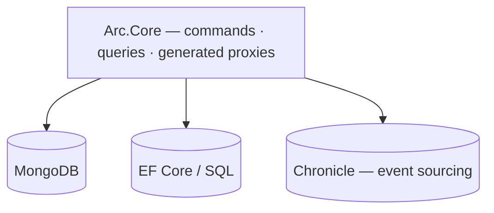

You can use Arc's commands, queries, and generated TypeScript proxies while storing current state directly in a database. Arc uses CQRS (Command Query Responsibility Segregation) to separate changes from reads. That separation does not require an event log or [Chronicle](/chronicle/), the Cratis event-sourcing platform.

Use this approach for a bounded CRUD (create, read, update, delete) feature, such as reference data or settings, or when adopting Arc over existing storage. The author-registration slice below writes a MongoDB document and serves a live list to React. It shows which work belongs to Arc and which work remains with the data provider.

## The line between Arc and Chronicle

Arc can sit on top of Chronicle; Chronicle never depends on Arc. A current-state slice uses Arc without that integration. Each backend has its own current-state integrations: [MongoDB](./backend/csharp/mongodb/index.md) and [Entity Framework](./backend/csharp/entity-framework/index.md) on C#, [Spring Data](/arc/backend/kotlin/guides/spring-data/) on JVM, [MongoDB or Drizzle](/arc/backend/typescript/reference/capabilities/) on TypeScript, and explicit providers in [Arc for Go](/arc/go/). Check Go's [parity reference](/arc/go/parity/) for each provider's verification limits. Chronicle adds the optional event-sourced path.



With current-state storage, the handler writes the data that queries read. With Chronicle, commands can append events and projections build the read models from those stored facts. The command/query boundary remains, but persistence and read-model updates work differently.

## A standalone slice, end to end

:::note[Choose your backend]
The document-store examples and host excerpts below have C#, Kotlin, Java, and TypeScript tabs. Go examples are not included; use its [running application guide](/arc/go/backend/go/core/getting-started/) for explicit registration and handlers. The proxy-generation and testing guidance that follows is .NET-specific. For JVM setup and testing see [Spring Data read models](/arc/backend/kotlin/guides/spring-data/) and [testing](/arc/backend/kotlin/guides/testing/); for TypeScript see [getting started](/arc/backend/typescript/getting-started/) and [testing](/arc/backend/typescript/testing/).
:::

These excerpts show registering an author and listing authors live in MongoDB. For a runnable project, use [standalone .NET setup](./backend/csharp/getting-started/index.md) and its [backend checkpoint](/arc/backend/csharp/getting-started/your-first-command/), [Kotlin setup](/arc/backend/kotlin/get-started/), [Java setup](/arc/backend/kotlin/get-started/java/), or [TypeScript setup](/arc/backend/typescript/getting-started/) for domain declarations, host, database configuration, and replica-set bootstrap. The explanation here does not replace those prerequisites.

Start with the document the screen needs to read. Declare it as a read model so Arc can expose its query methods. Here the query returns a live stream:

<ArcBackendTabs snippet="arc-without-event-sourcing/author-read-model" />

The registration command injects the database dependency and saves the document directly. It returns no response payload and appends no event:

<ArcBackendTabs snippet="arc-without-event-sourcing/register-author" />

For a rename, the command needs the existing author. Mark the key on the command and configure the read model's database lookup, so Arc supplies the current state to the handler. On the JVM MongoDB branch, `Author` must be a Spring Data-mapped `@Document` as well as an Arc `@ReadModel`; otherwise the MongoDB resolver cannot claim it from the mapping context at startup:

<ArcBackendTabs snippet="arc-without-event-sourcing/rename-author" />

On .NET this works both for a MongoDB read model and for one carried by an Entity Framework `ReadOnlyDbContext`. On TypeScript, configure a `ReadModelForCommandResolver` for the keyed model (the MongoDB integration registers one for configured `readModels`). [Read models in commands](./backend/csharp/chronicle/read-models/injecting-into-commands.md) covers what a nullable parameter means, and [Read models from other providers](./backend/csharp/chronicle/read-models/other-providers.md#declaring-the-key-without-chronicle) how to declare the key when it is not a single property.

:::tip[Separate the decision from the write]
These direct collection calls remain supported. On C# and TypeScript, for immediate inline work that a model-bound command can describe before execution, prefer returned command operations ([C#](./backend/csharp/commands/operations/index.md), [TypeScript](/arc/backend/typescript/commands/operations/)). The JVM backend has no operation mechanism; there, perform the work in `handle` through an injected service. With operations, the handler declares the write and Arc performs it afterward, without requiring Chronicle. Optional compensation is best-effort and in-process, not atomic database rollback or durable recovery. The [migration recipe](./backend/csharp/commands/operations/migrating.md) shows how to preserve an existing response contract.
:::

Start the host with the database configured as in the backend-specific setup guides. The .NET excerpt assumes `Cratis:MongoDB`; Arc auto-discovers collections and serializers rather than requiring per-model registrations.

For the TypeScript excerpt, place the `AuthorRepository` abstract class shown below in `Features/Authors/AuthorRepository.ts` and import it into the command, query, validators, and host; it is the runtime token used by `@inject` and `service`, not a type-only interface. Import your `Author`, `AuthorId`, `AuthorName`, `RegisterAuthor`, and `RenameAuthor` declarations from their feature files.

Keep the TypeScript [setup guide's `generate.mjs`](/arc/backend/typescript/getting-started/create-an-application/#generate-the-metadata) on `--project ./tsconfig.json` and `--artifacts ./Features`; import its generated metadata and discover the same `Features/` root in the host. Regenerate after chapter 2 adds validators, or the host will not register them.

Install `@cratis/arc.mongodb`, set `MONGODB_URI` (or use the loopback default), and use a replica set for live MongoDB change streams.

The scoped `MongoAuthorRepository` supplies the persistence methods used in the preceding excerpts:

<ArcBackendTabs snippet="arc-without-event-sourcing/standalone-host" />

On .NET, install `Cratis.Arc.ProxyGenerator.Build`, configure `CratisProxiesOutputPath`, and build in Debug as shown in setup to generate `RegisterAuthor` and `AllAuthors`. Building with Arc alone does not generate them. On the JVM, run `generateArcProxies`; on TypeScript, run your application's source-based generator script and regenerate metadata after changing artifacts.

This React fragment assumes the [frontend setup](/arc/frontend/react/getting-started/) imports/providers and the [per-operation `id` state](/arc/tutorial/first-slice/) (`Guid.create()` from `@cratis/fundamentals`), with a fresh dialog instance for each registration:

```tsx
const [authors] = AllAuthors.use();   // live — re-renders when the collection changes

<CommandDialog<RegisterAuthor> command={RegisterAuthor} title="Add author" initialValues={{ id }}>
    <InputTextField<RegisterAuthor> value={i => i.name} title="Name" />
</CommandDialog>
```

> [!NOTE]
> `AllAuthors` is live with no event sourcing involved. On C#, `IMongoCollection<T>.Observe()` watches MongoDB's change stream; the JVM and TypeScript tabs use their own observable sources. Subscribed browsers update when the configured source emits. [Observed DbSets](./backend/csharp/entity-framework/observing.md) receive same-host `SaveChanges` notifications through Arc's configured interceptor. SQLite does not detect arbitrary external-process writes; other EF providers need their database notification setup for that.

## Test the slice without Chronicle

On C#, Arc's command testing does not depend on Chronicle either. Start with `Cratis.Arc.Testing`, drive the
command through a `CommandScenario<TCommand>`, and assert the `CommandResult` exactly as you would in an
event-sourced slice. The only difference is what you assert after the command runs: a current-state slice
checks the database or application service it wrote to, while a Chronicle-backed slice can also assert
the appended events.

That keeps the CQRS boundary testable before you decide whether the slice needs an event log. See
[Arc testing](./backend/csharp/testing/) and [command scenarios](./backend/csharp/testing/command-scenario.md) for the
base testing loop; add the [Chronicle testing extension](./backend/csharp/testing/chronicle.md) only when the
command appends events.

## What actually changes when you add Chronicle

For C#, set this slice next to the same slice with [Chronicle added later](/arc/backend/csharp/chronicle/add-event-sourcing/). The TypeScript Chronicle integration has its own [capability limits](/arc/backend/typescript/reference/capabilities/); do not assume the same migration procedure applies. You can preserve the query and frontend **contracts**, while replacing direct writes with events and configuring a projection. The provider lookup/observation implementation may need to change; adding a package does not migrate existing data automatically:

| | Standalone (this page) | With Chronicle |
| --- | --- | --- |
| What the handler does | inserts a document | appends an event |
| What fills the read model | the command, directly | a projection over the event |
| What you can read | current state | current state **and full history** |

Adopting Chronicle changes persistence and adds projection/bootstrap work. If you preserve the query's contract and route, its generated caller and screen can remain unchanged.

## The trade-off

Storing current state directly is simpler for bounded CRUD surfaces, reference data, settings, and adoption steps. What you don't get is everything an event log buys you: an audit trail, the ability to rebuild a read model a brand-new way from history, temporal queries, and reactors that fire on facts. For information systems, we prefer starting with Chronicle because those needs show up often. [Why Event Sourcing](/chronicle/why-event-sourcing/) explains the default.

If the slice later needs history, move persistence to Chronicle and deliberately preserve the public read contracts so the frontend need not change. Plan how existing data enters the event-sourced model as part of that move. [Adopting Cratis](/adopting-cratis/) walks through adoption one slice at a time.

## Go deeper

- [MongoDB integration](./backend/csharp/mongodb/index.md) — setup, serializers, class mapping, and [observing collections](./backend/csharp/mongodb/observing-collections.md) for live queries.
- [Entity Framework integration](./backend/csharp/entity-framework/getting-started.md) — DbContexts, read-only contexts, and [observing DbSets](./backend/csharp/entity-framework/observing.md).
- [Commands](./backend/csharp/commands/index.md) and [Queries](./backend/csharp/queries/index.md) — the full model-bound and controller-based reference.
- [Why Arc](./why-arc.md) — the problem Arc solves, and how CQRS relates to event sourcing.
