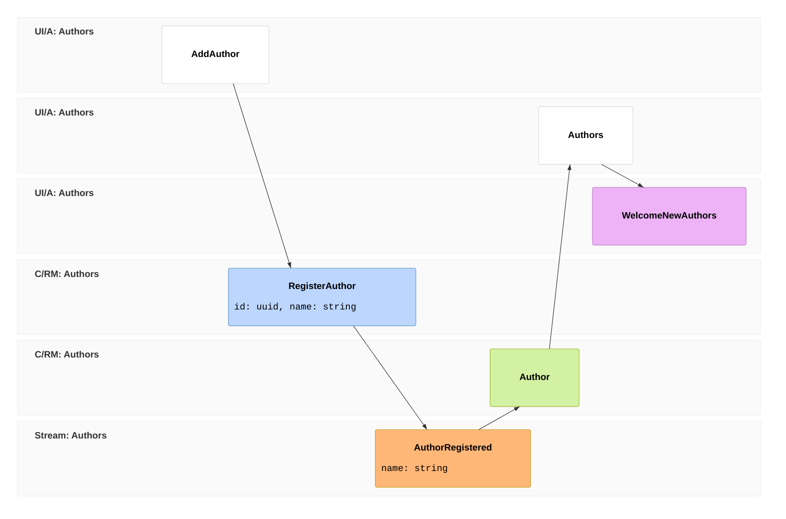

import { Aside } from '@astrojs/starlight/components';
import FullStackTabs from '@components/FullStackTabs.astro';

Add [Cratis Chronicle](/chronicle/) to a working Arc slice when you need a history of its changes. This guide moves the library tutorial's write side from a database insert to a returned event. The query signatures, generated proxies, and React screens can stay in place if you preserve the read model's storage contract.

This outline follows the tutorial's MongoDB branch: Chronicle's projection writes the read model into the collection the existing query observes. The EF Core branch queries `LibraryDbContext` instead. Keeping that query unchanged would require materializing the read model into the same relational table, which this page does not cover. Choose the projection's storage before changing the command.

## Before changing the slice

Start with the working library slice from the Arc tutorial. The fragments below show its type changes; they assume you have completed this host and storage setup:

- Add the **`Cratis` package** to the ASP.NET Core host and follow its [basic setup](./cratis-package.md#basic-setup): `builder.AddCratis()` before building, then `app.UseCratis()`. This supplies both Arc and Chronicle's ASP.NET Core integration. If you bring your own authentication, retain the `Cratis` package reference and follow its [split-registration example](./cratis-package.md#running-arc-or-chronicle-on-their-own) instead. `Cratis.Arc.Chronicle` alone does not establish the ASP.NET Core extension surface used by that example.
- Run a compatible Chronicle server and configure its connection, event store, namespace, and read-model sink. The client registration does not start the server.
- For the MongoDB query below, separately install/configure `Cratis.Arc.MongoDB`. Align its database, collection naming, key mapping, serialization, and tenant mapping with Chronicle's sink. Sharing an application host does not establish that alignment.
- Decide how existing rows become history: import explicit initial facts, backfill, or cut over to a new model. Adding a projection does not turn existing rows into events. Plan replay and prevent old direct writes from racing the new projection.

After the change, register one author and check that its event source id, projected key, and query result agree. The projected state becomes visible after projection processing, not necessarily when the command response arrives.

In the slice's [event model](/event-modeling/), the screen, command, `AuthorRegistered` fact, read model, and query keep their roles. The fact is now stored as an event. Frame `06` adds a reactor: a handler that performs follow-up work when Chronicle processes that event.



Frames `01`–`05` retain the tutorial's flow. Frame `06` depends on the stored event at `03`; it can send a welcome notification without putting that work in the registration command.

## What changes, and what doesn't

Change the command first. Instead of inserting a document, `Handle()` returns the fact that an author was registered:

```csharp
[Command]
public record RegisterAuthor(AuthorId Id, AuthorName Name)
{
    public AuthorRegistered Handle() => new(Name);   // returns the fact, doesn't write
}

[EventType]
public record AuthorRegistered(AuthorName Name);
```

`[EventType]` has no name argument here, so Chronicle uses `AuthorRegistered` as the event-type id: the kind of fact recorded. The event source id answers a different question: whose history receives it? Derive `AuthorId` from `EventSourceId<Guid>` in `Cratis.Chronicle.Events` so the command's `Id` property selects the author's stream:

```csharp
public record AuthorId(Guid Value) : EventSourceId<Guid>(Value)
{
    public static readonly AuthorId NotSet = new(Guid.Empty);
    public static AuthorId New() => new(Guid.NewGuid());
    public static implicit operator AuthorId(Guid value) => new(value);
}
```

Next, let a projection fill the read model. `[FromEvent<AuthorRegistered>]` maps matching event properties onto `Author`, including `Name`, and uses the event source id as the model key:

```csharp
[ReadModel]
[FromEvent<AuthorRegistered>]
public record Author(AuthorId Id, AuthorName Name)
{
    // The query is UNCHANGED from chapter 1.
    public static ISubject<IEnumerable<Author>> AllAuthors(IMongoCollection<Author> collection) =>
        collection.Observe();
}
```

Those are the slice's type changes. With bootstrap, existing-data treatment, and sink alignment in place, the intended contract is:

| | Over a database | With Chronicle |
| --- | --- | --- |
| What `Handle()` does | writes a document | returns an event |
| What fills the read model | the command, directly | a projection over the event |
| What you can read | current state | current state **and full history** |
| The query method | `AllAuthors` | `AllAuthors` — *identical* |
| The generated proxies & React | as built | *identical* |

## The frontend doesn't notice

With the storage alignment above, `AllAuthors` still observes the same collection and returns the same type. Its generated proxy and the screen's subscription stay unchanged; a projection now updates the documents:

<FullStackTabs>
  <Fragment slot="csharp">
  ```csharp
  // the read model is now event-sourced — the query signature is unchanged
  public static ISubject<IEnumerable<Author>> AllAuthors(IMongoCollection<Author> collection) =>
      collection.Observe();
  ```
  </Fragment>
  <Fragment slot="typescript">
  ```tsx
  // not one character changes
  const [authors] = AllAuthors.use();
  ```
  </Fragment>
</FullStackTabs>

## What the events unlock

The event history lets you build another view of author registrations later by replaying the recorded facts into a new read model. Decide retention and [causation privacy](./commands/causation.md) explicitly; Chronicle does not automatically audit writes made outside it.

You can also automate work after a registration. A reactor implements `IReactor`, and its handler's first parameter identifies the event it consumes:

  ```csharp
  public class WelcomeNewAuthors(INotificationService notifications) : IReactor
  {
      [OnceOnly]
      public Task AuthorRegistered(AuthorRegistered @event, EventContext context) =>
          notifications.Notify($"Welcome aboard, {@event.Name}!");
  }
  ```

`[OnceOnly]` skips this notification handler during replay; it does not deduplicate retries. The notification service must tolerate duplicate delivery. These fragments assume the Chronicle event, projection, and reactor namespaces and your existing domain types.

<Aside type="note">
Observable queries update a screen when query data changes. Reactors perform work in response to stored events. Keeping the screen live did not require event sourcing; this notification handler does.
</Aside>

## Why this is usually the better backbone

Keep direct database writes for features that only need current state. Choose event sourcing when the recorded history will help you explain changes, rebuild views, or drive follow-up work. [Why Event Sourcing](/chronicle/why-event-sourcing/) explains that choice, and [When to use event sourcing](/chronicle/concepts/when-to-use-event-sourcing/) covers where it does not fit. Arc supports both approaches in the same application.

Continue with [React to an event](./react-to-an-event.md) to develop the notification handler, or follow the [Chronicle tutorial](/chronicle/tutorial/) to build the library's event-sourced model step by step. [Adopting Cratis](/adopting-cratis/) covers moving other slices incrementally. For the broader application, the [Cratis Stack tour](/cratis-stack/) and [full-stack capstone](/build-a-full-app/) connect Arc, Chronicle, and Components.
