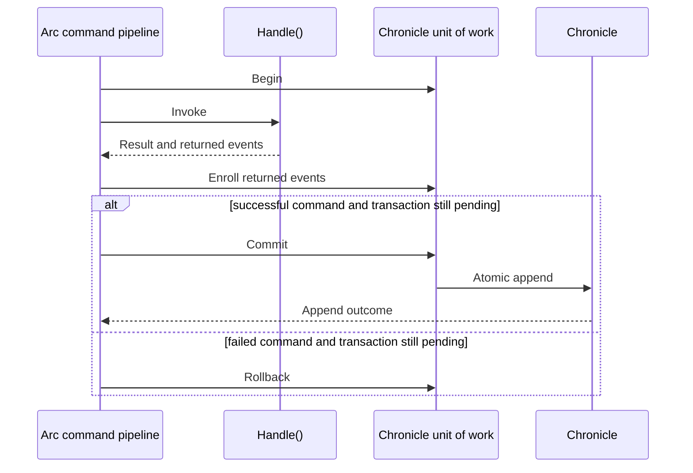

Cratis Arc uses Cratis Chronicle transactions to commit a command's returned events and explicit transactional appends as one atomic batch. Use this when several events must be recorded together. A command failure discards events still pending in that batch; it cannot undo an immediate append, an earlier explicit commit, or an external call.

With `Cratis.Arc.Chronicle` registered, a top-level model-bound command executed through Arc's command pipeline owns this transaction. Its unit of work holds the pending events until completion. Enrolling an event adds it to that pending batch without persisting it. The integration uses Arc's [command execution scope](../../commands/command-execution-scopes.md) extension point; standalone Arc does not supply this event-store guarantee.

:::note[Events and external operations have different recovery boundaries]
Return events for durable domain facts. If the same command must make an immediate external call, prefer [command operations](../../commands/operations/index.md) over a direct service call or a hand-written rollback stack. Arc can attempt their optional compensation only when the observed commit boundary permits it. External work remains outside Chronicle's atomic event transaction. Use a reactor or durable workflow when work must follow committed facts reliably.
:::

## Choosing an append style

| Style | Boundary | Outcome |
| --- | --- | --- |
| Return events from `Handle()` | Enroll in the command transaction | Final `CommandResult` |
| Return `EventsWithConcurrencyScopes` | Enroll ordered cross-source events with exact revision expectations | Final `CommandResult` |
| `eventLog.Transactional.Append(...)` | Enroll; no append has occurred yet | `Task`, not a per-append result |
| `eventLog.Append(...)` or `eventStore.EventLog.Append(...)` | Immediate and final | Real `AppendResult`; observed failures can also fail the command |
| Aggregate `Apply(...)` | Enroll aggregate events | Await mutation; see aggregate failure handling below |
| Aggregate `Commit()` | Commit the shared unit of work immediately | `AggregateRootCommitResult` |

Keep the unit of work within one event store, namespace, and event sequence. The ordered-batch API rejects mixing event sequences; legacy imperative enrollment does not establish a cross-sequence guarantee. Independently configured databases and external calls need their own consistency design.

Prefer returning events from `Handle()`. In this example, starting onboarding records two related facts: the onboarding started and an administrator was invited. Returning both keeps them in the same commit even though they target different event sources. The command and types below assume the integration is configured:

```csharp
using Cratis.Arc.Commands.ModelBound;
using Cratis.Chronicle.Events;
using Cratis.Chronicle.EventSequences;
using Cratis.Concepts;

public record OnboardingId(Guid Value) : EventSourceId<Guid>(Value)
{
    public static readonly OnboardingId NotSet = new(Guid.Empty);

    public static OnboardingId New() => new(Guid.NewGuid());
    public static implicit operator OnboardingId(Guid value) => new(value);
}

public record InvitationId(Guid Value) : EventSourceId<Guid>(Value)
{
    public static readonly InvitationId NotSet = new(Guid.Empty);

    public static InvitationId New() => new(Guid.NewGuid());
    public static implicit operator InvitationId(Guid value) => new(value);
}

public record OrganizationNumber(string Value) : ConceptAs<string>(Value)
{
    public static readonly OrganizationNumber NotSet = new(string.Empty);

    public static implicit operator OrganizationNumber(string value) => new(value);
}

[Command]
public record StartOnboarding(OnboardingId OnboardingId, InvitationId InvitationId, OrganizationNumber OrganizationNumber)
    : ICanProvideEventSourceId
{
    public EventSourceId GetEventSourceId() => OnboardingId;

    public IEnumerable<EventForEventSourceId> Handle() =>
    [
        new(OnboardingId, new OnboardingStarted(OrganizationNumber)),
        new(InvitationId, new AdminInvited(OnboardingId))
    ];
}

/// <summary>
/// Records that onboarding started for an organization.
/// </summary>
[EventType]
public record OnboardingStarted(OrganizationNumber OrganizationNumber);

/// <summary>
/// Records an administrator invitation associated with an onboarding.
/// </summary>
[EventType]
public record AdminInvited(OnboardingId OnboardingId);
```

Keep each concept in its own application file. `OnboardingId` and `InvitationId` prevent swapping the two identities. Because both derive from `EventSourceId<Guid>`, `GetEventSourceId()` explicitly selects the command's identity. Each returned wrapper still selects its own append target: `AdminInvited` goes to the invitation's event source and carries the onboarding id as a foreign reference.

If Chronicle rejects one event, neither event in this returned batch is persisted. The final `CommandResult` reports the commit outcome. To reject a duplicate through a uniqueness constraint, you must configure that constraint; these event/type declarations do not create one.

## Explicit transactional and immediate appends

Use `eventLog.Transactional` when a handler needs to stage an event imperatively. It requires an active command transaction or another explicitly established unit of work; without one, it throws. These examples are method-body fragments, not complete commands. `eventLog` is an `IEventLog`, `sensorId` is an `EventSourceId`, and the event records are application types.

```csharp
await eventLog.Transactional.Append(sensorId, new ReadingRegistered(reading));
```

Awaiting this call finishes enrollment. It does not persist `ReadingRegistered` or tell you whether the eventual commit succeeds. The command's owner commits it with the other pending events at completion.

On the command's unit of work, direct `AddEvent`, `AddEvents`, `AddEventWithNamedTags` and all four `Transactional` append variants enforce [generated-identifier freshness](fresh-identifiers.md), just like returned events. Nested invocations share that protection. If a generated target is already occupied, the whole pending unit is rejected at commit. This integration requires Chronicle client 19.65.2 or later and contributor support from custom units.

`AddEvents` preflights the whole call, while transactional many-event methods stage one event at a time. Let a later enrollment rejection escape the handler so that command failure rolls back the earlier pending events.

```csharp
var result = await eventLog.Append(sensorId, new ImportAttempted());
```

Without `.Transactional`, this call appends immediately and returns a real `AppendResult`. A successful `ImportAttempted` remains persisted even if the handler later throws or the pending batch is rejected. The command scope observes failed append operations on its event log and merges attributable failures into the command result. That observation cannot undo earlier successes and does not cover arbitrary other stores or event sequences.

When you protect a command's decision reads with read protection `On`, the immediate call is refused with `ImmediateAppendWhileReadsAreProtected`; return the event or use `eventLog.Transactional.Append(...)`. Immediate appends also bypass the automatic generated-identifier guard. Use returned events or the command's transactional unit when you need that protection.

[ARCCHR0007](../code-analysis/ARCCHR0007.md) warns on `IEventLog` parameters in `Handle()`, even for reads or deliberate transactional use. Prefer returned events. For an intentional advanced use, narrowly suppress that warning with a documented reason; suppression does not change the append boundary.

## Completion

Arc starts the unit of work before invoking the handler and enrolls returned events before completing it. For a transaction that is still pending, the command result determines whether Arc commits or rolls back:



Commit violations become part of the command result, including validation details where available. An exception or validation failure rolls back pending enrollment. Events persisted by an earlier explicit commit or immediate append remain persisted.

This scope covers HTTP model-bound commands, POST controller commands (except `[AspNetResult]` actions), direct `ICommandPipeline` execution, reactor commands, and `CommandScenario`. Chronicle's request-level unit-of-work middleware has a separate boundary. An Arc command starts its own transaction instead of joining that request-level unit of work.

## Nested commands and aggregates

:::caution[Command operations use a narrower execution profile]
The nesting and explicit-commit behavior below describes ordinary Chronicle commands. The [command operation contract](../../commands/operations/reference.md#supported-scope-profile) supports flat commands and deferred completion. It rejects nested operation-bearing commands and explicit aggregate commits inside an operation boundary. Event-only commands retain the behavior described here.
:::

### Nested pipeline commands

A nested pipeline command joins the outer command's active transaction. In the deferred-completion path, only the outer owner completes it. A successful nested result means its events have been enrolled; commit-time violations arrive when the outer command completes. Inspect a nested command's result and propagate its failure so the outer command does not treat a failed call as success.

Several commands returned by a reactor are separate transactions. Earlier successes remain if a later command fails. Return one command when its events must commit together.

### Commands called from a controller

A model-bound command executed through `ICommandPipeline` inside a controller action owns a separate transaction. It commits before `Execute` returns, and its `CommandResult` reports that commit outcome. Nested read-protection rules do not treat it as a child of the controller.

The controller's own appends remain in the controller's unit, which commits when the action completes unless explicitly committed earlier. Propagate the inner command's failure if it should fail the action. A later failure of the action cannot undo the inner command's commit.

Controller actions receive execution scopes and a transactional boundary, but not pipeline decision-policy or generated-parameter semantics. Read-protection declarations on the body type do not enable enforcement or measurement. Commands executed through `ICommandPipeline` keep their own policies.

### Explicit aggregate commits

Aggregate mutations share the command's unit of work. An explicit aggregate `Commit()` finalizes all events enrolled so far, including events from other aggregates or transactional appends. The command scope leaves that completed transaction alone. An aggregate used by a controller can likewise commit the controller's ambient unit; the action filter does not defer it. Treat an explicit commit as the end of the work you expect to roll back together. Further enrollment or fallible work cannot make that commit reversible.

`AggregateRoot.Commit()` also checks that aggregate's accumulated `Failed(...)` results. Automatic command completion commits the unit of work directly and does not collect those lists, so removing an explicit commit can change rejection behavior. Return the aggregate's commit result and end the handler at that boundary, or propagate its rejection through the command's result before automatic completion. Committing one aggregate does not validate every other aggregate's private failures. [Defining an aggregate root](../aggregates/defining-an-aggregate-root.md) explains that validation path.

Under read protection `On`, mixing an aggregate and a plain read of the same event source is refused. A read or append after the aggregate's `Commit()` is also refused: read first and return `Commit()` last. Outside `On`, do not mix an aggregate `Commit()` with `[ProtectedDecision]` reads. Once a decision read is enrolled, that commit throws because only the command's owner may commit the unit of work.

## Occurrence commands

A command run for a Chronicle occurrence through `IOccurrenceCommandExecutor` writes an effect receipt with its final commit, recording the occurrence's effect. That must be its only commit, so early aggregate commits, stream completion and immediate appends are refused. Use [Commands for occurrences](./occurrence-commands.md) when you need that execution and receipt boundary.

## Things to know

An event-log read observes persisted events, including successful immediate appends. It does not see the pending batch. Staging `ReadingRegistered` above therefore does not make it available to a subsequent event-log read in the handler.

Keep transactional work inside the lifetime of the command that owns it. Fire-and-forget work or continuations that outlive the command can enroll against a completed unit and have those events discarded. Use an awaited command or a reactor for follow-up work.

Atomic append keeps a batch together, but does not by itself bind a decision to the revision it read. If your handler reads state before deciding what to append, continue with [Concurrency](./concurrency.md), including empty-history expectations, and [Choosing how a command's rule holds](../consistency/index.md) to select the mechanism that protects that decision.

To assert that a rejected returned batch leaves no partial events and inspect command failures, follow [Testing with Chronicle](../../testing/chronicle.md). For an event plus an external operation, [test compensation after a real constraint rejection](../../testing/command-operations-with-chronicle.md).
