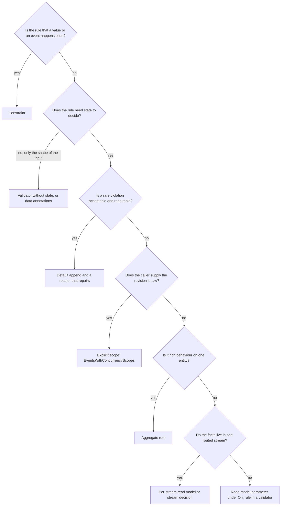

Use this page when a command's outcome depends on state: a stock level, a unique value, a capacity, a document that someone else may have edited. It tells you which mechanism makes the rule hold when two commands run at the same time, and which ones only look as if they do.

## The short answer

When two requests read the same state, both decide it is fine, and both write, a plain read cannot tell them apart. Arc's **read protection** fixes that for the state a command reads. With read protection **On**, a read-model parameter on a command is read fresh and guarded. If what the command read changes before its events are committed, nothing is written and the caller gets a `400` with the reason `concurrencyViolation`.

| You want | Do this |
| --- | --- |
| A rule over stored state to hold | Set `<CratisReadProtection>On</CratisReadProtection>`, take the read model as a parameter, put the rule in a `CommandValidator<T>`. See [Getting started](./getting-started.md) |
| To try it on an existing application first | `Measure`, then `On`. See [Adopting read protection](./adopting.md) |
| A value to be unique, or something to happen once | A Chronicle constraint |
| A rule over one routed stream of raw events | A stream decision |
| Rich behaviour on one entity | An aggregate root |
| The caller supplies the revision it saw | An explicit scope |
| A rare violation to be acceptable | The default append, and a reactor that repairs |

Under **Off**, which is the default, nothing changes: an injected read model is a plain read, it returns a snapshot, and it guards nothing. The next major version of Arc makes `On` the default. See [The default changes in the next major version](#the-default-changes-in-the-next-major-version).

## Three concepts

| Concept | What it is | Where you set it |
| --- | --- | --- |
| Mode: `Off`, `Measure` or `On` | Whether read-model parameters are guarded, only measured, or left alone | `<CratisReadProtection>` in the project, or `[ReadProtection(...)]` on a command |
| `[Unprotected("why")]` | The read is deliberately advisory and guards nothing | A parameter, a read-model type, a `Handle()` or `Provide()` method body, or a command |
| `[LookUpBy(nameof(Property))]` | Which command property selects the instance a parameter reads | A parameter |

Read protection has two layers, and the names are close. **Read protection in Chronicle** is the client API that refuses unguarded reads inside one unit of work. See [Read protection in Chronicle](/chronicle/read-models/read-protection/). **The Arc mode** is the switch that turns that API on for your commands and resolves your parameters through it. This section is about the mode.

## The modes

| Mode | Plain `T` parameter | Other reads (`IReadModels`, raw event log) | Immediate appends | Use it when |
| --- | --- | --- | --- | --- |
| `Off` | Plain read | Allowed | Allowed | The default. Nothing changes |
| `Measure` | Plain read. Arc records what `On` would do | Allowed | Allowed | You adopt it on an existing application |
| `On` | Read fresh and guarded | Refused unless `[Unprotected]` | Refused | New code, and migrated code |

## Decision matrix by rule shape

| Rule shape | Use | Alternatives | Never rely on | Too much |
| --- | --- | --- | --- | --- |
| Unique value (email, user name) | Constraint: `[Unique]` on an event property | The value as the event source id, with an expected-empty scope (Chronicle used directly) | A validator that checks "does it exist" first | Read protection only for uniqueness |
| Created once (one library card per member) | `[Unique]` on the event class | An aggregate: a new aggregate expects an empty history | An `Exists` check in a validator | A read over the whole history |
| Rule over one key's history, stock or count on one key | A read model parameter under `On`, the rule in a validator | An aggregate | A validator over a plain read under `Off` | A constraint: it cannot count |
| Rule spanning two keys (course capacity and student limit) | Two read-model parameters, one event per key in one batch | Explicit scopes in the same batch (Chronicle used directly) | Two aggregates, each guarding only its own source | One model that folds both keys: it is refused |
| Editing conflict | Explicit scope carrying the revision the client saw | A read model parameter when the edit does not depend on what the client saw | `concurrency: true` alone: it reads the tail after `Handle()` | A read model, which folds state to detect what a revision number already tells you |
| One stream, for example approvals per period | Per-stream read model or a stream decision | A read-model parameter over the whole source | Reading the stream with an injected read model under `Off` | A whole-source read when only one period matters |
| Rich behaviour (many invariants) | Aggregate root | Several validators over one model | Ignoring the result of `Commit()` | A read model for each invariant |
| A rare violation is acceptable | Default append and a reactor that repairs | `concurrency: true` to narrow the default check | Assuming the repair runs before harm is done | Any guard |
| UX hint ("no copies left") | A query, or `[Unprotected("why")]` on the read | None needed | Treating the hint as the rule | A guarded read |
| External data (a price, a tax rate) | `Provide()` fetches it. The read guards your own state | None | Assuming the external value is guarded | Guarding state you do not decide from |
| Hot key with a long history | Key by period, or use a constraint | An aggregate (it reads the key's handled events on every command) | A guarded read on a key that never stops growing | A flat model over years of events |

"Never rely on" means the mechanism can fail silently: the command succeeds and the rule is broken.

## Choose a stream or source model

| Rule lives in… | Use |
| --- | --- |
| Folded state of one stream on the command's own route | [Per-stream model](./scenarios/per-stream.md) |
| The entity's whole history, such as a balance | Whole-source model. Combining it with a per-stream model gives a whole-source guard |
| “Has fact X happened in this short stream?”, without a model | Stream decision |
| Rich behaviour across the whole entity | Aggregate, without reads of the same source |
| Another month or another source | `IDecisionReads` stream overload in `Provide()` |
| Uniqueness across sources | Constraint |

## Decision flowchart

## What each mechanism guards

| Mechanism | Guards the rule? | Boundary captured | Cost of one command |
| --- | --- | --- | --- |
| Constraint | Uniqueness and create-once only. It cannot count or sum | None needed. The kernel checks every append | An index check inside the append |
| Read-model parameter under `On` | Yes, for the event types the model folds, on the key it reads | Before the read | A fresh fold of the key's history for each read |
| Stream decision | Yes, for any event in the routed stream | Before reading the stream | The whole stream crosses the wire |
| Aggregate root | Yes, for the event types it handles | When the aggregate is resolved | The handled events cross the wire. No snapshots |
| Explicit scope | As strong as where you captured the revision | Wherever your code captured it | One filtered tail query at commit |
| Default append | No. It checks only the window after `Handle()` | At commit, after `Handle()` | One tail query per event source |
| Validator, or read model under `Off` | No. It is a hint | None | One lookup |
| Reading the database directly | No. It bypasses Chronicle and can lag | None | One query |
| Reactor repair | No. It is a later correcting event | None | An extra event and its observer |

A guard detects any matching event appended through the kernel, whoever wrote it. It protects the decisions that carry it. A writer that decides without a guard can still break the rule, so a rule holds fully only when every writer that decides on it is guarded, or when it is a constraint.

## Where event source definitions fit

An [event source definition](../commands/event-source-definitions.md) names the event source and stream a command appends to. With `[EventSource<TSource>(stream)]` it also gives the append a typed concurrency boundary. That boundary is the default append check, so a definition alone is not a row in the matrix. It is the routing a [stream decision](../commands/stream-decisions.md) reads from, and the place a completed stream is declared.

## Dynamic Consistency Boundary

The Dynamic Consistency Boundary (DCB) is an approach to event-sourced consistency: a command reads the events it needs, remembers the position of the last event it knew, and appends only if no matching event has arrived since. See [dcb.events](https://dcb.events/) for the specification and [Dynamic Consistency Boundary in Chronicle](/chronicle/dynamic-consistency-boundary/) for how Chronicle maps it.

Read protection is how an Arc command uses that idea without writing it by hand. Each guarded read becomes a condition on the append: the event types the model folds, on the key it reads, after the position captured before the read. [How guards are derived](./how-it-works.md) shows the guard of each example.

What DCB can do that Chronicle cannot:

- Match events by arbitrary tags. Chronicle stores tags, but a guard narrows by event source id, event source type, stream type, stream id and event types.
- Give one event several tags, so a fact about two entities is a single event. A Chronicle event has one event source id, so such a fact is written as one event per source, in one atomic append.
- Keep several separate conditions on one source. Chronicle merges them into one wider condition, which is safe and can cause extra conflicts.
- Fold a decision model across entities or by property. Joins, children and by-property keys are refused.

See [Choosing how a rule holds in Chronicle](/chronicle/dynamic-consistency-boundary/choosing/) for the same decision from Chronicle's side.

## When not to use read protection

Choose something else when:

- **The rule is uniqueness.** A constraint is cheaper and covers every writer.
- **A hint is enough.** Mark the read `[Unprotected("why")]`. Do not pay for a fold to display a message.
- **The state is too big or too hot.** A key with a long history, or a model read by every command, makes each command fold again.
- **The model cannot be guarded.** Joins, children, by-property keys, filtered reducers and open-ended event types are refused. Use a flat, event-source-keyed model, an aggregate or a stream decision.
- **The state is not in the event log.** External data, another database or another event sequence is outside the guard.

### Why protection is opt-in

Read protection is chosen per project or per command, and `Off` is the default today.

- A protected command fails closed. It refuses a read it cannot guard, an immediate append, and a read outside a parameter. Making that the default would turn commands that work today into errors.
- Existing code reads plain models in validators and handlers in many places. Moving them is a change to the rule, not a flag.
- A guarded read costs more than a plain one, and a team should accept that where the rule needs it.

[Adopting read protection](./adopting.md) is the path that keeps existing commands working while you move.

### The default changes in the next major version

The next major version of Arc turns read protection `On` by default. You can still turn it off where a command or a read must stay plain:

- for one command, with `[ReadProtection(ReadProtectionMode.Off)]` or `[Unprotected("why")]` on the command;
- for one read, with `[Unprotected("why")]` on the parameter, the read-model type, or, for reads in its body, the `Handle()` or `Provide()` method;
- for a project, with `<CratisReadProtection>Off</CratisReadProtection>`.

To keep today's behaviour through the upgrade, set `<CratisReadProtection>` explicitly in each project now. To prepare for `On`, run `Measure` and fix what it reports. The change is tracked in [Cratis/Arc#3255](https://github.com/Cratis/Arc/issues/3255).

## Costs

A guarded read is a fresh fold of the key's history. Chronicle does not use the materialized state, because that state can lag and has no boundary. The cost grows with the number of events of the model's types for that key, on every read, and identical reads inside one command share one fold.

| Mechanism | Grows with | Note |
| --- | --- | --- |
| Materialized plain read | Nothing | Eventually consistent |
| Read-model parameter under `On` | The key's history of the model's types | Two tail reads and a fold for each read, and a retry if events arrive during the fold |
| Stream decision | The whole stream | No type narrowing |
| Aggregate | The key's handled events, on every command | No snapshots |
| Constraint | Nothing | Checked inside the append |
| `Measure` | Nothing on the request path beyond one awaited tail read | Scans run in the background on a sample |

No benchmark for read protection is published yet, so this page gives the shape of the cost and no figures. Keep guarded models flat and keys short-lived: a key per period, per order or per booking, not one key for the life of the company.

## Where to go next

- [Getting started](./getting-started.md): turn `On` and write your first protected command.
- [Adopting read protection](./adopting.md): `Off`, `Measure`, `On`.
- [Reads](./reads.md): which reads are protected, advisory or refused.
- [Validators](./validators.md): the place for "may this command proceed" rules.
- [Refusals](./refusals.md): every error with its fix.
- [How it works](./how-it-works.md): how guards are derived and merged.
- [Scenarios](./scenarios/index.md): the same rule shapes written step by step.
- [Pitfalls](./pitfalls.md) and [FAQ](./faq.md).
