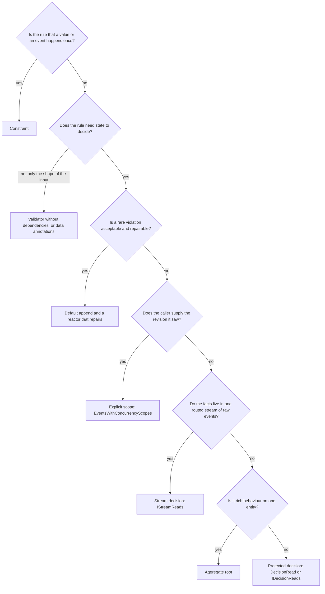

Use this page when a command's outcome depends on state: a stock level, a unique value, a capacity, a document that someone else may have edited. It tells you which mechanism makes the rule hold when two commands run at the same time, which mechanisms only look as if they do, and what each one costs.

## The short answer

Reading state in a validator or in `Handle()` never makes a rule hold. An injected read model, or a call to `IReadModels`, is a **plain read**: it returns a snapshot, captures no boundary and guards nothing. By default Arc builds the concurrency scope *after* `Handle()` returns, at the moment the command's events are committed. That check protects only the short window between that late tail read and the write. It does not bind your decision to the state you decided on.

To make a rule hold, use the first row of this list that fits:

1. **Uniqueness or create-once:** a Chronicle constraint. The kernel enforces it for every writer.
2. **A rule over the state of one or more event sources:** mark the command `[ProtectedDecision]` and take a `DecisionRead<T>` (or `IDecisionReads` for other keys).
3. **A rule over one routed stream of raw events:** a stream decision with `IStreamReads`, on a command routed through an [event source definition](../commands/event-source-definitions.md) or string routing attributes.
4. **Rich behaviour on one entity:** an aggregate root, with its result returned from `Commit()`.
5. **The caller supplies the revision it saw:** an explicit scope with `EventsWithConcurrencyScopes`.
6. **A rare violation is acceptable:** the default append, and a reactor that repairs the result.

## Decision matrix by rule shape

| Rule shape | Use | Alternatives | Never rely on | Too much |
| --- | --- | --- | --- | --- |
| Unique value (email, user name) | Constraint: `[Unique]` on an event property, or `IConstraint` | Use the value as the event source id and append with an expected-empty scope (Chronicle used directly) | A validator or read model that checks "does it exist" first | A protected decision only for uniqueness |
| Created once (one library card per member) | `[Unique]` on the event class | An aggregate: a new aggregate expects an empty history | An `Exists` check in a validator | A decision read over the whole history |
| Rule over one key's history (no loan while suspended) | Protected decision on that key | An aggregate; a stream decision if the facts live in one routed stream | An injected read model | A stream decision over a long stream |
| Stock or count on one key | Protected decision with a counting model-bound projection | An aggregate | A validator reading the count | A constraint: it cannot count |
| Rule spanning two keys (course capacity and student limit) | Protected decision with `IDecisionReads` for both keys and one event per key in one batch | Explicit scopes in the same batch (Chronicle used directly) | Two aggregates, each guarding only its own source | One model that tries to fold both keys: decision reads refuse it |
| Editing conflict (two people edit one document) | Explicit scope carrying the revision the client saw | A protected decision when the edit does not depend on what the client saw; an aggregate | `concurrency: true` alone: it reads the tail after `Handle()` | A protected decision, which folds state to detect what a revision number already tells you |
| One stream, for example approvals per period | Stream decision | A protected decision if the projection is admitted | Reading the stream with an injected read model | A protected decision that folds the whole key on every command |
| Rich behaviour (many invariants, state transitions) | Aggregate root | One protected decision per rule | Mixing an aggregate with `[ProtectedDecision]`: it throws | A protected decision for each invariant when one aggregate carries them |
| A rare violation is acceptable (overbooking is fixed afterwards) | Default append and a reactor that repairs | `concurrency: true` to narrow the default check | Assuming the repair always runs before harm is done | Any guard |
| UX hint (show "no copies left" before submit) | A query or an advisory validator over a plain read | None needed | Treating the hint as the rule | A decision read |
| External data (a price, a tax rate) | `Provide()` fetches it; a decision read guards your own state | None | Assuming the external value is guarded: it is not | Guarding state you do not decide from |
| Hot key with a long history | Keep the state small: key by period, or use a constraint | An aggregate (it rehydrates the key's handled events on every command) | A decision read per command on a key that never stops growing | A flat model over years of events |

"Never rely on" means the mechanism can fail silently: the command succeeds and the rule is broken. [Where guarantees do not hold](#where-guarantees-do-not-hold) lists which failures are silent and which are loud.

## Decision flowchart



## The idiomatic path

A protected decision is the default shape for a stateful rule on event-sourced state. You mark the command, take the state as a `DecisionRead<T>`, and return a `Result` that declines or an event that records the decision:

```csharp
using Cratis.Arc.Chronicle.ReadModels;
using Cratis.Arc.Commands.ModelBound;
using Cratis.Arc.Validation;
using Cratis.Chronicle.Events;
using Cratis.Chronicle.Projections.ModelBound;
using Cratis.Chronicle.ReadModels;
using Cratis.Concepts;
using Cratis.Monads;

public record MemberId(Guid Value) : ConceptAs<Guid>(Value);

[EventType]
public record CopyAdded();

[EventType]
public record BookBorrowed(MemberId MemberId);

[EventType]
public record BookReturned();

public record BookStock(
    EventSourceId Id,
    [Increment<CopyAdded>, Decrement<BookBorrowed>, Increment<BookReturned>] int Available);

[Command]
[ProtectedDecision]
public record BorrowBook(EventSourceId BookId, MemberId MemberId)
{
    public Result<BookBorrowed, ValidationResult> Handle(DecisionRead<BookStock> stock) =>
        stock.Instance is not { Available: > 0 }
            ? ValidationResult.Error("No copies of this book are available.")
            : new BookBorrowed(MemberId);
}
```

What happens when this command runs:

1. Arc begins the command's Chronicle unit of work and claims ownership of it.
2. Before `Handle()`, Chronicle captures the log's tail, then folds `BookStock` from the book's own events. The boundary is captured *before* the fold, so any event that lands during or after the fold is detected.
3. `Handle()` decides from `stock.Instance`. `Result<TEvent, ValidationResult>` declines the command before anything is appended. It adds no guard of its own; the guard is the decision read.
4. After a successful `Handle()`, Arc commits as owner. Chronicle appends the events and rejects the append if any event of the types `BookStock` is built from, on that book, arrived after the boundary.
5. On a conflict nothing is written. The caller receives a validation result with the reason `concurrencyViolation` and a message that the model "changed after it was read". Arc does not retry the command; the caller reads again and resubmits.

The book's id is the command's event source id and therefore the decision read's key. `BookStock` needs a property named `Id` of a string-like or `Guid` type: the key is matched to it. A model without one is refused when the command runs, with `DecisionReadCouldNotBeAcquired`, which surfaces as an error response, not as a build failure.

Only the facts that `BookStock` folds are guarded. Every `CopyAdded`, `BookBorrowed` and `BookReturned` must be appended to the book's event source, or the model never sees them. See [pitfalls](./pitfalls.md#the-model-folds-a-different-key-than-the-one-the-facts-are-written-to).

Tests that exercise a protected decision use `CommandScenario<T>().UseDecisionReads()` with real seeded events and `AppendConcurrently(...)`. See [protected decision scenarios](../../testing/chronicle.md#protected-decision-scenarios).

## Where event source definitions fit

An [event source definition](../commands/event-source-definitions.md) is how a command names the event source and stream it appends to, and with `[EventSource<TSource>(stream)]` it gives the append a typed concurrency boundary: the event source id narrowed by the dimensions the definition declares. That boundary is the default append check, so a definition alone is not a row in the matrix above. It is the routing a [stream decision](../commands/stream-decisions.md) reads from and the place a completed stream is declared. [Scenarios for each stream shape](../commands/event-source-definition-scenarios.md) and [how routing works](../commands/event-source-definition-routing.md) show the whole path.

## What each mechanism guards

| Mechanism | Guards the rule? | Protects every writer's decision? | Boundary captured | Cost of one command |
| --- | --- | --- | --- | --- |
| Constraint | Uniqueness and create-once only; it cannot count or sum | Yes: the kernel checks every append | None needed | An index check inside the append |
| Protected decision (`DecisionRead<T>`, `IDecisionReads`) | Yes, for the folded event types on the read keys | Only decisions that carry a guard; it still detects any writer's matching event | Before the fold | A fresh fold of the key's history on every read |
| Stream decision (`IStreamReads`) | Yes, for any event in the routed stream | Only decisions that carry a guard; it still detects any writer's matching event | Before reading the stream, in `Provide()` | The whole stream crosses the wire per command |
| Aggregate root | Yes, for the event types it handles | Only decisions that carry a guard; it still detects any writer's matching event | When the aggregate is resolved | The handled events cross the wire per command; no snapshots |
| Explicit scope (`EventsWithConcurrencyScopes`) | Yes, as strong as where you captured the revision | Only decisions that carry a guard; it still detects any writer's matching event | Wherever your code captured it | One filtered tail query at commit |
| Default append | No: it checks the window after `Handle()` only | No | At commit, after `Handle()` | One tail query per event source |
| Command validator | No: it is shape validation, see [validators](./validators.md) | No | None | None |
| Plain read: materialized projection | No: it comes from the sink and can lag | No | None | One lookup |
| Plain read: passive projection or reducer | No: it folds fresh at read time but captures nothing | No | None | A fold of the key's history on the first read |
| Reading the database directly | No: it bypasses Chronicle and is eventually consistent | No | None | One query |
| Reactor repair | No: a later compensating event, not a guard | No | None | An extra event and its observer |

Self-reducing read models (Chronicle 19.58.0 and later) behave like reducers here: they are plain reads, and decision reads refuse them.

## Dynamic Consistency Boundary

The Dynamic Consistency Boundary (DCB) is an approach to event-sourced consistency: a command reads the events it needs, remembers the position of the last event it knew, and appends only if no matching event has arrived since. See [dcb.events](https://dcb.events/) for the specification and [Dynamic Consistency Boundary in Chronicle](/chronicle/dynamic-consistency-boundary/) for how Chronicle maps it.

Chronicle expresses the DCB append condition. A concurrency scope plays the part of one query item with a position, a list of scopes acts as an OR, and an append of several event sources is atomic. A decision read is the Chronicle API that captures the position before it reads. A protected decision is how Arc opts a command in.

What Chronicle adds to DCB:

- Constraints, which enforce uniqueness without a read.
- Admission checks: a decision read refuses projection shapes that cannot be guarded exactly, instead of guarding them approximately.
- A retry of the fold when events arrive during it, and a refusal if it cannot settle.
- A mapping from a conflict back to the read model and key that conflicted.

What DCB can do that Chronicle cannot:

- Match events by arbitrary tags. Chronicle stores tags, but tags take no part in consistency: a scope narrows by event source id, event source type, stream type, stream id and event types.
- Give one event several tags, so a fact about two entities is a single event. A Chronicle event has exactly one event source id, so such a fact is written as one event per source, in one atomic append.
- Combine several query items for the same key in one condition. Chronicle merges them into one scope: wider but safe.
- Fold a decision model across entities or by property. Decision reads refuse joins, children and by-property keys.

See [Choosing how a rule holds in Chronicle](/chronicle/dynamic-consistency-boundary/choosing/) for the same decision from Chronicle's side, and [scenarios](/chronicle/dynamic-consistency-boundary/scenarios/) for Chronicle-only examples.

## Costs

A decision read is a fresh fold of the key's history. Chronicle does not take the materialized state, because that state can lag and has no boundary. The cost is therefore linear in the number of events of the model's types for that key, on every read.

One decision read makes about four calls per attempt (two tail reads in parallel, the fold, and a fire-and-forget cleanup), and up to three attempts if events arrive during the fold. The first read of a model type in a process makes two more calls to check the projection definition. The kernel serves the fold through a projection grain shared by every key of that model type, so heavy use of one model type serialises across keys and tenants.

The only measurement published for decision reads is one scratch run. Treat it as an order of magnitude, not a benchmark:

| Operation (median, ms) | 10 events for the key | 100 events for the key |
| --- | --- | --- |
| Materialized read | 2.1 | 5.3 |
| Passive read, warm | 3.7 | 8.7 |
| Passive read, cold fold | 8.1 | 13.9 |
| Decision read (detached) | 12.7 | 22.6 |
| Aggregate-style read: tail and events | 5.3 | 19.2 |
| Append of one event, no scope | 15.4 | 33.1 |
| Append with an aggregate scope | 11.8 | 23.6 |

The run used the Chronicle development container 19.54.0 with the 19.54.0 client, on an Apple M4 Pro host with a load average of 80 to 100, 20 other event sources with 500 events each, and 20 samples per cell. A decision read cost about 1.6 to 2 times a cold passive fold and 4 to 6 times a materialized read. The guarded commit added no overhead that stood out from the noise; the append rows vary more between N=10 and N=100 than their content explains, so do not read a trend into them.

N=1,000 and N=10,000 were **not measured**. The growth with history is inferred from how the fold works: it starts at the first event of the key every time. Concurrent contention, SQL storage and the effect of the shared projection grain under load were not measured either.

| Mechanism | Round trips | Grows with | Note |
| --- | --- | --- | --- |
| Materialized read | 1 | Nothing | Eventually consistent |
| Decision read | About 4 per attempt, up to 3 attempts | The key's history of the model's types, on every read | Identical reads in one command invocation share one fold |
| Stream decision | Same shape | The whole stream, which crosses the wire | No type narrowing |
| Aggregate | 2 to 3 | The key's handled events, on every command | No snapshots; the fold runs in your process |
| Constraint | None extra | Nothing | Checked inside the append |

Keep decision-read models flat and keys short-lived: a key per period, per order or per booking, not one key for the life of the company.

## When not to use a protected decision

Choose something else when:

- **The rule is uniqueness.** A constraint is cheaper and covers every writer.
- **A hint is enough.** A plain read costs one lookup. Do not pay for a fold to display a message.
- **The state is too big or too hot.** A key with a long history, or a model type read by every command, makes each command fold again.
- **The projection cannot be admitted.** Reducers, self-reducing models, joins, children, `FromEvery`, by-property keys and open-ended event types are refused. Use a flat, event-source-keyed model-bound projection, an aggregate or a stream decision instead.
- **The state is not in the event log.** External data, another database or another event sequence is not guarded.
- **You do not write .NET.** Decision reads exist only in the .NET client.

### Why protection is opt-in

Protection is a per-command choice: unmarked commands keep the behaviour they had before protected decisions existed. When protected decisions were introduced, the stated rule was: protection is opt-in, and unmarked commands keep their current behavior. The reasons are mechanical:

- A protected command **fails closed**. It refuses a validator with constructor dependencies, an unguardable read shape, and a direct commit of its unit of work, instead of running unguarded. Making that the default would turn existing commands that work today into errors.
- Existing code reads plain models in validators and handlers in many places. Moving them is a rewrite of the rule, not a flag.
- A decision read has a real cost, which a team should accept where the rule needs it.

The cost of opt-in is that a plain read next to a protected decision stays unguarded without any failure. The analyzer [ARCCHR0011](../code-analysis/index.md#arcchr0011-unguarded-legacy-decision-reads) reports plain reads in event-producing commands, but at Info severity, which is easy to miss in a build log. Raise it for projects that rely on protected decisions:

```ini
[*.cs]
dotnet_diagnostic.ARCCHR0011.severity = warning
dotnet_diagnostic.ARCCHR0012.severity = warning
```

An application-wide setting and automatic conversion of plain reads whose projection is admitted do not exist today. Screenplay takes the opposite default: under an opted-in language version it protects every declared read. That decision is recorded in Screenplay's decision log; it does not change how Arc commands behave today.

## Where guarantees do not hold

| Situation | What happens | Failure |
| --- | --- | --- |
| A plain read next to a protected decision | That part of the rule is advisory | Silent |
| An immediate `IEventLog.Append` in a protected command | It is written before the owner commits and stays if the commit conflicts | Silent |
| A command with no event source id property | Each call gets a random id; nothing can conflict | Silent |
| The first append into a scope | Not checked by default; opt in with `CheckFirstAppendIntoAScope` | Silent |
| A manual `ConcurrencyScope` without a sequence number | The kernel skips it | Silent, visible in `ConcurrencyCheckPerformed` |
| `Revise` or `Redact` between read and append | Not detected | Silent |
| A projection definition changed in another process | Not detected until this client re-registers | Silent |
| Other event sequences, external state, non-canonical GUID forms from other SDKs | Not guarded | Silent |
| A writer that decides on the rule without a guard | Its own decision is not protected, although a guarded writer still detects its event | Silent |
| A unique-constraint index update that fails after the append is durable | Logged; a later duplicate can pass until a reindex repairs it | Silent |
| A conflict | The command is rejected, no retry | Loud |
| A refused read shape, a model without `Id`, a validator with constructor dependencies on a protected command | The command fails every time | Loud |

Each row, with the diagnostics that catch it and how to fix it, is on [pitfalls](./pitfalls.md).

## Where to go next

- [Scenarios](./scenarios.md): the same rule shapes written three ways, from fully idiomatic Arc to Chronicle used directly.
- [Validators](./validators.md): what a `CommandValidator<T>` can and cannot do, and how it interacts with a protected decision.
- [Pitfalls](./pitfalls.md): silent and loud failures, with the analyzer that reports each.
- [FAQ](./faq.md): short answers.
- [Read models in commands](../read-models/injecting-into-commands.md): the reference for plain reads and the decision-read contract.
- [Route a command through an event source definition](../commands/event-source-definitions.md): the typed routing and boundary a stream decision reads from.
- [Concurrency](../commands/concurrency.md), [stream decisions](../commands/stream-decisions.md), [transactional commands](../commands/transactional-commands.md) and [aggregate roots in commands](../aggregates/injecting-into-commands.md): the reference pages for each mechanism.
