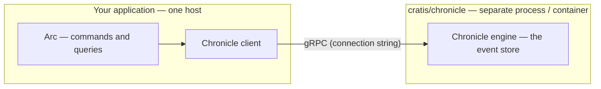
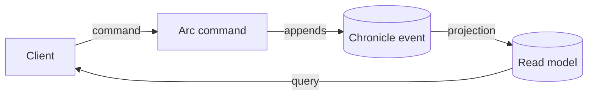

Use the `Cratis` package to register Cratis Arc, the Cratis Chronicle client, and a header-based identity adapter in an ASP.NET Core application. Pair `builder.AddCratis()` with `app.UseCratis()`. You still need a running Chronicle server and separate configuration for its projection sink and your application's query provider.

## What is the Cratis Package?

The `Cratis` package composes Arc's command and query infrastructure with Chronicle's client integration and Swagger/OpenAPI support. Choose it when you want that ASP.NET Core setup, including the identity adapter described below, without registering each part yourself.

For Arc without event sourcing, use `AddCratisArc()` on its own. If you need Chronicle but bring your own authentication, keep the `Cratis` package reference for the ASP.NET Core split-registration example under [Running Arc or Chronicle on their own](#running-arc-or-chronicle-on-their-own).

## Installation

Add the Cratis package to your ASP.NET Core project:

```bash
dotnet add package Cratis
```

## Basic Setup

Configure Cratis in your `Program.cs` with one call on the builder and one on the app:

> [!WARNING]
> `AddCratis()` installs a [header-based identity adapter](../asp-net-core/microsoft-identity.md), not token validation. It ignores the forwarded identity headers until you opt in with `builder.AddCratis(options => options.TrustForwardedIdentityHeaders = true)` or `Cratis:Arc:TrustForwardedIdentityHeaders`. Opt in only behind trusted ingress that authenticates users, strips/replaces incoming identity headers, and prevents direct backend access. Otherwise, [wire your own authentication](#running-arc-or-chronicle-on-their-own).

```csharp
var builder = WebApplication.CreateBuilder(args);

// Add Cratis (Arc + Chronicle) with default configuration
builder.AddCratis();

var app = builder.Build();

// Wire up Cratis middleware and endpoints
app.UseCratis();

app.Run();
```

`AddCratis()` registers Arc's command and query infrastructure, the Chronicle client (which connects to a separately running event store — see [what AddCratis sets up for you](#what-addcratis-sets-up-for-you)), Swagger, and validation/model binding. `UseCratis()` activates both halves — it calls `UseCratisArc()` and `UseCratisChronicle()` for you.

## What AddCratis sets up for you

`AddCratis()` calls `AddCratisArc()` and its ASP.NET Core `WithChronicle()` composition. The Chronicle client shares your application host and connects over gRPC to a separate Chronicle server, typically a `cratis/chronicle` container. The connection string selects that server; this registration never starts it.

The call also registers `AddMicrosoftIdentityPlatformIdentityAuthentication()`. That adapter ignores forwarded identity headers until you enable `TrustForwardedIdentityHeaders`, so requests remain anonymous by default. Use the trusted-ingress setup in the warning above or choose the split registration to supply your own authentication.

`WithChronicle()` registers `TenantNamespaceResolver`, which maps Arc's active tenant to a Chronicle namespace. An unset or default tenant maps to Chronicle's default namespace. Decide whether requests without a tenant may access that namespace; registration alone does not establish your access policy. See [Tenancy](tenancy.md) and [Namespaces](/chronicle/namespaces/).

The process boundary is:



> [!NOTE]
> The client can connect to a local server in development or a shared server in production. Configure the connection for each environment and make sure that server is running before using the event store.

## How Arc and Chronicle fit together

An Arc command returns an event recording a change. Chronicle appends it and a projection builds the read model, the state an Arc query serves to the client:



Arc and the Chronicle client share the application host and its configured integration services. The server's materialized sink is a separate configuration boundary. For `IMongoCollection<T>` queries, install `Cratis.Arc.MongoDB` and align database, collection names, key/serialization conventions, and tenant mapping with the sink. One host does not automatically share a MongoDB connection with the Chronicle server.

## Running Arc or Chronicle on their own

Choose the composition that matches your persistence and authentication needs:

- Arc without an event store: call `AddCratisArc()` on its own and back your commands and queries with MongoDB or EF Core. You keep command/query separation and proxy generation without an event log. See [CQRS without event sourcing](../../../arc-without-event-sourcing.mdx).
- Arc and Chronicle with your own authentication: retain the `Cratis` package reference for this ASP.NET Core example. Call `AddCratisArc()` and its ASP.NET Core `WithChronicle()` composition yourself, omitting `AddMicrosoftIdentityPlatformIdentityAuthentication()`. `Cratis.Arc.Chronicle` supplies the generic-host integration, not all ASP.NET Core extensions below.

```csharp
var builder = WebApplication.CreateBuilder(args);

builder.AddCratisArc(configureBuilder: arc =>
    Microsoft.AspNetCore.Builder.ArcBuilderExtensions.WithChronicle(arc));

var app = builder.Build();

app.UseCratisArc();
app.UseCratisChronicle();   // UseCratis() calls both — wire both halves yourself when you split them
app.Run();
```

The explicit static call selects the ASP.NET Core `WithChronicle()` composition. It avoids an ambiguous call when both `Cratis.Arc` and `Microsoft.AspNetCore.Builder` extensions are in scope; the generic-host overload is a different setup surface.

The ASP.NET Core composition preserves Chronicle's scoped, deferred `IUnitOfWorkManager`. Resolving that manager or beginning a unit of work does not select the event store. Its first event-store operation binds the unit to the tenant active at that point, so authenticate before performing store operations. See [Request unit-of-work binding](tenancy.md#request-unit-of-work-binding).

The generic-host composition instead resolves its scoped manager from `IEventStore.UnitOfWorkManager`. It also supports a `WebApplicationBuilder` when using `Cratis.Arc.Chronicle` directly, but it is a different registration path from the ASP.NET Core example above.

Both paths preserve explicitly registered managers and their chosen lifetimes, including registrations made before `WithChronicle()` or inside its Chronicle builder callback. A manager registered afterward takes precedence for single-service resolution; resolving all managers can still return both registrations. Custom managers own their tenant-binding behavior. Configure `UnitOfWorkLifecyclePolicy` through the Chronicle options callback, not by registering the enum as a service.

> [!IMPORTANT]
> Chronicle types need Chronicle registration. If a project calls `AddCratisArc()` without `WithChronicle()` and uses aggregates, reactors, reducers, projections, `[EventType]` events, or `IEventLog`, [ARCCHR0005](code-analysis/ARCCHR0005.md) reports the missing setup at compile time. If the analyzer cannot see the host setup, runtime resolution can still fail. Add `WithChronicle()` or use `AddCratis()`; database-backed Arc applications that do not use Chronicle need neither.

## Advanced Configuration

You can customize both Arc and Chronicle through the optional configuration callbacks:

```csharp
builder.AddCratis(
    configureArcOptions: options =>
    {
        // Configure Arc options (ArcOptions)
    },
    configureArcBuilder: arcBuilder =>
    {
        // Add additional Arc features
        arcBuilder.WithMongoDB();
    },
    configureChronicleOptions: options =>
    {
        // Configure Chronicle options (ChronicleAspNetCoreOptions)
        options.EventStore = "my-store";
    },
    configureChronicleBuilder: chronicleBuilder =>
    {
        // Configure Chronicle features
        chronicleBuilder.WithCamelCaseNamingPolicy();
    });
```

`options.EventStore` names the Chronicle event store the application connects to. The Chronicle options are bound from the `Cratis:Chronicle` section of `appsettings.json`, so the connection string and other settings come from configuration — see the [ChronicleOptions reference](/chronicle/configuration/chronicle-options/).

## Adding MongoDB Support

By default, the Cratis package doesn't include MongoDB support. To use MongoDB with your application, add the MongoDB package separately:

```bash
dotnet add package Cratis.Arc.MongoDB
```

Then configure MongoDB using the `WithMongoDB` extension method:

```csharp
builder.AddCratis(
    configureArcBuilder: arcBuilder =>
    {
        arcBuilder.WithMongoDB();
    });
```

### MongoDB Configuration Options

You can customize MongoDB settings using the configuration callback:

```csharp
builder.AddCratis(
    configureArcBuilder: arcBuilder =>
    {
        arcBuilder.WithMongoDB(
            configureOptions: options =>
            {
                options.Server = "mongodb://localhost:27017";
                options.Database = "my-database";
            });
    });
```

### MongoDB Configuration from appsettings.json

Alternatively, configure MongoDB settings in `appsettings.json`:

```json
{
  "Cratis": {
    "MongoDB": {
      "Server": "mongodb://localhost:27017",
      "Database": "my-database"
    }
  }
}
```

The `WithMongoDB` extension automatically reads these settings from `Cratis:MongoDB`.

### Custom Configuration Section Path

If your MongoDB settings are in a different configuration section:

```csharp
arcBuilder.WithMongoDB(
    mongoDBConfigSectionPath: "MyApp:Database:MongoDB");
```

## Adding Entity Framework Core Support

To use Entity Framework Core with your application, add the Entity Framework Core package:

```bash
dotnet add package Cratis.Arc.EntityFrameworkCore
```

Package installation alone does not register your contexts. Call `WithEntityFrameworkCore()` in `configureArcBuilder` and configure a nonempty connection string and eligible context types, or use explicit registration. Follow [Entity Framework Core registration and configuration](../entity-framework/getting-started.md) for the required constructor, discovery options, and migration boundary.

Pooled context registration does not automatically select a database per Arc tenant. Design and test tenant isolation separately; see the [provider limits](../entity-framework/getting-started.md#scope-and-provider-limits).

## Program.cs composition

Use this host-body fragment to combine MongoDB queries with a named Chronicle event store. It assumes the packages above, `Cratis.Arc` and `Microsoft.AspNetCore.Builder` imports, the Chronicle extensions used in your configuration, and configured authentication, server, and sink connections:

```csharp
var builder = WebApplication.CreateBuilder(args);

builder.AddCratis(
    configureArcBuilder: arc => arc.WithMongoDB(),
    configureChronicleOptions: chronicle => chronicle.EventStore = "my-store",
    configureChronicleBuilder: chronicle => chronicle.WithCamelCaseNamingPolicy());

var app = builder.Build();

app.UseCratis();
app.Run();
```

The `dotnet new cratis` full-stack template uses this builder/app composition. Its MongoDB branch also configures camel-case naming for the query provider, aligning it with Chronicle's naming policy. Keep both sides aligned when adapting the fragment.

## Next Steps

With the host registered, define a [command](../commands/index.md) to record a change and a [query](../queries/index.md) to read its projected state. [Aggregates](aggregates/index.md) cover decisions that need an entity's event history.

Before serving data, finish the [MongoDB query configuration](../mongodb/index.md) if you use that provider, and choose an [Arc tenant resolver](../tenancy/index.md) that matches your access policy.
