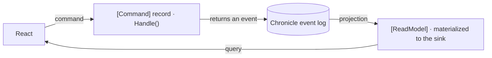

Cratis Arc's optional Chronicle integration lets commands record business changes as events in [Cratis Chronicle](https://github.com/Cratis/Chronicle). Use it when a feature needs a history of what happened, not just its latest database state. Arc still owns the command and query contracts and generates their TypeScript clients.

Arc and Chronicle can each run independently. You can keep database-backed features alongside event-sourced ones and adopt Chronicle for one slice at a time. Start with [Add event sourcing to an Arc slice](/arc/backend/csharp/chronicle/add-event-sourcing/) if you already have a working feature; the references below explain the integration's behavior.

## How the two fit together

An Arc command handles a request to change something and returns an event recording that change. A Chronicle projection builds a read model from those events: the state an Arc query serves to the client. Generated TypeScript proxies let React execute the command and read the query result.

In code, a `[Command]` record carries inputs as properties and makes its decision in `Handle()`. Return an `[EventType]` event and the integration appends it. The [return signature](commands/events.md) determines how single events, collections, tuples, `Result<,>` values, and empty responses are handled. Prefer returned events; [transactional commands](commands/transactional-commands.md) explains when explicit appends are needed.

Each event belongs to an event source, the entity whose history it records. The command's event source id selects that stream before command dependencies are resolved. Declare one identity candidate or provide it explicitly through `ICanProvideEventSourceId`; [Resolving EventSourceId](resolving-event-source-id.md) explains the selection rules.

A `[ReadModel]` record declares the state to query. Attributes such as `[FromEvent<T>]`, `[SetFrom<T>]`, and `[SetValue<T>]` describe how events update it. Chronicle materializes that state in the configured sink. Your query must read from the corresponding storage. A materialized query can lag behind an append; returning an event does not mean every query already sees it.

When a later command needs state to make a decision, Arc can resolve a read model for its key and supply it to a validator, `Provide()`, or `Handle()`. Follow [Use current state in a command](/arc/scenarios/use-current-state-in-a-command/) for that path instead of adding a client-side query round-trip.

## What it provides

Choose the host setup before adding event-sourced types. The [`Cratis` package](cratis-package.md) composes Arc, the Chronicle client, and a header-based identity adapter for ASP.NET Core. Use `AddCratisArc()` with `WithChronicle()` when you want to configure authentication yourself. The `Cratis.Arc.Chronicle` package supplies the generic-host integration; the package guide distinguishes it from the ASP.NET Core composition.

Both setups connect to a separately running Chronicle server. Configure that connection and the server's projection sink, then register the query provider your application uses to read the materialized data. Installing the client does not start the server or configure an application database.

The integration also makes aggregate roots available through the command pipeline and maps Arc's tenant context to Chronicle namespaces. [Tenancy](tenancy.md) explains the default-namespace fallback and the separate access-policy and query-storage responsibilities.

Stream identity, authenticated identity, and compliance subjects have different jobs. Command metadata selects the event stream; compliance metadata supplies append subjects. Read-model interception requests release of personally identifiable information (PII). Consult [Compliance](compliance/index.md) for failure behavior and passive-read limits before using that path for protected data.

## Topics

| Topic | Description |
| --- | --- |
| [Aggregates](aggregates/index.md) | Working with aggregate roots and event sourcing. |
| [Add event sourcing to an Arc slice](/arc/backend/csharp/chronicle/add-event-sourcing/) | Move one database-backed slice to Chronicle while keeping its query and React screen in place. |
| [Cratis Package](cratis-package.md) | The convenience package for Arc + Chronicle applications. |
| [React to an event](react-to-an-event.md) | Run side effects or follow-up commands from Chronicle events with reactors. |
| [Commands](commands/index.md) | Returning events from commands, event source id resolution, and concurrency scoping. |
| [Resolving EventSourceId](resolving-event-source-id.md) | Command identity selection, dependency timing, and the separate query-binding boundary. |
| [Read Models](read-models/index.md) | What makes a read model injectable into a command, how it is resolved by key, and what happens when it does not exist. |
| [Tenancy](tenancy.md) | Tenant-aware namespaces for event stores and projections. |
| [Validation](validation.md) | Validating a command against the state Chronicle already projected for its key. |
| [Compliance](compliance/index.md) | PII decryption on read models and compliance subject resolution on commands. |
| [Code Analysis](code-analysis/index.md) | Diagnostics and analyzers specific to the Chronicle integration. |
