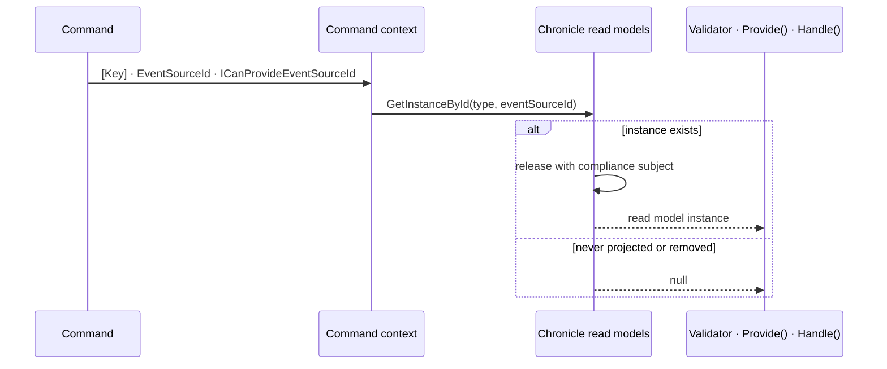

A Chronicle read model is current state folded out of events. Arc makes that state available to a command as an ordinary constructor or method parameter, resolved for the key the command already carries — no query, no repository, no manual lookup.

This section explains the mechanism. To _use_ it, start with [Use current state in a command](../../../../scenarios/use-current-state-in-a-command.mdx) for the recipe, or [Read models in commands](./injecting-into-commands.md) for the full reference on each position.

## What makes a read model injectable

A read model can be injected into command-scoped code because it is **resolvable by key** — the event source id Arc resolved from the command — through Chronicle's read model store. That resolvability comes from a Chronicle backing artifact, so a read model is registered when it has one of:

- a fluent [`IProjectionFor<T>`](/chronicle/projections/) projection
- a standalone model-bound projection (`[FromEvent<T>]`, `[SetFrom<T>]`, `[SetValue<T>]`)
- an [`IReducerFor<T>`](/chronicle/reducers/) reducer
- a [self-reducing read model](/chronicle/reducers/self-reducing-read-models/) discovered by Chronicle **19.58.0 or later**

You declare the dependency identically in every case. The backing still matters for freshness, serialization, and compliance release; it is not always a materialized document.

### Children and nested objects are not standalone read models

A type used only as a child or complex subobject of a model-bound projection is part of its parent's document. Its mapping attributes do not give it an independent Chronicle lookup by key. Arc excludes those types from Chronicle's model-bound command registrations, matching Chronicle's projection discovery.

Inject the parent and select the child from its state, or define a separate standalone read model for the command. A type that also has an explicit fluent projection or reducer remains eligible through that backing artifact. A self-referencing root is still eligible unless another candidate uses it as a child or subobject.

This restriction concerns Chronicle ownership only. Arc leaves registrations from MongoDB, Entity Framework Core, or your application intact; those providers may independently own the same CLR type. Without such a registration, a required dependency fails resolution and a nullable dependency can receive null without a lookup. Making a child parameter nullable does not make it independently resolvable.

### `[ReadModel]` alone is not enough

The `[ReadModel]` attribute does **not** make a type injectable into commands. `[ReadModel]` is an Arc concept used for queries, and it can be backed by stores other than Chronicle — Entity Framework Core, for example. Injection into command scope only makes sense for a type that is resolvable by key, and key resolution is owned by the backing provider. Chronicle registers the read models it can resolve; a read model backed by another provider is registered by that provider, not by Chronicle.

The practical consequence: adding `[ReadModel]` to a record with no projection or reducer behind it will not make it appear in a validator. Add the backing artifact.

## Self-reducing read models

When a projection cannot express a state transition, you can put the reduction on the model itself instead of creating a separate `IReducerFor<T>`. Use Chronicle **19.58.0 or later** in your application. Arc remains compatible with older Chronicle clients, but those clients do not automatically discover this backing kind.

This complete model declaration assumes an Arc host with [Chronicle configured](../add-event-sourcing.mdx); it is not a complete host:

```csharp
using System.Threading.Tasks;
using Cratis.Arc.Queries.ModelBound;
using Cratis.Chronicle.Events;
using Cratis.Chronicle.ReadModels;

namespace Banking.Ledgers;

[ReadModel]
public record LedgerBalance(EventSourceId Id, decimal Balance)
{
    public static LedgerBalance Reduce(FundsAdded @event, LedgerBalance? current, EventContext context) =>
        new(context.EventSourceId, (current?.Balance ?? 0) + @event.Amount);

    public static LedgerBalance? Reduce(LedgerClosed @event, LedgerBalance? current) => null;

    public static async Task<LedgerBalance?> ById(IReadModels readModels, EventSourceId id) =>
        await readModels.GetInstanceById<LedgerBalance>(id);
}

[EventType]
public record FundsAdded(decimal Amount);

[EventType]
public record LedgerClosed;
```

`Reduce` receives the event and nullable current state; a null result removes the state. `ById` is an ordinary query. You do **not** need `RequireQueryAttribute`: Arc excludes any method accepting its own read-model type, regardless of name, parameter position, or nullability. Only `ById` becomes an endpoint and TypeScript query proxy. Apply [query authorization](../../queries/model-bound/authorization.md) before exposing private data.

For command injection, Arc claims a concrete, non-generic type listed in Chronicle's reducer artifacts only when it has at least one eligible **public static nongeneric** `Reduce(event, current[, EventContext])`. The event type must carry `[EventType]` directly or through a base type; `current` is the exact nullable model type (nullable-oblivious declarations are also accepted). Return the model, nullable model, or `Task` of either. By-reference, optional, and `params` parameters are not eligible. A classic `IReducer`/`IReducerFor<T>` implementation is not a self model, and explicitly nominating a plain reducer class does not make that class injectable as its own read model.

Self models use the same command-key lookup and `Release(instance)` as other Chronicle backings, not MongoDB fallback. Their materialized/passive freshness and absence follow [Chronicle's self-reducer contract](/chronicle/reducers/self-reducing-read-models/). Injecting them is still an advisory snapshot, **not concurrency protection**. Screenplay extraction recovers their eligible observed events and reports the imperative fold as lost; it does not translate the reduction code into projection mappings.

## How an instance is resolved



Step by step:

1. **Identity strategy** — Arc inspects the command to determine its key, using one of the strategies in [Resolving EventSourceId](../resolving-event-source-id.md).
2. **Command context lookup** — the resolved identity is read from the current `CommandContext`.
3. **Guard** — if no usable identity is available, resolution fails with [`UnableToResolveReadModelFromCommandContext`](./failures.md#unabletoresolvereadmodelfromcommandcontext).
4. **Store query** — Chronicle's read model store is queried by the resolved identity.
5. **Subject release** — if the instance exists, Arc additionally calls `Release(instance)`, whether or not the command declares a compliance `Subject`. It does not pass the command subject. Chronicle resolves the release subject from the instance; materialized state may already have been released server-side. See [Subject](../compliance/subject.md).
6. **Result** — the instance is returned, or `null` when a materialized or reducer-backed instance does not exist. A never-created passive projection can instead return a default-valued instance; see [absence and passive projections](./injecting-into-commands.md).

Resolution happens exactly once per command. The same instance is handed to the validator, `Provide()`, and `Handle()`.

### The key does not prove existence

A `[Key]` or event source id tells Arc _which_ instance to resolve; it does not prove that instance exists. A projection may never have been created, may have been removed, or may be mid-rebuild. Whether that is a normal business condition or a fault is yours to declare — see [nullable versus required](./injecting-into-commands.md#nullable-means-you-handle-absence).

## Lifetime and mutability

Read models are registered as **command-scoped** services:

- The state is fetched once per command and shared across that command's validator, `Provide()`, and `Handle()`.
- The instance is tied to the identity resolved from the command context.
- It is disposed when the command completes.

And they are **read-only snapshots**:

- **Immutable in practice** — changes made to an injected instance are not persisted anywhere.
- **Backing-dependent freshness** — asynchronously materialized models reflect events processed so far, not necessarily every append. Passive models are built on demand.
- **Fetched on first resolution** — the command-scoped snapshot is not refreshed after a later append or returned identity change.

To _change_ state, return events from `Handle()` or use an [aggregate root](../aggregates/index.md). A read model is an input to a decision, never the place a decision is recorded.

## Materialized and passive paths

Passive reducer models are folded in-process. Passive projection models register with no materialized sink and are resolved on demand by Chronicle. Ordinary materialized reads cross the service/JSON boundary; a passive reducer does not use that same document-deserialization path.

Arc calls the non-generic `GetInstanceById(Type, key)` overload. For passive reducers, do not assume it performs the generic overload's post-reduction release. Arc attempts its own `Release(instance)` for every existing command-side instance, and Chronicle decides from the instance whether there is anything to release. Test sensitive state on the path you actually use.

On-demand state is still a snapshot, not a lock. Neither passive nor materialized read-model injection by itself binds the later append to the revision used by a decision. Use append-time constraints or an explicitly captured concurrency expectation where needed.

## Read models or aggregate roots

Both give a command access to current state, and they answer different questions.

| Reach for          | When                                                                                                                        |
| ------------------ | --------------------------------------------------------------------------------------------------------------------------- |
| **Read model**     | You need projected, possibly denormalized state to validate against or compute from, and eventual consistency is acceptable |
| **Aggregate root** | You need to emit events, enforce an invariant inside a consistency boundary, or work from source-of-truth stream state      |
| **Both**           | Validate against projected state, then make the change through the aggregate                                                |

If correctness depends on source-of-truth state under concurrency, prefer aggregate or event-stream state over a read model — or enforce it with a Chronicle [constraint](/chronicle/constraints/), which is checked at append time.

## Topics

| Topic | Description |
| --- | --- |
| [Read models in commands](./injecting-into-commands.md) | Injecting into a validator, `Provide()`, and `Handle()`, and what nullability means. |
| [Read models from other providers](./other-providers.md) | Injecting one backed by Entity Framework Core or MongoDB, and declaring the key without Chronicle. |
| [When resolution fails](./failures.md) | Every failure mode, what it means, and how to fix it. |
