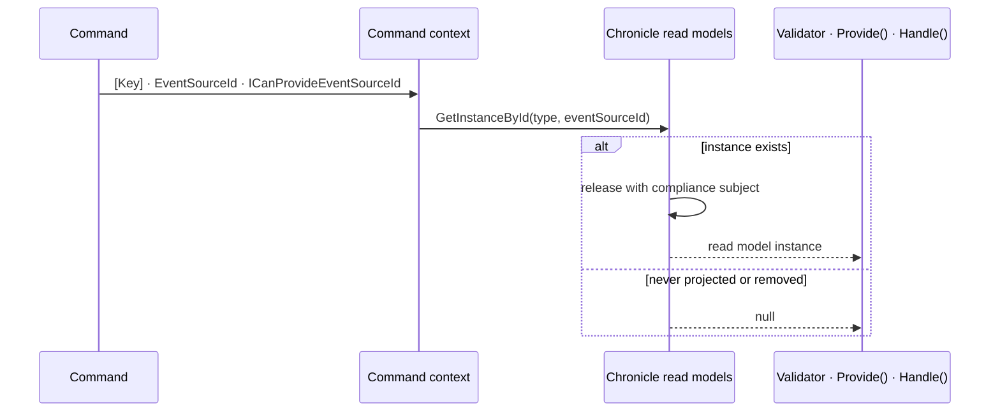

Cratis Arc injects Chronicle read models into commands so a validator or handler can use state derived from recorded events without loading it itself. Declare the model as a dependency, choose the key that identifies its instance, and decide whether the read must protect a later append against concurrent changes.

Start with [Use current state in a command](../../../../scenarios/use-current-state-in-a-command.mdx) for the recipe. This page explains which models Chronicle can supply; [Read models in commands](./injecting-into-commands.md) shows where to place the dependency and how to handle missing state.

## What makes a read model injectable

Chronicle must know how to load the model by key. The default key is the command's resolved event source id, but the model needs a backing definition before any key can load it. Arc registers models backed by:

- a fluent [`IProjectionFor<T>`](/chronicle/projections/) projection
- a standalone model-bound projection (`[FromEvent<T>]`, `[SetFrom<T>]`, `[SetValue<T>]`)
- an [`IReducerFor<T>`](/chronicle/reducers/) reducer
- a [self-reducing read model](/chronicle/reducers/self-reducing-read-models/) discovered by Chronicle **19.58.0 or later**

Each backing uses the same dependency declaration. It still determines how Chronicle builds the state, how fresh an ordinary read is, and how protected values are released for use. Not every model is a stored document. See [materialized and passive paths](#materialized-and-passive-paths).

### Children and nested objects are not standalone read models

A type used only as a child or complex subobject of a model-bound projection is part of its parent's document. Its mapping attributes do not give it an independent Chronicle lookup by key. Arc excludes those types from Chronicle's model-bound command registrations, matching Chronicle's projection discovery.

Inject the parent and select the child from its state, or define a separate standalone read model for the command. A type that also has an explicit fluent projection or reducer remains eligible through that backing artifact. A self-referencing root is still eligible unless another candidate uses it as a child or subobject.

This restriction concerns Chronicle ownership only. Arc leaves registrations from MongoDB, Entity Framework Core, or your application intact; those providers may independently own the same CLR type. Without such a registration, a required dependency fails resolution and a nullable dependency can receive null without a lookup. Making a child parameter nullable does not make it independently resolvable.

### `[ReadModel]` alone is not enough

`[ReadModel]` identifies an Arc query model; it does not tell Chronicle how to load state. Adding it to a record with no projection or reducer will not make Chronicle inject that record into a validator. Add the backing definition.

A model stored in Entity Framework Core or MongoDB can also be injectable, but its storage provider owns that registration and lookup. Use [Read models from other providers](./other-providers.md) for those rules rather than adding a Chronicle projection solely to enable injection.

## Self-reducing read models

When a projection cannot express a state transition, you can put the reduction on the model itself instead of creating a separate `IReducerFor<T>`. Use Chronicle **19.58.0 or later** in your application. Arc remains compatible with older Chronicle clients, but those clients do not automatically discover this backing kind.

This complete model declaration assumes an Arc host with [Chronicle configured](../add-event-sourcing.mdx); it is not a complete host:

```csharp
using System.Threading.Tasks;
using Cratis.Arc.Queries.ModelBound;
using Cratis.Chronicle.Events;
using Cratis.Chronicle.ReadModels;

namespace Banking.Ledgers;

[ReadModel]
public record LedgerBalance(EventSourceId Id, decimal Balance)
{
    public static LedgerBalance Reduce(FundsAdded @event, LedgerBalance? current, EventContext context) =>
        new(context.EventSourceId, (current?.Balance ?? 0) + @event.Amount);

    public static LedgerBalance? Reduce(LedgerClosed @event, LedgerBalance? current) => null;

    public static async Task<LedgerBalance?> ById(IReadModels readModels, EventSourceId id) =>
        await readModels.GetInstanceById<LedgerBalance>(id);
}

[EventType]
public record FundsAdded(decimal Amount);

[EventType]
public record LedgerClosed;
```

`Reduce` receives the event and nullable current state; a null result removes the state. `ById` is an ordinary query. You do **not** need `RequireQueryAttribute`: Arc excludes any method accepting its own read-model type, regardless of name, parameter position, or nullability. Only `ById` becomes an endpoint and TypeScript query proxy. Apply [query authorization](../../queries/model-bound/authorization.md) before exposing private data.

For command injection, the model must be a concrete, non-generic type in Chronicle's discovered reducer set, with at least one eligible public static, non-generic `Reduce(event, current[, EventContext])` method. `current` must be the exact nullable model type; nullable-oblivious declarations are also accepted. Return the model, nullable model, or `Task` of either. By-reference, optional, and `params` parameters are not eligible.

The event parameter may be any class other than `object`, or an interface. It does not need `[EventType]`: Chronicle's event registry determines which registered concrete events match, including explicitly registered events without that attribute.

A classic `IReducer`/`IReducerFor<T>` implementation is not a self model. Explicitly nominating a plain reducer class does not make that class injectable as its own read model.

Self models use Chronicle's command-key lookup and `Release(instance)`, not MongoDB fallback. Their ordinary freshness and absence follow [Chronicle's self-reducer contract](/chronicle/reducers/self-reducing-read-models/). Under read protection `Off`, injection supplies an advisory snapshot. Under `On`, the model must pass reducer admission before Arc can acquire and guard it; self-reducer discovery alone does not establish that it can be protected.

Screenplay recognizes the same reducer shape and lists observed event types it can prove from `[EventType]`, including inherited markers. It reports the imperative fold as lost rather than translating reduction code into projection mappings. For an interface or unmarked event parameter whose registered concrete events cannot be determined from source, it reports incomplete observed-event coverage.

## How an instance is resolved

For an ordinary command-key read under read protection `Off`, Arc resolves the command identity and asks Chronicle for that instance:



Arc obtains the identity from `CommandContext`, using the strategies in [Resolving EventSourceId](../resolving-event-source-id.md). Without a usable identity, this lookup fails with [`UnableToResolveReadModelFromCommandContext`](./failures.md#unabletoresolvereadmodelfromcommandcontext). A parameter can select another key through a lookup attribute; see [command state inputs](./command-state-inputs.md).

For an existing instance, Arc calls `Release(instance)` so Chronicle can release compliance-protected values. Arc does not pass the command's compliance `Subject`; Chronicle determines the release subject from the instance. Materialized state may already have been released server-side. See [Subject](../compliance/subject.md).

An absent materialized or reducer-backed instance returns `null`. A never-created passive projection can instead return a default-valued instance, so choose absence checks for the backing you use. [Read models in commands](./injecting-into-commands.md) explains the nullable and required cases.

With read protection `On`, supported parameters use the protected acquisition path instead of this ordinary store read. Arc acquires fresh state and enrolls its boundary for the later append; unsupported models are refused. Start with [read protection](../consistency/getting-started.md) before relying on a read to enforce a concurrent rule.

### The key does not prove existence

A `[Key]` or event source id tells Arc _which_ instance to resolve; it does not prove that instance exists. A projection may never have been created, may have been removed, or may be mid-rebuild. Whether that is a normal business condition or a fault is yours to declare — see [nullable versus required](./injecting-into-commands.md#nullable-means-you-handle-absence).

## Lifetime and mutability

The ordinary read-model service is command-scoped: its first resolution loads the instance for the command key, and the validator, `Provide()`, and `Handle()` share it. Parameter-specific lookups can acquire other instances. Under `On`, protected acquisition caches by model, key, and stream scope, so equal lookups share state without merging distinct keys or streams.

Treat the injected instance as read-only input. Changing its properties does not persist anything, and a later append does not refresh the instance you already hold. With protection `Off`, asynchronously materialized state reflects the events processed so far; passive models build state on demand. `On` adds freshness and commit checks for admitted reads, not live updates to an object.

To change state, return events from `Handle()` or use an [aggregate root](../aggregates/index.md). The command records the decision through those events, not by mutating its input.

## Materialized and passive paths

Passive reducer models are folded in-process. Passive projection models register with no materialized sink and are resolved on demand by Chronicle. Ordinary materialized reads cross the service/JSON boundary; a passive reducer does not use that same document-deserialization path.

On the ordinary lookup path, Arc calls the non-generic `GetInstanceById(Type, key)` overload. For passive reducers, do not assume it performs the generic overload's post-reduction release. Arc calls `Release(instance)` for every existing command-side instance, and Chronicle determines from the instance whether anything needs releasing. Test sensitive state on the path your application uses.

On-demand state is still a snapshot, not a lock. Under `Off` or `Measure`, neither passive nor materialized injection binds the later append to the read's revision. Use read protection `On` for supported reads, or an append-time constraint for a rule such as uniqueness. See [Choosing how a command's rule holds](../consistency/index.md).

## Read models or aggregate roots

Both give a command access to current state, and they answer different questions.

| Reach for          | When                                                                                                                        |
| ------------------ | --------------------------------------------------------------------------------------------------------------------------- |
| **Read model**     | You need projected state to validate against or compute from; choose its read-protection policy if concurrency matters |
| **Aggregate root** | You need to emit events, enforce an invariant inside a consistency boundary, or work from source-of-truth stream state      |
| **Both**           | Validate against projected state, then make the change through the aggregate                                                |

Choose the state shape separately from the concurrency rule. Aggregate or event-stream state fits a stream-owned decision; a projected model can be an input too, with supported reads guarded under `On`. A Chronicle [constraint](/chronicle/constraints/) checks a rule such as uniqueness at append time. Loading any of these inputs alone does not establish that the later write is safe.

## Topics

| Topic | Description |
| --- | --- |
| [Read models in commands](./injecting-into-commands.md) | Injecting into a validator, `Provide()`, and `Handle()`, and what nullability means. |
| [Read models from other providers](./other-providers.md) | Injecting one backed by Entity Framework Core or MongoDB, and declaring the key without Chronicle. |
| [When resolution fails](./failures.md) | Every failure mode, what it means, and how to fix it. |
| [Read models in named sinks](../../mongodb/named-sinks.md) | Querying a read model the Kernel stores in a named MongoDB sink on another server. |
