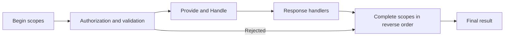

Timing a command or coordinating a storage lifetime requires a callback after handling as well as before it. An execution scope supplies that pair around model-bound execution. It begins before command filters and completes after handling and response processing, including failure paths. The hook lets an integration coordinate its own resource; it does not supply a transaction by itself.

:::tip[Use operations for per-command side effects]
Prefer [command operations](./operations/index.md), rather than a custom scope and rollback stack, for work chosen by one command. Arc manages operation failure handling and optional compensation. Scopes remain the integration mechanism for cross-cutting lifetime and commit concerns.
:::

## How it works

Arc discovers `ICommandExecutionScope` implementations and resolves them from the command's service scope. Authorization preparation and role checks can reject a command before scopes begin. Once a handler and context are available and that preparation allows execution, the pipeline:

1. Materializes the scope instances and calls synchronous `Begin(context)` on each.
2. Awaits `BeginAsync(context)` sequentially on scopes implementing `IAsyncCommandExecutionScope`, in the same order.
3. Runs filters, resolves provided data and handler arguments, awaits `Handle()`, and processes its response.
4. Calls asynchronous `Complete(context, result)` in reverse scope order, including when validation fails or execution throws.

Synchronous `Begin` lets ambient state flow into the execution that follows. Plan for partial initialization: outside command-operation participation, each materialized scope completes once, even if its `Begin` never ran because an earlier scope threw. For commands whose declared return type can contain operations, only scopes whose begin was attempted complete, including the scope whose begin threw. Completion must therefore tolerate missing state. A missing handler or a failure constructing context or scopes can occur before this lifecycle is available. Pre-flight `Validate` skips it entirely.

Add `IAsyncCommandExecutionScope` when initialization must await work. All synchronous begins finish before asynchronous initialization starts, and context values are already built. Honor `context.CancellationToken`: cancellation or initialization failure skips filters and enters completion cleanup. Establish ambient `AsyncLocal` state in synchronous `Begin`. Changes made inside `BeginAsync` do not flow back to the caller. Neither initialization form runs during pre-flight `Validate`.

With no asynchronous scopes, the lifecycle has no asynchronous initialization stage. Keep scopes independent because their relative discovery order is unspecified. If one `Complete` throws, the pipeline merges the exception into the result and still completes the remaining scopes.

The diagram's authorization and validation box represents command filters. It does not place all authorization work after scope initialization: preparation can reject earlier, while a scope can begin before an authorization filter gives its verdict.



## Implementing a custom execution scope

Use this timing scope to observe the lifecycle without committing business data. It requires a resolvable `ILogger<CommandTimingScope>` and a logging provider to see output. The timer lives in the per-command values dictionary, so even a shared scope instance keeps each command's timer separate.

```csharp
using System;
using System.Diagnostics;
using System.Threading.Tasks;
using Cratis.Arc.Commands;
using Microsoft.Extensions.Logging;

public class CommandTimingScope(ILogger<CommandTimingScope> logger) : ICommandOperationExecutionScope
{
    const string TimerKey = "Example.CommandTimingScope.Timer";
    static readonly Action<ILogger, string, double, bool, Exception?> _completed =
        LoggerMessage.Define<string, double, bool>(LogLevel.Information, new EventId(1, "CommandTimed"),
            "Command {CommandType} took {Milliseconds} ms; success at timing completion: {IsSuccess}");

    public bool IsCommitParticipant => false;

    public CommandCommitDisposition GetCommitDisposition(CommandContext context) =>
        CommandCommitDisposition.NoCommit;

    public void Begin(CommandContext context) =>
        context.Values[TimerKey] = Stopwatch.StartNew();

    public Task Complete(CommandContext context, CommandResult result)
    {
        if (context.Values.TryGetValue(TimerKey, out var value) && value is Stopwatch timer)
        {
            timer.Stop();
            _completed(logger, context.Type.FullName ?? context.Type.Name,
                timer.Elapsed.TotalMilliseconds, result.IsSuccess, null);
            context.Values.Remove(TimerKey);
        }
        return Task.CompletedTask;
    }
}
```

The timing scope implements `ICommandOperationExecutionScope`, declaring that it does not commit business changes. This makes its lifetime behavior explicit for operation-bearing commands while preserving ordinary execution-scope behavior. A scope that actually commits storage must report its real commitment facts instead; see the [supported operation scope profile](./operations/reference.md#supported-scope-profile).

If `Begin` did not run, no timer exists and completion does nothing. A recorded duration includes response processing and scopes that completed before this one. Read the log's success field as success **at this completion callback**. Another scope can still fail afterward; only the returned final result describes the completed invocation.

## Mutating the result — handle with care

`Complete` receives a mutable `CommandResult`, so a completion failure can change the eventual verdict. Add failures from your concern without erasing earlier authorization, validation, or exception outcomes. Another scope may already have acted on a failure; removing it would report success inconsistent with that action.

A response may already be present in the callback context. It is not proof that every scope will succeed. After completion, the pipeline clears the **result's** response if execution is unsuccessful. See [response phase availability](./response-value-handlers.md#response-object-availability).

## Optional integrations

A standalone Arc scope supplies lifecycle callbacks. If you use them for a database transaction, your implementation owns beginning, committing, rolling back, and handling nested or failed invocations. A failure result cannot undo an arbitrary service write by itself.

`Cratis.Arc.Chronicle` supplies a separate `TransactionalCommandScope`. Its event-store-specific guarantees are documented under [Chronicle transactional commands](./transactional-commands.md); they do not apply to arbitrary service writes.

Execution scopes apply wherever the model-bound pipeline runs, including HTTP and direct [pipeline calls](./command-pipeline.md). They also wrap POST controller commands, except actions marked `[AspNetResult]`, validation-only requests, and requests rejected by model-state validation. Controller commands run all synchronous `Begin` callbacks, then asynchronous initialization, the action, and reverse-order completion with the built `CommandResult`. Invocation cleanup runs in reverse order in `finally`. Completion finishes before the HTTP status is selected; an unsuccessful result has its response cleared.

With Chronicle, `TransactionalCommandScope` owns the controller command's unit of work. A refused commit becomes a validation or exception outcome (HTTP 400 or 500), never a successful HTTP 200 response. A controller that captures `unitOfWorkManager.Current` in its constructor still holds the request unit, not the command's unit: resolve the current unit during action execution instead. A model-bound command the action executes through `ICommandPipeline` owns its own transaction and commits before `Execute` returns; it does not join the controller's unit.

Use [command filters](./command-filters.md) when you only need a pre-execution decision in the model-bound pipeline.
