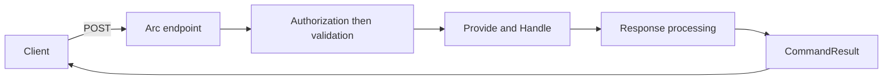

Opening an account or adding a cart line starts with an input contract and ends with a result the caller must check. An Arc command keeps that input with the behavior that handles it. Arc supplies the HTTP endpoint, command result, and generated TypeScript proxy so you do not have to repeat that plumbing for each operation.

Start with a handler that calls your application service. Arc is a standalone CQRS framework: your service can use any suitable storage, and the command does not have to return an event or use Chronicle. Authorization, validation, and awaiting the result still matter when there is no event store.

:::tip[Return operations for inline side effects]
Prefer [command operations](./operations/index.md) when `Handle()` decides which external work to perform. The decision returns inspectable values; Arc executes them and manages optional compensation without application-written error handling. Direct service calls remain supported, and durable follow-up work still belongs in a reactor or appropriate workflow.
:::



## Your first command

This is a declaration fragment using the shared `CartLineId`, `Sku`, and `Quantity` concepts and fully implemented `ICartService` from the [model-bound command example](./model-bound/index.md#a-service-backed-command):

```csharp
using Cratis.Arc.Commands.ModelBound;

[Command]
public record AddItemToCart(Sku Sku, Quantity Quantity)
{
    public CartLineId Handle(ICartService carts) => carts.AddItem(Sku, Quantity);
}
```

Arc discovers the public instance `Handle()` on the `[Command]` record. It resolves `ICartService` from the command scope, waits for the operation, and places the `CartLineId` in the response. The service owns the cart write; the command declaration alone does not provide storage. Follow the linked example for the service implementation, registration, and an execution checkpoint before adding validation or other pipeline extensions.

Choose the return shape by what the caller needs and where the work happens. A response value reports the outcome; it does not by itself describe a side effect or make that effect transactional:

- **`void` or `Task`** — no response value. A task is awaited; this is not fire-and-forget execution.
- **A value or `Task<T>`** — an unhandled value becomes the typed response.
- **An operation or `CommandOperations`** — declare one or many server-side actions, with optional compensation.
- **A tuple** — combine one response with [command operations](./operations/index.md) and other values consumed by [response value handlers](./response-value-handlers.md).
- **`Cratis.Monads.Result<TSuccess, TError>`** — process the active alternative. A recognized validation value becomes a rejection; arbitrary error types are not automatically failures.

Use [provided data](../../../scenarios/provide-data-to-a-command.mdx) when fetching handler input separately makes the operation clearer.

## Two ways to define a command

| Style | Choose it when |
| --- | --- |
| [Model-bound](./model-bound/index.md) | You want input and behavior together with minimal endpoint boilerplate. |
| [Controller-based](./controller-based.md) | You need MVC action control or are integrating existing controllers. |

Use model-bound commands for the examples in this chapter unless a section explicitly describes MVC. Controller commands run through MVC action filters, a different execution path. An extension or authorization attribute for one path does not automatically govern the other.

## Build on the basics

Pick the page for the problem you are solving. Start with input rules if bad requests reach the handler; use pre-flight validation when a form needs feedback before submission. Neither replaces checking the eventual execution result.

| Next concern | Read |
| --- | --- |
| Write annotation or FluentValidation input rules | [Validation](./validation.md) |
| Protect commands | [Model-bound authorization](./model-bound/authorization.md) |
| Check a form before attempting the change | [Pre-flight validation](./command-validation.md) |
| Execute, await, and interpret a result from application code | [Command pipeline](./command-pipeline.md) |
| Keep inline side effects out of the decision | [Command operations](./operations/index.md) · [Testing operations](../testing/command-operations.md) |
| Understand scalar and tuple responses | [Response value handlers](./response-value-handlers.md) · [Examples](./response-examples.md) |
| Carry cross-cutting data | [Command context](./command-context.md) |
| Reject work before handling or observe its completion | [Filters](./command-filters.md) · [Execution scopes](./command-execution-scopes.md) |

## Optional Chronicle integration

Add [Chronicle command integration](../chronicle/commands/index.md) when your application uses event sourcing and needs returned-event handling. Its [transactional command behavior](./transactional-commands.md) coordinates that integration's work; it does not turn arbitrary service writes into a transaction. You do not need Chronicle for service-backed commands or `Guid` responses.

## The frontend follows the backend

The [proxy generator](../proxy-generation/index.md) generates the TypeScript command contract from the backend. After building the backend, use [commands in React](../../../frontend/react/commands/index.mdx) to submit it and inspect the result. Continue to [queries](../queries/index.md) to read the data your commands change.
