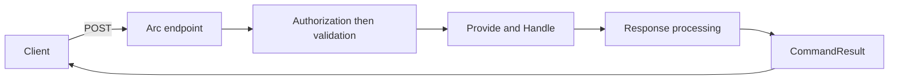

Opening an account or adding a cart line needs input, a handler, and a result the caller can check. An Arc command keeps the input with the behavior that handles it. Arc supplies the HTTP endpoint, command result, and generated TypeScript proxy, so you do not repeat that plumbing for each operation.

Start with a handler that calls your application service. Arc uses CQRS (Command Query Responsibility Segregation): commands change state, while queries read it. Your service can use any suitable storage; a command does not have to return an event or use Chronicle.

:::tip[Return operations for inline side effects]
Prefer [command operations](./operations/index.md) when `Handle()` decides which external work to perform. The decision returns inspectable values; Arc executes them and manages optional compensation without application-written error handling. Direct service calls remain supported, and durable follow-up work still belongs in a reactor or appropriate workflow.
:::



## Your first command

This is a declaration fragment using the shared `CartLineId`, `Sku`, and `Quantity` concepts and fully implemented `ICartService` from the [model-bound command example](./model-bound/index.md#a-service-backed-command):

```csharp
using Cratis.Arc.Commands.ModelBound;

[Command]
public record AddItemToCart(Sku Sku, Quantity Quantity)
{
    public CartLineId Handle(ICartService carts) => carts.AddItem(Sku, Quantity);
}
```

Arc discovers the public instance `Handle()` on the `[Command]` record. It resolves `ICartService` from the command scope, waits for the operation, and places the `CartLineId` in the response. The service owns the cart write; declaring the command does not supply storage. Follow the linked example to implement and register that service, then execute the command before adding pipeline extensions.

Choose the return shape by what the caller needs. Returning a value reports an outcome; it does not by itself make a service write transactional:

- **`void` or `Task`** — no response value. A task is awaited; this is not fire-and-forget execution.
- **A value or `Task<T>`** — an unhandled value becomes the typed response.
- **An operation or `CommandOperations`** — declare one or many server-side actions, with optional compensation.
- **A tuple** — combine one response with [command operations](./operations/index.md) and other values consumed by [response value handlers](./response-value-handlers.md).
- **`Cratis.Monads.Result<TSuccess, TError>`** — process the active alternative. A recognized validation value becomes a rejection; arbitrary error types are not automatically failures.

Use [provided data](../../../scenarios/provide-data-to-a-command.mdx) when fetching handler input separately makes the operation clearer.

## Two ways to define a command

| Style | Choose it when |
| --- | --- |
| [Model-bound](./model-bound/index.md) | You want input and behavior together with minimal endpoint boilerplate. |
| [Controller-based](./controller-based.md) | You need MVC action control or are integrating existing controllers. |

The model-bound pipeline and MVC action filters are different execution paths. Do not assume extensions or authorization attributes for one automatically govern the other.

## Build on the basics

Add validation when input needs rules, and authorization when the operation needs access checks. Pre-flight validation can give a form feedback before submission, but the caller must still check the execution result.

| Next concern | Read |
| --- | --- |
| Validate input | [Validation](./validation.md) |
| Protect commands | [Model-bound authorization](./model-bound/authorization.md) |
| Check without invoking the handler | [Pre-flight validation](./command-validation.md) |
| Execute from application code | [Command pipeline](./command-pipeline.md) |
| Keep inline side effects out of the decision | [Command operations](./operations/index.md) · [Testing operations](../testing/command-operations.md) |
| Understand scalar and tuple responses | [Response value handlers](./response-value-handlers.md) · [Examples](./response-examples.md) |
| Carry cross-cutting data | [Command context](./command-context.md) |
| Extend execution | [Filters](./command-filters.md) · [Execution scopes](./command-execution-scopes.md) |

## Optional Chronicle integration

If your application uses event sourcing, [Chronicle command integration](../chronicle/commands/index.md) adds returned-event handling. Its [transactional command behavior](./transactional-commands.md) coordinates that integration's work; it does not turn arbitrary service writes into a transaction. You do not need Chronicle for service-backed commands or `Guid` responses.

## The frontend follows the backend

The [proxy generator](../proxy-generation/index.md) generates the TypeScript command contract from the backend. After building the backend, use [commands in React](../../../frontend/react/commands/index.mdx) to submit it and inspect the result. Continue to [queries](../queries/index.md) to read the data your commands change.
