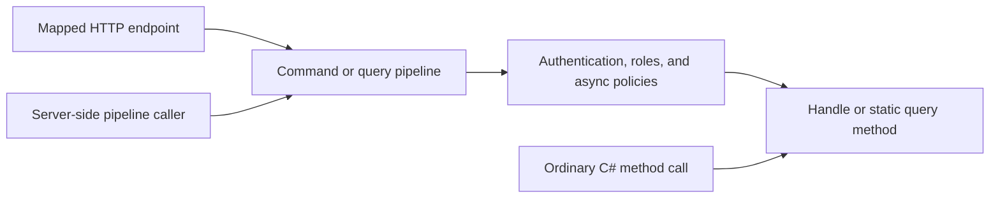

Cratis Arc authorization checks whether the current caller may run a command or query before its logic executes. Use attributes for authentication and role requirements, and named policies for rules that need asynchronous checks. These pipeline checks are part of `Cratis.Arc.Core`; they do not require ASP.NET Core, a database, or Chronicle.

## Authorization attributes

Use attributes from `Cratis.Arc.Authorization`:

| Attribute | Arc pipeline behavior |
| --- | --- |
| `[Authorize]` | Requires an authenticated principal. |
| `[Authorize(Roles = "Admin,Manager")]` | Requires authentication and at least one listed role. |
| `[Roles("Admin", "Manager")]` | The same OR-role check; derives from Arc's `AuthorizeAttribute`. |
| `[Authorize(Policy = "ActiveSubscription")]` | Requires authentication by default and the named policy to succeed asynchronously. An explicitly opted-in policy may evaluate guests. |
| `[AllowAnonymous]` | Explicitly allows anonymous access. |
| No authorization attribute | No pipeline authentication or role requirement unless a fallback evaluator supplies one. HTTP endpoints and hub subscriptions also apply the host's default authorization. |

Every authorization attribute on a declaration must pass. For example, stacked role and policy attributes require both the role check and the policy to succeed, even though the roles listed within one attribute are alternatives.

Register policies before starting the host. Unknown or duplicate policy names fail startup; a policy that cannot be resolved at runtime never grants access. The lightweight host cannot authenticate named schemes, so `AuthenticationSchemes` fails startup and is flagged by [ARC0021](../code-analysis/index.md#arc0021-unevaluated-authorization-settings). Use [ASP.NET Core integration](../asp-net-core/authorization.md) if you need scheme authentication.

## Protect a command

Add this command to the [Core host](getting-started.md) to require an authenticated caller. The example uses only Arc and .NET, and returns response data rather than appending an event:

```csharp
using Cratis.Arc.Authorization;
using Cratis.Arc.Commands.ModelBound;

[Authorize]
[Command]
public record Greet(string Name)
{
    public string Handle() => $"Hello, {Name}!";
}
```

Through the command pipeline, anonymous callers cannot reach `Handle()`. For role protection, replace `[Authorize]` with `[Roles("Admin", "Manager")]`.

## Register a named policy

Use a named policy when an attribute alone cannot express your permission rule. Arc resolves the policy from the command or query's executing service scope, so it can depend on scoped services. This policy checks a trusted claim established by the host's authentication mechanism:

```csharp
using System.Threading;
using System.Threading.Tasks;
using Cratis.Arc.Authorization;

public class ActiveSubscription : IAuthorizationPolicy
{
    public ValueTask<bool> IsAuthorized(AuthorizationPolicyContext context, CancellationToken cancellationToken)
    {
        cancellationToken.ThrowIfCancellationRequested();
        return ValueTask.FromResult(context.Principal.HasClaim("subscription", "active"));
    }
}
```

In the host builder, before `Build()`:

```csharp
using Cratis.Arc.Authorization;

builder.Services.AddArcAuthorizationPolicy<ActiveSubscription>("ActiveSubscription");
```

Apply `[Authorize(Policy = "ActiveSubscription")]` to a model-bound command or read model. In `AuthorizationPolicyContext`, `Target` identifies the type or query method being authorized, and `Resource` is its executing `CommandContext` or `QueryContext`.

Arc awaits policies before `Provide()`, `Handle()`, or a query method runs. Use the command/query pipelines rather than the old synchronous `IAuthorizationEvaluator.IsAuthorized` entry points, which reject policy-bearing declarations.

### Let a policy evaluate guests

Policies normally require an authenticated principal even if their own logic would allow a guest. To let a policy decide for an unauthenticated caller, register it explicitly with `builder.Services.AddArcAuthorizationPolicy<PublicOrMember>("PublicOrMember", evaluatesAnonymous: true)`. It then receives an empty, unauthenticated `ClaimsPrincipal` for guests and must decide whether to allow them.

Every stacked requirement must be an opted-in policy with no roles or authentication schemes. Roles and schemes always require authentication. Do not add `[AllowAnonymous]` alongside a policy: those declarations conflict rather than allowing the policy to decide.

For ASP.NET Core-registered policies, also call `builder.Services.AddArcAnonymousAspNetAuthorizationPolicy("PublicOrMember")` after registering the policy normally. The policy must not require an authenticated user. Both Arc and Microsoft's `[Authorize(Policy = "PublicOrMember")]` work identically on that host; see [ASP.NET Core authorization](../asp-net-core/authorization.md) for its registration setup.

Mapped model-bound HTTP endpoints whose effective declaration consists entirely of guest policies let unauthenticated callers reach Arc's pipeline. This applies to command execution, command validation, and query GET/QUERY endpoints. On the lightweight host, registering authentication handlers does not block these guests. On ASP.NET Core, anonymous endpoint metadata keeps an authentication-requiring `FallbackPolicy` from rejecting them before Arc evaluates the policies.

Reaching the pipeline is not permission to run the operation: a policy denial returns **403 Forbidden** and skips command/query logic. Ordinary policies, mixed guest/ordinary declarations, roles, schemes, and endpoints without guest policies retain their existing HTTP authentication behavior. A query method's declaration still replaces its type's declaration, including when the method opts into a guest policy.

### Keep work before the verdict free of business effects

Command context-value providers and execution-scope `Begin` run before the policy verdict to preserve filter ordering. They can therefore run for a caller who is ultimately denied. On the ASP.NET Core host, a named scheme is authenticated and selected before these hooks, but selecting a principal is not authorization. Do not perform irreversible business effects in these hooks.

### Use operation receipt time for time-sensitive rules

`AuthorizationPolicyContext.ReceivedAt` is the same `DateTimeOffset` as `Resource.ReceivedAt` for an Arc pipeline operation. It stays fixed if policy evaluation is delayed or repeated, including when ASP.NET Core scheme selection moves execution into another service scope.

Arc captures this time at model-bound transport dispatch before binding and authentication preparation, at direct pipeline entry, or for each hub subscribe operation rather than each connection. It is Arc's receipt time, not network arrival time or the time before application middleware. MVC action filters establish their contexts after MVC binding.

Use that captured receipt instead of reading the clock again after an asynchronous lookup. The following policy type works in an Arc host with policies registered as above. Its UTC weekday rule illustrates the timing behavior; choose an admission rule appropriate to your application:

```csharp
using System;
using System.Threading;
using System.Threading.Tasks;
using Cratis.Arc.Authorization;

public class WeekdayAdmission : IAuthorizationPolicy
{
    public ValueTask<bool> IsAuthorized(AuthorizationPolicyContext context, CancellationToken cancellationToken)
    {
        cancellationToken.ThrowIfCancellationRequested();
        if (context.ReceivedAt == default) return ValueTask.FromResult(false);
        var weekday = context.ReceivedAt.UtcDateTime.DayOfWeek;
        return ValueTask.FromResult(weekday != DayOfWeek.Saturday && weekday != DayOfWeek.Sunday);
    }
}
```

Register this type with `builder.Services.AddArcAuthorizationPolicy<WeekdayAdmission>("WeekdayAdmission")` before `Build()`, then apply `[Authorize(Policy = "WeekdayAdmission")]`. The rule uses Arc receipt time even if evaluating the policy starts later and denies a missing receipt. Set the `TimeProvider` in tests when asserting a specific receipt date.

### Identity checks during policy evaluation

For policy- or scheme-protected declarations, Arc checks both the identity passed to a policy and the current execution identity before and after each policy, including construction. A detected change denies access before another policy runs.

After policy and legacy evaluator callbacks, Arc rechecks the execution principal and effective requirements before invoking the command handler or query action. Model-bound and controller-based queries check immediately before calling their method. A changed declaration or missing asynchronous verdict denies access. Roles-only and plain `[Authorize]` declarations are decided synchronously, so they have no asynchronous verdict to recheck.

These identity-continuity checks compare captured claims and their properties, authentication type, name and role claim types, label, and actor chain. For custom principal/identity types and opaque bootstrap contexts, Arc checks references. It cannot inspect mutable state hidden behind custom behavior or opaque objects.

The checks do not sandbox trusted application code. A policy can mutate and restore identity within one callback, including ASP.NET Core handlers within one `AuthorizeAsync` call. Callbacks can still do work or cause side effects. The checks also do not bind separately writable ASP.NET Core and Arc principal views or tenant/service bindings made before the verdict. Raw contexts and services retained outside Arc's supported execution scope, and identity-bound services constructed outside Arc before pipeline entry, remain outside this protection.

Admission is not ongoing permission revocation. Changes in an external permission store after admission are not detected by this verdict, nor does it recheck deferred query enumeration or observable emissions. Observable emissions need their own guards. See [decision 0006](https://github.com/Cratis/Arc/blob/main/decisions/0006-opt-in-anonymous-authorization-policy-evaluation.md) for the trust boundary.

## Authorization when a command body cannot bind

Model-bound execute and `/validate` endpoints check authentication, roles, schemes, and fallback requirements before reporting binding errors. A denied caller receives 403 instead of a malformed-request result. Without a command instance, Arc does not run command context providers, execution scopes, or authorization command filters.

Core's `IAuthorizationPolicy` implementations are skipped when the command cannot bind: they have no requirement-level opt-in for evaluation without a resource. They receive a bound resource on normal executions.

The ASP.NET Core host can evaluate a named policy with a null resource, but only when every requirement in the complete policy set is resource-free. Its built-in authentication, role, claim, and name requirements qualify; `AssertionRequirement` does not. A custom ASP.NET requirement can implement `Cratis.Arc.Authorization.IResourceFreeRequirement` (from `Cratis.Arc`) to promise that all its handlers read only the user. Do not mark a requirement that compares claims with command properties or otherwise needs the command context.

If any policy requirement needs a resource, the entire policy set is skipped for the unbindable body. After authentication and roles pass, the result remains Validation, even for a caller whose bound command would be denied by policy. See [command input binding](../commands/input-binding.md) for the exact error contract.

## Protect a query

Add authorization to a read model to protect its queries together. Here, either listed role permits `Internal()`, while `Public()` explicitly allows anonymous callers:

```csharp
using Cratis.Arc.Authorization;
using Cratis.Arc.Queries.ModelBound;

[Roles("Admin", "Auditor")]
[ReadModel]
public record ServiceStatus(string State)
{
    public static ServiceStatus Internal() => new("Running");

    [AllowAnonymous]
    public static ServiceStatus Public() => new("Available");
}
```

A method's authorization declaration replaces the type declaration; it does not add to it. This also applies to guest policies: if a read model has `[Roles("Admin")]`, a method with `[Authorize(Policy = "PublicOrMember")]` registered with `evaluatesAnonymous: true` is reachable by guests allowed by that policy. The type's Admin role no longer protects that method.

Do not combine `[Authorize]` and `[AllowAnonymous]` on the same target. Arc rejects that conflict with `AmbiguousAuthorizationLevel`.

## Set baseline requirements without overriding anonymous access

To protect commands and queries that have no explicit authorization declaration, implement `IFallbackAuthorizationEvaluator`. Arc discovers implementations by convention, so no manual registration is needed. Add this type to an existing Arc host to require the `Member` role by default:

```csharp
using System;
using System.Collections.Generic;
using System.Reflection;
using Cratis.Arc.Authorization;

public class MembersByDefault : IFallbackAuthorizationEvaluator
{
    public IEnumerable<AuthorizationRequirement> GetAuthorizationRequirements(Type type) =>
        [AuthorizationRequirement.FromRoles("Member")];

    public IEnumerable<AuthorizationRequirement> GetAuthorizationRequirements(MethodInfo method) => [];
}
```

An unannotated command type or query now requires the `Member` role. Put a baseline intended for all commands in `GetAuthorizationRequirements(Type)`: commands and queries authorized by type consult only that overload. `GetAuthorizationRequirements(MethodInfo)` applies only to query methods.

For a query method, Arc first checks both the method and its declaring type for explicit declarations. If neither has one, all type and method fallback requirements apply, including those from different evaluators. An unauthenticated or wrong-role caller is denied before the command or query runs.

Explicit declarations replace the baseline. A method's `[AllowAnonymous]` permits anonymous access even when its type has a baseline; method-level or type-level `[Authorize]` also replaces that baseline rather than adding to it.

Controller-based queries reached through Arc's observable hub use the query pipeline and can receive this baseline. Direct HTTP GET and WebSocket requests to controller-based queries are MVC actions, outside `IFallbackAuthorizationEvaluator`. On that host, configure ASP.NET Core's [`FallbackPolicy`](../asp-net-core/authorization.md#protecting-all-endpoints-by-default) for MVC actions without authorization metadata, including controller-based commands.

Use `IAuthorizationAttributeEvaluator` to report explicit declarations from another attribute family, not to supply a baseline. Its requirements conflict with `[AllowAnonymous]` on the same member and raise `AmbiguousAuthorizationLevel`.

Baseline evaluators return requirements, not authorization verdicts or cached results for a particular principal. Use a named policy or pipeline filter when the decision depends on a resource.

## Host defaults on query hub subscriptions

The query hub's transport routes are anonymous, but the hub checks the host's default authorization before running each query. On the lightweight host, registering authentication handlers requires an authenticated caller for queries that are not anonymous. On ASP.NET Core, the hub evaluates the host's `FallbackPolicy`.

Arc's `[AllowAnonymous]` and fully opted-in guest declarations bypass this host check, as they do on direct mapped endpoints. Guest policies and other query pipeline filters still run. If the host check denies access or fails, no query logic runs: the hub sends `Unauthorized`, and Server-Sent Events (SSE) subscribe also returns 401.

This host check is separate from `IFallbackAuthorizationEvaluator`: it protects hub admission, not server-side pipeline invocations. Non-streaming query results sent through the hub also pass [emission guards](../queries/observable-query-emission-guards.md) before delivery. Direct HTTP non-observable queries retain their existing authorization and do not invoke those guards.

## The pipeline boundary



Attributes do not intercept ordinary C# calls. `new Greet("World").Handle()` and `ServiceStatus.Internal()` bypass pipeline authorization, validation, filters, and result handling. Use mapped endpoints, [the command pipeline](../commands/command-pipeline.md), or [the query pipeline](../queries/query-pipeline.md) when you need those checks.

Server-side pipeline callers must establish an appropriate principal through the supported execution scope. Running in the same process is not proof of permission. Outside HTTP, `BeginScope` restores the outer principal when disposed, but a nested command in the same Arc host cannot change identity once the outer command's transaction is active. Arc refuses that change with an authorization-configuration failure, whether the principal comes from authentication schemes or a server-side scope.

## Working with claims

Read the caller through `ICurrentPrincipalAccessor.Current`, a nullable `ClaimsPrincipal` that does not depend on HTTP. During an HTTP request it reads the request principal; outside HTTP it can read the principal established by a server-side execution scope.

For example, this query returns the caller's name-identifier claim as data:

```csharp
using System.Security.Claims;
using Cratis.Arc.Authorization;
using Cratis.Arc.Queries.ModelBound;

[Authorize]
[ReadModel]
public record CurrentUser(string? Id)
{
    public static CurrentUser Mine(ICurrentPrincipalAccessor principalAccessor) =>
        new(principalAccessor.Current?.FindFirst(ClaimTypes.NameIdentifier)?.Value);
}
```

Use `FindFirst(ClaimTypes.NameIdentifier)?.Value` or `IsInRole(...)` on this principal for application checks. No `IHttpContextAccessor` is required by the lightweight host. [Identity details](../identity/index.md) are presentation data and do not add trusted claims to this principal.

## Custom authorization logic

Authentication and roles do not establish ownership, tenant membership, or permission to access a particular resource. Check these against trusted claims and authoritative application data. Put reusable checks into appropriate pipeline filters; a command filter denying access returns `CommandResult.Unauthorized(context.CorrelationId)`, not `CommandResult.Error(...)`.

For a business rejection rather than a permission denial, a handler can return `ValidationResult.Error(...)` through a typed `Result<TResponse, ValidationResult>`. Callers receive validation errors, not a forbidden result. This is not policy enforcement and does not imply rollback of side effects already performed. Standalone Arc does not append events; event-return behavior belongs to the optional [Chronicle integration](../chronicle/commands/events.md).

## Authorization results

An Arc pipeline authorization rejection sets `IsAuthorized = false`; mapped HTTP results use **403 Forbidden**. Lightweight authentication middleware may reject earlier with **401 Unauthorized**. ASP.NET Core authentication/authorization middleware has its own challenge/forbid behavior. Do not infer which layer ran solely from an HTTP status.

## Testing authorization

Exercise the pipeline with [command scenarios](../testing/command-scenario.md) and assert `ShouldNotBeAuthorized()` or `ShouldBeAuthorized()`. Include anonymous callers, authenticated callers without the required role, and callers with an allowed role. For custom rules, include resource access and tenant membership cases.

Test HTTP access separately if you rely on ingress or ASP.NET middleware. Direct pipeline specs do not exercise those boundaries.

## Next steps

- [Authentication](authentication.md) — establish a trustworthy principal.
- [ASP.NET Core authorization](../asp-net-core/authorization.md) — separate host policies from Arc checks.
- [Tenancy](../tenancy/index.md) — distinguish tenant selection from permission and storage isolation.
