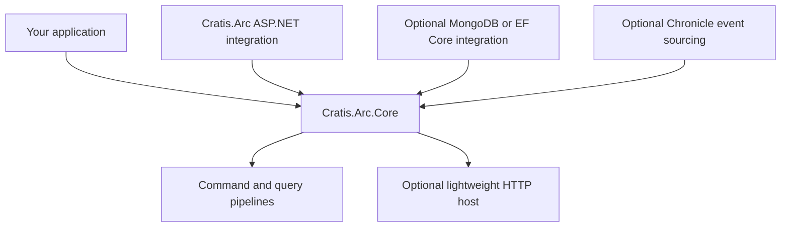

Cratis Arc's `Cratis.Arc.Core` package lets a worker or console application run commands and queries without an ASP.NET Core dependency. Its optional `HttpListener` host exposes those operations over HTTP and can serve public static assets. Choose `Cratis.Arc` instead when you need ASP.NET Core hosting and middleware. Neither package requires event sourcing.

## What Core provides

Core supplies the command and query pipelines, including model binding, validation, authorization, and result handling. Convention-based discovery and dependency injection connect your application types to those pipelines. Correlation IDs let you follow an operation, while identity and tenant context make the caller and tenant available to application code. Configure authorization and tenant membership for your application's access rules.

The HTTP host adds manual endpoints, [static files and single-page application fallback](static-files.md), and [basic OpenAPI route metadata](openapi.md). A fallback serves the frontend's entry file when an unmatched browser URL needs to reach its client-side router.



You can add persistence without adding Chronicle. Check each integration's dependencies when assembling your application; the absence of ASP.NET Core in the Core package does not apply automatically to every package you combine with it.

## Comparison with ASP.NET Core

| Capability | Arc.Core lightweight host | Arc with ASP.NET Core |
| --- | --- | --- |
| Package | `Cratis.Arc.Core` | `Cratis.Arc` |
| HTTP server | `HttpListener` | ASP.NET hosting, commonly Kestrel |
| Request handling | Arc's simplified route/static/fallback handling | ASP.NET middleware ecosystem |
| Manual routing | Literal-path GET/POST helpers | ASP.NET routing APIs |
| Static files | Built-in support and SPA fallback | ASP.NET static-file middleware |
| MVC/Razor | Not included | Available through ASP.NET |
| OpenAPI | Basic route metadata in Core | Optional `Cratis.Arc.OpenApi` or `Cratis.Arc.Swagger` |
| Pipelines, validation, identity, tenant context | Available | Available |

The Core host checks registered routes, then static files, then the fallback. Changing the order of those configuration calls does not create an ASP.NET-style middleware pipeline. Named endpoint groups are not supported because this host cannot restrict a route to a particular local port.

Here, lightweight describes the hosting dependency boundary. It does not guarantee native AOT compatibility or a particular startup time, memory use, deployment size, or throughput. Check your publish configuration and measure the workload with the discovery, serialization, and integrations you use.

## When to choose each host

Choose Core when you want to expose a small service or give a worker management endpoints without taking on ASP.NET Core. It also lets you learn the command and query pipelines in a console project.

Choose the [ASP.NET Core integration](../asp-net-core/index.md) when your application needs controllers, Razor, advanced routing, standard authentication middleware, or other ASP.NET libraries. Core does not supply a gRPC server or other protocol hosts.

## Architecture

The builder registers services. `UseCratisArc()` maps Arc endpoints and schedules the HTTP listener to start when the application starts. This bootstrap fragment belongs in a console project's `Program.cs` with `using Cratis.Arc;`:

```csharp
var builder = ArcApplication.CreateBuilder(args);
builder.AddCratisArc();
var app = builder.Build();
app.UseCratisArc();
await app.RunAsync();
```

The default listener binds `http://+:5001/`. Start with the [getting-started checkpoint](getting-started.md), which sets an explicit loopback URL and supplies a complete command and query. Review [discovery access defaults](../introspection/index.md) before exposing the host.

## Next steps

- [Getting started](getting-started.md) — run a complete command/query example.
- [Authentication](authentication.md) and [authorization](authorization.md) — establish and enforce trust.
- [Configuration](../configuration/index.md) — all runtime options and host differences.
- [Invariant culture](invariant-culture.md) — culture-sensitive behavior.
- [Chronicle integration](../chronicle/index.md) — optional event sourcing, not a prerequisite.
