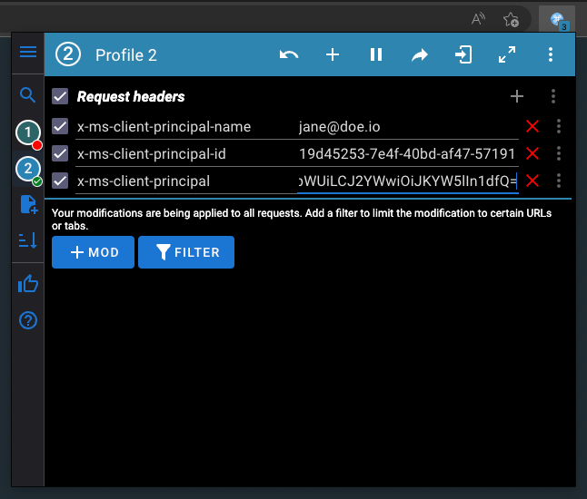

Cratis Arc's [Microsoft identity header adapter](../asp-net-core/microsoft-identity.md) lets you simulate users and roles on an isolated, loopback-bound development host. Use it to check authorization before connecting production login: the adapter constructs a principal from headers rather than validating a bearer token.

## Understand the trust boundary first

The local `x-ms-client-principal` fixture is Base64-encoded JSON, an unsigned assertion rather than a signed bearer token. The adapter decodes it into claims without validating a signature, issuer, or audience. Anyone who can send these headers can choose the identity they assert.

Before sending headers, follow the [authorization tutorial](/arc/tutorial/authorization/) to register the ASP.NET adapter and place its authentication middleware only in `Development`. That setup also opts in with `Cratis:Arc:TrustForwardedIdentityHeaders`; without the opt-in, Arc ignores the unsigned headers. Bind the host to loopback as the tutorial shows. A localhost browser URL alone does not prevent other machines from reaching a server bound to all interfaces. The [lightweight host authentication](../core/authentication.md) uses different APIs; keep its setup separate from this ASP.NET procedure.

Use manually supplied headers only on that isolated development host. In production, configure a token/cookie authentication scheme or accept these assertions only from a trusted authenticated ingress, the service through which requests reach your backend. That ingress must strip and replace all incoming identity headers, and the backend must not be reachable through a bypass route. A browser or arbitrary proxy sending the headers does not establish trust.

## Construct the assertion

The adapter expects all three headers:

| Header                       | Content                                                                                                                                                        |
| ---------------------------- | -------------------------------------------------------------------------------------------------------------------------------------------------------------- |
| `x-ms-client-principal`      | Base64 JSON following the [client principal shape](https://learn.microsoft.com/en-us/azure/static-web-apps/user-information?tabs=csharp#client-principal-data) |
| `x-ms-client-principal-id`   | The selected user's stable identifier                                                                                                                          |
| `x-ms-client-principal-name` | The selected user's display name or email                                                                                                                      |

Save this synthetic fixture as `principal.json` in your local application workspace:

```json
{
    "identityProvider": "aad",
    "userId": "e7f664ca-4ecc-45be-84cf-74b6240d049a",
    "userDetails": "jane.doe@contoso.com",
    "userRoles": ["anonymous", "authenticated", "Librarian"],
    "claims": [
        {
            "typ": "preferred_username",
            "val": "jane.doe@contoso.com"
        },
        {
            "typ": "name",
            "val": "Jane Doe"
        },
        {
            "typ": "given_name",
            "val": "Jane"
        },
        {
            "typ": "family_name",
            "val": "Doe"
        },
        {
            "typ": "oid",
            "val": "e7f664ca-4ecc-45be-84cf-74b6240d049a"
        }
    ]
}
```

The adapter maps `userRoles` to role claims, so `Librarian` lets this fixture pass the tutorial's role check. Remove it to exercise an authenticated user who lacks permission. Changing a role field returned by `IProvideIdentityDetails` would not grant or remove a role claim.

Encode locally, keeping the result on one line:

```bash
python3 -c 'import base64,pathlib; print(base64.b64encode(pathlib.Path("principal.json").read_bytes()).decode())'
```

A local editor's Base64 action is another option. Do not submit real identity payloads to an online encoder. Base64 provides neither confidentiality nor authenticity.

## Configure ModHeader narrowly

In [ModHeader](https://modheader.com), create a development-only profile and **add an include URL filter before enabling it**. For the tutorial Vite server, use `^http://localhost:5173/.*$`. Add a separate `^http://localhost:5000/.*$` only when testing that backend directly. If you use a different local port, update the filter; never select all requests.

Set:

- `x-ms-client-principal-id`: `e7f664ca-4ecc-45be-84cf-74b6240d049a`
- `x-ms-client-principal-name`: `jane.doe@contoso.com`
- `x-ms-client-principal`: the one-line Base64 output above

> [!WARNING]
> The older screenshot below illustrates the header fields only. Its **“All requests”** setting is unsafe and must not be copied. Apply the localhost include filter above, and disable the profile when finished.



Use separate filtered profiles for different synthetic users. When you change `principal.json`, encode it again and replace the profile's `x-ms-client-principal` value. Confirm in browser developer tools that headers are sent only to your intended localhost application.

## Verify the distinct behaviors

With the tutorial's Development-only adapter and role-protected operations in place, check each case separately:

- No headers: protected operations reject an unauthenticated caller.
- Valid fixture without `Librarian`: authentication succeeds but role-protected operations reject access.
- Fixture with `Librarian`: role-protected operations can execute, subject to their other checks.
- Identity-details provider returning `IsUserAuthorized: false`: `/.cratis/me` rejects that identity result. This does not replace operation authorization.

If the valid fixture still leaves the caller unauthenticated, check that the host runs in `Development`, has opted in to trusting the unsigned headers, and receives all three headers. The tutorial shows where to register the adapter and place the middleware.

These checks exercise the adapter and your authorization configuration, not production token verification. Before deploying, test the authentication scheme you will use and, if you accept forwarded identity headers, verify ingress header replacement and blocked direct backend access. Continue with [identity and access](/arc/understanding-identity-and-access/) to distinguish role claims from identity details, operation permissions, and tenant membership.
