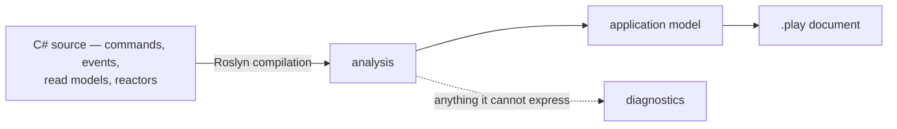

An [event model](/event-modeling/) is the picture of your system: which commands change state, which events they produce, which read models those events build, and which reactors turn one thing into another. Teams draw it on a whiteboard at the start, and then the code moves on without it. Six months later the picture is fiction and nobody trusts it enough to open.

**Screenplay** is a small language for writing that picture down as text — a `.play` file — so it can live in the repository next to the code it describes. Arc can _generate_ one from your application's source. The model stops being something you maintain by hand and becomes something you regenerate, the same way the [TypeScript proxies](/arc/understanding-the-proxy-boundary/) are regenerated rather than hand-written.

## Generated from source, not from a running system

The generator reads a Roslyn compilation of your C# — the same thing the compiler sees. It never starts your application, connects to Chronicle, or looks at a deployed instance.

That choice is what makes the output useful:

- **It works from a checkout, not a live store.** You still need the CLI, a compatible .NET/MSBuild environment, restored project dependencies, and the build inputs required to obtain a meaningful compilation. No running database or Chronicle connection is needed.
- **It is diffable in a pull request.** A commit that adds a command shows up as a few lines added to the `.play`. Reviewers see the model change next to the code change, and "did this alter the event model?" becomes a question the diff answers.
- **It is reproducible.** The same source always produces byte-identical output. Everything is ordered explicitly rather than by whatever order symbols happened to arrive in, so regenerating in CI and failing on a diff is a viable check.

A runtime-derived model would answer a different question — what one deployed instance looks like right now — and would vary with configuration and environment. There is one model, and its source of truth is your source code.



## Running it

The generator is used through the Cratis CLI, which ships separately from Arc:

```shell
cratis screenplay generate ./MyApp/MyApp.csproj --file MyApp.play
```

Point it at a project or a solution. A solution is one application rather than several, so its projects are read together into a single document — see [an application written as several projects](#an-application-written-as-several-projects). Anything the generator could not express is reported on the way out, and a run that reports an error exits non-zero — so a document nothing trustworthy went into never quietly looks fine. What the CLI has to do before it hands the source over is covered in [what the generator expects of its host](#what-the-generator-expects-of-its-host).

Because output is reproducible, a CI step can regenerate and fail when the committed `.play` no longer matches the source.

## Nothing is dropped silently

The gap between "what C# can say" and "what Screenplay can say" is real, and the worst thing a generator can do is paper over it. Every construct that cannot be expressed is reported as a located diagnostic — a stable code, a message you can act on, and where it came from — rather than quietly disappearing.

```text
Warning SP0019: The query 'Raw' returns 'IActionResult', which says how the result is
transported rather than what it is, so the query was left out (Library.Messaging.Feed)
```

Diagnostics come in three severities. **Information** describes a limitation without failing generation. **Warning** means something was left out or standalone generation found an unexpected semantic binding error (`SP0056`). Embedded generation reports `SP0056` as Information so a generator limitation cannot break your application's build. **Error** means the document should not be trusted at all — either because the generator produced something the language rejects, or because nothing at all was recovered from source the compiler accepted.

## What the generator expects of its host

The compatibility generator accepts either a Roslyn `Compilation` or a Generation `DotNetProjectCompilation`. It never opens a project file or loads a workspace, which is what lets it be driven from a CLI, from a specification, or from an editor. `DotNetProjectCompilation` adds the host-owned project role, authored syntax trees, and stable source-path context needed by neutral source adapters; the established compilation-only overloads remain available and produce the same `.play` bytes. The other side of that bargain is that **assembling the compilation the way a real build would is the caller's job** — the generator reads what it is handed and cannot tell a missing type from a type that was never written.

Distinguish **workspace source generators** from **MSBuild-generated inputs**. `GetCompilationAsync` belongs to Roslyn `Project`, not `MSBuildWorkspace`. A workspace project compilation can already contain source-generator output; do not run the same generators over it again unconditionally. Arc's CLI uses `project.GetCompilationAsync(cancellationToken)` and separately restores missing resource sources/framework references where needed. MSBuild/custom-tool output such as resource designer files is not interchangeable with Roslyn generator output. Arc's TypeScript proxy generator is a post-build executable, not a C# source generator.

For an already loaded workspace `Project`, the host fragment is:

```csharp
using Microsoft.CodeAnalysis;

static Task<Compilation?> GetCompilation(Project project, CancellationToken cancellationToken) =>
    project.GetCompilationAsync(cancellationToken);
```

Handle a null compilation and inspect diagnostics before passing it to Screenplay. Loading the workspace, restoring packages, and supplying missing build-generated files remain host responsibilities.

If you intentionally construct a **raw C# compilation outside the workspace compilation path**, run the selected generators once. This alternative fragment assumes `project` supplies the matching analyzer references and parse options, and `compilation` has not already received those generated trees:

```csharp
using Microsoft.CodeAnalysis;
using Microsoft.CodeAnalysis.CSharp;

static Compilation RunGenerators(Project project, Compilation compilation)
{
    var driver = CSharpGeneratorDriver.Create(
        generators: project.AnalyzerReferences
            .SelectMany(reference => reference.GetGenerators(LanguageNames.CSharp)),
        parseOptions: (CSharpParseOptions)project.ParseOptions!);

    driver.RunGeneratorsAndUpdateCompilation(compilation, out var generated, out var diagnostics);
    foreach (var diagnostic in diagnostics)
    {
        Console.Error.WriteLine(diagnostic);
    }

    return generated;
}
```

`AnalyzerReference.GetGenerators` already returns `ISourceGenerator` values. `AsSourceGenerator` converts an `IIncrementalGenerator`; applying it to those values does not compile. Real custom hosts must also supply any generator-required additional texts and analyzer-config options, and decide how diagnostics affect their exit status. This fragment is not a complete replacement for the CLI loader.

### What happens when it does not

Nothing is hidden, and nothing correct is thrown away. A compilation carrying errors is still analyzed, and `SP0024` says what happened — how many errors there were, the first of them, and how many artifacts came through anyway:

```text
Warning SP0024: The source did not compile - 607 error(s), the first being 'The name
'AccountsMessages' does not exist in the current context'. 341 artifact(s) were recovered
anyway, 341 of them from a declaration no error sits inside, so the document describes those
exactly as the source states them - a missing type named like 'SomethingMessages' or a
designer class usually means the compilation was handed over without the compile items a
build generates (Accounts)
```

Its **severity is decided rather than fixed**, because "the source did not compile" covers two outcomes that could not be further apart:

- **Warning** when at least one artifact was recovered from a declaration no compilation error sits inside. Those artifacts are described exactly as their source states them whatever failed elsewhere, so the run is successful and the document is worth keeping. A compilation missing its generated symbols lands here — the errors sit in code that declares no artifact, and the model is unaffected.
- **Error** when none were, either because nothing was recovered at all or because every declaration something came out of is one the compiler could not make sense of. There is then no part of the document a reader could trust, and a host following the contract exits non-zero.

A count is used rather than a proportion deliberately: any threshold would make the same recovery pass for a large application and fail for a small one, and zero is the only number that means recovery was _prevented_ rather than merely dented.

Either way the document is written out, so what was recovered can be read.

### An application written as several projects

Nothing says an application is one project. A layered one puts its contracts in a project of their own; a host sitting beside the bounded contexts it serves is two projects at least — and no single one of them describes the application. Pointed at any one, the generator would describe half of it and refer to events it never introduced.

So `Generate` takes a list of compilations as well as a single one, and a host generating from a solution hands over one per project:

```csharp
var result = generator.Generate([contracts, application, host], options);
```

A host that also runs neutral adapters should retain the project metadata instead of reducing each project to its compilation:

```csharp
IReadOnlyList<DotNetProjectCompilation> projects = LoadProjects();
var result = generator.Generate(projects, options);
```

This project-aware compatibility overload intentionally delegates to the same established generator. The source context is carried for the neutral adapter path, not used to reinterpret legacy placement.

What comes back is one document rather than one per project, because the boundaries between projects are a build concern rather than something the model has:

- A namespace two projects declare into is **one slice**, whichever project each artifact sits in.
- A concept is **declared once**, however many projects refer to it.
- An event a sibling project declares is one the application **has**, so it is declared like anything else — not imported the way an event from a referenced package outside the application is.

Paths stay readable because they are written relative to the directory all the projects sit under rather than to each project's own root, so every path opens with the project it belongs to — `Library/Shipping/Dispatching/Dispatching.cs` beside `Library.Contracts/Ordering/Placing/Placing.cs`. Projects checked out in unrelated places share no such directory; each one's paths then fall back to its own root, and `SP0038` says so, because two files can then come out as the same path.

The order the projects arrive in never reaches the document. Nothing decides what order a host enumerates a solution in, so they are sorted by assembly name before anything is read and the same projects always print the same bytes. Where that order has to decide something it says so: two projects declaring the same artifact name into one slice keep the first and report `SP0037`.

## Inline events and destinations

An event used by exactly one production site can appear as `produces event <Name>` inside its command. The generator counts production sites across every analyzed project, including reactors and other application code but excluding specification fixtures and `nameof` references. Runtime-typed appends and projects outside the analyzed set are not counted. Values whose event type is only known at runtime are not counted. It only inlines a local generation-one event in the same slice when the command has a required scalar identifier, the production is unconditional, and every payload member has a supported mapping. Tombstones, compensations, unsupported shapes, and payload copies of the identifier stay standalone.

Both forms preserve descriptions, documentation, rename pins, and the persisted payload shape. Inlining changes where the declaration appears, not its executable meaning. Scoped embedded documents still import an inline event declared outside their scope, and the board keeps its schema and flow links.

A self-provided identity can return a required property through Chronicle's identity conversions or `new EventSourceId(property.ToString())`, including parentheses and null-forgiving syntax. String, UUID, signed `int`/`long`, and their framework concepts are supported; integral text can also use `CultureInfo.InvariantCulture`. The same forms preserve explicit production destinations. Nullable properties, computed values, helper calls, custom conversions, and custom text formats remain unproven rather than being guessed into a destination.

The generator retains `identifier` and explicit `for` destinations when every production uses proven command context or has an admitted explicit destination and effective route. A directly returned `(TEvent, TResponse)` tuple keeps command context when its response cannot be an event source identifier, including returns through `Task` or `ValueTask`. A returned Chronicle identity tuple can instead select a proven required input. An arbitrary `Guid` or string response is not treated as an identity; `object`, interfaces and unknown union branches cannot prove the destination.

Returned `EventForEventSourceId` wrappers can supply per-production `for` and `stream` overrides, including arrays, literal lists and mixed plain-event/wrapper tuples or collections. Each occurrence keeps its own destination and route, even when the same event type appears several times. Plain siblings retain command defaults and state their own `for`. See [Event sources and streams](#event-sources-and-streams) for admission limits.

Unproven destinations, explicit appends and aggregates fetched for another identity keep the conservative standalone-event fallback. Information diagnostic `SP0051` reports the omitted destination once per command rather than redirecting it. An unproven override also withholds the command route with `SP0054` in both output modes: keeping it would claim routing the generator could not establish.

## Read models

Every read model the application declares gets a `readmodel` declaration of its own: each `[ReadModel]` type, and each type an `IProjectionFor<T>` or `IReducerFor<T>` builds. The declaration carries the properties of the type, its XML `<summary>` as `description`, and a `file` line when the file declaring it has a repository-relative path that stays true on another machine. Projections, reducers, and queries then name a read model the document declares, which is what lets them bind to the executable model.

```screenplay
query ById => Book optional
  by id Uuid

readmodel Book
  description "A book on the shelves and how many of it there are."
  file Library/Inventory/Listing/Book.cs
  id Uuid
  title String
  count Int

projection Book => Book
  automap
  from BookAddedToInventory
```

The declaration states the shape and nothing else. No property is marked `identifier`: the executable model identifies an instance through the read model's keyed query, so a read model with a `by` query answering with one instance is identifiable, and one without such a query is declared without claiming an identity it does not have.

A query's first required caller parameter becomes `by` only when its emitted name exactly matches an emitted read-model property name, including case. Other parameters become filters only when the query body proves a same-named scalar equality on a returned collection. A parameter with no matching property, such as `GetById(string id)` returning a model with only `Title`, is withheld with Information diagnostic `SP0019`, not guessed as a filter.

A document refers to a read model by its simple name, so each read model is declared exactly once. It goes in the first slice, in namespace order, that matches the earliest of these:

1. The slice declaring a keyed query onto it.
2. The slice declaring the projection or reducer that builds it.
3. The slice its type is written in.
4. The slice declaring any other query onto it.
5. The slice declaring a command that reads it.

Scoped embedded documents import a read model declared in another scope, the same way they import an event declared elsewhere.

A read model is left undeclared, with Information diagnostic `SP0057`, when no declaration could say what the application holds:

- two read models come out under the same declaration name (`Order_Summary` and `OrderSummary` both become `OrderSummary`), or a query or a command reads a different type under that name;
- the name is already used by a concept or a type;
- a value it holds, at any depth, is a collection whose elements may be null (`optional` on a collection says only that the collection may be absent), or a carried record or concept shares its declaration name with a different type the document already declares, with another type the read model holds, or with a read model;
- no slice refers to it.

Queries and projections referring to an omitted read model are withheld too, as are dependent screen data, tables and scenarios, with Information diagnostic `SP0030`. Authoring reads and their dependent requirements, mappings and operations are withheld with `SP0055` or `SP0053`. If these omissions empty a slice, Information diagnostic `SP0002` reports why the slice was left out. None of the concepts or types it holds are declared on its behalf.

### Properties without a Screenplay type

Dictionaries, constructed generic values such as `KeyValuePair<TKey, TValue>`, interfaces, abstract classes and other carried types without a Screenplay declaration are omitted with Warning `SP0030`, naming the property and its original type. This also applies to collections of those values and to properties inside carried records. Representable sibling properties remain. A carried record that loses every property cannot be declared; references to that emptied shape are omitted too. Abstract records with declarable properties remain supported.

ESM v28 has no map, JSON, object or open-shape property type. The generator does not substitute `String`, invent a placeholder, or write a bare type name that nothing declares. The resulting declarations are partial descriptions, not equivalent replacements for the original C# contracts.

Behavior requiring a complete affected schema is withheld with Information `SP0030`: declarative commands, projections and reactions are not restated over fewer fields, and dependent screen data, tables and actions are left out. Queries remain when their parameters are representable; a query with an unnameable parameter is withheld rather than broadened. A scenario using an affected schema or withheld behavior is omitted in full with `SP0039`; fixtures and assertions are never silently trimmed. Review these diagnostics before using the generated document as a behavioral model.

## Query descriptions and implementations

A query method's XML `<summary>` becomes its `description`. Collection query filters describe equality against the same-named read-model property, combining with `by` and other filters as AND. The generator recognizes direct `x.Property == parameter` and `parameter == x.Property` comparisons in returned LINQ `Where` and MongoDB `Find`/`Where` query chains, in the filter of Arc's observable `Observe` queries on a MongoDB collection or an Entity Framework Core `DbSet`, and in Entity Framework Core chains awaited through `ToListAsync`, `ToArrayAsync` or `AsAsyncEnumerable`, including conjunctions with `&&`. Property and parameter names must match without regard to case; the emitted filter uses the property's name and type, including its concept or enum.

For example, this read model uses a nullable parameter to skip name filtering when no name is supplied:

```csharp
using System.Collections.Generic;
using System.Linq;
using Cratis.Arc.Queries.ModelBound;

[ReadModel]
public record Book(string Id, string? Name)
{
    public static IEnumerable<Book> ByName(string id, IEnumerable<Book> books, string? name = null) =>
        books.Where(book => book.Id == id && (name is null || book.Name == name));
}
```

Its generated query is:

```screenplay
query ByName => Book[]
  by id String
  filter name String optional
```

Only a nullable parameter whose comparison is skipped by `parameter is null || equality` becomes `optional`. Reversed operands and `== null` checks are recognized too. A nullable equality without that skip remains required: ESM v14 refuses supplied null filter values. A default alone does not prove optional filtering. Non-null defaults have no equivalent omission semantics and are withheld with `SP0019`.

The generator leaves unproven parameters out with `SP0019`: different property names, `!=`, `<`/`>`, `Contains`, method calls or computed comparison operands, repeated parameter comparisons, and `||` other than the nullable null-skip form. Predicates unrelated to the returned query, conditional query bodies, and filters on single-result queries are not recovered. Paging, sorting and injected services keep their existing handling.

Equality filters bind as ESM v14; filter-free documents keep their previous executable version. Set `ScreenplayOptions.MaximumExecutableModelVersion` to `SemanticVersion.V13` or earlier to withhold filters with a located `SP0019` naming the required version and cap. This applies in authoring mode too. As with other caps, the resulting document describes less behavior; withholding filters is not an equivalent implementation of the original query.

Nullable scalar returns remain optional through `Task<T>` and `ValueTask<T>` wrappers. For collection returns, `optional` describes the collection, not its elements; nullable elements are reported as `SP0019` rather than described as an optional collection.

Set `ScreenplayOptions.AuthoringOnlyConstructs` to include a `performer` with the repository-relative file containing a query's block or expression body. A declaration without a body gets no performer. Performer-backed queries are not executable in the pinned language, so default output retains the query without its performer and reports Information diagnostic `SP0019`. A body with no portable source path is also reported rather than given a machine-specific file reference.

The generator does not infer `from $context.*` from a parameter's name or from reads inside the query body. Arc's model-bound parameter binder supplies caller arguments, dependencies, and cancellation tokens; it does not declare a scalar parameter-to-Screenplay-context binding. Arc's `QueryContext` is a host dependency with a different shape from Screenplay's context. It remains excluded from caller parameters, and `SP0041` explains why no context source was inferred. Paging and sorting remain serving concerns, not context-bound scalar filters.

## Policy claim targets

Readable `RequireAssertion` registrations can describe claims compared with command input properties instead of literal values. The supported shape guards `AuthorizationHandlerContext.Resource` as a `CommandContext` holding the command type, then calls the real `ClaimsPrincipal.HasClaim` with a constant claim type and a required string property. Positional record properties and nested positional record members become artifact paths; `&&`, `||`, and parentheses keep their meaning. The resource guard is removed only when every application use of that policy authorizes the guarded command type. An identifier comparison becomes `matches subject` for a command with an empty void `Handle()`; other proven comparisons keep their property paths rather than assuming the generated command retains an identifier.

A keyed snapshot query can also yield `matches subject`. Its assertion must guard the `QueryContext` argument dictionary, read the key with `TryGetValue`, check that the retrieved value is a string, and compare that value with `HasClaim`. Every use must have that same sole caller-supplied string key, matching a returned read-model property. A dictionary indexer, unchecked cast, another query shape, or an additional unreadable guard is not treated as equivalent.

Computed getters, transformations, nullable claim targets, conditional assertion registration, and arbitrary policy bodies retain `SP0026` rather than producing a partial recovered assertion. Existing literal-claim, role, and authenticated requirements remain supported. When nothing is recovered, the existing `require authenticated` fallback remains explicitly diagnosed; it is not a claim that the original policy allowed access. Negated assertions also retain this fallback; the generator does not emit Screenplay's `not` policy conditions.

## Generated values and responses

A `[GeneratedValue]` Handle parameter becomes a `generated` property when its concept's `IGeneratable<T>.New()` or `IGeneratableInContext<T>.New(context)` proves a supported generation strategy. The property name is the attribute's explicit name, or the C# parameter name. A directly returned event-source identity, alone or beside an event in a tuple, becomes `generated identifier` and `returns <name>`. A direct `EventForEventSourceId(parameter, event)` target becomes `generated identifier` without inventing a response. Aggregate-backed handlers do not infer a generated destination.

A generated value must be a required scalar concept backed by `Uuid`, `String`, signed `long` or `int`, with a recovered strategy, completely recovered default validation, and no compliance markers. Integral concepts support only random generation, not generated identifiers. An empty concept validator does not block generation. UUID-backed concepts retain implicit UUID v4 generation; non-default rule-free strategies require ESM v15, and admitted String-backed strategies with concept rules require ESM v20. Generated identifiers also require at least 64 random bits. The parameter must not be reassigned or passed by reference, and its emitted name must not collide with another command property. Successful scenarios can now pin these parameters; a missing or unreadable pin withholds that scenario with `SP0039`, not the command's generation contract. Existing `Guid.NewGuid()` and proven `New()` local and response heuristics remain supported, but their successful scenarios still cause the legacy fallback with `SP0052`: values created inside `Handle()` have no pinning seam.

Response-record fields must be compiler-synthesized positional properties, not explicit properties that transform their inputs. Scalar responses use `returns <property>` only for a direct value of the same declared type without a value-changing conversion; fully readable response records use a `returns` block whose fields refer directly to command inputs or admitted generated values. Scenarios asserting a response must state it as `then returns` (see [the scenarios a slice is specified by](#the-scenarios-a-slice-is-specified-by)). An unrecovered response assertion beside events preserves the command's legacy form with `SP0052`. Generated values and responses select at least ESM v7; a non-default concept generation declaration selects ESM v15. Documents without those declarations retain their existing ESM version.

Generated values do not exist during authorization or validation. Property rules and requirements cannot reference them (`PLAY0273`); when recovered protection reads a generated value, the command falls back to its legacy representation without `generated` or `returns`, and `SP0052` explains that the protection remains in code. The generator's recovered authorization policies describe the caller, not generated command properties.

Unadmitted generated shapes and dependent responses are omitted with `SP0052`. A required event payload mapping that needs an unavailable generated value or read causes the entire production to be withheld with Information diagnostic `SP0012`; an incomplete event payload is never emitted by pruning. Successful scenarios of that command are withheld with `SP0039`. If no event production remains, its route is withheld with `SP0054` and the command keeps its handler pointer. For an optional payload member, only the blocked mapping is omitted with Warning diagnostic `SP0012`; independent mappings and the production are retained. A production whose condition depends on an unadmitted value is omitted with an explicit diagnostic; when no production remains, the command keeps a handler reference. An unproven tuple destination reports `SP0013`.

A generated identifier supplies an inline event's destination. Standalone productions using that identity carry explicit `for <identifier>`; a plain production without `for` still needs its separate allocation channel. Empty and provably response-only commands need no handler. Commands whose behavior lives in code keep a `handler` file reference by default, as before, rather than disappearing from the embedded board or being described as recording no facts. A command never carries both `produces` and `handler`.

The generator preserves the legacy authoring document and adds generated values and responses only where they are admitted. Documents containing handler references still compile and round-trip, but have **no executable model** because handlers report `PLAY0268`.

## Recovering generation strategies

In the shop from [Generated values](commands/generated-values.md), `OrderId` (`GenerateValue.TypeId("order", context)`) and `ApiKey` (`GenerateValue.Bytes(32, ValueEncoding.Base64Url)`) match the forms in the table below and recover as `generate typeid "order"` and `generate bytes 32 base64url`. `CustomerId` calls `GenerateValue.Ulid()` inside string interpolation, which reads the ambient clock. That custom body stays in code; a context-dependent factory must pass its captured context to the time-based call. Even a recovered opaque body cannot supply a generated identifier because its entropy is unknown. `InviteCode` reads its alphabet from a field, so it stays in code and is reported with `SP0073`. The `[NotAudited]` marking is not part of the model. For how Screenplay and Stage treat these strategies, see [Generated values](/screenplay/generated-values/) and [Generated values rendering](https://github.com/Cratis/Stage/blob/main/Documentation/reference/generated-values-rendering.md).

Recovery reads the concept's generation contract, including explicit interface implementations. A recognized body is one expression, or a block containing only its return: `new(<call>)`, `new Concept(<call>)`, or `<call>` through a proven implicit conversion. Constructors and conversions must forward the primitive unchanged to the concept base. Built-in strategy arguments must be literals, encoding or checksum enum members, or a passed-through `GenerationContext` parameter. Self-contained String bodies using `context.Now` and `context.Tenant` can instead recover as inline rules, as described below.

The concept owns the strategy. Its declaration gets the `generate` line; each command property says only `generated` or `generated identifier`.

| Factory call | Concept generation |
|---|---|
| `Guid.NewGuid()` or `GenerateValue.Uuid()` | Implicit UUID v4; no `generate` line. |
| `GenerateValue.UuidV7()` or `Guid.CreateVersion7()` | `generate uuidv7`. |
| `GenerateValue.Ulid()` | `generate ulid`, uppercase Crockford base32. |
| `GenerateValue.TypeId("user")` | `generate typeid "user"`; an empty prefix is supported. |
| `GenerateValue.NanoId()` | `generate nanoid`, size 21 with the default alphabet. |
| `GenerateValue.NanoId(64, "ab")` | `generate nanoid 64 alphabet "ab"`. |
| `GenerateValue.Bytes(32)` | `generate bytes 32 base64url`, without padding. |
| `GenerateValue.Bytes(16, ValueEncoding.Hex)` | `generate bytes 16 hex`, lowercase. |
| `GenerateValue.Bytes(16, ValueEncoding.Base32)` | `generate bytes 16 base32`, uppercase RFC 4648, without padding. |
| `RandomNumberGenerator.GetHexString(64, lowercase: true)` | `generate bytes 32 hex`; the character count must be even. |
| `RandomNumberGenerator.GetHexString(32)` or the overload with `lowercase: false` | `generate bytes 16 hex case upper`. |
| `GenerateValue.Pattern("[A-Z]{16}")` | `generate pattern "[A-Z]{16}"` (ESM v21). |
| `GenerateValue.Pattern("[0-9]{20}", checksum: Checksum.Luhn)` | `generate pattern "[0-9]{20}" checksum luhn`; also `Mod11` and `Mod97`. |
| `GenerateValue.Integer(-9, 9)` on `ConceptAs<long>` | `generate random -9..9`, inclusive (ESM v21). |
| `(int)GenerateValue.Integer(-9, 9)` on `ConceptAs<int>` | The same random range; exactly one cast and both bounds within Int32 are required. |

`GenerateValue.UuidV7(context)`, `Ulid(context)` and `TypeId("user", context)` map to the same strategies when `context` is the factory's `GenerationContext` parameter. NanoID sizes must be 1–256 and alphabets 2–256 distinct printable ASCII characters. Byte counts must be 1–512. TypeID prefixes must be empty or 1–63 lowercase letters and underscores, starting and ending with a letter. Invalid literal arguments are withheld with `SP0073`, not emitted as invalid Screenplay.

`SP0073` (`GenerationNotRecoverable`) points to `[GeneratedValue]` and names the parameter, concept and unrecovered body or arguments. The parameter stays server-owned: the generator never substitutes a caller parameter, an implicit UUID strategy, a null or a default value. Each generated parameter is read independently, so an opaque factory does not prevent recovery of another parameter's supported strategy.

Dependencies on an unrecovered parameter are tracked through local aliases, member access and returned constructions in both default and authoring output, including version-capped documents. A required payload dependency withholds the whole production (`SP0012`, Information); an optional dependency withholds only its mapping (`SP0012`, Warning). An unavailable condition withholds the guarded production (`SP0052`), rather than making it unconditional. Dependent scalar responses and whole response-record blocks are withheld with `SP0052`, operations with `SP0053`, and explicitly generated destinations with `SP0013`, without redirecting them to command context. Independent behavior remains stated. If no event production survives, its route is withheld with `SP0054` and the command retains `handler file <source>` instead of claiming no-fact behavior.

This is a partial authoring model, not a lossless executable replacement for the original handler. The handler file reference compiles and round-trips but still receives the exact existing `PLAY0268` refusal that a handler requires a constrained implementation attachment. Missing required event mappings (`PLAY0273`) and unexpected binding failures (`SP0056`) are not accepted as limitations of opaque generation.

Date-bearing patterns require the `GenerateValue.Pattern(pattern, context, checksum)` overload; the context-free overload cannot supply their time. Escaped literal braces and character-class contents do not count as date references. Pattern validity, checksum compatibility, rule consistency and identifier entropy are decided by Screenplay's binder, not by sampling or by a second pattern evaluator in Arc. Invalid contracts are withheld with `SP0073`. Signed random ranges retain exact Int64 bounds; unsigned backings, out-of-range Int32 casts and multiple casts are refused. Compliance-marked generation remains in code. Concept rules can accompany a supported strategy when their complete default validation contract is recoverable; see [Validated generation](#validated-generation-and-esm-v20).

### Inline generation rules and the Cratis C# context

A self-contained String factory becomes `generate rule <Concept>New` with a `csharp` fence. Arc copies the body and removes only constructors or conversions proven to forward the primitive unchanged. For example, a factory returning `new($"{context.Tenant}:{GenerateValue.Ulid(context)}")` yields a rule body containing `return $"{context.Tenant}:{GenerateValue.Ulid(context)}";`.

The accepted dependencies are literals, primitive locals, `context.Now`, `context.Tenant`, and the allowlisted types `string`, `Math`, `Convert`, `Guid`, `RandomNumberGenerator` and `GenerateValue`. Instance formatting of the captured time and tenant is supported. Compound bodies must pass their factory context to time-based `GenerateValue.Ulid`, `UuidV7` and `TypeId` calls; the context-free overloads read an ambient clock. Fields, private helpers, DI, other types, aliases, static imports, ambient clock reads, a raw `"Default"` tenant comparison and non-self-contained bodies remain in code with `SP0073`. No generation-rule `file` fallback is invented. Opaque rule entropy is unknown, so rules never supply generated identifiers.

The version-1 ValueGeneration context is a language-neutral descriptor. **The Cratis C# target binds it to Fundamentals' `Cratis.Concepts.GenerationContext`**, not to `Cratis.Screenplay.Contexts.GenerationContext`. Passing `context` to `GenerateValue.*` is therefore valid in these recovered bodies and makes them target-bound. A `csharp` fence alone does not select that binding; another provider must admit the body against its own native context. Recovery preserves the body, but does not execute it or promise that another target can compile it. See [Screenplay's context binding](/screenplay/context/).

Pin a concrete UUID, text or integral value with [Pin generated values in command specs](testing/generated-values.md). A pin for the issued command's generated identifier becomes indented `for "<value>"` beneath `when`; other pins become `generated <name> = "<value>"`. UUIDs are normalized to lowercase `D` format; text is preserved exactly and must match the strategy's encoding, length, case and unused trailing bits. Direct concept constructions and one-hop stable held fields are readable. Given and then occurrences on the pinned identifier stay implicit. Generic pins are accepted only when their command type is the issued command. Nested-command pins, `New()` pins, `AllowGeneration()`, conditional or repeated pins, mismatched shapes and missing successful-scenario fixtures withhold only the scenario with a located `SP0039` explaining the fix. Models below v15 retain legacy fixture reuse. In an ESM v15 model, Screenplay rejects an append to a generated identifier whose whole event source already has facts.

## Validated generation and ESM v20

A readable String-backed factory and its `ConceptValidator<T>` can now be recovered together. The generator retains the concept's rules, including when scenarios exercise it, and uses Screenplay's rule-consistency checks rather than sampling generated values. For example, `GenerateValue.NanoId()` with a matching validator produces:

```screenplay
concept InviteCode : String
  generate nanoid
  validate
    matches "^[A-Za-z0-9_-]{21}$"
```

Proven rules admit generation silently. Non-opaque Unproven rules remain stated: Information diagnostic `SP0078` carries `PLAY0689` and its reason, not a claim of proof. A Refuted rule withholds generation and dependent claims; `SP0073` carries `PLAY0688` and the witness. The validation contract remains intact. Conditional registrations, unreadable inherited validation and opaque predicates also withhold generation rather than treating partially recovered rules as the whole validator. Deliberately excluded non-default rule sets are not part of default validation.

UUID concepts have no admissible non-opaque rule in Screenplay 4.164's declarative algebra. A UUID validator such as Guid `NotEmpty` therefore does not produce executable generation. Its original rules remain in the analyzed model and its validator is retained through an opaque source-file attachment, not restated as an invalid text rule. Dependent productions and pins follow the same fail-closed pruning as an unrecoverable factory. An empty UUID validator still permits the previous ESM v7 generation contract.

A valid literal pin must satisfy both the generated shape and the concept's rules. An incompatible successful scenario is omitted with located `SP0039`; its rule is never deleted or its pin rewritten to make the scenario pass. Screenplay classifies invalid generated fixtures as `Rejected(Contract)`, a server defect rather than client validation. Reference execution cannot evaluate opaque validation; those scenarios are withheld while the validator is preserved.

### Keep validated generation below ESM v20

Set `ScreenplayOptions.MaximumExecutableModelVersion` to `SemanticVersion.V19` or earlier when a consumer does not admit V20. The generator keeps the validation contract but withholds the strategy, generated values and dependent mappings, responses, destinations and scenarios, with diagnostics naming ESM v20 and the cap. This applies in both generation modes. Raising the cap to `SemanticVersion.V20`, or leaving it unset, permits admitted validated strategies; it does not make opaque or refuted rules executable.

Rule-free output retains its prior version and bytes. A serialized generation strategy retains Screenplay's Guarded freshness semantics; validator presence alone does not add a freshness guarantee.

## Pattern, random, rule and checksum recovery in ESM v21

An unconditional String concept rule `RuleFor(value => value.Value).Must(v => GenerateValue.HasValidChecksum(v, Checksum.Luhn))` becomes `validate checksum luhn`. `Mod11` and `Mod97` map likewise; `None`, conditional predicates and arbitrary helper predicates are not declared as checksum rules. Screenplay checks the complete generation-and-validation contract, including pattern checksums, without redrawing invalid generated values.

Pattern, random and inline rule generation, and checksum validation, select ESM v21. Set `ScreenplayOptions.MaximumExecutableModelVersion` to `SemanticVersion.V20` or earlier for a consumer that has not admitted v21. In both default and authoring output, Arc withholds generation and its dependent values, mappings, responses, destinations and scenarios. It preserves other declarative rules and retains the original checksum validator as a source attachment, reporting `SP0073` with the required version and cap; it never silently drops a checksum to downgrade generation. A V21 cap or no cap admits supported contracts. Existing v15/v20 contracts retain their previous version and output.

Concrete pattern and random fixtures are checked by Screenplay's reference runner, including checksum-conditioned support and signed integral bounds. An invalid fixture withholds its scenario with `SP0039`, not its valid generation strategy. A rule body's fixture supplies its result without executing the opaque C# body.

## Keeping documents below ESM v15

If your renderer does not admit ESM v15, set `ScreenplayOptions.MaximumExecutableModelVersion` to `Cratis.Screenplay.Semantics.SemanticVersion.V14` or earlier. Non-default `generate` lines are withheld with located Information diagnostic `SP0073`, naming the required version and cap. Their generated command values and dependent responses or mappings remain in code with `SP0052`; pins against withheld values omit the scenario with `SP0039`. This applies in authoring mode too. Plain UUID v4 generation writes no strategy line and keeps its previous document bytes.

Embedded generation uses the same cap on `EmbeddedDocumentOptions`; MSBuild projects set `CratisEmbeddedScreenplayMaximumExecutableModelVersion` to `14.0`. A cap describes less behavior, not an equivalent implementation of the original strategy.

## Enumerations

An enum member's number is its stored identity. Reordering bare members in a model can change those numbers when code is rendered again. The generator therefore pins every recovered C# number, including implicit continuation and positional `0..n-1` values. This applies to direct enums and enum-backed `ConceptAs<T>` concepts, in both default and authoring output.

For example, this C# declaration:

```csharp
public enum Status
{
    Draft = 1,
    Issued = 4
}
```

becomes this document-level declaration:

```screenplay
concept Status : Enum
  draft = 1
  issued = 4
```

Names still identify members in mappings, validation rules and scenarios: `status = "issued"`, not `status = 4`. Sparse, negative and reordered numbers select ESM v12. Explicit positional pins keep the previous executable version and canonical bytes, even below v12. Never renumber a published member or reuse its number for another member: persisted data still carries the old identity.

Screenplay admits only unique int32 numbers. For aliases, the generator keeps the ordinal-first C# member name for each number, matching scenario constant resolution, and drops the other names with warning `SP0069`. A number outside int32 cannot be pinned; the whole enum falls back to bare, positional members with warning `SP0068`. Members whose names collide after conversion keep only the first name with `SP0068`, without renumbering surviving members when their numbers can be emitted.

A `[Flags]` enum still declares one member at a time. Named combinations such as `All = 7` are ordinary members, not set semantics. Warning `SP0067` names the enum and its analyzed property uses when combinations exist that no member names. It is absent when every combination of positive members is named. The warning looks at properties of the types the document declares; an enum used only as a query or method parameter, and negative members such as `All = -1`, are not considered. Unnamed combinations in scenarios remain unsupported by [Screenplay's flags work](https://github.com/Cratis/Screenplay/issues/319).

## ESM v22 atomic reaction batches

When an emitted reaction trigger or refusal branch has two or more `produces` entries, the generator declares `reaction batches atomic` at the application root. Screenplay 4.181.0 admits this as ESM v22, with `reactionProductionMode: "atomic"` in the executable model. Each trigger's direct productions append all-or-none, including batches with uniqueness constraints and explicit `for` destinations. A single-production reaction does not add the declaration.

Invoked commands and selected refusal branches are separate batches. A later failure does not roll back previously accepted batches or commands; the declaration does not promise atomic observer updates or recovery from infrastructure failures.

For a consumer that has not admitted v22, set `ScreenplayOptions.MaximumExecutableModelVersion` to `Cratis.Screenplay.Semantics.SemanticVersion.V21`. Embedded generation uses the same cap on `EmbeddedDocumentOptions`; MSBuild projects set `CratisEmbeddedScreenplayMaximumExecutableModelVersion` to `21.0`. This keeps legacy output: no atomic declaration, and constrained batches that cannot match per-fact appends remain file-backed with `SP0070`. The cap applies in authoring mode too.

An early stream closure, unreadable constraint coverage, or a rejecting constraint not represented in the document still keeps a batch in code with `SP0070`, even at v22. This includes class-level `[Unique]`, which the generator does not emit, and fluent uniqueness rules it cannot recover faithfully. Closing reaction batches await [Screenplay's closure admission](https://github.com/Cratis/Screenplay/issues/770); atomic mode does not admit direct stream routes either.

## Keeping documents below ESM v12

If your renderer does not admit ESM v12, set `ScreenplayOptions.MaximumExecutableModelVersion` to `Cratis.Screenplay.Semantics.SemanticVersion.V11`. Embedded generation exposes the same cap on `EmbeddedDocumentOptions`; MSBuild projects set `CratisEmbeddedScreenplayMaximumExecutableModelVersion` to `11.0`. A cap below v12 keeps bare names for non-positional enums and reports `SP0068` (Warning), listing their numbers and explaining that positional output does not preserve stored identity. Positional enums still get explicit pins because those pins do not raise the executable version. The cap applies in authoring mode too; it does not make other authoring-only constructs executable.

## Keeping documents below ESM v7

If your renderer does not yet admit ESM v7, set `ScreenplayOptions.MaximumExecutableModelVersion` to `Cratis.Screenplay.Semantics.SemanticVersion.V6`. The default is `null` (no cap), admitting the latest supported constructs. A cap below v7 withholds generated identifiers, other generated values, and scalar or record `returns` blocks, including `[GeneratedValue]` recovery. Scenarios with generation pins are omitted with `SP0039` rather than emitting `for` or `generated` fixtures against a legacy command. Commands keep the same legacy productions or handler references used when generation cannot be represented, and Information diagnostic `SP0052` names the cap.

Embedded generation exposes the same nullable version on `EmbeddedDocumentOptions`. For MSBuild generation, set `CratisEmbeddedScreenplayMaximumExecutableModelVersion` to the canonical version `6.0`; leave it empty for no cap. For example, this lets you generate a document for `cratis render` versions that refuse ESM v7 with `CLI-RENDER-004` until their Stage renderer admits it. The separately shipped CLI must expose the generation option before it can be selected there.

The cap also withholds v7 command values and responses when `AuthoringOnlyConstructs` is enabled, without disabling its other authoring constructs. It does not turn handler references or authoring-only constructs into executable behavior, nor downgrade earlier ESM features: a document may still have an existing binding limitation.

## Event sources and streams

A route tells you where a command's facts land, not just which event type it produces. Default output includes readable `eventsource` and source-owned `stream` declarations, command routes, and specification routes. These constructs select ESM v8. A command routed this way no longer emits a legacy `concurrency` block. When it also opts into concurrency, Information diagnostic `SP0044` names the omitted concurrency dimensions: the route does not enforce them, and ESM v8 has no executable concurrency syntax. Concurrency-only commands keep that block, with `SP0044` describing its non-executable legacy meaning.

Command stream ids can come from a direct required scalar command property or a portable literal attribute. A template containing exactly one property placeholder and no surrounding text, such as `[EventStreamId("{Name}")]`, maps that direct required portable property. Explicitly typed composite parts in an application model are emitted together, in declaration order. Other C# formatting templates are not assumed to have Screenplay's escaped composite encoding: an unproven template remains in code with `SP0054`, rather than becoming a different stream id.

### Per-production destinations and routes

A returned `EventForEventSourceId` can override the command's destination and classification independently. For example, this command records an audit fact on its own source and a registration on a different source:

```csharp
using Cratis.Arc.Commands.ModelBound;
using Cratis.Chronicle.Events;
using Cratis.Chronicle.EventSequences;
using Cratis.Chronicle.Keys;

[EventType] public record AuthorAudited(string Name);
[EventType] public record AuthorRegistered(string Name);

[Command, EventSourceType("Account"), EventStreamType("Main")]
public record RegisterAuthor([Key] string Id, string OtherId, string Month, string Name)
{
    public object[] Handle() =>
    [
        new AuthorAudited(Name),
        new EventForEventSourceId(OtherId, new AuthorRegistered(Name))
        {
            EventSourceType = "Ledger",
            EventStreamType = "Postings",
            EventStreamId = Month
        }
    ];
}
```

Its generated command body includes these productions; the document also declares `Account.Main` and the scalar-keyed `Ledger.Postings` stream:

```screenplay
produces event AuthorAudited
  for id
  name String = name
produces event AuthorRegistered
  for otherId
  stream Ledger.Postings
    streamId = month
  name String = name
```

The destination must be a proven required scalar command property or admitted generated identifier. Types remain nominal: a UUID-backed identity concept is not silently converted to bare `Uuid` to satisfy another source's identifier. Key-only fan-out without an admitted stream or generated command identifier stays withheld because the pinned binder cannot admit it. A complete override can be recovered even when the command declares no default route. Constructor argument names are bound by parameter, not written order.

Legacy source, stream and key sentinels inherit the corresponding command values. Definition routing is coupled instead: `EventSource = typeof(TSource)` selects that definition and its own `EventStream`; a stream-only definition override uses the command's definition. Legacy source/stream type strings clear definition routing. Definition and constant-backed stored names retain their model names and `id` pins; unknown ownership or incompatible declarations are refused. The emitted override states the complete effective route, including an inherited stream id, rather than assuming that changing streams clears its key.

Stream keys admit direct required portable inputs and nonempty NFC literals. Proven scalar conversions preserve nominal types, including UUID `ToString()`/`ToString("D")` and integer-backed concepts formatted with `CultureInfo.InvariantCulture`; other formatters are not assumed equivalent. A single-placeholder **attribute** template can map an input, but wrapper text such as `EventStreamId = "{Month}"` is literal text, not an inferred template. Computed ids, multipart formatting, nested or optional inputs, generated stream keys, unreturned constructions, collection spreads and unsupported metadata such as subject, occurrence time, tags or causation stay in code. An unavailable generated dependency in a destination or route withholds the whole production, never retargets it; dependent successful scenarios are withheld too.

Property-backed stream-key recovery assumes nonempty, non-sentinel inputs. Arc can replace a default/unset wrapper key with the command's key at runtime; the generated scalar mapping always reads the property and does not express that value-dependent fallback. If an input can take the sentinel path, keep that routing case in source rather than treating the recovered mapping as an equivalent contract.

Overrides require ESM v10. A `MaximumExecutableModelVersion` cap of v7, v8 or v9 withholds overrides in **both** modes, with located `SP0054` naming v10 and the cap. `SP0051` preserves the unknown-destination fallback; command defaults are not substituted for an omitted override. Unchanged default-only routes still need only v8. A generated-identity wrapper that retains command context inherits that route without a production override; it keeps v7 without routing, or v8 with a default route. When an explicit destination needs a production stream identical to the default stream, Screenplay can report the redundant-route advisory `PLAY0664`; removing that stream would make non-identifier fan-out unbindable.

Recovery does not establish renderer support. In particular, Stage must refuse unkeyed overrides under keyed defaults until its Arc adapter prevents sentinel key inheritance. The generator describes Arc's actual effective key; it does not promise render-and-recover equivalence.

Property-path mappings and routes on handler commands remain authoring-only (`PLAY0268`). Generated-property mappings, incompatible source or stream declarations, and the reserved source name `Default` cannot be emitted faithfully (`PLAY0273`); `SP0054` identifies the reason and the complete route is withheld. No partial stream-id mapping or orphan source declaration is emitted.

Set `ScreenplayOptions.MaximumExecutableModelVersion` to `SemanticVersion.V7` or earlier to retain the previous default routing behavior: command routes and their declarations are withheld with `SP0044`, and routed scenarios are withheld whole with `SP0060`. Authoring mode still permits syntax-only routes regardless of this cap.

## Protected command reads and ESM v25

A command that decides from a read model should decide from a state that is still true when it commits. Arc gives you that with [read protection](chronicle/consistency/reads.md): with `ReadProtection(ReadProtectionMode.On)` a read-model parameter of `Handle()` or `Provide()` is a protected decision read, and Chronicle rejects the command when a relevant event arrives after the read. The generator states those reads in the document, so the decision and its guarantee travel with the model.

A document states them under one root line, `command reads protected`, which selects ESM v25 (Screenplay decision 0085). Under that line every `reads` claims protection, and the Screenplay compiler refuses a read it cannot protect instead of treating it as advisory. The generator emits the line only when at least one command keeps a protected read, in the default output and with `AuthoringOnlyConstructs`.

### What becomes a protected read

A read is a candidate when all of these hold:

- The effective read protection of the command is `On`: declared on the command, inherited, set on the assembly, or set by the `CratisReadProtection` MSBuild property. `[Unprotected]` on the command turns it off.
- Neither the parameter nor the read-model type carries `[Unprotected]`. `Off`, `Measure` and `[Unprotected]` reads are advisory and are never promoted. `Measure` only observes; it does not protect.
- The key is known. `[LookUpBy(nameof(Property))]` names the command property in every mode. Under `On` without it, the generator uses the one command property of the read model's key type, falls back to the command's event-source key, and treats several matching properties as ambiguous, which leaves the read in code. Name one with `LookUpBy`.
- The read model is not stream-scoped. A read model with `[EventStream<T>]` is read per stream, the runtime rejects a look-up by key for it, and Screenplay cannot state it until [Cratis/Screenplay#805](https://github.com/Cratis/Screenplay/issues/805). It stays in code with `SP0079`.
- Absence is rejected. A non-nullable parameter counts, since Arc rejects the command when the instance is missing. A nullable parameter counts only when `Handle()` opens with a guard such as `if (room is null) return ValidationResult.Error("...");`. A nullable parameter without that guard means absence is a valid state, and it is not stated as a protected read.

| In C# | In the `.play` document |
| --- | --- |
| `ReadProtection(On)` and a `RoomOccupancy` parameter keyed by `RoomId` | `command reads protected`, then `reads RoomOccupancy as occupancy by roomId` |
| a leading `if (room is null) return ValidationResult.Error(...)` | nothing: the model rejects an absent read itself, and the generator reports that its message is not carried as `SP0079` |
| `if (room.FreeBeds < Guests) return ValidationResult.Error("...")` as a leading guard, or in `Provide()` | `require occupancy.freeBeds >= guests` with the message |
| `new RoomBooked(Guests, room.FreeBeds)` | `freeBeds = occupancy.freeBeds` in `produces` |

Screenplay names a read by its alias, or by its view when it states none. The generator writes `as <alias>`, the parameter name, and paths through the alias. When the parameter is named as the view (`Current? current`), it drops the alias: the read is `reads Current by sourceId` and its paths are `Current.value`. The guards Stage renders around the same command, such as `if (current is null) return OneOf<...>.FromT1(ValidationResult.Error(...))` and `if (!(!Object.Equals(current.Value, ""))) return ...`, are read the same way: `OneOf` and `Result` wrappers are looked through, an absence guard may use any message because the model's own message applies, and `!`, `==`, `!=` and `Object.Equals` over a read become the requirement. A requirement guard keeps its message only when it is a constant. Otherwise the guard stays in code.

### When Screenplay refuses a read

Whether Screenplay admits a read is Screenplay's decision, so the generator asks the compiler instead of restating its rules. It emits the candidate reads with the preamble, binds the document, and maps every `PLAY0780` to `PLAY0785` diagnostic to the read it concerns. That read, and the requirements and mappings that depend on it, stay in code, and each is reported as Information `SP0079` with the PLAY code and its message. A refusal that cannot be attributed to a read, or a bad read path (`PLAY0784`, `PLAY0785`) with no other refusal behind it, is the generator being wrong rather than your source, and is reported as Error `SP0056`. The document is emitted again, and without the preamble when no read is left. A refusal of one read never affects another. For `PLAY0781` to `PLAY0785`, the compiler identifies the command and read through named, typed diagnostic arguments rather than message wording or source lines. Two refused reads in one command each receive their own report.

Typical reasons are a view that never becomes absent (no `RemovedWith`), a view with joins, children or a payload key, a view without a keyed query, a command that also declares concurrency or routes, and a key that is not a string, concept over a string, or GUID. A candidate whose key the compiler cannot accept (for example an optional property) is refused the same way. A read that is refused is never emitted as an unguarded `reads`.

### What stays authoring-only

`provide`, `derive` and file forms, optional and advisory reads, reducer reads, stream-scoped reads (`[EventStream<T>]`, `SP0079`), reaction reads, and validators over read-backed rules are not admitted by ESM v25. They stay in code. With the preamble present, advisory reads are left out of authoring documents as well, with `SP0055`, because every `reads` under the preamble claims protection.

### Keeping documents below ESM v25

With `MaximumExecutableModelVersion` below v25, protected reads are not stated as protected reads and the document is what it was before: executable output leaves the reads in code and authoring output keeps its legacy `reads`. Warning `SP0079` names ESM v25. Every other `SP0079` is Information.

### What the document states

The document states the declared protection. The runtime option `ReadProtection:MaximumMode` can lower `On` at run time, for example to `Measure` while you roll protection out, and the document does not follow it. A read the document calls protected is protected only while the effective mode at run time is still `On`.

### Testing it

The generator's own round trip proves the result: the document compiles, binds at v25 and prints back unchanged. Check a command of yours the same way: generate with the options you use, assert that the source contains `command reads protected` and `reads <View> by <key>` (with `as <alias>` when the parameter is not named as the view), and that no `SP0079` names a read you expect to be protected.

## Including authoring-only constructs

Set `ScreenplayOptions.AuthoringOnlyConstructs` to `true` when you want a fuller authoring document rather than an executable model. It defaults to `false`. Embedded generation exposes the same boolean on `EmbeddedDocumentOptions`; MSBuild projects can set `CratisEmbeddedScreenplayAuthoringOnlyConstructs` to `true`. The separately shipped CLI must expose the option before it can be selected there.

The option retains handler references even for response-only commands, and adds returned command operations with their external system and execute/compensate implementation files, plus syntax-only route mappings outside ESM v8's executable subset. It also retains generated authoring shapes outside the executable subset. An operation must use exactly one external system in the current grammar. Authoring mode retains existing, value-bearing concurrency dimensions; observer filters and dynamic concurrency flags without a value are still reported rather than invented.

It also describes keyed read-model dependencies of `Provide()` and `Handle()`, simple provisioning rejection comparisons as acceptance requirements, and event mappings from read-model members. Reads use the key Arc resolves for them, honoring `LookUpBy` and otherwise the command's proven event-source key. Advisory reads (`Off`, `Measure` or `[Unprotected]`) are described this way; [protected reads](#protected-command-reads-and-esm-v25) are executable. Arbitrary provisioning stays in code and is reported; no `provide` block is generated.

These documents still compile and round-trip, but **there is no executable model while `PLAY0268` constructs are present**. Binding legacy (advisory) reads also reports `PLAY0271` because they cannot imply decision consistency. Enabling the option does not execute operations, generate implementation code, or weaken those admission checks. Unsupported types, ambiguous names and unreadable behavior retain diagnostics instead of guessed output.

## The generator checks its own output

Most diagnostics name something about _your application_ — a construct the language cannot hold, source that did not compile, projects that share no directory. `SP0034` and `SP0056` name defects in the generated document instead.

After the document is written, the generator hands it straight back to the Screenplay compiler. If the compiler rejects it, `SP0034` is reported as an error — because a `.play` that does not compile is output nobody can use, and there is no way of writing an application that avoids it. This is not a mode you turn on: it runs on every generation, since the only way a rejected document is ever found is by reading each one back.

```text
Error SP0034: The generated document did not compile - 1 error(s), the first being
'Invalid description 'description RequestDescription' - expected 'description "<text>"''
on line 6. That is the generator being wrong rather than anything the source declared,
and the document is returned as it stands so the line can be read (Library)
```

A document that compiles is also passed to Screenplay's executable semantic binder. Each unexpected binding error becomes `SP0056`, carrying the binder's code, message, line and column. It identifies a generator defect, not an application defect. `PLAY0268` alone does **not** mean an expected limitation: Screenplay also uses it for malformed bindings, including incompatible condition operands. The generator accepts only the pinned binder's known admission messages:

- In both modes: legacy handler attachments; read models without an unambiguous keyed query or conventional `*Id` property; queries with unsupported scope, implementation, caller-argument, or return shapes; concept compliance attributes whose execution needs portable data-subject semantics. Admitted collection and observable queries receive no exemption for unresolved references.
- With authoring-only constructs enabled: the explicit refusal of operations and systems, or property-path stream-id mappings.
- Legacy concurrency messages (`PLAY0271`) remain accepted for unrouted commands. Routed commands carrying legacy concurrency fail default verification. Legacy read messages remain accepted only in authoring mode. Informational diagnostics do not produce `SP0056`.

Before accepting a known limitation, the generator checks the loaded Screenplay compiler's contract catalog: the code must be neither retired nor reserved, and its supported severities must include Error. A compiler upgrade that removes that status stops the exemption. Message matching stays exact because the contract lists codes, titles and severities, not the individual reasons that distinguish an admission limit from malformed output.

Queries with the same name in different slices keep their names and bind by slice. An ambiguous query reference receives no exemption.

The classifier matches the complete reason after a declaration name, or the complete authoring-feature refusal message. Unknown or changed messages fail closed. Operand/type mismatches, undeclared operands, ambiguous references across slices, and invalid parent keys produce `SP0056` even when Screenplay reports them as `PLAY0268`.

Standalone generation reports `SP0056` as **Warning**. Embedded generation compiles every scoped document independently, but binds only the final assembly/root document that holds the whole application. Scoped documents contain subsets of that document and symbolic imports the executable binder does not admit; they are compiled but semantically verified through the whole-application document, not bound in isolation. Embedded generation reports `SP0056` as **Information**, so MSBuild warnings-as-errors cannot break a consumer build because of a generator limitation. Arc's end-to-end CI gate takes the stricter responsibility: it fails on **any `SP0056`, regardless of severity**, or any unexpected binding error, and runs all three sample applications with authoring-only constructs both disabled and enabled. Accepting an admission limitation never exempts unresolved references, type mismatches, or other binding defects.

The document is still written out, so you can open it at the reported line and see what happened. If you hit this, it is a bug worth [reporting](https://github.com/Cratis/Arc/issues) — include the line, and the C# declaration it came from.

Source that did not compile (`SP0024`) suppresses `SP0034` and `SP0056` **when it is reported as an error** — a model recovered from symbols the compiler never accepted describes an application that does not exist, so a poor document made from it is a consequence of the broken build rather than a second, separate defect. Fix the build and generate again.

As a warning it suppresses nothing. That severity says the model stands, and a document built from a model that stands is exactly what the check exists for — suppressing it there would hand back a `.play` the language rejects with nothing wrong reported.

## A value is only ever what the source states

Wherever the document states a value — the mapping a command's `produces` writes into an event, the values a scenario is issued with, the message a validation rule fails with — it states what the source states and nothing beyond it. Two sources survive: a constant the compiler already holds, and a path into the command's own input. Anything arrived at while the request runs is left out and reported, because a guessed value is worse than an absent one.

Messages are where that bites. An application speaking more than one language declares each message once in a resource and names it from the validator, and the property it names resolves its text against the caller's culture — so there is no text for the compiler to hold, and no single text the document could honestly state.

The key is there to be read even though the text is not, and it is the better of the two to take: text would settle the document on one language the application itself never settled on. So the key is what is written, unresolved:

```text
command RequestBook
  title String
  validate
    title not empty message $strings.RequestMessages.TitleRequired
```

A key is qualified by the class declaring it, because a key is unique to its own resource and to nothing wider. Two areas of one application both requiring an organization number is ordinary rather than a mistake, and bare, those two would be one key that can carry only one text.

A message genuinely put together in code — `string.Format`, an interpolation — still has no text to write down, and is reported as `SP0016` rather than guessed at. So is a key the language has no way of writing: a reference is a path of bare words, and a resource key is under no such constraint.

## Operational secrets

A concept carrying both `[Encrypted]` and `[NotAudited]` becomes `secret`: encrypted at rest and withheld from the command's causation chain. With `[PII]` as well, it becomes `pii secret`; Screenplay's C# providers render only `[PII]` for that combination, and Chronicle rejects `[PII]` combined with `[Encrypted]`. Encryption or audit suppression alone is not the secret contract; `SP0058` (Information) reports partial or member-specific markings without adding `secret`. An existing `[PII]` marking is retained.

Subject encryption scope, whether omitted or explicit, stays implicit as bare `secret`. For Namespace or Global scope, default output retains `secret` and reports `SP0061` (Information): the requested scope is not stated, so the document implies Subject scope. Set `ScreenplayOptions.AuthoringOnlyConstructs` to emit `secret scope namespace` or `secret scope global` in the concept body. These details are syntax-only and do not raise the ESM version. No scope is emitted for `pii secret`, because providers ignore it. Changing encryption scope for persisted events requires a new event generation.

Member `[PII]` markings are read from properties and positional constructor parameters. Screenplay classifies only concepts, so `[PII] string Email` cannot be stated; `SP0062` (Information) names the member and suggests a personal-data concept. The generator does not invent one. A member marking on an existing concept promotes the whole concept to `pii`. If the concept itself lacks `[PII]` and other analyzed uses are unmarked, `SP0063` (Information) lists those uses, which the document now also classifies as personal data. When every analyzed use is marked, no promotion diagnostic is reported.

Screenplay rejects `pii` and `secret` concepts as command identifiers, event-source identifiers, event-production `for` destinations, stream ids and stream-id parts, including the command properties supplying route mappings (`PLAY0515`). The generator checks the positions actually emitted in the document, not every identity found during analysis. If an identifier and its route are withheld, that analysis alone does not remove a true compliance claim. For a concept occupying a rejected position, the generator leaves its `pii`/`secret` annotations off globally, because Screenplay classifies the concept rather than individual uses. `SP0059` (Information) names the concept, the withheld annotations, and each retained identity use; those identities and routes remain stated.

## Identifiers, event documentation, and named rules

A command's required scalar event-source key is emitted with `identifier`, and its productions carry `for <property>`. The generator follows Chronicle's key rules: a property assignable to `EventSourceId`, a generic `EventSourceId<T>`, or `[Key]` on the property or its matching constructor parameter. An implicit conversion from a `ConceptAs<Guid>` to `EventSourceId` does not make that concept a key. An `ICanProvideEventSourceId` implementation is recovered only when it directly returns a required scalar property.

Several candidates produce `SP0049`; an unreadable or optional identity produces `SP0050`. In either case the command remains, but no identifier or destination is guessed.

An event's XML `<summary>` becomes its `description`; `<remarks>` becomes a Markdown documentation block. References such as `<see cref="AuthorId"/>` retain their names in backticks. Remarks containing a Markdown fence are left out with `SP0014`, because the fence cannot be nested. A generation-1 `[EventType("PreviousName")]` whose persisted name differs from the current type name emits `id "PreviousName"`. Later generations still report `SP0014` and do not emit a rename pin.

### Validation rules

The generator emits unconditional declarative rules such as `NotEmpty`, `Length`, and `GreaterThan` for commands and concepts. Arc validates with the default FluentValidation context, which runs rules with no rule set and rules whose sets include `default`. FluentValidation splits a rule-set name on commas and semicolons and trims each part. The generator follows that behavior for compile-time constants, comparing `default` without regard to case: `RuleSet("default,draft", ...)` and `RuleSet("draft; Default", ...)` are retained too. Rules inside any set without `default`, or an unproven rule set, are omitted with `SP0016`, naming the rule and rule set.

Rules held to `When` or `Unless` (including async conditions and enclosing condition blocks), or declared after a possible constructor early exit such as `if (...) return;` or `throw`, are also omitted with `SP0016`. The diagnostic names the condition or early exit. A chained condition applies to preceding validators, or just the immediately preceding validator when `ApplyConditionTo.CurrentValidator` is specified; unconditional siblings remain. `DependentRules` conditions only its callback's rules on the parent succeeding, not the parent rule. `Otherwise` conditions only the alternative callback's rules on the enclosing `When` or `Unless` branch not applying. Those callback rules are omitted while unconditional rules outside them remain.

A throw caught before registration does not count as an exit when a covering catch has no explicit exit, its filter is absent or proven true, and the catch and any `finally` block have reachable endpoints and no explicit exits. A catch-all, `catch (Exception)`, or a catch covering the resolved exception type can establish this. Rules inside the throwing `try` still remain conditional: catching the throw would skip their registration. Unknown filters, unproven exception types, and possible exits in the catch or finally are treated conservatively and can keep rules out of the document.

Screenplay has no `when` clause on validation rules, and the generator does not invent an implication for an arbitrary C# predicate or constructor condition.

Match rules must belong to Screenplay's portable pattern dialect. Refused constructs such as regex lookaround are withheld with `SP0016`, naming the property or concept and the language's reason. A generated concept with such a rule also loses its generation contract and dependent claims rather than silently becoming a less constrained generator.

An unconditional top-level property rule written as `.Must(IsKnownName)` can become a named `rule IsKnownName` with a repository-relative `file` referencing the predicate's source. Its method name is preserved. Conditional named predicates remain omitted with `SP0016` rather than stated as unconditional constraints.

Named rules are opaque to reference execution. The generator withholds them when any scenario exercises the affected command, preserving the scenario's legacy declarative behavior instead of changing it to `SemanticUnsupported`. For a concept rule, this includes every command carrying that concept, directly or through nested composite properties and collections. `SP0016` names the command or concept and the scenario commands that caused the omission. This safeguard applies to both success and rejection scenarios, in both default and authoring-only mode. Generated concepts are the exception: their rules are never removed to preserve a scenario. Opaque generated-concept validation instead withholds generation and any scenario that reference execution cannot evaluate.

Predicates without a portable implementation file, inline lambdas, and unsupported rule shapes also remain omitted with `SP0016`; a message following an omitted validator does not attach to the rule before it. Metadata modifiers such as `WithErrorCode`, `WithSeverity`, and `WithName` do not add a validator, so a subsequent `WithMessage` still belongs to the preceding retained rule.

### Date comparisons and ESM v26

The generator reads chronological `==`, `!=`, `<`, `<=`, `>` and `>=` comparisons on `DateOnly` (`Date`) and `DateTime`/`DateTimeOffset` (`DateTime`) command properties, including concepts wrapping those types. Concept properties retain their concept names; comparisons use their backing primitives, which must match on both sides (`Date` with `Date`, `DateTime` with `DateTime`). A `produces when` guard can compare two required command properties or a required property and a literal. Readable authoring-only `Provide()` guards can use the same comparisons in `require`.

Command property validators support `Equal`, `NotEqual`, `GreaterThan`, `GreaterThanOrEqualTo`, `LessThan` and `LessThanOrEqualTo` against **literals only**. Nullable validation subjects are supported: an absent value passes these rules unless a separate `NotEmpty` rule rejects it. Optional operands in command conditions remain unsupported.

Literal recovery accepts `DateOnly.Parse`, `DateTime.Parse` and `DateTimeOffset.Parse` with constant text and `CultureInfo.InvariantCulture`, and `new DateOnly(year, month, day)` with constant arguments. A concept literal can wrap one of these forms with `new ReservationDate(...)`, where the constructor forwards the primitive unchanged, or receive the primitive through an implicit conversion. Dates print as `yyyy-MM-dd`. Instants must include an explicit offset or `Z`; they print in UTC with seven fractional digits, for example `2026-01-01T00:00:00.1234567Z`. Comparisons retain tick precision rather than truncating to milliseconds. Compared `DateTime` command inputs must also be bound with an explicit offset or `Z`, before deserialization can supply a local offset.

The generator reports unsupported comparisons with the property and reason instead of emitting a condition or rule the compiler cannot bind:

- Mixed `Date` and `DateTime` operands, invalid dates, and instant literals without an offset.
- Clock expressions such as `DateTime.Now`, `DateTimeOffset.UtcNow` and `DateOnly.FromDateTime(DateTime.Today)`.
- Date rules in `ConceptValidator<T>`, which would also affect query inputs and client validation. A command validator may compare a concept-typed property against a literal; this does not admit concept-level rules.
- Dotted concept paths such as `End.Value`; compare the concept property itself.
- Property-to-property date validation rules, protected read paths, context operands, and date ordering in reaction `where`.

These boundaries follow [Screenplay decision 0087](https://github.com/Cratis/Screenplay/blob/main/decisions/0087-admit-chronological-date-and-datetime-ordering-in-command-conditions.md). Client validators never carry date ordering; it is a server-side contract.

Set `ScreenplayOptions.MaximumExecutableModelVersion` below `SemanticVersion.V26` to withhold date comparisons in both default and authoring output. A located diagnostic names ESM v26 and the cap. As with other caps, the document then describes less behavior, not an equivalent implementation of the original command. Without date comparisons, a document keeps its existing executable version.

### Uuid equality and ESM v28

The generator reads `==` and `!=` between Uuid operands: a `Guid`, or a concept or `EventSourceId<Guid>` identity backed by one. A `produces when` guard can compare a required command property with another command property or a literal. Readable authoring-only `Provide()` guards can also compare a protected read path, such as `grant.Instance!.MemberId == RequestedBy`, in `require`. A literal on either side is moved to the right.

Literals are printed in the canonical form, lowercase and hyphenated. The generator reads `Guid.Parse("...")`, `new Guid("...")`, `Guid.Empty` and a concept constructed from one of those, and rewrites any other spelling of the same value (uppercase, braces) to the canonical one. Both sides must be the same concept; a bare `Guid` can be compared with any Uuid concept.

These are refused and left in code, with a located diagnostic naming the property and the reason:

- Different concepts or identities on each side, such as a `MemberId` against a `PlantId`.
- Ordering (`<`, `<=`, `>`, `>=`).
- Optional operands, including an optional read-model property behind a read path.
- Generated or computed values such as `Guid.NewGuid()`, and literals that are not a constant valid Guid string.
- Comparing a Uuid with a value of another type.

Set `ScreenplayOptions.MaximumExecutableModelVersion` below `SemanticVersion.V28` to withhold Uuid comparisons in both default and authoring output. A located diagnostic names ESM v28 and the cap. Without Uuid comparisons, a document keeps its existing executable version. The rules follow [Screenplay decision 0090](https://github.com/Cratis/Screenplay/blob/main/decisions/0090-admit-uuid-equality-in-command-conditions.md).

## Constraints

A uniqueness claim can cover several event types. The generator keeps every readable `On<T>` target under one `constraint`, rather than splitting the claim into independent rules. Multiple direct property selectors become an ordered composite key. Repeated parameterless `RemovedWith<T>()` declarations become `released by` lines, including releases of a generic `Unique<T>` event constraint.

Fluent property claims preserve `IgnoreCasing()` as `ignore casing`. The default retention mode, `PerEventSource`, is supported; `WithMode(PerValue)` and nonconstant retention modes withhold the claim because Screenplay cannot express that lifetime.

If any target, property selector, release, or retention mode cannot be recovered faithfully, the generator withholds the whole fluent uniqueness declaration with Warning diagnostic `SP0017`. It never keeps only the readable targets or silently drops a release. This includes non-generic event-type arguments, computed selectors, nested property paths, and releases that select particular values: Screenplay can release a whole claim, but cannot express a value-specific release.

The generator recovers registration only from unconditional direct builder calls. Builder aliases, helper escapes, conditional assignments and deferred callbacks withhold the declaration with `SP0017` rather than implying that no release exists. Each property callback is read independently of the outer builder chain: chaining `Unique(...)` declarations never merges their targets or releases.

Reaction batch admission remains separate from constraint emission. A constraint omitted from the document still affects whether a batch can be stated: unreadable coverage keeps it in code even with atomic mode; below v22, a possible later rejection also prevents equivalence to sequential appends.

## Reactors

Every reactor becomes a `reaction` with one `when` trigger per event it handles. What happens under each trigger depends on the handler.

A slice containing a reactor is inferred as an automation, including when the reaction produces events, invokes commands, runs as the system, or returns a public event. These effects and observing a non-default event sequence do not prove translation between external and internal vocabularies. An explicitly supplied `Translate` model remains a translation; the generator does not infer one from those reactor shapes.

A handler whose only effect is the value it returns is stated as what that value sets off, so specifications can run it:

```csharp
public class Welcomer : IReactor
{
    public AuthorWelcomed Welcome(AuthorRegistered @event) => new(@event.Name, "Welcome");
}
```

```screenplay
reaction Welcomer
  when AuthorRegistered
    produces AuthorWelcomed
      name = name
      greeting = "Welcome"
```

The generator only writes this form when it is exactly what Chronicle and Arc do with the returned value:

- **`produces`** comes from an event returned by a synchronous handler declared to return that event, or from a literal collection of events returned as a sequence of events or of `object`. Chronicle appends the events to the event source of the triggering event, which is what `produces` says when it names no `for`. A retained batch of two or more events selects [atomic reaction batches](#esm-v22-atomic-reaction-batches), so represented uniqueness constraints no longer force it to stay code. Early stream closure or unreadable constraint coverage still reports `SP0070`; below a v22 cap, legacy per-fact equivalence is required.
- **`invokes`** comes from a command returned through `Task<TCommand>` (`Task.FromResult(...)`, or an `async` handler that only returns it), or from a literal collection of commands returned as a sequence of `object`. Arc's command side effect handlers run each command through the pipeline in order and stop at the first that fails. Without `[ExecuteCommandsAsSystem]`, they run with no caller; with it, the reaction declares the system identity. Chronicle rejects a synchronous handler declared to return a command type, so that shape stays code.
- A two-argument `EventForEventSourceId(target, event)` preserves its explicit destination as `for`, whether returned alone, through `Task`, or in a collection. The target must be a required scalar property of the triggering event or unchanged literal text. Computed targets, context destinations, additional constructor arguments, and wrapper initializers keep the handler as code.
- The handler takes only the event and, optionally, its `EventContext`. Its body is a single unconditional return of one construction or one literal collection of them. An empty `List<T>` local followed only by `local.Add(expression)` statements and `return local` is recovered too; branches, loops, reassignment, aliases, and other list uses stay code. Every payload value is a property of the triggering event, `context.Occurred` (`$context.occurred`), or a constant. A text constant must be written into the document unchanged, so text with surrounding or repeated whitespace, line breaks, double quotes or backslashes stays code, as do numbers a double cannot hold exactly.
- The construction gives every property the event or command carries a value, directly: a positional record property through its constructor argument, or an automatic property with no initializer through the object initializer. A computed property, a property with an initializer or accessor body, a redeclared positional property, an explicit field, or a type deriving from another type keeps the handler as code.
- Every event and command it names is declared once in the document, with the properties the mapping fills in. An invoked command receives every one of its properties, and none of them is generated.

### Command refusal branches

A returned `Invoke.Command(...)` chain becomes an `invokes` declaration with ordered `on refused` branches. These excerpts assume the event and command types above, and imports for `System.Threading.Tasks` and `Cratis.Arc.Chronicle.Reactors`:

```csharp
public class Welcomer : IReactor
{
    public Task<CommandInvocation> Welcome(AuthorRegistered @event) => Task.FromResult(
        Invoke.Command(new SendWelcome(@event.Name, @event.Country))
            .OnRefused(Refused.ByValidation, refusal => new AuthorWelcomed(@event.Name, refusal.Message))
            .Acknowledge(Refused.ByAuthorization));
}
```

```screenplay
reaction Welcomer
  when AuthorRegistered
    invokes SendWelcome
      name = name
      country = country
      on refused by validation
        produces AuthorWelcomed
          name = name
          greeting = $refusal.message
      on refused by authorization
        acknowledge
```

The first matching branch wins, and a handled refusal stops the trigger's remaining invocations. The generator preserves declaration order; it never sorts or drops branches. Synchronous `CommandInvocation`, `Task<CommandInvocation>` and homogeneous literal invocation collections are supported.

| Arc selector | Generated selector |
| --- | --- |
| `Refused.ByValidation` | `on refused by validation` |
| `Refused.ByAuthorization` | `on refused by authorization` |
| `Refused.ByAnyConstraint` | `on refused by constraint` |
| `Refused.ByConstraint("Name")` | `on refused by constraint Name` |
| `Refused.Any` | `on refused` — validation and constraints, never authorization |

Named constraints require a constant name that prints unchanged, resolves uniquely to a declared constraint, and targets an event the invoked command produces. Unresolved, renamed, duplicate or shadowed selectors keep the whole trigger as code rather than emitting an invalid branch.

A callback must be a pure expression or single-return lambda, anonymous method, or static method group with an available, non-async body. It may return `null` to acknowledge, an event construction, a nonempty literal event array, or a provable two-argument `EventForEventSourceId`. `.Acknowledge(selector)` emits the same acknowledgment. Payloads use the ordinary trigger, occurrence-time and constant mappings; `refusal.Message` additionally maps to `$refusal.message`. `refusal.ConstraintName` (also with `!`) maps to `$refusal.constraint` only under a constraint selector. Both retain the runtime's verbatim message and first-violated-name semantics. `CommandRefusal.Kind` is an enum, not Screenplay's lowercase String `$refusal.reason`, so it and its `ToString()` remain code; the generator does not invent a conversion.

Branches and refusal values require **ESM v19**, available from Screenplay 4.160.0. A `MaximumExecutableModelVersion` cap below v19 keeps the **whole trigger** file-backed with Information diagnostic `SP0071`, in both authoring modes. An opaque helper, instance method group, conditional callback, side effect, unprovable mapping or route, or invalid production does the same. A branch withheld for batch semantics instead reports `SP0070`, including below v22 when it needs atomic appends. The generator never substitutes an invocation without its refusal handling. Ordinary command scenarios that do not run reactors are omitted only when the reaction actually remains declarative under that cap.

See [handling a command refusal](chronicle/reactors/command-side-effects.md#handle-a-command-refusal) for runtime classification, append failures and recovery limits.

### Identity and observation

Identity and observation metadata survive even when the body stays code:

- `[ExecuteCommandsAsSystem]` becomes `runs as system`. No attribute means no declared identity; an attribute with zero roles means an authenticated system identity with no roles. The nearest declaration replaces inherited roles. Role text is preserved exactly, including quotes, backslashes, whitespace inside a non-blank role, and Unicode. Null, blank, or duplicate roles retain the source implementation with `SP0064`; none are silently removed.
- A direct `[FromEventSource<TSource>(stream)]` wins over raw source and stream filters and is not inherited. Otherwise, the nearest `[EventSourceType]` and `[EventStreamType]` declarations are resolved separately. Recoverable filters become `from Source` or `from Source.Stream`. An empty raw source and stream `All` mean unrestricted observation; `*` is not a wildcard. A fixed stream without a fixed source cannot be stated.
- Observer-only `eventsource` and `stream` declarations come from actual source definitions. No identifier or stream-key type is invented. For const-backed definitions such as Stage renders, `AccountEventSource` supplies model name `Account`, and a direct reference to `AccountEventSource.Notes` supplies stream name `Notes`. The const must be declared on that class. When stored names differ, the declarations retain them with `id "stored-account"` and `id "stored-notes"`. Each name must print and parse unchanged; no alias is guessed from a stored stream value, another owner's const, or a computed expression. Existing literal identity names retain their spelling. Commands and reducer analysis use the same name recovery; reducer filters remain unstated on their projection counterpart. Unknown, unsafe, reserved, or colliding names retain the reactor implementation with `SP0047`; an undeclared typed stream also reports `SP0048`.

Observation is not append routing. `[EventStreamId]` and `ICanProvideEventStreamId` choose where returned events append, not which events reach the reactor. Typed observation alone does not select that append route. Raw source/stream attributes and identity providers affect append routing when returned bare events use the reactor context. If every handler returns only explicit `EventForEventSourceId` destinations, commands, or no results, `[EventSourceType]` and `[FromEventSource<TSource>(stream)]` remain observation filters (`from Source` or `from Source.Stream`), without an `SP0065` append-route refusal. A provable two-argument explicit destination becomes a production with `for`; an unprovable destination keeps its `file` reference even when the filter is recovered. A bare event or event collection, including one handler in an otherwise explicitly routed reactor, keeps the existing append-route classification. Unproven results keep that conservative classification too. A handler returning bare events with non-default append routing or an identity provider stays a whole `file` trigger with `SP0065`: the released reaction evaluator appends unrouted facts, even though stream syntax exists.

Chronicle appends a returned event collection atomically; a Screenplay reaction appends each fact separately. If a later event can be rejected, Screenplay could keep earlier facts that Chronicle would not append. A batch is stated only when no event after the first is targeted by a readable uniqueness constraint, no event before the last closes the stream, and every constraint's coverage is readable. Coverage includes all generic `On<T>` targets, class-level and property-level `[Unique]`, `[ClosesStream]`, and `ClosesStreamOn<T>`. Constraint configuration such as `PerEventStreamId()` does not make coverage unreadable, and `ReopenedBy<T>` does not add rejection targets. An unreadable constraint, including a visible implementation in a referenced binary, withholds batches but not single-event reactions. Referenced binaries use Roslyn's public metadata view: internal `IConstraint` implementations are not visible to this scan. Supply that project's source as an analyzed compilation for complete coverage rather than relying on internal declarations in a referenced package. Reactor scenarios reaching a withheld batch are omitted with `SP0039`.

Both metadata directives require ESM v10. A `MaximumExecutableModelVersion` cap below v10 withholds those directives and reports `SP0066` in both default and authoring mode. An otherwise recoverable handler returning only events keeps its `produces` body when only `runs as` is withheld: system identity applies to returned commands, not event appends. Effects that depend on a withheld identity or observation filter retain their source reference. The cap never substitutes an unfiltered or unauthorized executable effect.

Anything outside the supported shapes keeps the trigger's `file` reference: arbitrary control flow, a computed value, a call to a collaborator, any other parameter, an `object` return, a mixed event/command result or routing envelope, a `[Replay]` handler, several handlers for one event, tag filtering, or observation outside the event log. Manual `ICommandPipeline.Execute` outcome inspection or discarded results keep the trigger as code with Information diagnostic `SP0071`, including forwarding the execution task from a non-generic `Task` or `ValueTask` handler; `ReactorDelivery` receipts or `DeliveryId` use report `SP0072`. Recognition uses Arc's method symbols, not method-name lookalikes. `when redelivered` is a specification action: receipt use cannot prove that a scenario delivers the same recorded delivery again, so it remains opaque rather than becoming a redelivery specification. Conditions are not translated into `where`. `runs as` describes the identity of **returned commands**, not an identity wrapped around imperative pipeline calls inside a handler. A reaction with a `file` body returns `SemanticUnsupported` when a specification reaches it; preserving its metadata does not make that body executable.

## The scenarios a slice is specified by

A `.play` says what a slice does. The Chronicle integration specs in the folder beneath it already say the same thing by example — what had happened, the command that was issued, what followed — which is exactly the shape of a Screenplay `specification`. So they are read too, and the document carries the examples proving the model rather than only the model:

```text
slice StateChange Registration

  command RegisterAuthor
    id String identifier
    name String
    produces AuthorRegistered
      for id
      name = name

  event AuthorRegistered
    name String

  specification WhenRegisteringAndTheNameIsTaken
    given AuthorRegistered
      name = "Jane Austen"
    given readmodel Author
      id = "author"
      name = "Jane Austen"
    when RegisterAuthor
      id = "author"
      name = "Jane Austen"
    then error "unique-author-name"
```

- **`given`** is what the specification started from — the events it seeded, and the read model it pinned.
- **`when`** is its action: a command it executed, or `when append <EventType>` for an event scenario's append.
- **`then`** is each event it asserted was appended, **`then error`** a validation or constraint rejection, and **`then denied`** an authorization denial.

A fixture's implicit conversion to a concept must preserve the value you wrote. The generator states a scalar constant or collection element only when it can prove that the conversion operator and its constructor forward the backing value unchanged. An operator that uppercases text, a constructor that changes it, or a conversion whose implementation cannot be proven leaves the whole scenario out with `SP0039`. Expected event values follow the same rule; the generator never removes an element or substitutes the original constant for a transformed value.

A held `Slice<TCommand>` field is also recognized for **unnamed rejection only**: construct it directly in its field initializer or in one unconditional `Establish` assignment, then make a single unconditional awaited `Run()` call. Assert the exact parameterless `ShouldBeRejected()` on either the stored outcome field (`_outcome = await _slice.Run()` followed by `_outcome.ShouldBeRejected()`) or that same slice's `Then` (`await _slice.Run()` followed by `_slice.Then.ShouldBeRejected()`). This narrow path emits the slice's own command and `then error`; it admits no additional setup, writes, caller, denial, named-reason, event or read-model assertions, and infers no downstream events.

### Literal-case tables

When body-less concrete classes pass literal values to the primary constructor of one abstract scenario, the generator can state the shared steps once. It reads the base symbolically, reads every row with its constants, and folds only when substituting those values reproduces every row's complete model: the same steps, outcomes and caller. Textual similarity is not enough.

This excerpt assumes `RegisterAuthor` takes a string key and an `AuthorName` concept, and produces `AuthorRegistered` with that same `Name` property:

```csharp
using System.Threading.Tasks;
using Cratis.Arc.Testing.Commands;
using Cratis.Arc.Chronicle.Testing.Commands;
using Cratis.Chronicle.Testing.EventSequences;
using Cratis.Specifications;
using Xunit;

namespace Library.Authors.Registration.given;

public abstract class Registering(string name) : Specification
{
    readonly CommandScenario<RegisterAuthor> _scenario = new();
    async Task Because() => await _scenario.Execute(new RegisterAuthor("author", name));
    [Fact] Task should_append() => _scenario.EventSequence
        .ShouldHaveAppendedEvent<AuthorRegistered>("author", e => e.Name == name);
    void Destroy() => _scenario.Dispose();
}

public class Jane() : Registering("Jane");
public class John() : Registering("John");
public class Empty() : Registering("");
```

Inside the slice, the generated table is:

```screenplay
specification Registering
  parameter name AuthorName
  case Empty
    name = ""
  case Jane
    name = "Jane"
  case John
    name = "John"
  when RegisterAuthor
    id = "author"
    name = case.name
  then AuthorRegistered
    name = case.name
```

The parameter uses the single target type it feeds, not necessarily the constructor's primitive type. Cases keep their class names and are ordered deterministically. Screenplay expands them into independent specifications such as `Registering_Jane` under ordinary executable admission; tables do not require a new ESM version. An optional read-model target can receive a literal `null` row value; null command and event fixtures remain inadmissible.

Rows with added steps or assertions, nonliteral constructor arguments, inconsistent target types, or references outside supported whole value positions stay individual, with Information `SP0076` explaining why they were not folded. Direct parameters are currently recovered in constructed command/event/read-model property values and expected-event equalities. Parameterized callers, clocks, redelivery locators and examples cannot be folded. Existing unreadable-scenario diagnostics still apply; an invalid fixture is not made valid by leaving it outside a table.

Parameterized `[Theory]`/`[InlineData]` scenarios are still not stated. Information `SP0076` names each omitted theory: reading an action and its assertions inside a theory method needs a separate reader from the `Establish`/`Because`/`[Fact]` shape.

Both command-testing shapes Arc documents are read: the in-process one driving the pipeline through a scenario (`Scenario.Given…`, `Scenario.Execute`) and the one driving a running host (`EventLog.Append`, `Client.ExecuteCommand`). Event scenarios are also read: `EventScenario.When.ForEventSource(...).Events(...)` or a direct append to its event sequence becomes `when append`, not a command. An append action must state one event. Which calls are which is decided by the type each one sits on, so neither testing package has to be referenced for either to be read.

### The caller a command scenario runs as

An authorized command's example needs the same caller as its C# run. The generator reads the [documented caller setup](testing/command-scenario.md): one stable local or field created with `Substitute.For<ICurrentPrincipalAccessor>()`, one `Current.Returns(...)` configuration, and one `Scenario.Services.AddSingleton(accessor)` registration on the same scenario whose `Execute` is the action. The configuration and registration must run unconditionally in `Establish`, before the scenario is initialized. The explicitly typed `AddSingleton<ICurrentPrincipalAccessor>(accessor)` form is accepted too.

A directly constructed `ClaimsPrincipal` with one default `ClaimsIdentity` becomes `given caller`. A nonempty constant authentication type becomes `authenticated`. Constant `ClaimTypes.Role` claims become `role` lines; other claims become `claim` lines, preserving casing, order within each group, and repetitions:

```screenplay
given caller
  authenticated
  role "Librarian"
  claim "tenant" = "a"
  claim "tenant" = "b"
  claim "tenant" = "a"
```

Claims must be constructed with two constant strings inside a collection expression, array initializer, or an empty `List<Claim>` construction with an initializer. A parameterless principal or identity produces an empty `given caller` block. Custom name or role claim types, multiple identities, computed values, unauthenticated identities holding claims, competing authorization services, and extra accessor uses are not recovered.

For an authorized command, an unrecoverable or absent caller takes the whole scenario out with `SP0039`, naming the reason. Every referenced policy must also be recovered completely: a partially read or unregistered policy is not proof of the caller's outcome. Host-driven authorized scenarios are withheld because their caller cannot be recovered from this setup. For a command without authorization, an unsupported caller setup keeps the scenario without `given caller` and reports `SP0075` (Information). No persona is inferred from the claims.

Event assertions must state every payload property. `ShouldHaveAppendedEvent` predicates that check only part of an event, or assert only its type, cause the whole command or append scenario to be omitted with `SP0039` (Warning), naming the event and its missing properties. Screenplay compares expected events as whole facts, not subsets; the generator does not fill the gaps from command inputs or defaults. Screenplay 4.98.0 permits omitted optional properties, but the generator conservatively omits these partial scenarios as well; an explicit `null` is not a valid specification event value. Complete predicates retain their stated values. This check also applies to event assertions after `when append`, before any assertion that merely restates the appended fact is removed.

A generated scenario must say the same thing as the code. Screenplay assumes a source-less command scenario's `given` events belong to the command's own source. An event seeded or asserted on another source must state that source as an indented `for <value>` on its `given`, event `then`, or `when append` block. If the generator cannot state it faithfully, it omits the whole scenario with `SP0039` (Warning), including validation-only and authorization rejections. A command without an emitted identifier is not an exception: explicit sources cannot be collapsed into one implicit source unless they are provably the same as the command's source.

Concrete sources can be stated only when every producing command retains the same required scalar identifier type and the values fit that type. A `Uuid` destination requires a canonical lowercase GUID string. Stable fields and properties with a single constant initializer are followed one hop; equal values, including constant-wrapped identities, remain implicit when they match the command's source. String event-source ids are compared exactly, including casing and braces; only values converted to GUIDs at runtime are normalized to `Guid.ToString("D")`. A positional identifier property read from the same unreassigned held command passed to `Scenario.Execute` also remains implicit. An event scenario sharing one source can also remain implicit when that source cannot be typed. Distinct or undecidable sources that cannot be stated take the scenario out with `SP0039`; separate calls to `EventSourceId.New()` are not the same source.

A direct event-sequence append supplying concrete source and stream names becomes `stream <Source>.<Stream>` by default, with `streamId = <value>` when stated. An unrouted given or append retains its other values without a route directive, with `SP0060` (Information) reporting the omitted metadata; an unrouted expected fact states `no stream`. Expected events can carry the issued command's route when every production demonstrably uses command context and the stream-id fixture is concrete. A source identity remains a separate `for` value, not payload data.

Routes must fit the source and stream types the document declares. Computed routing, unproven composite stream-id construction, nonportable literals, or incompatible types retain `SP0039` rather than a guessed route. ESM v8 admits routes on `given`, `when append`, and `then`; the generator withholds a routed scenario with `SP0060` only when default output is capped below v8, or its source has the reserved name `Default`.

An unconditional `result.ShouldNotBeAuthorized()` on the stable result of the scenario's `Execute` becomes `then denied`. The command must have an emitted `authorize` gate, every referenced role or named policy must be recovered exactly, and the scenario must supply an exactly recovered `given caller`. The standard authentication-only gate is also supported. A partial or synthesized named policy is not proof of denial. Before emitting denial, the generator runs an authorization-only probe through the pinned Screenplay reference runner with the emitted policies and caller. The probe must produce the typed `Unauthorized` outcome, not a validation error. If the caller would pass, `SP0039` reports "stated caller satisfies the stated authorization". A policy needing a subject, artifact value, or unrecovered predicate cannot prove failure from the caller alone; `SP0039` reports "denial cannot be decided from the stated caller".

A denial cannot accompany event, read-model, response or error assertions. An unconditional `ShouldNotBeSuccessful()` on the same command result adds nothing to denial and may accompany it. No separate `then no events` is emitted: Screenplay does not allow that form beside `then denied`. Other assertions that cannot be proven redundant withhold the scenario. `SP0039` names the reason: caller not recovered, policy not recovered exactly, denial combined with another outcome, or "denial not explained by any stated policy" for a command without an emitted gate. Conditional denial assertions, unrelated helpers with the same name, and assertions on another or reassigned result also retain `SP0039`. A command whose visible code can return `AuthorizationResult`, `CommandResult`, a wrapper carrying either, or an untyped result is also withheld: code-level denial from `Provide()`, `Handle()`, or a visible helper is not explained by the stated gate alone.

`ShouldHaveExceptions()` remains unsupported. `ShouldNotBeSuccessful()` and `IsSuccess.ShouldBeFalse()` alone do not identify a validation, constraint or authorization category and retain `SP0039`; beside a separate validation assertion they add no reason.

A rejection the source asserts without naming a reason is written as bare `then error`, not `then error ""`. This includes `IsValid.ShouldBeFalse()` and `ShouldHaveValidationErrors()`. The bare form binds and matches a validation or constraint rejection without asserting its message. The source gives no code or presentation message, and inventing either would put meaning in the document the application never states.

A scenario that compares the command response with concrete values becomes `then returns`:

```csharp
[Fact] void should_return_the_name() => ((CommandResult<string>)_result).Response.ShouldEqual("Apollo");
```

```screenplay
specification WhenEchoingAndANameIsSupplied
  when EchoName
    name = "Apollo"
  then returns "Apollo"
```

The generator reads `ShouldEqual` and xUnit's `Assert.Equal`, applied unconditionally to `CommandResult<T>.Response`, or to one field of a record response, and compared with a literal, a `string`, `int`, `decimal` or `bool` constant, `Guid.Parse("...")`, an enumeration member, or a concept constructed directly from a literal or `Guid.Parse("...")`. A whole record compared with a construction of every field becomes the full field list. Field assertions become a `then returns` block holding only the asserted fields. `T` must be the type the handler returns, and the result must be the variable the scenario's own `Execute` call is assigned to, written nowhere else. A write through any member or element reached from that result (assignment, `++`/`--`, `ref`/`out`), or copying the result or a non-string reference value read through it into another variable or returning it from a member or lambda, also keeps the response from being stated. The null-forgiving `result!` is a read, not a write. Mutation through ordinary method calls is not analyzed. Every read of `Response` in the scenario must be such an equality. A null check, a comparison with a value computed during the run, a result from somewhere else, or an assertion under a condition, after an early `return`, or inside a `try` with a `catch` cannot be stated, and nothing about the response is stated in that case. A scenario left out this way does not hold back the command's named rules.

What happens to a scenario asserting the response:

| The scenario | The command | Result |
|---|---|---|
| States the response and other outcomes | Emits `returns` | The scenario keeps its events and gains `then returns`. |
| Asserts the response in a form that cannot be stated, beside other outcomes | Has a response | The command keeps its legacy form (`SP0052`); the scenario is kept and the response assertion ignored, as in the legacy document. |
| Has the response as its only outcome | Emits `returns`, has no productions, and its handler can return no event: no event, tuple, collection, `Result` or union holding one, and no `object` or interface | The scenario is stated with `then returns` only. |
| Has the response as its only outcome, or asserts it in a form that cannot be stated | Records facts, or emits no `returns` | The scenario is omitted with `SP0039`, because a specification without expected events asserts that none were produced. |

A scenario that does not assert the response does not hold the response back.

For `[GeneratedValue]` parameters, `PinGeneratedValue` supplies the deterministic fixtures Screenplay needs: indented `for <value>` for a generated identifier and `generated <property> = <value>` for other generated values beneath `when`. Literal UUID and strategy-shaped text pins, including stable held fields and pins explicitly targeting the issued command type, are recovered. Missing or unreadable fixtures omit the scenario with `SP0039` and leave the command's generation contract intact. `New()` pins, `AllowGeneration()` and nested-command pins cannot be stated as concrete fixtures. See [Recovering generation strategies](#recovering-generation-strategies).

Legacy values created inside `Handle()` still cannot be pinned. Their commands with successful scenarios keep legacy productions or handler references without `generated` or `returns`, and `SP0052` says why. Explicit given event sources also preserve this legacy fallback. Validation and authorization rejection scenarios need no generation fixture because those checks precede generation. A cap below ESM v7 withholds responses and `then returns` as well. A scenario whose sources cannot be stated faithfully is omitted regardless of fallback.

Expect the document to grow. On a real application this roughly doubled it, at about seven lines per scenario.

### Reactor scenarios and the reactions a scenario sets off

Since ESM v6 a specification runs the reactions its facts set off, and its `then` events are every fact that follows: the action's and the reactions'. Arc's `CommandScenario` and `EventScenario` run no reactor. A command or append scenario whose facts set off a reaction stated with `produces` or `invokes` would therefore state less than the document runs, so it is omitted with `SP0039`. A rejected command records no facts and is kept. A scenario reaching a reaction that is still a `file` reference is kept as before.

A Chronicle `ReactorScenario` of a reactor stated declaratively becomes a specification of its reaction. The event it delivers becomes `when append`, and each `ShouldHaveProduced<TEvent>(...)` becomes a `then` event, in the order the reaction produces them:

```csharp
public class and_the_author_is_welcomed
{
    readonly ReactorScenario<Welcomer> _scenario = new();

    async Task Because() =>
        await _scenario.Given.ForEventSource(EventSourceId.New()).Events(new AuthorRegistered("Jane Austen", "UK"));

    [Fact] void should_welcome_the_author() =>
        _scenario.ShouldHaveProduced<AuthorWelcomed>(e => e.Name == "Jane Austen" && e.Greeting == "Welcome");
}
```

```screenplay
specification WhenAnAuthorIsRegisteredAndTheAuthorIsWelcomed
  when append AuthorRegistered
    name = "Jane Austen"
    country = "UK"
  then AuthorWelcomed
    name = "Jane Austen"
    greeting = "Welcome"
```

The scenario is kept only when it says what its reaction does, and no more:

- Its assertions are `ShouldHaveProduced<TEvent>(...)` and `ShouldNotHaveProduced<T>()` and nothing else. A predicate is a conjunction of equalities with constants, and each event is stated whole: every property gets a value.
- It expects every event the reaction appends to the triggering event's source, each once. `ShouldNotHaveProduced<T>()` must name something the reaction does not produce.
- The last event it delivers is the one the reaction handles. Earlier events become `given` only when the reactor does not handle them, because every event a reactor scenario delivers runs the reactor.
- It seeds no read model, the appended event sets off no other reactor, and nothing the reaction appends sets off a reaction.
- Its observation is unrestricted. A filtered reactor requires a routed occurrence fixture; the generator does not infer that fixture from the filter or replace it with an unrestricted append.

A reactor scenario that asserts something else has no counterpart and is reported with `SP0043`. That covers a collaborator mock, `Produced` read directly, a scenario of a reactor whose handlers are all code, and `ShouldHaveProduced<TCommand>()`. Screenplay states the facts an invoked command records, while the reactor scenario only records the command; those facts stay omitted unless the reactor specification's own source evidence proves them, and the command's scenarios alone are not enough. A reactor scenario that does have a counterpart but cannot be stated faithfully is omitted with `SP0039`, which names the reason.

### A scenario is read whole or not at all

An optional event payload mapping can be left out while the rest of its block still says something true. When dependency pruning would remove a required payload mapping or leave a condition reading an unavailable read, the whole production is withheld instead. A scenario cannot: an example missing the state it started from, the action it performed, or the outcome it expected is not that example — it is a different one nobody wrote. So a step that cannot be read takes the whole scenario with it, and `SP0039` names the scenario and what made it unreadable.

A value the document cannot hold takes the scenario with it the same way. The document names an enumeration member, and a scenario value that is none — a number cast to an enumeration that declares no member with it, `default` for an enumeration with no zero member, `null` for a required record or list, or several `[Flags]` members combined into a value no member is declared with, because Screenplay has no form to state combined flags — would be written as a different example if it were dropped or invented. `SP0039` names the property, the value and why. The type-extraction warning `SP0067` also reports the flags limitation before any scenario uses an unnamed combination; see [Enumerations](#enumerations).

Conditional steps are the common case. Anything written under an `if`, a `switch`, a loop, a ternary or a lambda happened in some runs of the specification and not in others, and the source text does not say which — so a step recovered as unconditional would state a world nobody specified. That is the one failure mode a reader has no way of catching, which is why it is reported rather than guessed at.

A step need not construct what it states where it is written. A specification routinely holds the event or the command in a member and names that member in the step — `Scenario.Given.ForEventSource(id).ReadModel(TargetUser)`, `Scenario.Execute(_command)` — because the same value is asserted on later, or because it is built where the values it needs already are. Such a member is followed **one hop**, to the single place it was put together, and the step reads exactly as the inline form does. A `= null!` or `= default` declaration is not one of those places: it exists to satisfy the compiler and states no value.

One hop, and only from one place. A member given a value twice, or given it under a condition, held different values in different runs and the source does not say which one the step saw — so it stays unread and the scenario is left out with `SP0039`, the same as any other conditional step. Following a chain would mean reasoning about what a value was at the moment the step ran, which is a different discipline from reading what was written.

Values are the exception for the compatibility document generator, because a value stands on its own the way a mapping does. They follow [the discipline every other value follows](#a-value-is-only-ever-what-the-source-states): the identity two steps agree on is routinely a fresh identifier held in a field rather than something written down, and such a value is reported on its own while the rest of the legacy scenario stands.

### Neutral specification facts are stricter

`ArcSpecificationFactAdapter` is the independently consumable source-evidence surface. It contributes Generation scenario, ordered-step, and typed-value facts only when every explicitly authored step and value is exact. One computed or unreadable required value, conditional/repeated step, unretained read-model assertion, or event predicate value blocks the whole neutral scenario with `ARCSP0001`; it never contributes a smaller example than the source wrote.

The adapter retains scenario-, step-, value-, and rejection-level source ranges separately from the existing Arc model. This does not change legacy model equality or the current `.play` generator's compatibility output. It creates one fixed `DotNetSourceStructures` snapshot and asks `DotNetSourcePlacementDerivation` to place all exact targets together. Application and specification projects therefore use the application target's source placement, read-model and query targets retain `StateView` placement, and folder/namespace disagreement or invalid source policy produces a typed `DOTNETSP####` diagnostic instead of a guessed placement. Generation attaches a scenario only through that exact target placement and lowers it only after complete atomic admission.

This distinction is deliberate: the compatibility generator keeps existing consumers stable, while the neutral adapter provides the fail-closed evidence required for render→recover semantic fidelity.

## Screens

A [vertical slice](../../vertical-slices.md) puts the React component that realizes a slice's screen in the same folder as its C#. Roslyn syntax trees carry real file paths, so the generator knows where each slice's source lives and declares a `screen` for every `.tsx` component sitting next to it, named after the file:

```text
slice StateView Listing
  query AllAuthors => Author[]
  query AuthorById(id : String) => Author

  screen AuthorList
    file Authors/Listing/AuthorList.tsx
    data Author[] via query AllAuthors
    data Author via query AuthorById by id
```

What is recovered about a screen comes from something that can be checked.

**The `file` reference** says which file realizes the screen. It is what a reader opens, and no directive replaces it, so it stays on the screen even when directives sit beside it.

**The `data` directives** say which queries the screen reads through — the slice's own, or another slice's under a qualified name. Arc generates a TypeScript proxy per query and a component imports that proxy by name, so the component's `import` statements name candidates — and a candidate is kept only when the slice its import points at really declares that query. Nothing about the binding comes from the component beyond that name: the read model, whether there is one or many of it, and the parameter it is keyed by all come from the C# query. An import naming anything else — a package, a command, a sibling component, a type-only import — leaves nothing behind.

**`title`, `table` and `action`** come from the [Cratis Components](/components/) the screen uses, because their properties mean the same thing in every application. Only components imported from `@cratis/components` are read:

| Component | Becomes |
| --- | --- |
| `DataPage` `title="…"` | `title "…"` |
| `DataPage`, `DataTableForQuery` or `DataTableForObservableQuery` with `query={…}` naming a query of the slice or, qualified, of another slice | `table <ReadModel>`, named after the read model the query returns |
| `Column` `field="…"` inside such a table | `column <field>`, with `label "…"` when `header="…"` is text |
| `CommandDialog` with `command={…}` naming a command of the slice or, qualified, of another slice | `action <Command>`, unless a toolbar item already exposes that dialog |
| `DataPage.MenuItems` / `DataPage.MenuItem`, or imported `MenuItems` / `MenuItem`, opening a command dialog of the slice or, qualified, of another slice | `toolbar actions` with `item <name> action <Command>` and a literal `label`, when the opener can be proven |

Take a listing screen written with a data page:

```tsx
import { DataPage } from '@cratis/components/DataPage';
import { Column } from '@cratis/components/DataTables';
import { AllAuthors } from './AllAuthors';

export const AuthorList = () => (
    <DataPage title="Authors" query={AllAuthors} emptyMessage="No authors">
        <DataPage.MenuItems>
            <DataPage.MenuItem label="Retire" command={() => retire()} />
        </DataPage.MenuItems>
        <DataPage.Columns>
            <Column field="name" header="Name" />
            <Column header="Initials" body={author => author.name.slice(0, 1)} />
        </DataPage.Columns>
    </DataPage>
);
```

It is generated as:

```text
screen AuthorList
  file Authors/Listing/AuthorList.tsx
  data Author[] via query AllAuthors
  title "Authors"
  table Author
    column name label "Name"
```

A property is read only when it is written as text, or as an imported query or command declared by a slice. Anything else is left out rather than guessed, and `SP0028` reports each omission on its own: a computed title or header, a column without a `field`, an unread menu callback, a table or dialog whose imported query or command cannot be resolved, and a component whose properties are spread in from an object. Above, the `Initials` column and the `Retire` menu item are each reported. Comment markers inside quoted strings, template text, JSX attributes and JSX text stay literal: `//` in a URL does not cut off the rest of a component. The reader scans lexical boundaries, not all of TypeScript; ambiguous type-position JSX or a regex after a closing parenthesis or brace can fall outside its supported shapes. If a file importing recognized components cannot be scanned, no structure is inferred and one `SP0028` names the line and construct.

A menu item becomes a toolbar action only when its `command` is exactly `() => show(true)` or `() => { show(true); }`, with exactly one React `useState` tuple for that setter connecting it to the `visible` property of one readable `CommandDialog`. Other setters may have their own tuples and dialog openers. The tuple, setter reference and visibility reference must be in the same enclosing component function, in directly returned JSX without intervening parameter or local shadowing. The reader supports block-bodied named functions and parenthesized arrow functions; scopes it cannot prove get `SP0028` rather than an item. Named `useState` imports must be unaliased and come from `react`; `React.useState` requires a React default or namespace import. Within that component body, the hook or namespace name must occur only in recognized tuple calls, so local hook rebinding or other uses that the reader cannot prove also withhold the item. The dialog's command may belong to another slice. The `MenuItems` container must itself be an unconditional direct child of `DataPage` and contain only unconditional direct item markers; spreads, conditional or mixed children, wrappers, and disabled items are reported rather than emitted. An orphan `MenuItem` outside a `MenuItems` container renders nothing and gets its own `SP0028`. A computed item label is reported with `SP0028` and the proven item is emitted without a label. Icons are omitted. The toolbar is named `actions` for a single page; multiple pages use read-model-based names or positional suffixes, and repeated item names get numeric suffixes. A claimed dialog does not also create a screen-level action, but another unclaimed dialog for the same command still does.

Input opening is not post-success navigation. A resolved `CommandDialog onSuccess` navigation becomes the command action's after-success destination, never navigation attached to the input-opening item. An unread success callback gets its own `SP0028`. See [Navigation](#navigation) for the route-table shapes that prove a destination. `detailsComponent` is a selected-row pane on the same screen, not navigation. It reports Information diagnostic `SP0077`, as do a screen opened through `useDialog` from `@cratis/arc.react/dialogs`, computed `disabled`, and a recovered item's `disableOnUnselected`: Screenplay has no corresponding composition or toolbar enablement. The MVVM `useDialog` takes a request type and a component, so it is not treated as the single-component hook. Computed `disabled` withholds the toolbar item and leaves a readable dialog command as a screen action; `disableOnUnselected` on a recovered item only reports that its enablement is not stated. A details file beside the slice still appears as its own screen. The router's route table supplies navigation destinations; same-screen composition does not.

Cross-slice screen actions, toolbar actions, navigation destinations and `data … via query` bindings use qualified references. The generator resolves the proxy import's relative module path to the source directory of the slice declaring that command or query; a matching name in another directory is not enough. It writes the shortest trailing scope of the emitted module/feature/slice path that uniquely identifies a declaration of that name and kind. For example, a listing screen importing `../Registration/RegisterAuthor` writes `action Registration.RegisterAuthor`. If two features each declare that command in a `Registration` slice, it writes `action Authors.Registration.RegisterAuthor`. Own-slice references stay bare. A component binding with an unresolvable module path, an import outside any slice directory, or a name not declared by the imported slice still gets `SP0028`. A reference whose declaration is withheld during emission, or whose emitted scope is ambiguous even when fully qualified, is also omitted with `SP0028`. Unmatched imports alone do not establish query bindings; `SP0036` is reserved and no longer reported.

Everything else is **never inferred**: `section`, `summary`, `layout`, and structure outside the recognized component and navigation shapes. A details component is a pane on the same screen, so it does not establish navigation. A screen that uses none of the components reports `SP0028` once. In a mixed screen, markup outside recognized component spans is also reported: once per distinct component tag, then one report listing distinct HTML tags. This check covers the whole file, including helper components. Content inside a recognized component stays covered by that component's own reports, so dialog inputs do not create extra reports. Fragments without direct content and intrinsic wrappers around recognized components with no direct text or expression children are exempt. A guessed column is worse than an absent one: it puts a confident falsehood into a document whose entire value is that it describes the real application. Write those directives by hand if you want them, and expect a regeneration to leave them out.

Two more rules keep the result honest:

- **Components only, no descending.** A file carrying a second extension — `AddAuthor.stories.tsx`, `AddAuthor.spec.tsx` — is a companion of a component, not a screen. A folder _inside_ a slice folder is a slice of its own under the same convention, so its files belong to it.
- **Anything uncertain is reported.** The relationship between a file and a slice comes entirely from where the file sits, so `SP0025` is reported whenever sitting there says less than usual: a slice whose source is spread over several folders, one folder holding the source of several slices, or two files claiming a single screen name.

### Navigation

A literal router gesture can identify a destination without guessing from a URL's spelling. The generator reads TSX files importing named `Route`, `Routes`, `createBrowserRouter`, `createHashRouter`, or `createMemoryRouter` bindings from `react-router` or `react-router-dom` under the common root of each compilation's source paths. Discovery is recursive, including nested `.frontend` folders. It skips `node_modules`, `bin`, `obj`, `dist`, `wwwroot`, other hidden directories, and file or directory symlinks, including when an excluded directory is a search root. The normal slice-directory rule still determines which files are screens; finding a route table does not turn it into a screen.

Supported tables use nested `<Route path="…" element={<Screen />}>` declarations inside `<Routes>`, or direct `createBrowserRouter([...])`, `createHashRouter([...])`, or `createMemoryRouter([...])` calls with literal route objects. Relative child paths join their parent; absolute paths retain their prefix; path-less layout routes pass through the parent path; an `index` route uses that parent path. Router imports may be aliased. The element must be a sole JSX component imported by a named relative import. Its resolved module file, not its component name or the route's spelling, must match exactly one retained screen file.

Two gestures use that table:

- A menu item's `command={() => navigate('/literal')}` becomes `item <name> navigate to <Screen>`, preserving a literal label.
- A `CommandDialog onSuccess={() => navigate('/literal')}` becomes `navigate to <Screen>` under its command action. If a toolbar already opens that dialog's input, the separate action carries success navigation. Dialogs exposing the same command must agree on the destination screen, route pattern, and every parameter key and value; conflicting success behavior is reported rather than combined.

The callback must use a `const navigate = useNavigate()` binding imported from either router package in the same directly returned component body, without hook or parameter shadowing. Only absolute, quoted literal destinations are matched. Required whole-segment route parameters such as `:id` become `parameter id from literal "42"` when the gesture supplies `/authors/42`. A destination in another slice uses the same shortest unique emitted scope as other cross-slice screen references.

For example, an application's `App.tsx` can declare:

```tsx
import { Route, Routes } from 'react-router-dom';
import { AuthorDetails } from './Authors/Details/AuthorDetails';

export const App = () => (
    <Routes>
        <Route path="authors">
            <Route path=":id" element={<AuthorDetails />} />
        </Route>
    </Routes>
);
```

This screen excerpt assumes the `RetireAuthor` command proxy and the destination screen already exist in their respective slices:

```tsx
import { DataPage, CommandDialog } from '@cratis/components';
import { useNavigate } from 'react-router-dom';
import { RetireAuthor } from './RetireAuthor';

export const AuthorRetirement = () => {
    const navigate = useNavigate();
    return <DataPage title="Authors">
        <DataPage.MenuItems>
            <DataPage.MenuItem label="Details" command={() => navigate('/authors/42')} />
        </DataPage.MenuItems>
        <CommandDialog command={RetireAuthor} onSuccess={() => navigate('/authors/42')} />
    </DataPage>;
};
```

With the screen in `Authors.Retirement` and its destination in `Authors.Details`, the generated directives are:

```text
screen AuthorRetirement
  file Authors/Retirement/AuthorRetirement.tsx
  title "Authors"
  toolbar actions
    item authorDetails navigate to Details.AuthorDetails
      label "Details"
      parameter id from literal "42"
  action RetireAuthor
    navigate to Details.AuthorDetails
      route "/authors/:id"
      parameter id from literal "42"
```

An action's navigation retains the matched literal route-table pattern as `route "…"`, including its parameter names; the gesture supplies the parameter values. The pinned Screenplay toolbar-item grammar accepts parameters but not a `route` option, so toolbar items omit that option.

Duplicate literal paths, wildcard or optional paths, computed paths or elements, lazy components, `<Navigate>` redirects, non-default `caseSensitive`, a `Routes location` override, spreads, and route children written outside the literal table shapes do not establish destinations. Unread declarations remain competing route claims: a destination maps only when every declaration that could match it is known and exactly one readable route matches. An unread subtree blocks its parent prefix and descendants; an unread path with no known scope blocks all destinations. A table is a root only when it is lexically inside a rendered `BrowserRouter`, `HashRouter`, `MemoryRouter`, or `RouterProvider`, is passed directly to one of the supported router factories, or is the only route-declaring file in the entire scan. An entry point that only wraps an imported `<App />` in `BrowserRouter` does not count as another route-declaring file. Every other table has an unknown mount prefix: its route claims block any root path whose trailing segments could match under any prefix, including parameterized paths. Unread unknown-mount subtrees block conservatively. Root detection never follows application imports, so aliases, barrels, comments, and dynamic imports cannot make a nested table look like an absolute root. Multiple `<Routes>` containers in one file also have unproven mount prefixes. One `SP0028` per route-table file lists what was not read; an unresolved gesture still gets its own `SP0028`. Matching more than one route pattern also withholds navigation rather than choosing a destination. A missing table leaves the previous omission reports unchanged.

`<Link to>`, inline JSX `onClick` navigation outside menu items, row-click navigation, relative destinations such as `navigate('..')`, template literals, variables, and navigation with state or options remain reported, not inferred. Encoded destination segments, query strings, and fragments also remain unmatched. These require gesture or URL readers beyond literal route-to-screen resolution.

## What is not expressed

A `.play` is a description of an application, not a second copy of it. **It does not round-trip back to code**, and reading one will not tell you everything the code does. The losses run in both directions.

### Screenplay constructs the generator cannot infer

These are part of the language, but nothing in C# says them, so a generated document never contains them. Add them by hand if you want them, and expect a regeneration to leave them out:

| Construct                                                                                                      | Why it cannot be inferred                                                                                                                               |
| -------------------------------------------------------------------------------------------------------------- | ------------------------------------------------------------------------------------------------------------------------------------------------------- |
| `capture`                                                                                                      | Describes ingesting an external system. Nothing in an Arc application declares one.                                                                     |
| `persona`                                                                                                      | Who uses the system is a product decision, not a code artifact.                                                                                         |
| `seed`                                                                                                         | Sample data is a modeling concern, not something the source states.                                                                                     |
| The rest of the body of a `screen` — `section`, `summary`, `layout`, and structure outside recognized components and navigation gestures | What a screen _shows and does_ is JSX. Its `file`, its `data` bindings and what known Cratis Components state are generated; the rest would be a guess — see [Screens](#screens). |
| Compliance reasons and personal-data qualifiers | Bare `pii` and `secret` are recovered from `[PII]` and concept-level `[Encrypted]` plus `[NotAudited]`. The generator does not infer reasons, special categories, or criminal-data classification. Non-default secret scope is emitted only in authoring mode; otherwise `SP0061` reports its omission. |

### Detail Screenplay cannot represent

These details can remain outside the document because the language has no counterpart, the source cannot be read reliably, or an authoring-only construct is disabled. Diagnostics explain what the document leaves out.

| In Arc or Chronicle                                                                                   | Why it is not in the document                                                                                                                                                                                                                                                                                                                                                                                                                       |
| ----------------------------------------------------------------------------------------------------- | --------------------------------------------------------------------------------------------------------------------------------------------------------------------------------------------------------------------------------------------------------------------------------------------------------------------------------------------------------------------------------------------------------------------------------------------------- |
| Event generations, `[Tombstone]`, `[CompensationFor]`                                                 | Screenplay describes the current shape of an event. It has no notion of versioning, of a deletion marker, or of one event compensating another. `SP0014`.                                                                                                                                                                                                                                                                                           |
| Same-screen `detailsComponent`, screens opened through `useDialog`, toolbar selection or computed enablement | Information diagnostic `SP0077` distinguishes missing Screenplay composition or enablement from unread callbacks. No navigation, dialog template, or component identity is invented. |
| Unread menu callbacks, proxy imports, route tables and dialog `onSuccess` | `SP0028` reports unsupported behavior separately from input-opening gestures. Literal menu and success navigation maps only through unambiguous route-table screen imports; parameters come from matching literal path segments. Duplicate, lazy or computed declarations are listed once per table. Missing tables, unresolved bindings, Link targets, inline clicks, row-clicks, relative or computed destinations, and navigation options remain reported. |
| Screen markup outside recognized Cratis Components | `SP0028` per distinct component tag, plus one list of HTML tags. Fragments and pure wrappers are exempt; unscannable TSX reports once and yields no inferred structure. |
| Reducer folds (`IReducerFor<T>`)                                                                      | The fold is code. The read model and the events it observes are recovered; the logic that combines them is not. `SP0020`.                                                                                                                                                                                                                                                                                                                           |
| Unrecoverable reactor observation filters | Recoverable filters are emitted as `from`, including on file-backed triggers. Missing, ambiguous, unsafe, or unexpressible definitions keep executable effects in source rather than broadening observation. `SP0047` explains the refusal; `SP0048` reports an undeclared typed stream. Reducer filters remain unstated on the projection counterpart. |
| Invalid returned-command system identity | Null, blank, or duplicate roles retain the source implementation with Warning diagnostic `SP0064`; roles are never sanitized. |
| Routed reactor event results | Provable two-argument `EventForEventSourceId` destinations become `for`. Extra wrapper metadata stays code. Context append routes and identity providers retain the whole trigger with Warning diagnostic `SP0065`, independently of recoverable observation metadata. |
| Unrecoverable reactor command refusal handling | Pure Arc `OnRefused` and `Acknowledge` chains emit ordered branches at ESM v19. Opaque callbacks, unproven selectors or mappings, a cap below v19, and manual inspection or discarding of `CommandResult` after pipeline execution retain the whole trigger as `file` with Information diagnostic `SP0071`. |
| Receipt-based reactor redelivery | `ReactorDelivery` or `DeliveryId` use retains `file` with Information diagnostic `SP0072`. Receipt use alone cannot recover a same-delivery `when redelivered` specification action from code. |
| Unreadable fluent uniqueness targets, lifetimes or registration | The whole constraint is withheld with Warning diagnostic `SP0017`, rather than stating a subset. Non-generic event-type arguments, computed or nested selectors, value-specific releases, non-default or unknown retention, builder aliases and unproven control flow cannot be stated faithfully. |
| Returned event batches whose semantics are not admitted | A rejecting constraint absent from the document (including class-level `[Unique]`), early stream closure (pending [Screenplay#770](https://github.com/Cratis/Screenplay/issues/770)) or unreadable constraint coverage keeps the whole trigger as `file` with Warning diagnostic `SP0070`. Below v22, a possible later rejection does too. At v22, recoverable multi-production batches use `reaction batches atomic`, including refusal branches. |
| Reaction metadata below an ESM v10 cap | Warning diagnostic `SP0066` reports withheld metadata in both default and authoring mode. Effects depending on that metadata retain their source; event-only productions remain declarative when only `runs as` is withheld. |
| Aggregate roots no command reaches                                                                    | The events an aggregate root applies are stated through the command that hands its work to it. One that nothing calls has nothing to state them through — a document has no construct for a class that decides on its own. `SP0018`.                                                                                                                                                                                                                |
| A behavior deciding on the state an aggregate root holds                                              | A `produces when` condition compares the input of the command, which is all a document knows at the moment the command is issued. A behavior refusing to act on what it has already seen is a real decision with nowhere to go, so the event is stated unconditionally and `SP0027` reports the decision. A behavior deciding on one of its own _parameters_ is recovered, because the call site says which command input that parameter was given. |
| Inline `policy` code and requirements built in code                                                   | Unreadable `RequireAssertion(…)` bodies and a policy registered from an `AuthorizationPolicy` built elsewhere remain in code. Guarded claim-target assertions described above, `RequireAuthenticatedUser`, `RequireRole`, and `RequireClaim` given the values it accepts are recovered; the rest is reported as `SP0026` — including a `RequireClaim` naming only a claim type, which a policy condition has no way to state.                                                                                                |
| The event source id from a `(TKey, TEvent)` handler                                                   | The event is recovered. An admitted generated UUID or String identity and response are stated by default. If the destination cannot be proven or the generated concept has validation, no destination is inferred and `SP0013` explains the omission.                                                                                                                                                                                                                                                                                                                                         |
| Emptying a scope with `[ClearWith]`; removing a child with `[RemovedWith]` on the property holding it | Nothing in the model a projection is built from carries a scope being emptied again, so `[ClearWith]` has nowhere to go (`SP0015`). A removal does have somewhere — but it is read from the type of the child, alongside the events filling that child in, so the same removal written beside the collection is reported as `SP0007` instead.                                                                                                       |
| Read model tags                                                                                       | A `readmodel` declaration states the shape of a read model — its properties, a description, and the file declaring it — and nothing else, so there is nowhere to hang a tag. Tags on _events_ are recovered and written out. `SP0042`.                                                                                                                                                                                                              |
| Read models the document cannot declare | Two read models sharing a declaration name, a name a concept or type already uses, a value with no faithful Screenplay type (no type at all, nullable collection elements, or a type whose name another type already declares), or a read model no slice refers to. The read model is left undeclared rather than described with a shape the application does not have. Information diagnostic `SP0057`. |
| Query paging and sorting, custom routes                                                               | These say how a model is served rather than what it is. The parameters the host fills in are left out, and a route template — `[Path]`, `[Route]`, or a template on an HTTP verb — has no counterpart. `SP0041`.                                                                                                                                                                                                                                    |
| Several command identity candidates | The generator cannot choose between key properties or event source identities. No `identifier` is emitted. Information diagnostic `SP0049`. |
| An unreadable command identity | A self-provided identity must directly return a required scalar command property; an optional or collection key cannot be an identifier. Information diagnostic `SP0050`. |
| An unprovable production destination | Proven returned wrappers and identity tuples can emit per-production destinations and effective routes. Unproven routing, key-only fan-out without an admitted stream/generated identifier, and overrides below an ESM v10 cap retain the conservative fallback instead. Information diagnostic `SP0051`. |
| Generated values and responses outside supported shapes | Admitted values and responses are emitted by default. A generated value needs a required scalar generatable concept with completely recovered, non-opaque validation and no compliance markers; rule-free non-default strategies require ESM v15 and validated strategies require ESM v20; a response must be a direct property or fully readable record. Unsupported shapes and pre-generation references remain in code. Information diagnostic `SP0052`. |
| Unrecovered `[GeneratedValue]` strategies | Supported UUID, ULID, TypeID, NanoID and byte strategies are recovered. Rule bodies, context-member use, pattern/random and invalid literal arguments keep the legacy command with located Information diagnostic `SP0073`. A cap below v15 withholds non-default concept generation; a cap below v20 withholds validated generation without deleting its rules. Refuted rules report `PLAY0688` with a witness in `SP0073`. Non-opaque unproven rules remain stated with Information `SP0078` carrying `PLAY0689`. |
| Unrecoverable generation pins | Successful `[GeneratedValue]` scenarios need literal UUID or strategy-shaped text pins for every generated parameter. Missing, mismatched, computed, conditional, repeated or nested-command pins and `AllowGeneration()` omit the scenario with Warning `SP0039`; the command keeps its admitted generation contract. |
| Unreadable returned operations | Operations are authoring-only. Unsupported construction, input mappings, batch spreads, or ambiguous external systems remain in code; readable literal batch members can still be described. Information diagnostic `SP0053`. |
| Event-source definition routes | Readable source and stream routes are emitted by default at ESM v8. `SP0044` describes an unavailable route or preserved legacy concurrency; a cap below v8 retains the previous default output. |
| Unreadable source or stream routes | Computed stream ids, unproven formatting, generated keys, conflicting declarations, reserved classifications and unsupported wrapper metadata stay in code. An unproven or capped production override also withholds the command route rather than claiming the command's defaults for that event. Information diagnostic `SP0054` reports the omission in both modes. Admitted production overrides require ESM v10; default routes require v8. Property-path mappings and handler-command routes remain authoring-only. |
| Unreadable reads or provisioning | Advisory reads and their requirements are authoring-only; [protected reads](#protected-command-reads-and-esm-v25) are executable. Dependencies need a proven input key and a uniquely readable model and projection; only supported comparison guards become requirements. Other provisioning remains in code. Information diagnostic `SP0055`; a protected read left in code is reported as `SP0079`. |
| Same-named concepts with different meanings | Primitive type, generation strategy, enumeration names and numbers, `pii`, `secret`, and encryption scope must agree. The first declaration is kept; warning diagnostic `SP0031` names each conflicting type rather than silently merging its compliance claims. |
| Protected concepts in emitted identity positions | The identifier, route or event-production destination remains stated, but its concept's `pii`/`secret` annotations are omitted globally. Information diagnostic `SP0059` names each retained use. An analyzed identity that is not emitted does not cause this omission. |
| Namespace or Global encryption scope in default output | Bare `secret` implies Subject scope. Information diagnostic `SP0061` names the concept and omitted scope. Enable `ScreenplayOptions.AuthoringOnlyConstructs` to state it. |
| Member `[PII]` on a non-concept type | Screenplay classifies only concepts. Information diagnostic `SP0062` names `Type.Member` and suggests a personal-data concept; none is invented. |
| Member `[PII]` promoting unmarked concept uses | The concept remains `pii` everywhere. Information diagnostic `SP0063` names the concept and lists unmarked analyzed uses that acquire this classification. No diagnostic is reported if the concept itself is marked or every analyzed use is marked. |
| Unnamed `[Flags]` combinations | Members remain declared individually. Warning `SP0067` names the enum and property uses; named combinations are ordinary members. No warning is reported when every positive-member combination is named. |
| Enum numbers outside int32 or above the ESM cap | Numbers are withheld together and members fall back to positional numbering. Warning `SP0068` lists the numbers and the range or cap limitation; stored identity is not preserved. Emitted-name collisions also report `SP0068` for dropped member identities. |
| Enum aliases sharing one number | The ordinal-first member is kept so scenario constants still name a declaration. Warning `SP0069` names the kept and dropped aliases. |
| Parameterized `[Theory]` scenario | Information `SP0076` names the omitted theory, including theories that construct a local command, event, read-model, or reactor scenario; case tables are not generated yet. Ordinary `[Fact]` scenarios in the same class remain eligible. |
| Unsupported command scenario caller | An authorized scenario is withheld with Warning `SP0039` when its caller or any referenced policy cannot be recovered exactly. An open command scenario is retained without a caller, with Information `SP0075` naming the unsupported setup. |
| Unrepresentable command denial or failure | `ShouldNotBeAuthorized()` becomes `then denied` only with an emitted authorization gate, exact policies and caller, and no other outcome. Otherwise Warning `SP0039` names the missing caller, inexact policy, combined outcome, or denial not explained by any stated policy. Exception assertions and uncategorized failures remain unsupported. |
| Unexpected generated-document binding errors | The document compiles but fails executable semantic binding. Warning diagnostic `SP0056` includes each binder error's code, message, line and column; the generated text is retained for inspection. |

If a generated `.play` is missing something you expected, the diagnostics are the first place to look — the omission is almost always reported.

## When this is the wrong fit

If you maintain a `.play` by hand as the _design_ your code is written against — modeling first, then implementing — generation is the wrong direction and will overwrite your intent. Generation suits the opposite flow: code exists, and you want the model it already describes, kept honest automatically.

## Related

- [Embedded event-model explorer](embedded-event-model.md) — generate documents during the build and browse them inside your ASP.NET Core application.
- [Vertical slices](../../vertical-slices.md) — the folder shape the generator recovers slices from. A slice per namespace produces a far better document than artifacts sitting in the root namespace.
- [Understanding the proxy boundary](/arc/understanding-the-proxy-boundary/) — the other thing Arc generates from the same source of truth.
