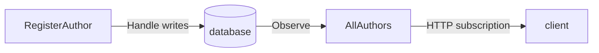

import { Aside, Tabs, TabItem } from '@astrojs/starlight/components';

Use a Cratis Arc command to register an author and a query to read the saved author back. You'll finish the standalone library backend, verify that the author survives a restart, and generate the TypeScript clients for the next lesson. This example stores current state directly; it does not return or append events.

## Prerequisites

Complete [Set up a standalone Arc backend](./index.md) first, then continue in the same `Library/` project. Use the **EF Core** tabs for the default SQLite setup, or **MongoDB** if you chose that alternative. Create each file once, using only your chosen database's version.

Keep the setup's `GlobalUsings.cs`: `Cratis.Concepts` supplies `ConceptAs<T>`, `Cratis.Arc.Commands.ModelBound` supplies `[Command]`, `Cratis.Arc.Queries.ModelBound` supplies `[ReadModel]`, and `System.Reactive.Subjects` supplies `ISubject<T>`. The EF Core examples also use the setup's `Cratis.Arc.EntityFrameworkCore` and `Microsoft.EntityFrameworkCore` imports; the MongoDB examples use `MongoDB.Driver`. You do not need the `Cratis` integration meta-package.



## Name the domain values

Create `src/Authors/AuthorId.cs`:

```csharp
namespace Library.Authors;

public record AuthorId(Guid Value) : ConceptAs<Guid>(Value)
{
    public static AuthorId New() => new(Guid.NewGuid());
}
```

Create `src/Authors/AuthorName.cs`:

```csharp
namespace Library.Authors;

public record AuthorName(string Value) : ConceptAs<string>(Value)
{
    public static implicit operator AuthorName(string value) => new(value);
}
```

`ConceptAs<T>` wraps a primitive value in a domain-specific type, so the compiler can distinguish an author's id from its name. JSON and generated clients use the underlying values: a GUID and a string. `AuthorId` identifies the stored author; it is not a Chronicle event-source identifier.

## Write the command

Create `src/Authors/RegisterAuthor.cs` using your storage branch:

<Tabs syncKey="db">
<TabItem label="EF Core" icon="seti:db">

```csharp
namespace Library.Authors;

[Command]
public record RegisterAuthor(AuthorId Id, AuthorName Name)
{
    public async Task Handle(LibraryDbContext db)
    {
        db.Authors.Add(new Author(Id, Name));
        await db.SaveChangesAsync();
    }
}
```

</TabItem>
<TabItem label="MongoDB" icon="seti:db">

```csharp
namespace Library.Authors;

[Command]
public record RegisterAuthor(AuthorId Id, AuthorName Name)
{
    public Task Handle(IMongoCollection<Author> authors) =>
        authors.InsertOneAsync(new Author(Id, Name));
}
```

</TabItem>
</Tabs>

`[Command]` exposes the record's `Handle()` as a command endpoint. Arc supplies the database context or collection through the method parameter, so you do not register a separate handler. The method saves the author before completing. Returning `Task` means there is no application-specific response payload; Arc still returns a command result that reports success or failure.

<Aside type="tip" title="Separate the decision from the write">
These direct database calls remain supported. When the write can be described from the command's inputs, prefer a pure `Handle()` that returns a command operation, with the collection or context injected into its `Execute()` method. Arc runs the declared work; database writes do not become automatically reversible. Follow [the migration recipe](../commands/operations/migrating.md) when you are ready to separate the two responsibilities.
</Aside>

## Expose the read shape

Create `src/Authors/Author.cs` using the same branch. The EF Core tab also supplies the context referenced by `Program.cs`:

<Tabs syncKey="db">
<TabItem label="EF Core" icon="seti:db">

```csharp
namespace Library.Authors;

[ReadModel]
public record Author(AuthorId Id, AuthorName Name)
{
    public static ISubject<IEnumerable<Author>> AllAuthors(LibraryDbContext db) =>
        db.Authors.Observe();
}
```

Also create `src/Authors/LibraryDbContext.cs`:

```csharp
namespace Library.Authors;

public class LibraryDbContext(DbContextOptions<LibraryDbContext> options) : BaseDbContext(options)
{
    public DbSet<Author> Authors => Set<Author>();
}
```

</TabItem>
<TabItem label="MongoDB" icon="seti:db">

```csharp
namespace Library.Authors;

[ReadModel]
public record Author(AuthorId Id, AuthorName Name)
{
    public static ISubject<IEnumerable<Author>> AllAuthors(IMongoCollection<Author> authors) =>
        authors.Observe();
}
```

</TabItem>
</Tabs>

`Author` is the read model: the shape the client receives. Its static `AllAuthors()` method becomes a query endpoint. `Observe()` returns the current authors and subsequent changes to subscribers. MongoDB uses change streams, which need the replica set configured in the setup. SQLite uses this host's configured `SaveChanges` notifications and does not detect arbitrary writes from another process.

The checkpoint below reads a single HTTP snapshot. You'll use a subscription to keep the browser's list updated in the next lesson.

## Build and run the checkpoint

From `Library/`:

```bash
dotnet build -c Debug
dotnet run --no-build --no-launch-profile \
  -e ASPNETCORE_ENVIRONMENT=Development --urls http://localhost:5000
```

After the build, check these generated files:

| File | Contents |
| --- | --- |
| `src/Authors/RegisterAuthor.ts` | Command proxy, including its request fields and route |
| `src/Authors/Author.ts` | Author shape and the `AllAuthors` query proxy |

Do not edit generated files. If they are missing, check that the build succeeded, `Cratis.Arc.ProxyGenerator.Build` is installed, and `CratisProxiesOutputPath` is set in `Library.csproj`. If you see `AllAuthors.ts` instead, source-file output is not enabled; restore the setup's property before following the React imports. Regenerate after changing a backend contract.

The console should print `Now listening on: http://localhost:5000` and `Hosting environment: Development`. EF creates the initial SQLite schema at startup; MongoDB should already report a writable primary. If either fails, fix storage before moving to the browser.

<Aside type="caution" title="Set the environment through ASPNETCORE_ENVIRONMENT">
`--no-launch-profile` skips the Development environment that `launchSettings.json` would set, so the command sets `ASPNETCORE_ENVIRONMENT` itself. In the .NET 10 SDK, `dotnet run -e` (long form `--environment`) sets an environment *variable* as `NAME=VALUE`; `--environment Development` does not select an ASP.NET Core environment. If the log says `Hosting environment: Production`, `appsettings.Development.json` was not loaded: the MongoDB branch then stops at startup because `Server` and `Database` are required, and the authorization chapter's Development-only sign-in is never registered.
</Aside>

## Write and read an author

<Aside type="caution" title="Local development only">
These tutorial endpoints allow anonymous reads and writes. Keep the host bound to `localhost`. Before exposing the app to other users, add [authentication and authorization](/arc/tutorial/authorization/) and configure tenant isolation if your app needs it.
</Aside>

Keep the host running. From a second terminal, register one author, then read the list through the routes the generated proxies use. The query parameter `waitForFirstResult=true` waits for the observable query's first result, which matters when MongoDB is still loading its initial snapshot.

```bash
curl -s -X POST http://localhost:5000/api/library/authors/register-author \
  -H 'Content-Type: application/json' \
  -d '{"id":"8f7c7c52-2d5d-4c1e-9a55-0c1f2b8a6f10","name":"Ursula K. Le Guin"}'
curl -s 'http://localhost:5000/api/library/authors/all-authors?waitForFirstResult=true'
```

Check for `"isSuccess":true` in the command result and the query result. The query's `data` array should contain:

```json
[
  {
    "id": "8f7c7c52-2d5d-4c1e-9a55-0c1f2b8a6f10",
    "name": "Ursula K. Le Guin"
  }
]
```

Run the command once: the id is the stored key, so repeating it reports a storage error rather than a second author. If a request reports failure, read its `validationResults` and `exceptionMessages` and check the host log. A timeout waiting for the query's first result is a reason to check storage, including MongoDB's writable-primary check from the setup.

The routes come from the namespace (`Library.Authors`) plus the command or query name. Compare a 404 with the generated `route` fields in `RegisterAuthor.ts` and `Author.ts`; do not edit the generated files. Without `waitForFirstResult=true`, a query that has not produced a result yet can return HTTP 202 with `"isReady":false` instead of the author list.

Stop and restart the host from the same `Library/` directory with the same run command, then repeat **only the GET**. The author should still be present: SQLite keeps `library.db`, and MongoDB keeps the collection. You have now checked that the write reaches storage and can be read after a restart, before adding a UI. Nothing validates the name yet, so a blank name is also accepted until [chapter 2](/arc/tutorial/validation/) adds the rules.

## Continue in the browser

Continue to [Your first full-stack slice](/arc/tutorial/first-slice/) to register authors from a React dialog and see the list update without refreshing. That lesson adds Vite and the browser setup to this same project; its backend examples recap the files you already created, so do not create a second copy.

If you already have a Vite app, use [Frontend getting started](/arc/frontend/react/getting-started/) instead. It uses an inline `CommandForm` and offers a route without Components. Both paths import `AllAuthors` from `./Authors/Author` with this setup's source-file proxy grouping.

Go deeper in [Commands](/arc/backend/csharp/commands/) and [Queries](/arc/backend/csharp/queries/). If you later choose event sourcing, [add Chronicle explicitly](/arc/backend/csharp/chronicle/add-event-sourcing/); retaining a query's public contract is a migration goal, not a guarantee that its storage implementation never changes.
