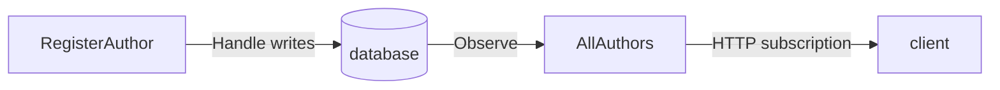

import { Aside, Tabs, TabItem } from '@astrojs/starlight/components';

A librarian registers an author; the catalog should show it. Let's express that as one command that writes current state and one query that reads it. **No events are returned or appended in this lesson.**

## Prerequisites

Complete [Set up a standalone Arc backend](./index.md) first. It supplies packages, imports, ASP.NET Core hosting, storage settings, and the proxy-generator configuration. Continue in that same `Library/` project. Use **EF Core** below for the default SQLite setup, or **MongoDB** if you chose that alternative. Create each file once, using only your branch's version.



## Name the domain values

Create `src/Authors/AuthorId.cs`:

```csharp
namespace Library.Authors;

public record AuthorId(Guid Value) : ConceptAs<Guid>(Value)
{
    public static AuthorId New() => new(Guid.NewGuid());
}
```

Create `src/Authors/AuthorName.cs`:

```csharp
namespace Library.Authors;

public record AuthorName(string Value) : ConceptAs<string>(Value)
{
    public static implicit operator AuthorName(string value) => new(value);
}
```

These are standalone `ConceptAs<T>` values. `AuthorId` is not a Chronicle event-source identifier. The compiler distinguishes an author's id and name; JSON and the generated client use their underlying value types.

## Write the command

Create `src/Authors/RegisterAuthor.cs` using your storage branch:

<Tabs syncKey="db">
<TabItem label="EF Core" icon="seti:db">

```csharp
namespace Library.Authors;

[Command]
public record RegisterAuthor(AuthorId Id, AuthorName Name)
{
    public async Task Handle(LibraryDbContext db)
    {
        db.Authors.Add(new Author(Id, Name));
        await db.SaveChangesAsync();
    }
}
```

</TabItem>
<TabItem label="MongoDB" icon="seti:db">

```csharp
namespace Library.Authors;

[Command]
public record RegisterAuthor(AuthorId Id, AuthorName Name)
{
    public Task Handle(IMongoCollection<Author> authors) =>
        authors.InsertOneAsync(new Author(Id, Name));
}
```

</TabItem>
</Tabs>

`[Command]` exposes the record's `Handle()` as a command endpoint. Arc method-injects the collection or context; you do not register a separate handler. The explicit write is the effect; returning `Task` adds no response payload.

<Aside type="tip" title="Separate the decision from the write">
These direct database calls remain supported. When the write can be described from the command's inputs, prefer a pure `Handle()` that returns a command operation, with the collection or context injected into its `Execute()` method. Arc runs the declared work; database writes do not become automatically reversible. Follow [the migration recipe](../commands/operations/migrating.md) when you are ready to separate the two responsibilities.
</Aside>

## Expose the read shape

Create `src/Authors/Author.cs` using the same branch. The EF Core tab also supplies the context referenced by `Program.cs`:

<Tabs syncKey="db">
<TabItem label="EF Core" icon="seti:db">

```csharp
namespace Library.Authors;

[ReadModel]
public record Author(AuthorId Id, AuthorName Name)
{
    public static ISubject<IEnumerable<Author>> AllAuthors(LibraryDbContext db) =>
        db.Authors.Observe();
}
```

Also create `src/Authors/LibraryDbContext.cs`:

```csharp
namespace Library.Authors;

public class LibraryDbContext(DbContextOptions<LibraryDbContext> options) : BaseDbContext(options)
{
    public DbSet<Author> Authors => Set<Author>();
}
```

</TabItem>
<TabItem label="MongoDB" icon="seti:db">

```csharp
namespace Library.Authors;

[ReadModel]
public record Author(AuthorId Id, AuthorName Name)
{
    public static ISubject<IEnumerable<Author>> AllAuthors(IMongoCollection<Author> authors) =>
        authors.Observe();
}
```

</TabItem>
</Tabs>

A static query on `[ReadModel]` becomes an endpoint. MongoDB observation uses change streams; SQLite uses this host's configured `SaveChanges` notifications, not arbitrary writes from another process. The host setup establishes their prerequisites.

## Build and run the checkpoint

From `Library/`:

```bash
dotnet build -c Debug
dotnet run --no-build --no-launch-profile \
  -e ASPNETCORE_ENVIRONMENT=Development --urls http://localhost:5000
```

After the build, check these generated files:

| File | Contents |
| --- | --- |
| `src/Authors/RegisterAuthor.ts` | Command proxy, including its request fields and route |
| `src/Authors/Author.ts` | Author shape and the `AllAuthors` query proxy |

Do not edit generated files. If they are missing, check that the build succeeded, `Cratis.Arc.ProxyGenerator.Build` is installed, and `CratisProxiesOutputPath` is set in `Library.csproj`. If you see `AllAuthors.ts` instead, source-file output is not enabled; restore the setup's property before following the React imports. Regenerate after changing a backend contract.

The console should print `Now listening on: http://localhost:5000` and `Hosting environment: Development`. EF creates the initial SQLite schema at startup; MongoDB should already report a writable primary. If either fails, fix storage before moving to the browser.

<Aside type="caution" title="Set the environment through ASPNETCORE_ENVIRONMENT">
`--no-launch-profile` skips the Development environment that `launchSettings.json` would set, so the command sets `ASPNETCORE_ENVIRONMENT` itself. In the .NET 10 SDK, `dotnet run -e` (long form `--environment`) sets an environment *variable* as `NAME=VALUE`; `--environment Development` does not select an ASP.NET Core environment. If the log says `Hosting environment: Production`, `appsettings.Development.json` was not loaded: the MongoDB branch then stops at startup because `Server` and `Database` are required, and the authorization chapter's Development-only sign-in is never registered.
</Aside>

## Write and read an author

<Aside type="caution" title="Local development only">
These tutorial endpoints allow anonymous reads and writes. Keep the host bound to `localhost`. Before exposing the app to other users, add [authentication and authorization](/arc/tutorial/authorization/) and configure tenant isolation if your app needs it.
</Aside>

Keep the host running. From a second terminal, call the routes the generated proxies use:

```bash
curl -s -X POST http://localhost:5000/api/library/authors/register-author \
  -H 'Content-Type: application/json' \
  -d '{"id":"8f7c7c52-2d5d-4c1e-9a55-0c1f2b8a6f10","name":"Ursula K. Le Guin"}'
curl -s http://localhost:5000/api/library/authors/all-authors
```

The command returns `"isSuccess":true`, and the query's `data` array contains the author. Run the command once: the id is the stored key, so repeating it reports a storage error rather than a second author. The routes come from the namespace (`Library.Authors`) plus the command or query name, and the generated `route` fields in `RegisterAuthor.ts` and `Author.ts` show the same paths. A 404 is a reason to compare those routes, not to edit the generated files.

Stop and restart the host with the same run command, then repeat **only the GET**. The author should still be present: SQLite keeps `library.db`, and MongoDB keeps the collection. This checks persistence, not just compilation. Nothing validates the name yet, so a blank name is also accepted until [chapter 2](/arc/tutorial/validation/) adds the rules.

## Continue in the browser

[Your first full-stack slice](/arc/tutorial/first-slice/) continues this same project with a Vite bootstrap, Components dialog, providers, and dev proxy configuration; its backend blocks recap these files rather than creating a second copy. [Frontend getting started](/arc/frontend/react/getting-started/) is the **alternative for an existing Vite app**: an inline `CommandForm` with Components fields, plus a route without Components. Both use `./Authors/Author` for this setup's `AllAuthors` import.

Go deeper in [Commands](/arc/backend/csharp/commands/) and [Queries](/arc/backend/csharp/queries/). If you later choose event sourcing, [add Chronicle explicitly](/arc/backend/csharp/chronicle/add-event-sourcing/); retaining a query's public contract is a migration goal, not a guarantee that its storage implementation never changes.
