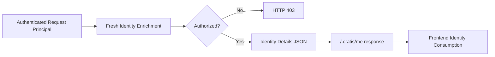

Cratis Arc identity enrichment adds application-specific details, such as a display name, to the identity your frontend shows. It starts from the authenticated request principal, the server-side representation of the caller, and returns presentation data through `/.cratis/me`. It does not validate or modify the authentication provider's token.

## Overview

Use an `IProvideIdentityDetails` implementation when the frontend needs information that the authenticated principal does not contain. Arc invokes it for each authenticated identity request and combines its details with the principal's identity and roles. Without a custom provider, `DefaultIdentityDetailsProvider` allows authenticated callers through this step and returns empty details.

A custom provider can also check whether an authenticated user may enter the application. Returning `IsUserAuthorized = false` makes `/.cratis/me` answer 403. That decision controls the identity response, not access to individual commands or queries. Protect those operations with [pipeline authorization](../core/authorization.md).

> [!WARNING]
> The identity is presentation data. Do not use its flags, roles, or details in place of backend authorization. See [provider flow](provider-flow.md) and [trust](identity-provider-service.md#trust). Arc no longer uses the `.cratis-identity` cookie; see [migrating from the identity cookie](migrating-from-the-identity-cookie.md).

## Topics

| Topic | Description |
| ------- | ----------- |
| [Provider Flow](./provider-flow.md) | Add display details and understand the responses from `/.cratis/me`. |
| [Identity Contracts](./contracts.md) | Look up the provider's `IdentityProviderContext` input and `IdentityDetails` output. |
| [IdentityProvider Service](./identity-provider-service.md) | Read identity presentation data in backend code or change the current response. |
| [Development and Topologies](./development-and-topologies.md) | Supply development user and tenant rosters, or plan cross-service composition. |
| [Migrating from the Identity Cookie](./migrating-from-the-identity-cookie.md) | Move cookie readers to the endpoint and handle mixed package versions. |
