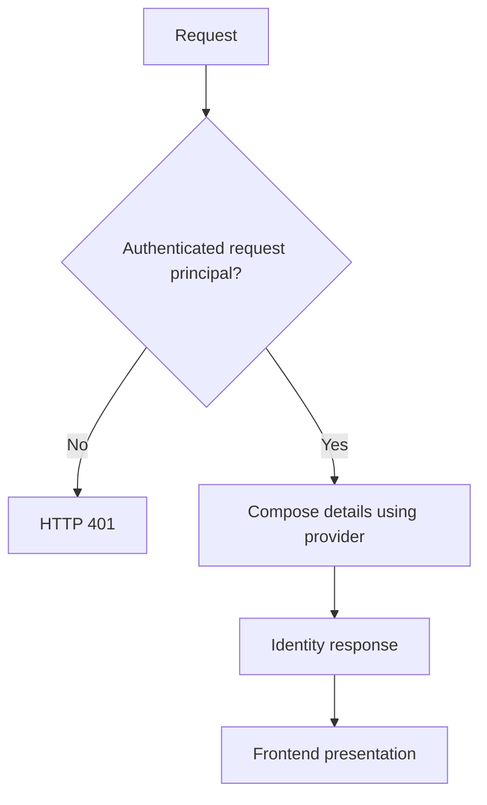

Cratis Arc identity enrichment combines the authenticated caller's identity with application-specific display details and returns them through `/.cratis/me`. Add a details provider when your frontend needs information beyond the caller's claims. Authentication must first establish the principal, the server-side representation of that caller; a details provider does not sign anyone in.

## Endpoint mapping

Normal `UseCratisArc()` activation maps `/.cratis/me` when `IProvideIdentityDetails` is registered, unless a replacement endpoint with the same endpoint name already exists. Standard Arc service registration supplies `DefaultIdentityDetailsProvider` when no custom provider is found, so you do not need a custom provider or a second mapping call just to expose the endpoint.

The endpoint permits anonymous requests so it can report the identity result itself. It calls `IIdentityProvider.Get()` and returns 401 when there is no authenticated principal, or 403 when the details provider rejects application entry. Otherwise, it writes the identity as JSON. Arc does not read an identity cookie to resolve the caller or write a new one.

Arc sets `Cache-Control: no-store, private` and `Vary: Cookie` on `/.cratis/me` (including its 401 and 403 responses), `/.cratis/users`, and `/.cratis/tenants`. It also sets these headers whenever `IIdentityProvider.SetCookieForHttpResponse()` writes an identity, including after `ModifyDetails()`. Do not configure a shared cache to override these headers: the responses contain per-user data. The application-wide `/.cratis/identity-details/schema` response is not covered by this identity-response policy.

## Identity details provider

Implement `IProvideIdentityDetails` to supply your application's display data. Arc discovers the implementation automatically; if it finds more than one custom provider, select one explicitly through `ArcOptions.IdentityDetailsProvider`.

For each authenticated identity request, Arc constructs `IdentityProviderContext` and invokes the selected provider. The ID comes from the principal's `sub` claim, or `"unknown"` when absent. The name comes from the principal. Arc uses the forwarded name header as a fallback only when `TrustForwardedIdentityHeaders` is enabled and signed forwarding is not enabled; without a name, it uses `"unknown"`. Configure that trust boundary through [authentication](../core/authentication.md), not through a details provider.

This example returns the principal's name as `DisplayName`. The `true` argument allows every already-authenticated user through this enrichment step; it does not check application membership:

```csharp
using Cratis.Arc.Identity;

public class IdentityDetailsProvider : IProvideIdentityDetails
{
    public Task<IdentityDetails> Provide(IdentityProviderContext context) =>
        Task.FromResult(new IdentityDetails(true, new { DisplayName = context.Name }));
}
```

If application entry depends on membership, consult authoritative membership data and return `IdentityDetails` with `IsUserAuthorized` set to the result. A false result makes `/.cratis/me` return 403. It does not add claims to the principal or protect individual commands and queries; enforce those permissions with [pipeline authorization](../core/authorization.md).

## Request flow and frontend integration



The Arc frontend identity provider requests `/.cratis/me` and keeps a resolved identity in memory for the page. `refresh()` asks the server again, including a fresh details-provider call for an authenticated request. A 401 or 403 leaves the frontend identity unset; neither response is overruled by a legacy identity cookie.

Use [React identity integration](../../../frontend/react/identity.md) to show the result and handle loading. If backend code also needs the presentation data, read the [trust and mutation limits](identity-provider-service.md) before using `IIdentityProvider`.
