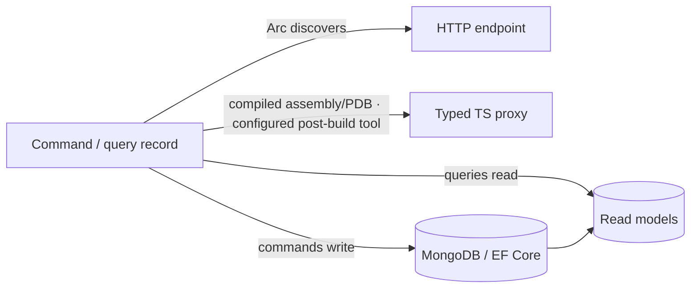

Cratis Arc exposes C# commands and queries as HTTP endpoints and generates TypeScript proxies for the frontend. Commands change state; queries read it. Keeping those responsibilities separate is Command Query Responsibility Segregation (CQRS). You can express each as a model-bound record, with its behavior beside its inputs, rather than maintaining a controller and a separate API model.

You still write the business behavior and configure validation, authorization, and proxy generation. With Chronicle, commands can append events and queries can read the models built from them. A slice that only needs current state can instead write through MongoDB or Entity Framework Core; Arc does not require event sourcing.

## Start here

Follow [Getting started](./getting-started/index.md) to build your first command and query. If you already use MediatR or MVC, start with [the adoption guide](coming-from-mediatr-and-mvc.md) to see which responsibilities move into Arc and which stay in your code.

For the implementation details, choose the part you are working on:

- [Commands](./commands/index.md) explains state changes through `Handle()`.
- [Queries](./queries/index.md) covers reads, including observable queries that send updates to connected clients.
- [Proxy generation](./proxy-generation/index.md) shows how to configure the post-build tool that turns backend contracts into TypeScript. The tool reads compiled assemblies and their PDBs; it does not generate proxies at runtime.

## Integrations

Choose storage and hosting to match the slice you are building:

| Topic | What it covers |
| ------- | ----------- |
| [MongoDB](./mongodb/index.md) | Document storage for read models and other data. |
| [Entity Framework](./entity-framework/index.md) | EF Core integration for relational read models. |
| [Chronicle](./chronicle/index.md) | Event sourcing integration — append events from commands, build read models, feed state back into business rules. |
| [ASP.NET Core](./asp-net-core/index.md) | How Arc plugs into the ASP.NET Core pipeline. |

## Cross-cutting

Once an endpoint works, decide who may call it and how it is exposed. [Authorization](authorizing-commands-and-queries.md) applies access rules to commands and queries. [Endpoint groups](endpoint-groups.md) separates endpoint sets by port and route prefix; it does not replace authorization.

For date-sensitive behavior, use the [application calendar](application-calendar.md) to resolve business dates in the right time zone. To inspect the event model represented by your source, [generate a Screenplay](generating-a-screenplay.md) or [embed the event-model explorer](embedded-event-model.md) in the application.

| Topic | What it covers |
| ------- | ----------- |
| [Core](./core/index.md) | Commands, queries, and dependency injection at the lower level. |
| [Identity](./identity/index.md) | Who the user is — authentication and identity details. |
| [Tenancy](./tenancy/index.md) | Tenant selection and provider-specific storage routing; membership authorization is separate. |
| [Open API](./open-api/index.md) | OpenAPI/Swagger generation. |
| [Code Analysis](./code-analysis/index.md) | Analyzers and fixers that catch mistakes at compile time. |

When your backend contracts are ready, continue with the [frontend](../../frontend/) to call commands and queries through their generated proxies.
