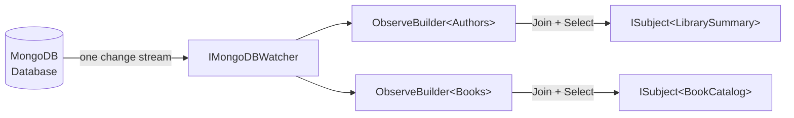

Use Cratis Arc's `IMongoDBWatcher` to combine several MongoDB collections into a live query result. It shares one change stream per database and client server/credential combination within the process, rather than opening a stream for each collection. A change stream notifies Arc when stored documents change so it can refresh the result.

For a single collection, use the `Observe()`, `ObserveSingle()`, or `ObserveById()` [collection extensions](./observing-collections.md). They share the watcher too; inject it directly when you need to combine collections.

## How it works



[MongoDB setup](./getting-started.md) registers `IMongoDBWatcher` as a singleton. Each watch is keyed by the client's servers and credential together with the database name, matching how Arc's client factory shares clients. The first observation starts the stream; later observations with the same key share it.

- `Observe<T>()` on the watcher resolves the database name and client from the current context, so tenants that resolve to different databases or servers get streams of their own.
- The collection extensions (`Observe()`, `ObserveSingle()`, `ObserveById()`) watch the collection's own database with the client it belongs to. A collection from a client the application did not configure, such as another library's storage, is watched on the deployment it lives on.

## Using the watcher without Arc's MongoDB configuration

A library or host that brings its own `IMongoDatabase` and observes its collections with the collection extensions needs only the watcher, not the rest of the MongoDB integration:

```csharp
services.AddMongoDBWatcher();
```

Import `Microsoft.Extensions.DependencyInjection` for this registration method. It adds the same singleton as `UseCratisMongoDB()`, so calling both registers the watcher once. Without MongoDB configuration, the collection extensions still work because each collection supplies its database and client. Calling `IMongoDBWatcher.Observe<T>()` instead throws `MongoDBWatcherNotConfigured`: that method needs a configured database.

## Prerequisites

Before using the joined observations below, get ordinary MongoDB reads working and check both prerequisites:

- A MongoDB replica set or sharded cluster that supports change streams, with database-level watch and read permissions. A standalone server is not sufficient.
- Arc's MongoDB integration registered at startup through either `builder.UseCratisMongoDB()` or `builder.AddCratisArc(configureBuilder: arc => arc.WithMongoDB())`. The watcher-only registration above is enough for collection extensions, but not for these `IMongoDBWatcher.Observe<T>()` examples.

The examples are service and query fragments using your application's `Book`, `Author`, and `Publisher` types. Import `Cratis.Arc.MongoDB` and `System.Reactive.Subjects`; the controller also uses `Microsoft.AspNetCore.Mvc`. For a complete host setup, start with [getting started](./getting-started.md).

## Observing a single collection

`IMongoDBWatcher.Observe<T>()` starts with one collection and returns a builder, not a subscribable result. This builder exposes `.Select()` after a `.Join<T2>()`, so use it when your result needs at least two collections. For a live result from just one collection, use the [collection extensions](./observing-collections.md) instead.

In this example, `Book` supplies the main data and `Author` supplies a lookup. `.Select()` combines both into a result subject: an object consumers can subscribe to for updated values.

### Example — watch one collection alongside a lookup

```csharp
public class BookCatalogService(IMongoDBWatcher watcher)
{
    public ISubject<BookCatalog> GetLiveCatalog()
    {
        return watcher
            .Observe<Book>()
            .Join<Author>()
            .Select((books, authors) => new BookCatalog(books, authors));
    }
}

public record BookCatalog(IEnumerable<Book> Books, IEnumerable<Author> Authors);
```

Arc initially reads each collection and calls your selector with those results. Changes to a watched collection trigger another read, including inserts, updates, replacements, drops, deletes, and renames into or out of an observed namespace. The collections are read separately, not as a single transactional snapshot. Pending notifications may be combined into one refresh, so the result represents current data rather than every intermediate state.

## Filtering observed documents

Pass a filter expression to `Observe<T>()` or `Join<T2>()` to restrict which documents are loaded when the subject re-fetches after a change.

```csharp
public ISubject<BookCatalog> GetLivePublishedCatalog()
{
    return watcher
        .Observe<Book>(book => book.IsPublished)
        .Join<Author>(author => author.IsActive)
        .Select((books, authors) => new BookCatalog(books, authors));
}
```

> Filters apply to the re-fetch query, not to the change stream trigger. Any change to a collection causes a re-fetch regardless of whether the changed document matches the filter.

## Joining three collections

Chain a second `.Join<T3>()` to watch three collections at once.

```csharp
public ISubject<LibrarySummary> GetLiveLibrarySummary()
{
    return watcher
        .Observe<Book>()
        .Join<Author>()
        .Join<Publisher>()
        .Select((books, authors, publishers) =>
            new LibrarySummary(books, authors, publishers));
}

public record LibrarySummary(
    IEnumerable<Book> Books,
    IEnumerable<Author> Authors,
    IEnumerable<Publisher> Publishers);
```

## Using the subject in a query

`ISubject<TResult>` implements both `IObservable<TResult>` and `IObserver<TResult>`. You can pass it directly to any observable query:

```csharp
[Route("api/catalog")]
public class CatalogController(IMongoDBWatcher watcher) : Controller
{
    [HttpGet("live")]
    public ISubject<BookCatalog> LiveCatalog()
    {
        return watcher
            .Observe<Book>(book => book.IsPublished)
            .Join<Author>()
            .Select((books, authors) => new BookCatalog(books, authors));
    }
}
```

## Lifetime and disposal

`IMongoDBWatcher` is a singleton. The host owns the singleton and disposes it at shutdown. A failed database watch reconnects with exponential backoff (one second up to 60 seconds), carrying its last resume token. An invalidation or an expired/invalid resume token discards that token, reopens the stream, and refreshes every joined observation. Tokens are held in memory, not as durable consumer checkpoints.

Each subject returned by `Select()` owns a background refresh loop. Completing or erroring the subject stops that loop. Removing the last subscriber also stops it and releases its resources, so create a new observation when you need to subscribe again.

A failed joined snapshot is logged and retried up to five times, with delays of 1, 2, 4, 8, and 16 seconds. If all six attempts fail, Arc logs an error and retains the subscription; the next relevant database notification starts another snapshot attempt. Disposing the subject or removing its last subscriber cancels pending retries. Selector failures terminate the result subject through `OnError`.

These snapshot retry rules apply to joined observations, not the per-collection `IMongoCollection.Observe()` extension, even though both use the shared stream. Keep tenant-specific result subjects within the lifetime of the request or service that owns them; the singleton watcher's lifetime is not a reason to share those results across tenants.

## See also

- [Observing Collections](observing-collections.md) — Per-collection `IMongoCollection.Observe()` extension methods for single-collection scenarios.
- [Getting Started](getting-started.md) — How to register the MongoDB integration, including `IMongoDBWatcher`.
