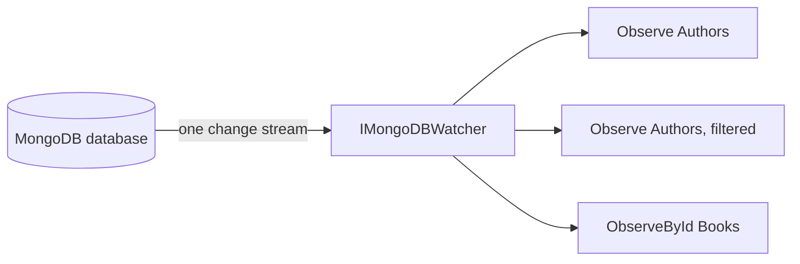

After ordinary collection reads work, use `Observe()` to publish an initial result and update it from MongoDB change streams. Every observation of a database shares one change stream, so observing many collections or queries does not open a stream of its own, or hold a MongoDB pool connection, for each subscription. This is a live result set, not an audit log or a guarantee that every intermediate state reaches every subscriber.

## Prerequisites

- Complete [Arc and MongoDB setup](./getting-started.md), including Arc activation. Observation accesses Arc's initialized service provider and query context.
- Use a MongoDB replica set or sharded cluster supporting change streams, with read/change-stream permissions. A standalone server cannot supply the watch.
- Map a document ID to a public CLR property; observation uses it to maintain membership.

## Choose an observation

These are method fragments for a scoped service with an injected `IMongoCollection<Author>` named `collection`. Import `MongoDB.Driver`.

```csharp
var all = collection.Observe();
var active = collection.Observe(author => author.IsActive);
var filter = Builders<Author>.Filter.Eq(author => author.Category, "Fiction");
var fiction = collection.Observe(filter);
var featured = collection.ObserveSingle(author => author.IsFeatured);
var byId = collection.ObserveById<Author, Guid>(authorId);
```

The examples assume your `Author` has a Guid `Id` and the named properties. Collection overloads return `ISubject<IEnumerable<Author>>`; single-document overloads return `ISubject<Author>`. When no document matches, single observation emits `null` and stays open; see [when there is no matching document](#when-the-observed-document-is-gone) below.

The observation attaches to the shared stream when `Observe()` is called, not when the first subscriber arrives. The collection result replays its latest emission to late subscribers. It does not emit a placeholder empty collection before the initial database query finishes.

## How observations share a change stream

Arc keeps one change stream per database per process, owned by the [`IMongoDBWatcher`](./change-stream-watcher.md) singleton. It watches the whole database, so it carries the changes of every collection. Each `Observe()`, `ObserveSingle()` and `ObserveById()` call subscribes to that stream and handles only the changes of its own collection, in order. You do not have to inject or opt in to anything: the extension methods use the shared stream automatically.



What this means in practice:

- A board of 30 observable queries holds one change stream and one pooled connection for the change stream, not 30.
- The stream is not narrowed by your filter, so the observation decides whether a changed document belongs. Inserts, updates and replaces cost one indexed lookup on the document's own key; an observation that takes every document skips that lookup. Deletes cost nothing, because the observation already knows its members.
- Paged observations re-read their page after any change in their collection, as before.
- Changes made while the initial query runs are held and applied after it, so none is lost.
- A database that is not observed opens no stream. The stream for a database opens on the first observation and stays open for the life of the process.
- In a multi-tenant application the stream is per resolved database name, so each tenant database gets its own.

## Find options, paging, and sorting

`Observe` and `ObserveSingle` accept **nongeneric `FindOptions`**, not `FindOptions<Author>` or projection options:

```csharp
var options = new FindOptions
{
    MaxTime = TimeSpan.FromSeconds(10)
};
var active = collection.Observe(author => author.IsActive, options);
```

This overload does not expose `Sort` or `Limit` properties through `FindOptions`. Arc takes paging and sorting from the current query context. Use the [query paging contract](../queries/model-bound/paging.md) when exposing a paged Arc query; arbitrary controller parameters do not populate that context automatically.

### Compose a primary observation with auxiliary sources

When a query combines observations from several collections, client paging and sorting belong to the primary source. Existing composed queries must opt in on each auxiliary observation to get this behavior; otherwise those observations still use the client query context. Pass `ignoreQueryContext: true` to an auxiliary observation to read **all** documents matching its filter without client paging or sorting. This also prevents that source from writing the query's `TotalItems`, both at startup and on changes:

```csharp
var primary = authors.Observe();
var auxiliary = categories.Observe(ignoreQueryContext: true);
var featured = categories.ObserveSingle(category => category.IsFeatured, ignoreQueryContext: true);
var selected = categories.ObserveById(categoryId, ignoreQueryContext: true);
```

This fragment assumes injected collections named `authors` and `categories`, a category with `IsFeatured`, and a matching `categoryId`. The option is available for expression and MongoDB filter overloads of `Observe` and `ObserveSingle`, as well as `ObserveById`. The primary observation keeps its usual paging, sorting, and `TotalItems` behavior; **you** decide which source is primary. `TotalItems` describes the primary collection's filtered count, not the size of an arbitrary result you derive by combining sources. If your composed result has different pagination semantics, compute its count explicitly rather than treating a collection's count as the composed count.

## Lifetime and scope

A directly owned subscription must be disposed. Example lifecycle fragment in an asynchronous method (`System.Reactive.Linq` supplies `Subscribe`):

```csharp
var subject = collection.Observe(author => author.IsActive);
using var subscription = subject.Subscribe(
    authors => Console.WriteLine($"Active authors: {authors.Count()}"),
    () => Console.WriteLine("Author observation completed"));
await Task.Delay(Timeout.InfiniteTimeSpan, cancellationToken);
```

When the last subscriber unsubscribes, the lifetime-aware subject detaches the observation from the shared stream. Cleanup completes and disposes the subject. The shared stream stays open for the other observations. Do not create an observation that is never subscribed or retained. Once completed, create a **new** observation rather than reusing the terminated subject.

Arc registers collections as **scoped** services. Register a service that captures `IMongoCollection<T>` as scoped too, not singleton. Keep its scope alive for the subscription's lifetime. A background worker must establish the intended tenant context and resolve a collection inside an appropriate scope; do not cache the first tenant's collection globally. See [MongoDB tenancy](./tenancy.md).

## Errors and recovery limits

The shared stream reconnects with exponential backoff and resumes from the last change it delivered, so a transient connection failure does not end your observations. See [the watcher's lifetime](./change-stream-watcher.md#lifetime-and-disposal) for the limits of resuming.

An observation completes, and disposes its subject, when the shared stream ends, which happens when the host shuts down, or when reading its changes fails. Failures are logged, not forwarded as `OnError`. Individual change-processing exceptions are logged while the observation carries on. Configuration errors before the observation starts, such as a missing ID mapping, still throw synchronously.

Consequently, `.Retry(3)` on the existing subject does not recreate a finished observation, and an `OnError` callback is not a reliable signal of a connection problem. Monitor completion and logs, and create a **new** observation, in a fresh scope, if you need one after completion.

## Change handling and troubleshooting

Insert, update, replace, and delete operations update observed membership. The shared stream delivers every change in the database, so the observation filters by collection first, then decides per change whether the document belongs to its filter. Updates that leave the filter remove the document from the result. Operations that are not changes to documents, such as dropping a collection, are ignored. Do not assume automatic batching of rapid changes.

## When the Observed Document Is Gone

`ObserveSingle()` and `ObserveById()` push a fresh document every time the underlying data changes, but there is no document to push when:

- the observed document is deleted,
- an update or replace moves the document out of the filter (it still exists, but no longer matches), or
- the initial query never found a match in the first place.

In every one of these cases the subject emits `default` — `null` for a reference type — rather than completing. Completing the observable would end the subscription; emitting `null` reports "nothing right now" while leaving the subscription open in case the document reappears, for example if it is re-inserted with the same id, or a later update moves it back into the filter.

> **Note**: A `[ReadModel]` marked `[RemovedWith<T>]` hard-deletes its backing document when the removal event fires. An active `ObserveSingle()`/`ObserveById()` subscriber sees that removal exactly as described above — "the read model was removed" is this same `null` emission, not a special case.

On the frontend, guard against it the same way you guard against "still loading" — check `result.hasData` (and `result.isReady` if you need to distinguish "no result yet" from "ready, but nothing matches"):

```tsx
const [result] = GetAccountObservable.use(accountId);

if (!result.isReady) {
    return <Spinner />;
}

if (!result.hasData) {
    return <NotFound />;
}

return <AccountDetails account={result.data} />;
```

## Advanced Usage

If no first result arrives, verify replica-set configuration, permissions, ID mapping, and connectivity. Enable logging for `MongoDB.Driver.MongoCollection` to inspect observation failures, and for `Cratis.Arc.MongoDB.MongoDBWatcher` to inspect the shared stream's connection and reconnects. Test filtered membership, deletion, paging, and forced disconnections in your deployment before relying on live results.
