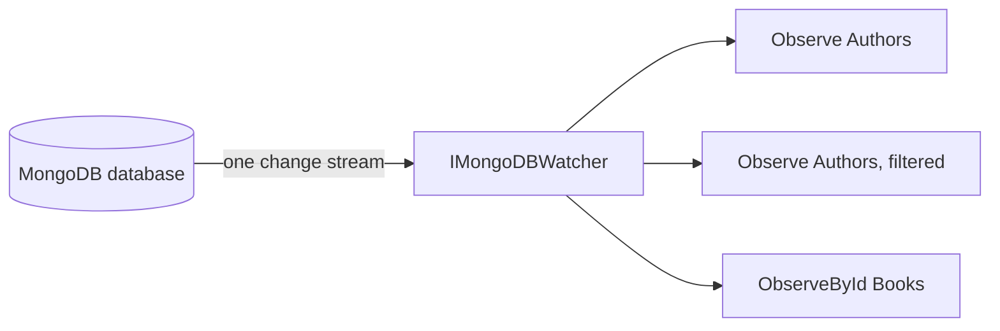

Use Cratis Arc's `Observe()` to keep query results current as MongoDB documents change. It publishes an initial result, then updates that result through a shared change stream, MongoDB's feed of document changes. Start here once ordinary collection reads work and you need a live list or document instead of a one-time snapshot.

Observations of the same database on the same deployment, using the same credentials, share one stream within the process. Each subscription therefore does not need its own stream or pooled connection for watching changes. The result represents current state; it is not an audit log and does not guarantee delivery of every intermediate state.

## Prerequisites

- Complete [Arc and MongoDB setup](./getting-started.md), including Arc activation. Observation accesses Arc's initialized service provider and query context.
- Use a MongoDB replica set or sharded cluster supporting change streams, with read/change-stream permissions. A standalone server cannot supply the watch.
- Map a document ID to a public CLR property; observation uses it to maintain membership.

MongoDB observable queries require change streams: use a MongoDB replica set or a compatible service that supports change streams. Standalone MongoDB servers and services without `$changeStream` support cannot serve observable queries. Arc detects this when the database's shared watch first opens and reports `MongoDBChangeStreamsNotSupported` rather than retrying indefinitely; the failure is cached per database for the watcher lifetime.

## Choose an observation

Use `Observe()` for a list, `ObserveSingle()` for one matching document, or `ObserveById()` when you know its ID. These method fragments assume a scoped service with an injected `IMongoCollection<Author>` named `collection`. Import `MongoDB.Driver`.

```csharp
var all = collection.Observe();
var active = collection.Observe(author => author.IsActive);
var filter = Builders<Author>.Filter.Eq(author => author.Category, "Fiction");
var fiction = collection.Observe(filter);
var featured = collection.ObserveSingle(author => author.IsFeatured);
var byId = collection.ObserveById<Author, Guid>(authorId);
```

The examples assume `Author` is a reference type with a Guid `Id` and the named properties. Collection overloads return `ISubject<IEnumerable<Author>>`; single-document overloads return `ISubject<Author>`. A subject lets your consumer subscribe to results and errors. If no document matches a single-document observation, it emits `null` and stays open; see [when there is no matching document](#when-the-observed-document-is-gone).

Calling `Observe()` starts the observation without waiting for its first subscriber. Subscribe to it and retain the subscription for as long as you need updates. The collection result replays its latest emission to late subscribers, but it does not emit a placeholder empty collection before the initial query finishes.

## How observations share a change stream

The [`IMongoDBWatcher`](./change-stream-watcher.md) singleton owns the shared streams within the process. It groups observations by database name, client server settings and credentials, so separate credentials or deployments do not share a stream. It uses the collection's own client, including for a collection supplied by another library. The extension methods use this watcher automatically; you do not need to inject it.

The stream covers the whole database. Each `Observe()`, `ObserveSingle()` and `ObserveById()` call handles changes for its own collection in order, then determines how those changes affect its result.



Sharing the stream reduces watch connections, but observations still do work to maintain their results:

- A filtered, unpaged observation checks membership with a lookup by document key for inserts, updates and replacements. An observation that includes every document skips that lookup. Deletes use the members already held in memory.
- Paged observations re-read their page after any change in their collection.
- After a reconnect that may have missed changes, or after a collection is dropped or renamed, the observation re-reads its result.
- Changes received while the initial query runs are buffered and applied after that query.

A database with no observations opens no stream. Its first observation opens one, and that stream stays open until the watcher shuts down, even if individual observations end. In a multi-tenant application, each resolved tenant database has its own stream.

## Find options, paging, and sorting

Pass nongeneric `FindOptions` to `Observe` or `ObserveSingle` to set options such as a query timeout. These overloads do not accept `FindOptions<Author>` or projection options:

```csharp
var options = new FindOptions
{
    MaxTime = TimeSpan.FromSeconds(10)
};
var active = collection.Observe(author => author.IsActive, options);
```

Nongeneric `FindOptions` does not expose `Sort` or `Limit`. Collection observations take paging and sorting from Arc's current query context, which carries the query's requested page, sort order and total count. Follow the [query paging contract](../queries/model-bound/paging.md) when exposing a paged Arc query; arbitrary controller parameters do not populate that context.

`ObserveSingle()` and `ObserveById()` always ignore query-context paging and sorting and leave its `TotalItems` unchanged. Passing `ignoreQueryContext: false` does not change this single-document behavior; that parameter remains for compatibility.

### Compose a primary observation with auxiliary sources

When a query combines several collections, choose which collection owns client paging and sorting. A supporting collection often needs all matching documents so the query can look up related data. Pass `ignoreQueryContext: true` to those auxiliary collection observations; they then skip client paging and sorting and leave the query's `TotalItems` unchanged, both at startup and on changes. Single-document observations already behave this way:

```csharp
var primary = authors.Observe();
var auxiliary = categories.Observe(ignoreQueryContext: true);
var featured = categories.ObserveSingle(category => category.IsFeatured);
var selected = categories.ObserveById(categoryId);
```

This fragment assumes injected collections named `authors` and `categories`, a category with `IsFeatured`, and a matching `categoryId`. Both expression and MongoDB filter overloads of `Observe` support the option.

Here, `authors` keeps the usual paging, sorting and `TotalItems` behavior. Its count describes matching authors. If combining sources changes the number of results, compute the composed result's count explicitly; the primary collection's count no longer describes that result.

A single-result query reports `PagingInfo.NotPaged`, even if an inner collection observation writes a count to the ambient context. If you compose a collection observation inside such a query, pass `ignoreQueryContext: true` to that inner observation too; suppressing paging metadata does not stop the inner source from applying client paging.

## Lifetime and scope

Dispose subscriptions you own directly so the observation stops when the consumer is done. This lifecycle fragment belongs in an asynchronous method with a `cancellationToken`; `System.Reactive.Linq` supplies `Subscribe`:

```csharp
var subject = collection.Observe(author => author.IsActive);
using var subscription = subject.Subscribe(
    authors => Console.WriteLine($"Active authors: {authors.Count()}"),
    error => Console.Error.WriteLine($"Author observation failed: {error.Message}"),
    () => Console.WriteLine("Author observation completed"));
await Task.Delay(Timeout.InfiniteTimeSpan, cancellationToken);
```

When the last subscriber unsubscribes, the subject detaches the observation from the shared stream. Cleanup completes and disposes that subject while the shared stream stays open. Avoid creating observations you never subscribe to or retain: the work starts at the method call, so there may be no subscription to dispose later. Once a subject has completed, create a new observation for another consumer.

Arc registers collections as scoped services. A service that captures `IMongoCollection<T>` must be scoped too, and its scope must stay alive for the subscription's lifetime. In a background worker, establish the intended tenant context and resolve the collection inside that scope. Caching the first tenant's collection globally would keep later work pointed at that tenant's database. See [MongoDB tenancy](./tenancy.md).

## Errors and recovery limits

If an observation fails while attaching to the stream, reading its initial result or applying a change, Arc logs the failure at Error level with the collection and document type, then calls subscribers' `OnError` before disposing the subject. Configuration errors before background work starts can throw synchronously.

Normal cancellation, disposal and shared-stream completion at host shutdown complete quietly; unsubscribing does not produce an error. To recover a failed observation, create and subscribe to a new one to read a fresh snapshot.

Handle `OnError` to distinguish failure from normal completion. When you expose the observation through an Arc observable query, Arc reports a failed result to the frontend with `hasExceptions: true` and an error message in `exceptionMessages`. Your consumer can then show an error instead of waiting for the first result.

A shared-stream reconnect is different from an observation failure. The watcher reconnects with backoff and uses its resume token to continue after a transient connection failure, keeping observations alive; see [the watcher's lifetime](./change-stream-watcher.md#lifetime-and-disposal). The initial result waits for the stream to open, so it can remain pending while the watcher retries a connection. An observation that has already called `OnError` cannot restart. Applying `.Retry(3)` to that subject does not recreate it. If your application needs retries after observation failure, give each attempt a fresh subject and appropriate scope, and design cancellation and backoff around that ownership.

For joins built with `IMongoDBWatcher.Observe<T>()`, follow the [joined results contract](./change-stream-watcher.md). That API shares the stream but has different refresh and error behavior.

## Change handling and troubleshooting

An observation maintains membership as well as document values. An insert can add a matching document, while an update or replacement can move a document into or out of the filter. A delete removes an existing member. Because each observation makes these decisions for its own result, the shared stream does not apply your filter globally. Do not assume rapid changes arrive as one batch.

Composite document IDs use the mapped ID member's BSON serializer, just like ordinary document reads. Give a composite ID value equality, for example with a record, so change-stream IDs match the IDs already in the result. Updates, replacements, and deletions retain that identity; inserted change metadata also carries the typed ID. Guid, concept, and ObjectId IDs use their mapped serializers as well.

## When the Observed Document Is Gone

`ObserveSingle()` and `ObserveById()` keep a single-document result current. That result can have no matching document when:

- the observed document is deleted,
- an update or replace moves the document out of the filter (it still exists, but no longer matches), or
- the initial query never found a match in the first place.

The subject emits `default`, which is `null` for a reference type, and leaves the subscription open. Your consumer can show a not-found state and still receive a later document if one is inserted with the same ID or an update moves a document back into the filter.

For a `[ReadModel]` marked `[RemovedWith<T>]`, the removal event deletes the backing document. An active `ObserveSingle()` or `ObserveById()` subscriber receives the same `null` result described above.

On the frontend, distinguish a missing document from a failed query. Show loading while the query is pending, then handle denied and unsuccessful results before checking `hasData`. Only a successful result without data belongs in the `NotFound` branch. This component fragment assumes a generated `GetAccountObservable` proxy, an `accountId` and the displayed components; it follows the [model-bound consumer](../queries/model-bound/observable-queries.md#when-there-is-no-matching-document):

```tsx
const [result] = GetAccountObservable.use(accountId);

if (!result.isReady) {
    return <Spinner />;
}

if (!result.isAuthorized) return <>Access denied</>;
if (!result.isSuccess) return <>Query failed</>;

if (!result.hasData) {
    return <NotFound />;
}

return <AccountDetails account={result.data} />;
```

## Advanced Usage

If no first result arrives, check replica-set configuration, permissions, ID mapping and connectivity. Logging for `MongoDB.Driver.MongoCollection` reports observation failures; `Cratis.Arc.MongoDB.MongoDBWatcher` reports shared-stream connections and reconnects.

Before relying on live results in your deployment, check what the consumer shows when a document leaves a filter, is deleted, or changes a paged result. Exercise disconnections too, so you can distinguish watcher recovery from a failed observation that needs a new subscription. Continue with [observable queries](../queries/model-bound/observable-queries.md#when-there-is-no-matching-document) to connect these results to an Arc frontend.
