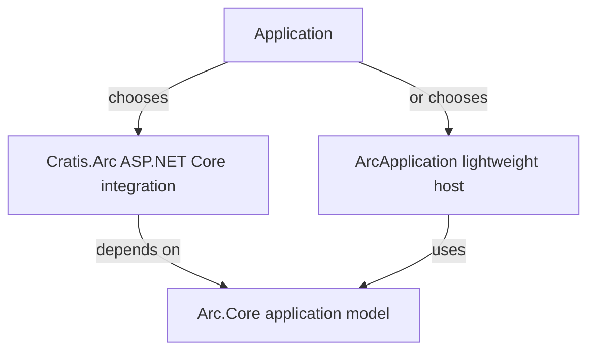

Cratis Arc offers two C# HTTP hosts: ASP.NET Core through `Cratis.Arc`, or a lightweight `HttpListener` host through `Cratis.Arc.Core`. Choose the host before following a setup guide: both use Arc.Core's command and query model, but their startup code is different. Persistence and TypeScript proxy generation are separate choices; neither host requires Cratis Chronicle.

## Choose the host first

| Host | Package and bootstrap | Use it when… |
| --- | --- | --- |
| ASP.NET Core | `Cratis.Arc`, `WebApplication.CreateBuilder(args)`, `builder.AddCratisArc()`, `app.UseCratisArc()` | You want ASP.NET Core routing, middleware, controllers alongside model-bound endpoints, and its authentication ecosystem |
| Lightweight host | `Cratis.Arc.Core`, `ArcApplication.CreateBuilder(args)` | You want a small HTTP service using .NET's `HttpListener`, without ASP.NET Core middleware or controllers |

For an ASP.NET Core application, start with the [standalone getting-started path](./getting-started/index.md). If you choose the lightweight host, follow the [Arc.Core getting-started guide](./core/getting-started.md) instead. Use the complete startup example for your chosen host: the builders and extension methods are host-specific.

Using Arc.Core without ASP.NET Core does not establish compatibility with every device, desktop, browser, ahead-of-time (AOT) compilation target, or restricted runtime. Check the selected host and dependencies on your deployment target before choosing it.

## Then choose persistence and client output

Once you have chosen a host, decide how each command saves changes. Commands may call application services, write MongoDB collections, or use EF Core contexts. Add [Chronicle](./chronicle/index.md) explicitly when a feature needs event persistence, projections that build read models from events, or reactors that respond to events. Returning an event-shaped object from standalone Core is ordinary response handling, not an automatic append to an event log.

:::tip[Separate decisions from inline persistence]
Direct service and database calls remain supported. When a model-bound command can describe its writes from the available inputs, prefer a pure `Handle()` returning [command operations](./commands/operations/index.md). Chronicle commands should still return events for durable facts; operations do not replace queries or `Provide()` reads.
:::

If you want generated TypeScript clients, configure [proxy generation](./proxy-generation/getting-started.md) after choosing the host. The generator is a separate post-build tool: install its build package and configure an output path. It inspects compiled assemblies and uses PDB debug information for source-file grouping, so the backend does not need to be running. Generate in Debug before type-checking the frontend.

## Continue

- [Set up Arc with ASP.NET Core](./getting-started/index.md) — packages, imports, database configuration, and the first runnable checkpoint.
- [ASP.NET Core integration](./asp-net-core/index.md) — middleware, authentication, and host-specific behavior.
- [Arc.Core overview](./core/overview.md) — the lightweight surface and its limits.
- [Backend guide](./index.md) — commands, queries, providers, identity, and tenancy.
