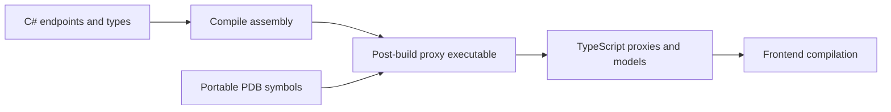

Cratis Arc's proxy generator turns compiled C# commands, queries and models into TypeScript clients, so you can call backend endpoints without maintaining a second set of request and response definitions. The default output includes React hooks and model metadata for converting JSON responses into typed objects.

Proxy generation works without Chronicle or event sourcing. Commands can call application services and return ordinary responses.

## How it works

The `CratisProxyGenerator` MSBuild target runs after `AfterBuild` when `CratisProxiesOutputPath` is nonempty. It launches a .NET executable over your compiled assembly, rather than a Roslyn source generator inside the C# compilation.

The executable discovers controller-based and model-bound endpoints, examines request and response types, extracts supported validation rules, and writes clients. PDB symbols optionally help choose output filenames; namespaces determine folders.

## What you receive

- Command classes with typed properties and `execute()`.
- Query clients for one-shot requests or observable updates, with parameter interfaces when needed.
- Model classes with runtime serialization metadata by default.
- Numeric TypeScript enums, including an all-flags constant for `[Flags]` enums.
- Identity details types discovered through `IProvideIdentityDetails<TDetails>`.
- Barrel files: `index.ts` files that re-export the generated types, unless index generation is disabled.

The default React output also includes command `use()` methods and query hooks. Set `CratisProxiesFramework` to `none` to omit React hooks and imports from command and query files.

There is no generated `Bindings` artifact or generated `Bindings.initialize()` call. Configure React consumers with the [`Arc` provider](../../../frontend/react/arc.md).

Generated files belong to the generator. After a backend contract changes, regenerate the clients and compile the frontend before using the new contract. Keep application code outside those files; handwritten changes can be lost when generation rewrites them.

## Choose your next step

1. [Set up generation](getting-started.md), including a safe output location and frontend dependencies.
2. Inspect [command](commands.md), [query](queries.md), and [type mapping](type-mapping.md) contracts.
3. Adjust [configuration](Configuration/index.md) when your folder structure or routes differ from the defaults.
4. Read [output behavior](Configuration/output-behavior.md) before changing deletion settings or mixing generated and handwritten files. Incremental output still removes stale generated files.

For specialized output, see [identity details](identity-details.md), [validation extraction](validation.md), [file tracking](file-index-tracking.md), and [linting generated proxies](linting.md).
