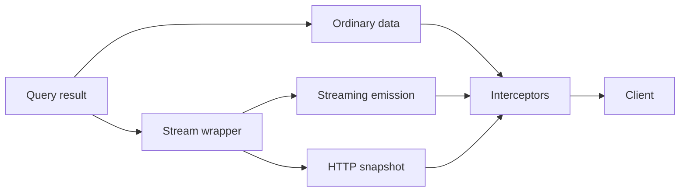

<!-- Copyright (c) Cratis. All rights reserved.
Licensed under the MIT license. See LICENSE file in the project root for full license information. -->

Read-model interception in Cratis Arc changes returned values before they reach the caller, without changing the stored read model. Use an interceptor to format a value or resolve protected data after the query has selected the rows the caller may read. This keeps the transformation out of individual query methods; it does not replace authorization.

## Supported paths and exceptions

| Path | Interception |
| --- | --- |
| Ordinary model-bound query data | Applied after rendering |
| Ordinary Arc-wrapped MVC GET data | Applied after rendering |
| Supported direct WebSocket/SSE streams and multiplexed hub emissions | Applied per emission |
| Observable HTTP snapshot, including `waitForFirstResult=true` | Applied before the first allowed result is returned |
| MVC `[AspNetResult]` | Opts out of the Arc result-processing path |

Check the endpoint style when using MVC. Ordinary wrapped GET results in `QueryActionFilter` use the returned object's runtime type as the interception key, or its generic element type for a collection—not the controller type. Controller queries performed through `IQueryPipeline` instead use the performer's `ReadModelType`, which `ControllerQueryPerformer` sets to the controller type. Observable MVC delivery uses the emitted type, or the read-model element type for a collection emission. Register `IInterceptReadModel<T>` for the type used by that path, and test the actual route to verify the transformation.

For private data, apply [query authorization](model-bound/authorization.md) and owner-scoped selection on every exposed path. An MVC `[AspNetResult]` response bypasses Arc result processing, including interception.



## Implement an interceptor

An account list can include a formatted balance while storage keeps the decimal value. This example uses the shared [`AccountId` concept](model-bound/index.md#model-account-identities-and-names) and returns an enriched record. Arc discovers `IInterceptReadModel<T>` implementations and resolves constructor dependencies from the current request or subscription's service provider.

```csharp
using System.Globalization;
using System.Threading.Tasks;
using Cratis.Arc.Queries;

namespace Banking.Accounts;

public record AccountSummary(AccountId Id, decimal Balance, string FormattedBalance);

public class FormatAccountBalance : IInterceptReadModel<AccountSummary>
{
    public Task<AccountSummary> Intercept(AccountSummary readModel) =>
        Task.FromResult(readModel with
        {
            FormattedBalance = readModel.Balance.ToString("C", CultureInfo.GetCultureInfo("en-US"))
        });
}
```

The caller receives the returned instance, including `FormattedBalance`. Use a `with` copy rather than mutating a record that another subscriber may share. An interceptor matches its declared model type; a different DTO with identical fields does not match automatically.

You can also register an interceptor as an `IInterceptReadModel<T>` service in dependency injection. If the same concrete type is both discovered and registered, Arc runs it once per model instance.

## Multiple interceptors and streams

Matching interceptors run in sequence for each item, but discovery order is not a business contract. Put order-sensitive work in one interceptor or an explicitly ordered application service. Collection items can be processed concurrently, so injected collaborators must support that use.

The pipeline skips stream wrappers because a wrapper is not a model instance. Streaming transports and observable HTTP snapshots intercept emitted values instead, using the requesting subscriber's identity and scoped services. A collection emission is intercepted by its element read-model type, not its collection type.

Interception runs before [emission guards](observable-query-emission-guards.md) decide whether delivery is allowed. A failing interceptor produces an error rather than releasing the raw value. Verify both transformed output and failure behavior through ordinary GET, observable snapshot GET, direct SSE/WebSocket, and hub delivery wherever the application exposes them.

Continue with [observable queries](model-bound/observable-queries.md) for lifetime rules and [emission guards](observable-query-emission-guards.md) for per-emission access decisions.
