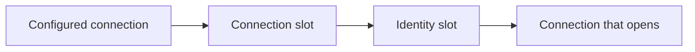

Your platform places each tenant's database somewhere: a server, a database name, maybe its own credentials or a short-lived access token. With one configured connection string, Arc cannot follow that placement. MongoDB only appends the tenant to a database name, and Entity Framework Core uses the same connection for everyone.

Connection resolution lets Arc ask instead. When a connection is needed, Arc describes **what** it connects for (the storage, the tenant and the purpose), and a resolver answers with the parts it knows. Everything it leaves out stays as configured.

## Two slots, one shape

Resolution has two optional slots, and both take the same kind of resolver:

- **`Connection`**: where to connect. This is the connection string, the database and the schema.
- **`Identity`**: who to connect as. This is a user name and password, or an access token.

Arc starts from the configured connection, applies what the `Connection` slot resolves, and then applies what the `Identity` slot resolves. A part set later wins. This is what makes the common split a configuration choice: keep the connection string from configuration and fetch only the identity from your platform. The reverse works too, and so does resolving both.



With no slot configured, nothing changes: Arc uses the configured connection exactly as before.

## Choose a resolver

| Resolver | Use it when |
| --- | --- |
| `Default` | Nothing needs resolving. This is the default for both slots. |
| `Template` | The placement follows a naming rule, such as `Database=app-{tenant}`. It also covers passwordless Entra ID authentication written into the connection string. |
| `Http` | Your platform decides placement or hands out credentials, and you can call it over HTTP. |
| `Custom` | You need code, such as a secret store or an SDK. Your type implements `IConnectionResolver` and is created through dependency injection. |

A template may use any scope value in braces (`{tenant}`), as well as `{purpose}` and `{storage}`. A placeholder with no value fails instead of connecting somewhere unintended.

## What a resolver answers

```csharp
public record ResolvedConnection(
    string? ConnectionString = null,
    string? Database = null,
    string? Schema = null,
    ConnectionIdentity? Identity = null,
    DateTimeOffset? ExpiresAt = null);

public record ConnectionIdentity(string? UserName = null, string? Password = null, string? AccessToken = null);
```

Every part is optional, and `ResolvedConnection.Unchanged` means "keep everything as configured". The identity is replaced as a whole, so a password from one slot never ends up next to an access token from the other.

A custom resolver is one method:

```csharp
using Cratis.Arc.Connections;

public class TenantConnections(ITenantDirectory directory) : IConnectionResolver
{
    public async Task<ResolvedConnection> Resolve(ConnectionRequest request, CancellationToken cancellationToken = default)
    {
        var tenant = request.Scope[WellKnownConnectionScopeKeys.Tenant];
        var placement = await directory.Find(tenant, cancellationToken);
        return new(Database: placement.Database, ExpiresAt: placement.ValidUntil);
    }
}
```

`ITenantDirectory` stands in for your own service. Select the resolver in code; Arc creates it through dependency injection, so its constructor can take any registered service:

```csharp
builder.AddCratisArc(configureBuilder: arc => arc.WithMongoDB(
    configureOptions: mongo => mongo.ConnectionResolution.Connection.UseCustom<TenantConnections>()));
```

## The HTTP contract

The `Http` resolver posts what it connects for (`storage`, `purpose` and a `scope` holding the `tenant`) as JSON to your endpoint, and your endpoint answers with the parts it knows. The contract is plain REST and the same for MongoDB and every SQL storage, so you can serve it from any language. The [connection resolution contract](../../../connection-resolution-contract.md) specifies the request, the response, the status codes, caching and security, and includes an OpenAPI description.

Configure static headers, such as an API key, under `Http:Headers`. The default timeout is 10 seconds (`Http:Timeout`).

## Authenticate to the endpoint

The resolver can call your endpoint with an OAuth 2.0 bearer token instead of, or next to, a static API key. Configure it under `Http:Authentication`, and every request carries `Authorization: Bearer <token>`:

| Setting | Description |
| --- | --- |
| `Type` | `None` (the default), `ClientCredentials` or `AzureCredential`. |
| `Scope` | The scope the token is requested for. For Microsoft Entra ID this is the endpoint's application ID URI with `/.default`, such as `api://<app-id>/.default`. |
| `TokenEndpoint` | The OAuth 2.0 token endpoint, for `ClientCredentials`. |
| `ClientId` | The client id. For `ClientCredentials` it identifies your application; for `AzureCredential` it selects a user-assigned managed identity or the workload identity application. |
| `ClientSecret` | The client secret, for `ClientCredentials`. Keep it in a secret store. |
| `Credential` | For `AzureCredential`: `ManagedIdentity` (the default), `WorkloadIdentity` or `Default`, the default Azure credential chain that also covers a developer sign-in. |
| `RefreshMargin` | How long before it expires a token is renewed. Five minutes by default. |

Arc keeps the token in memory, reuses it until the refresh margin, and fetches one token at a time however many connections ask for it. When your endpoint answers `401 Unauthorized`, Arc drops the token, gets a fresh one and sends the request once more. A `403 Forbidden` is not retried. Tokens and secrets are never logged.

Configuring both `Authentication` and an `Authorization` header under `Http:Headers` is a configuration error, and so is selecting a `Type` nothing can provide; both fail when the resolver is created rather than on the first connection.

### Client credentials

`TokenEndpoint` must use HTTPS; HTTP is allowed only for loopback hosts (`localhost`, `127.0.0.1` or `::1`) during local development.

`ClientCredentials` works with any OAuth 2.0 provider and needs nothing beyond Arc:

```json
{
  "Cratis": {
    "Arc": {
      "ConnectionResolution": {
        "Identity": {
          "Resolver": "Http",
          "Http": {
            "Endpoint": "https://platform.example/connections",
            "Authentication": {
              "Type": "ClientCredentials",
              "TokenEndpoint": "https://login.microsoftonline.com/<tenant-id>/oauth2/v2.0/token",
              "ClientId": "<client-id>",
              "ClientSecret": "from-your-secret-store",
              "Scope": "api://<app-id>/.default"
            }
          }
        }
      }
    }
  }
}
```

### Microsoft Entra ID with a managed identity

On Azure, let a managed identity or workload identity sign in, so there is no secret to keep. Add the `Cratis.Arc.Connections.Azure` package and register it:

```csharp
builder.Services.AddAzureConnectionResolverAuthentication();
```

Then select `AzureCredential`. The client id below selects a user-assigned managed identity; leave it out to use the system-assigned identity. As environment variables:

```bash
Cratis__Arc__ConnectionResolution__Identity__Resolver=Http
Cratis__Arc__ConnectionResolution__Identity__Http__Endpoint=https://platform.example/connections
Cratis__Arc__ConnectionResolution__Identity__Http__Authentication__Type=AzureCredential
Cratis__Arc__ConnectionResolution__Identity__Http__Authentication__Credential=ManagedIdentity
Cratis__Arc__ConnectionResolution__Identity__Http__Authentication__ClientId=<managed-identity-client-id>
Cratis__Arc__ConnectionResolution__Identity__Http__Authentication__Scope=api://<app-id>/.default
```

Without the package registered, `AzureCredential` fails at startup and tells you to call `AddAzureConnectionResolverAuthentication()`. To get tokens some other way, implement `IConnectionResolverAccessTokenProvider` and register it in the service collection.

Your endpoint must validate the token; see [Security](../../../connection-resolution-contract.md#security) in the contract.

## Caching and credentials

Arc keeps each resolution **in memory only**, keyed by storage, purpose and tenant. It never keys or logs by credential. An entry lives until its `ExpiresAt`, renewed one minute early, or for `CacheDuration` (five minutes by default) when the resolver gave no expiry. Set `CacheDuration` to `00:00:00` to resolve on every connection.

When a connection fails to authenticate, Arc drops the cached entry, so the next attempt resolves again and picks up rotated credentials. The failed attempt itself is not retried.

## Purpose

Connections resolve for `Runtime` unless code says otherwise. Run schema changes inside a purpose scope to have them resolve, for example, a user that may create tables:

```csharp
using (ConnectionPurposeScope.Begin(ConnectionPurpose.Schema))
{
    await dbContext.Database.MigrateAsync();
}
```

## Configure it once for the whole application

Configure resolution on Arc itself, under `Cratis:Arc:ConnectionResolution`, and both MongoDB and Entity Framework Core use it:

```json
{
  "Cratis": {
    "Arc": {
      "ConnectionResolution": {
        "Identity": {
          "Resolver": "Http",
          "Http": {
            "Endpoint": "https://platform.example/connections",
            "Headers": { "X-Api-Key": "from-your-secret-store" }
          }
        }
      }
    }
  }
}
```

The same in code:

```csharp
builder.AddCratisArc(configureOptions: arc =>
    arc.ConnectionResolution.Identity.UseHttp(new Uri("https://platform.example/connections")));
```

The `storage` in each request tells your endpoint which storage is asking, so one endpoint can serve both.

An integration that configures its own `ConnectionResolution` uses that instead, as a whole: there is no merging between the application-wide and the integration's configuration. Use it when one storage needs a different endpoint.

## Configure it for one storage

- [MongoDB connection resolution](../mongodb/connection-resolution.md)
- [Entity Framework Core connection resolution](../entity-framework/connection-resolution.md)

Connection resolution chooses a destination; it does not authorize the tenant. Keep rejecting tenants a caller may not use before any storage is touched, as described in [database isolation](./database-resolvers.md).
