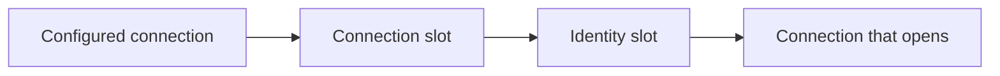

Your platform places each tenant's database somewhere: a server, a database name, maybe its own credentials or a short-lived access token. With one configured connection string, Arc cannot follow that placement. MongoDB only appends the tenant to a database name, and Entity Framework Core uses the same connection for everyone.

Connection resolution lets Arc ask instead. When a connection is needed, Arc describes **what** it connects for (the storage, the tenant and the purpose), and a resolver answers with the parts it knows. Everything it leaves out stays as configured.

## Two slots, one shape

Resolution has two optional slots, and both take the same kind of resolver:

- **`Connection`**: where to connect. This is the connection string, the database and the schema.
- **`Identity`**: who to connect as. This is a user name and password, or an access token.

Arc starts from the configured connection, applies what the `Connection` slot resolves, and then applies what the `Identity` slot resolves. A part set later wins. This is what makes the common split a configuration choice: keep the connection string from configuration and fetch only the identity from your platform. The reverse works too, and so does resolving both.



With no slot configured, nothing changes: Arc uses the configured connection exactly as before.

## Choose a resolver

| Resolver | Use it when |
| --- | --- |
| `Default` | Nothing needs resolving. This is the default for both slots. |
| `Template` | The placement follows a naming rule, such as `Database=app-{tenant}`. It also covers passwordless Entra ID authentication written into the connection string. |
| `Http` | Your platform decides placement or hands out credentials, and you can call it over HTTP. |
| `Custom` | You need code, such as a secret store or an SDK. Your type implements `IConnectionResolver` and is created through dependency injection. |

A template may use any scope value in braces (`{tenant}`), as well as `{purpose}` and `{storage}`. A placeholder with no value fails instead of connecting somewhere unintended.

## What a resolver answers

```csharp
public record ResolvedConnection(
    string? ConnectionString = null,
    string? Database = null,
    string? Schema = null,
    ConnectionIdentity? Identity = null,
    DateTimeOffset? ExpiresAt = null);

public record ConnectionIdentity(string? UserName = null, string? Password = null, string? AccessToken = null);
```

Every part is optional, and `ResolvedConnection.Unchanged` means "keep everything as configured". The identity is replaced as a whole, so a password from one slot never ends up next to an access token from the other.

A custom resolver is one method:

```csharp
using Cratis.Arc.Connections;

public class TenantConnections(ITenantDirectory directory) : IConnectionResolver
{
    public async Task<ResolvedConnection> Resolve(ConnectionRequest request, CancellationToken cancellationToken = default)
    {
        var tenant = request.Scope[WellKnownConnectionScopeKeys.Tenant];
        var placement = await directory.Find(tenant, cancellationToken);
        return new(Database: placement.Database, ExpiresAt: placement.ValidUntil);
    }
}
```

`ITenantDirectory` stands in for your own service. Select the resolver in code; Arc creates it through dependency injection, so its constructor can take any registered service:

```csharp
builder.AddCratisArc(configureBuilder: arc => arc.WithMongoDB(
    configureOptions: mongo => mongo.ConnectionResolution.Connection.UseCustom<TenantConnections>()));
```

## The HTTP contract

The `Http` resolver posts the request as JSON:

```http
POST https://platform.example/connections
Content-Type: application/json

{ "storage": "SqlServer", "purpose": "Runtime", "scope": { "tenant": "acme" } }
```

Your endpoint answers with a `ResolvedConnection` in camel case. Every property is optional:

```json
{
  "database": "tenant-acme",
  "identity": { "accessToken": "eyJ0eXAi..." },
  "expiresAt": "2026-10-15T12:00:00Z"
}
```

| Status | Meaning |
| --- | --- |
| `200 OK` with a body | Apply the parts in the body. |
| `204 No Content` | Keep the configured connection. |
| Anything else | Resolution fails with `ConnectionResolutionFailed`, and so does opening the connection. |

| Request property | Values |
| --- | --- |
| `storage` | `MongoDB`, `SqlServer`, `PostgreSql`, `Sqlite` |
| `purpose` | `Runtime` for data access, `Schema` for schema changes such as migrations |
| `scope` | `tenant` in Arc. The tenant is `Default` when no tenant is set. |

Configure static headers, such as an API key, under `Http:Headers`. The default timeout is 10 seconds (`Http:Timeout`).

## Caching and credentials

Arc keeps each resolution **in memory only**, keyed by storage, purpose and tenant. It never keys or logs by credential. An entry lives until its `ExpiresAt`, renewed one minute early, or for `CacheDuration` (five minutes by default) when the resolver gave no expiry. Set `CacheDuration` to `00:00:00` to resolve on every connection.

When a connection fails to authenticate, Arc drops the cached entry, so the next attempt resolves again and picks up rotated credentials. The failed attempt itself is not retried.

## Purpose

Connections resolve for `Runtime` unless code says otherwise. Run schema changes inside a purpose scope to have them resolve, for example, a user that may create tables:

```csharp
using (ConnectionPurposeScope.Begin(ConnectionPurpose.Schema))
{
    await dbContext.Database.MigrateAsync();
}
```

## Configure it for your storage

- [MongoDB connection resolution](../mongodb/connection-resolution.md)
- [Entity Framework Core connection resolution](../entity-framework/connection-resolution.md)

Connection resolution chooses a destination; it does not authorize the tenant. Keep rejecting tenants a caller may not use before any storage is touched, as described in [database isolation](./database-resolvers.md).
