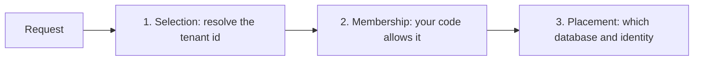

A Cratis Arc request needs a tenant ID, a decision that the caller may use it, and a storage destination. Follow tenant `acme` through those decisions to see which defaults you can use and where your application must supply membership checks or storage configuration.



| Decision | Owner | Details |
| --- | --- | --- |
| **Selection** | Arc | [Resolving tenant IDs](./resolvers.md) from a header, claim, subdomain or your own resolver |
| **Membership** | Your application or trusted ingress | [Verify caller-to-tenant membership](./membership.md) before accessing tenant storage |
| **Placement** | The storage integration | [Naming by default](#what-you-get-by-default), or [connection resolution](./connection-resolution.md) when your platform decides |

A resolver selects a candidate tenant; it does not establish caller membership. Arc can enforce your application's decision through a registered `ITenantMembership` hook. Without that hook or membership enforcement at a trusted ingress, selecting `acme` does not stop an unauthorized caller from using it.

## What you get by default

This configuration selects the tenant from the `tenant_id` claim. Authentication must validate the identity supplying that claim, and membership authorization must establish that it permits the caller to use the tenant:

```json
{
  "Cratis": {
    "Arc": {
      "Tenancy": {
        "ResolverType": "Claim",
        "ClaimType": "tenant_id"
      }
    }
  }
}
```

Each storage then reacts differently to the same tenant:

| Storage | What a named tenant `acme` gets | Default or unset tenant |
| --- | --- | --- |
| **MongoDB** | The database `<Database>+acme`. Collections in that scope come from it | The bare `<Database>` |
| **Entity Framework Core** | The configured connection, unchanged. Isolation is yours to configure | The same connection |
| **Chronicle** | The event store namespace `acme`, used verbatim | The `Default` namespace |

MongoDB's default naming and the optional Chronicle integration use the tenant ID to choose separate destinations. EF Core does not change its connection by default. An ordinary `DbContext` remains unaware of tenant context until your isolation design uses it.

Without a membership rule that rejects them, unset and default tenants select the default database or namespace. If your application requires a tenant, make that decision explicit in your membership check.

### Reading the tenant yourself

Inject `ITenantIdAccessor` where a service needs the current tenant. Arc applies any registered request membership hooks when resolving the candidate, but this fragment only checks whether an ID is set; it is not a membership rule:

```csharp
using Cratis.Arc.Tenancy;

public class CustomerService(ITenantIdAccessor tenantIdAccessor)
{
    public bool HasTenant => tenantIdAccessor.Current != TenantId.NotSet;
}
```

For off-request work, select the tenant first as described in [tenant context access](./tenant-context.md).

## Let your platform decide placement

Use [connection resolution](./connection-resolution.md) when the default names no longer describe where tenant data lives, or when each tenant needs its own server or credentials. Arc sends the storage type, tenant and connection purpose to a resolver. The answer can replace the destination or identity while leaving the other configured parts intact.

Resolution has two slots with one shape: `Connection` decides where to connect, and `Identity` decides who connects. Nothing changes until you configure one.

### One naming rule for every storage

This places every tenant in a database named after it, for MongoDB and EF Core alike:

```json
{
  "Cratis": {
    "Arc": {
      "ConnectionResolution": {
        "Connection": {
          "Resolver": "Template",
          "Template": { "Database": "tenant-{tenant}" }
        }
      }
    }
  }
}
```

### Credentials from your platform

Keep the server and database as configured, and resolve only who connects. A short-lived token from your platform stays out of configuration:

```json
{
  "Cratis": {
    "Arc": {
      "ConnectionResolution": {
        "Identity": {
          "Resolver": "Http",
          "Http": {
            "Endpoint": "https://platform.example/connections",
            "Headers": { "X-Api-Key": "from-your-secret-store" }
          }
        }
      }
    }
  }
}
```

The request carries the `storage`, so one endpoint can serve MongoDB and EF Core. It is a plain REST contract you can implement in any language: see the [connection resolution contract](../../../connection-resolution-contract.md).

### Placement by storage

The resolved parts apply differently to each storage:

| | MongoDB | SQL Server | PostgreSQL |
| --- | --- | --- | --- |
| `ConnectionString` | Replaces `Server` | Replaces the connection string | Replaces the connection string |
| `Database` | Replaces the database name, **including for the default tenant** | `Initial Catalog` | `Database` |
| `Identity` password | A SCRAM credential | `User ID` and `Password` | `Username` and `Password` |
| `Identity` access token | A `MONGODB-OIDC` credential that refreshes through the resolver | `SqlConnection.AccessToken` (Entra ID) | Used as the password |
| `Schema` | Not used | Not applied | Not applied |

Neo4j (see [Neo4j connection resolution](../neo4j/connection-resolution.md)) takes a Bolt URI as `ConnectionString`, a graph database name as `Database`, a basic credential from an `Identity` password and a bearer token from an `Identity` access token. It does not use `Schema`.

A resolved `Database` replaces default naming completely. With the template above, `acme` selects `tenant-acme`, while either default-tenant alias supplies `Default` and selects `tenant-Default`. Data under the old names stays there, so plan the data migration before changing the rule.

EF Core resolves when a connection opens, not when a context is created. The interceptor applies each resolution over the originally configured connection string, not a previous tenant's resolved string. Still check pooled-context reuse and any tenant-specific state your application keeps on the context.

See [MongoDB](../mongodb/connection-resolution.md) and [Entity Framework Core](../entity-framework/connection-resolution.md) for each storage. A storage that configures its own `ConnectionResolution` replaces the application-wide one as a whole. They are not merged.

### Migrations as a different identity

Resolution is for the `Runtime` purpose unless code says otherwise. Run schema changes inside a purpose scope so your resolver can hand out an identity that may alter the schema:

```csharp
using (ConnectionPurposeScope.Begin(ConnectionPurpose.Schema))
{
    await dbContext.Database.MigrateAsync();
}
```

## Chronicle: the kernel decides its own placement

The Chronicle integration maps the tenant to a namespace and nothing more. Where the namespace's events and read models live is decided by the Chronicle **kernel**, which is configured on its own, with the same resolvers and the same REST contract:

- Arc's `Cratis:Arc:ConnectionResolution` does not change where the kernel stores anything.
- The kernel's `storage.connectionResolution` does not change what your Arc application connects to.
- A single platform endpoint can answer both. Arc sends the tenant as its scope, and the kernel sends `kind`, `eventStore` and `namespace`.

Align these settings when your application reads read models that Chronicle writes. Chronicle projects into its read-model database for the namespace; the application reaches that database through its own MongoDB or EF Core configuration.

With default MongoDB naming, Arc's `<Database>+<tenant>` matches Chronicle's read-model name when `Database` is the event store name. Both use the bare name for the default tenant. With connection resolution, point both at the same destination. A MongoDB read from a nonexistent database can return no data instead of reporting a placement error.

Read Chronicle's [Tenancy](/chronicle/tenancy/) for the kernel side, including how MongoDB and SQL differ in naming, limits and permanent bindings.

## Choose a setup

| You want | Use |
| --- | --- |
| One database server, a database per tenant named by convention | The defaults for MongoDB and Chronicle. Add your own isolation for EF Core |
| Every tenant in a database named by a rule | A `Template` resolver on Arc, and the same rule on the kernel |
| Tenant databases provisioned by a platform, on separate servers | An `Http` resolver on Arc and on the kernel |
| Rotating credentials, managed identities or short-lived tokens | An `Identity` slot only, on both |
| Migrations as a more privileged user | `ConnectionPurpose.Schema`, and a resolver that answers it |

## Checklist

- Verify the caller's membership in the selected tenant before accessing storage, using `ITenantMembership` or a trusted ingress.
- Do not capture tenant-scoped collections, contexts or services in singletons.
- Include the tenant id in cache keys, logs and telemetry.
- Test an unset tenant, the default tenant and two named tenants, including concurrent requests and reused scopes.
- Check where each tenant's data actually lands, and not only that the tenant id was resolved.

## Where next

- [Database isolation](./database-resolvers.md): what each integration isolates
- [Connection resolution](./connection-resolution.md): the resolvers and the slots
- [Chronicle tenancy](../chronicle/tenancy.md): mapping the tenant to a namespace
- [Chronicle's Tenancy overview](/chronicle/tenancy/): the kernel, MongoDB and SQL in depth
