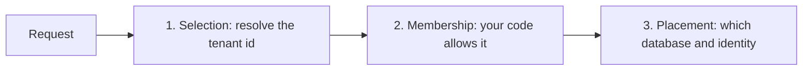

A tenant passes through three separate decisions before any data is read or written. Arc and the storage integrations each own part of it, and the defaults differ per storage. This page follows one tenant through all of them.



| Decision | Owner | Details |
| --- | --- | --- |
| **Selection** | Arc | [Resolving tenant IDs](./resolvers.md) from a header, claim, subdomain or your own resolver |
| **Membership** | Your application | Reject tenants the caller may not use, before any storage is touched |
| **Placement** | The storage integration | [Naming by default](#what-you-get-by-default), or [connection resolution](./connection-resolution.md) when your platform decides |

Arc resolves a tenant and exposes it. It does not authorize it. That check is yours.

## What you get by default

Resolve the tenant from a claim and nothing else needs configuring for selection:

```json
{
  "Cratis": {
    "Arc": {
      "Tenancy": {
        "ResolverType": "Claim",
        "ClaimType": "tenant_id"
      }
    }
  }
}
```

Each storage then reacts differently to the same tenant:

| Storage | What a named tenant `acme` gets | Default or unset tenant |
| --- | --- | --- |
| **MongoDB** | The database `<Database>+acme`. Collections in that scope come from it | The bare `<Database>` |
| **Entity Framework Core** | **Nothing.** Every tenant uses the one configured connection string. Isolation is yours to build | The same connection |
| **Chronicle** | The event store namespace `acme`, used verbatim | The `Default` namespace |

MongoDB and Chronicle separate tenants for you. EF Core does not, which is the usual surprise. A tenant context alone does not make an ordinary `DbContext` tenant-aware.

Unset and default tenants deliberately select the default database or namespace and are not rejected. If your application must not serve data without a tenant, reject the request yourself.

### Reading the tenant yourself

Inject `ITenantIdAccessor` where a service needs to branch on the tenant. This reads context only and does not authorize it:

```csharp
using Cratis.Arc.Tenancy;

public class CustomerService(ITenantIdAccessor tenantIdAccessor)
{
    public bool HasTenant => tenantIdAccessor.Current != TenantId.NotSet;
}
```

For off-request work, select the tenant first as described in [tenant context access](./tenant-context.md).

## Let your platform decide placement

Default naming suits a team that owns its database server. When a platform provisions each tenant's database, on its own server and with its own credentials, switch to [connection resolution](./connection-resolution.md). When a connection is needed, Arc describes **what** it is for (the storage, the tenant and the purpose), and a resolver answers with the parts it decides.

Resolution has two slots with one shape: `Connection` decides where to connect, and `Identity` decides who connects. Nothing changes until you configure one.

### One naming rule for every storage

This places every tenant in a database named after it, for MongoDB and EF Core alike:

```json
{
  "Cratis": {
    "Arc": {
      "ConnectionResolution": {
        "Connection": {
          "Resolver": "Template",
          "Template": { "Database": "tenant-{tenant}" }
        }
      }
    }
  }
}
```

### Credentials from your platform

Keep the server and database as configured, and resolve only who connects. A short-lived token from your platform stays out of configuration:

```json
{
  "Cratis": {
    "Arc": {
      "ConnectionResolution": {
        "Identity": {
          "Resolver": "Http",
          "Http": {
            "Endpoint": "https://platform.example/connections",
            "Headers": { "X-Api-Key": "from-your-secret-store" }
          }
        }
      }
    }
  }
}
```

The request carries the `storage`, so one endpoint can serve MongoDB and EF Core. It is a plain REST contract you can implement in any language: see the [connection resolution contract](../../../connection-resolution-contract.md).

### Placement by storage

The resolved parts apply differently to each storage:

| | MongoDB | SQL Server | PostgreSQL |
| --- | --- | --- | --- |
| `ConnectionString` | Replaces `Server` | Replaces the connection string | Replaces the connection string |
| `Database` | Replaces the database name, **including for the default tenant** | `Initial Catalog` | `Database` |
| `Identity` password | A SCRAM credential | `User ID` and `Password` | `Username` and `Password` |
| `Identity` access token | A `MONGODB-OIDC` credential that refreshes through the resolver | `SqlConnection.AccessToken` (Entra ID) | Used as the password |
| `Schema` | Not used | Not applied | Not applied |

Two nuances matter most:

- **A resolved `Database` replaces the default naming completely.** Tenant `acme` is no longer `<Database>+acme`, and the default tenant resolves as `Default`. Data stored under the old names stays there, so treat switching as a data migration.
- **EF Core resolves when a connection opens, not when a context is created.** A pooled context never reuses a connection resolved for an earlier tenant.

See [MongoDB](../mongodb/connection-resolution.md) and [Entity Framework Core](../entity-framework/connection-resolution.md) for each storage. A storage that configures its own `ConnectionResolution` replaces the application-wide one as a whole. They are not merged.

### Migrations as a different identity

Resolution is for the `Runtime` purpose unless code says otherwise. Run schema changes inside a purpose scope so your resolver can hand out an identity that may alter the schema:

```csharp
using (ConnectionPurposeScope.Begin(ConnectionPurpose.Schema))
{
    await dbContext.Database.MigrateAsync();
}
```

## Chronicle: the kernel decides its own placement

The Chronicle integration maps the tenant to a namespace and nothing more. Where the namespace's events and read models live is decided by the Chronicle **kernel**, which is configured on its own, with the same resolvers and the same REST contract:

- Arc's `Cratis:Arc:ConnectionResolution` does not change where the kernel stores anything.
- The kernel's `storage.connectionResolution` does not change what your Arc application connects to.
- A single platform endpoint can answer both. Arc sends the tenant as its scope, and the kernel sends `kind`, `eventStore` and `namespace`.

Keep them aligned when your application reads read models Chronicle writes. Chronicle projects into its read model database for the namespace. Your application reads through MongoDB or EF Core and its own resolution. Both must reach the same database. By default MongoDB lines up: Arc's `<Database>+<tenant>` equals Chronicle's read model name when `Database` is the event store name, and both use the bare name for the default tenant. With resolution, point both at the same placement. Reads that reach the wrong database come back empty rather than failing.

Read Chronicle's [Tenancy](/chronicle/tenancy/) for the kernel side, including how MongoDB and SQL differ in naming, limits and permanent bindings.

## Choose a setup

| You want | Use |
| --- | --- |
| One database server, a database per tenant named by convention | The defaults for MongoDB and Chronicle. Add your own isolation for EF Core |
| Every tenant in a database named by a rule | A `Template` resolver on Arc, and the same rule on the kernel |
| Tenant databases provisioned by a platform, on separate servers | An `Http` resolver on Arc and on the kernel |
| Rotating credentials, managed identities or short-lived tokens | An `Identity` slot only, on both |
| Migrations as a more privileged user | `ConnectionPurpose.Schema`, and a resolver that answers it |

## Checklist

- Verify membership before selecting a tenant, because Arc selects but does not authorize.
- Do not capture tenant-scoped collections, contexts or services in singletons.
- Include the tenant id in cache keys, logs and telemetry.
- Test an unset tenant, the default tenant and two named tenants, including concurrent requests and reused scopes.
- Check where each tenant's data actually lands, and not only that the tenant id was resolved.

## Where next

- [Database isolation](./database-resolvers.md): what each integration isolates
- [Connection resolution](./connection-resolution.md): the resolvers and the slots
- [Chronicle tenancy](../chronicle/tenancy.md): mapping the tenant to a namespace
- [Chronicle's Tenancy overview](/chronicle/tenancy/): the kernel, MongoDB and SQL in depth
