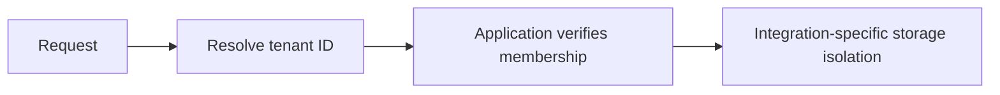

Cratis Arc tenancy gives request code a current tenant ID so one application can serve several customers or organizational units. Selecting that ID does not prove that the caller may use it, and it does not make every data store tenant-aware.

## Why Tenancy Matters

A request for tenant `acme` needs two answers before it reaches storage: may this caller use `acme`, and where does `acme`'s data live? A header or claim can supply the ID, but the application still needs an authorization decision and a storage design that agree with it.

Keep selection, membership authorization and storage isolation separate. Arc resolves the ID and exposes it through tenant context. Register an application-owned [`ITenantMembership` check](./membership.md) to verify the caller, or enforce that boundary at a trusted ingress. The MongoDB integration supplies tenant-aware database naming; EF Core isolation is application-owned. The optional Chronicle integration maps tenants to event-store namespaces. Storage naming never replaces membership checks.

See [database isolation](database-resolvers.md) for the exact integration boundaries, or [tenancy end to end](./end-to-end.md) to follow a tenant from request to storage across MongoDB, EF Core and Chronicle.

## Best Practices

Choose a [tenant resolver](./resolvers.md) that fits how requests reach your application. Use the development resolver only in local or test environments. Keep tenant IDs stable; opaque IDs can reduce enumeration but are not an access control.

Include the tenant ID in cache keys so data cached for one customer cannot be returned under another tenant's key. Carry it into logs and telemetry where needed for investigation, while treating it as sensitive metadata. Check that tenant-scoped services are resolved for the intended tenant rather than captured in a singleton.

## Security Considerations

Validate authentication before checking caller-to-tenant membership. Treat headers, query parameters and subdomains as candidate tenant selections, not evidence of permission. Use trusted claims or authoritative membership data for the decision, and still enforce permission to perform the requested operation.

Start with [tenant membership](./membership.md) to set that boundary. Then verify the storage destination for allowed requests and confirm that unauthorized requests are rejected before tenant data is accessed.

## Topics

- [Tenancy end to end](./end-to-end.md): follow a request through selection, membership and storage
- [Tenant membership](./membership.md): authorize the caller's use of the selected tenant
- [Resolving tenant IDs](./resolvers.md)
- [Configuration](./configuration.md)
- [Tenant context access](./tenant-context.md)
- [Database isolation](./database-resolvers.md)
- Development tenant discovery: [`ICanProvideTenants`](../identity/development-and-topologies.md#implementing-a-tenants-provider) in C#, or [JVM development providers](/arc/backend/kotlin/guides/development-users-and-tenants/) (`TenantsProvider` in Kotlin, `AsyncTenantsProvider` in Java). They supply a roster for tools such as [Lens](/tools/lens/). Publishing tenants through `/.cratis/tenants` neither resolves the current tenant nor checks caller membership.
