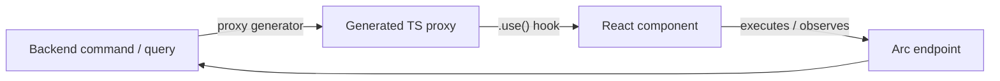

import { Aside, LinkCard, CardGrid } from '@astrojs/starlight/components';

Cratis Arc generates TypeScript clients from your backend's command and query contracts, so your
frontend can submit changes and read data through typed APIs instead of hand-written HTTP calls.
In React, the generated clients provide hooks for using those contracts in components.

A command asks the backend to change something; a query reads data. A generated client, also called
a proxy, carries the request and response types into your editor, along with validation rules the
generator can safely extract. Regenerate after a backend change, then type-check the frontend to
find callers that need updating.

This client workflow does not require a particular database or event sourcing. Your backend can use
[current-state storage](/arc/arc-without-event-sourcing/), or integrate with
[Cratis Chronicle](/arc/backend/csharp/chronicle/) to store events and build read models from them.

## How the pieces fit



Start with a command or query you want to call from the browser:

1. Define its input and result on the backend.
2. Configure generation using the [C#](/arc/backend/csharp/proxy-generation/getting-started/),
   [Kotlin or Java](/arc/backend/kotlin/guides/typescript-proxies/), or
   [TypeScript](/arc/backend/typescript/proxy-generation/getting-started/) guide.
3. Import the generated client and call its static `.use()` hook from your React component.

Each backend has its own generation commands, metadata inputs, and output paths. The React examples
below use C# output paths; use the imports your generator actually writes. Follow its setup guide for
frontend dependencies and configuration, even if you only instantiate the generated classes without hooks.

The clients use the same `@cratis/arc` runtime, but backend capabilities and generator coverage differ.
Use the [capability matrix](/arc/capabilities/) for C#, Kotlin, and Java, the
[JVM parity reference](/arc/backend/kotlin/reference/parity/) for JVM differences, and the
[TypeScript capability reference](/arc/backend/typescript/reference/capabilities/) for the
[TypeScript backend](/arc/backend/typescript/). Sharing a client runtime does not make the backends
interchangeable.

## Execute a command from React

To open an account, define a command with the account's identity and owner. These backend fragments
write current state directly: C# inserts a MongoDB document, while Kotlin, Java, and TypeScript save
through an application-supplied repository. They assume your application's `AccountId`, `AccountHolder`,
`Account`, and persistence registration; they are not a complete backend setup.

<ArcBackendTabs snippet="frontend/index/open-account" />

The handler writes the account; the frontend submits the command's input through its generated
client. This React component creates an account identity, binds the owner field, and reports whether
execution succeeded:

```tsx
// Frontend — the generated proxy, driven by its static .use() hook
import { useState } from 'react';
import { Guid } from '@cratis/fundamentals';
import { OpenAccount } from './api/accounts/OpenAccount';

export const OpenAccountForm = () => {
    const [id] = useState(() => Guid.create());
    const [command, setValues] = OpenAccount.use({ id, owner: '' });
    const [saving, setSaving] = useState(false);
    const [saved, setSaved] = useState(false);
    const [message, setMessage] = useState('');

    const submit = async () => {
        setSaving(true);
        try {
            const result = await command.execute();
            setSaved(result.isSuccess);
            setMessage(result.isSuccess ? 'Account opened.' : 'Could not open account. You can retry.');
        } finally {
            setSaving(false);
        }
    };

    return (
        <>
            <input value={command.owner ?? ''} disabled={saving || saved}
                onChange={(e) => setValues({ owner: e.target.value })} />
            <button onClick={submit} disabled={saving || saved}>Open account</button>
            <p role="status">{message}</p>
        </>
    );
};
```

The `.use()` hook returns `[command, setValues, clearValues]`. Use `setValues` when an input changes
so React renders the updated value. Assigning a command property directly tracks changes, but does not
guarantee a render for every edit or automatically run validation. Here the Guid-based `AccountId`
needs a Fundamentals `Guid`, created once for this operation. After success, the form disables further
submission with that identity. The [getting-started checkpoint](/arc/frontend/react/getting-started/)
shows the reset pattern for repeated submissions.

The component checks `result.isSuccess` before displaying “Account opened.” and leaves a failed
submission available to retry. Keep that save status explicit: `hasChanges` compares edits with a
baseline, and a successful execution accepts the submitted values as that baseline. It does not
replace the command result. See [execution baseline limitations](./react/commands/data-binding.md#execution-baseline-limitations)
for change-tracking guidance. Supported generated validation rules run on the client, but the server
still validates the command; some backend rules cannot be projected to the client.

<Aside type="tip" title="Don't hand-roll forms">
    To build a larger form, use [Command form](./react/command-form/) fields or the
    [Components](/components/) library's `CommandDialog`. They bind fields to the command and display
    validation feedback; the dialog also handles execution and in-flight state.
</Aside>

## Show live data with an observable query

Use an observable query when a screen needs to follow changes after its first read. The backend
supplies a stream of results, and the generated `.use()` hook subscribes to it. When that source emits
changed data, React renders the new result without polling.

```tsx
import { AllAccounts } from './api/accounts/AllAccounts';

export const AccountsList = () => {
    const [accounts] = AllAccounts.use();   // observable: re-renders as the read model changes

    return (
        <ul>
            {accounts.data.map((account) => (
                <li key={String(account.id)}>{account.owner}</li>
            ))}
        </ul>
    );
};
```

The hook returns a `QueryResultWithState`: `accounts.data` holds the rows, while `isPerforming`,
`hasData`, and validation state describe the result. This excerpt shows only the rows; before treating
them as a successful result, handle readiness, authorization, validation, and failure states in your
screen. [React observable queries](./react/queries/observable-queries.md) covers those states and the
connection setup.

A command write alone does not produce a live update. The backend needs a source that observes or
publishes the relevant changes, such as MongoDB `Observe()` on C# or an `ObservableSource` on TypeScript.
The [backend observable query guide](/arc/backend/csharp/queries/model-bound/observable-queries/)
explains the C# contract; use your backend's query guide for its supported stream types.

## Two ways to build: hooks or MVVM

Start with the hooks shown above to keep state beside the markup that uses it. If a screen develops
substantial view logic you want to test or reuse independently, Model-View-ViewModel (MVVM) gives that
logic a view model class.

| Reach for… | When |
| --- | --- |
| [Hooks](./react/) | Forms and lists where state belongs in the component. |
| [MVVM for React](./react/mvvm/) | Complex screens with substantial view logic you want to test and reuse apart from the markup. |

Start with hooks; move a screen to MVVM only when its logic outgrows the component.

## Where to go next

For your first screen, follow Getting started (React) to configure Arc, submit a command, and display
a query result. If that is already working, choose the guide for the interaction you need next.

<CardGrid>
    <LinkCard title="Getting started (React)" href="./react/getting-started/" description="Wire Arc into a React app and call your first command and query." />
    <LinkCard title="Commands in React" href="./react/commands/" description="The .use() hook, validation, and command scopes." />
    <LinkCard title="Queries in React" href="./react/queries/" description="Observable, paged, and conditional queries." />
    <LinkCard title="Command forms" href="./react/command-form/" description="Typed form fields that bind straight to a command." />
    <LinkCard title="Identity in React" href="./react/identity/" description="Who the user is and what they're allowed to do." />
    <LinkCard title="Components" href="/components/" description="Prebuilt dialogs, forms, and tables that consume these proxies." />
</CardGrid>
