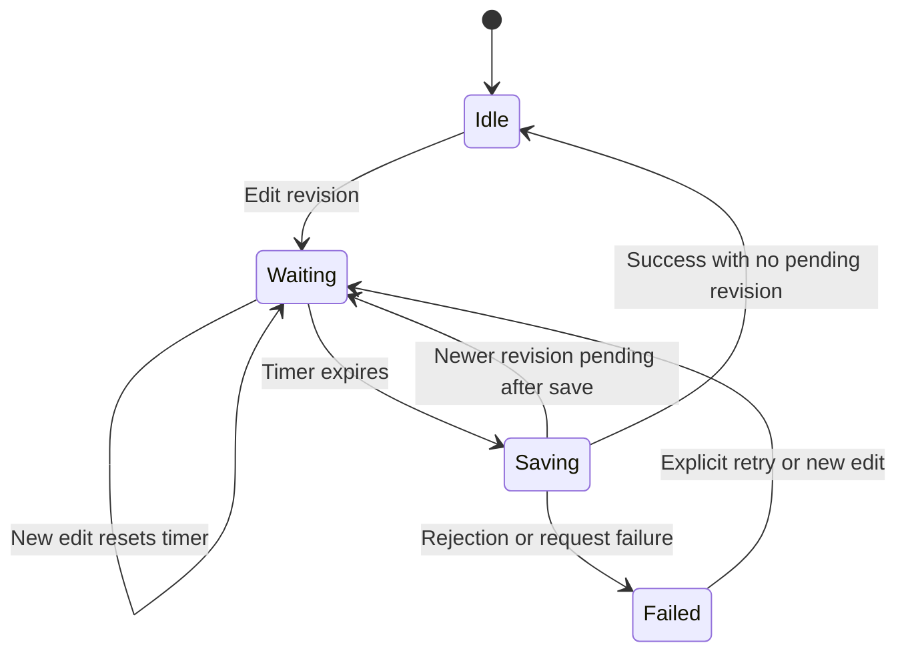

Extend Cratis Arc `CommandForm` through its context or form handle so computed displays and save controls use the values being edited. Calling `useCommand(UpdateProfile)` separately creates another command instance; executing it can submit different values from those on screen.

## Computed fields

To show an invoice total as the user edits, read `quantity` and `unitPrice` from a descendant of the form. In this example, the generated `CreateInvoice` has those two numeric properties. `InvoicePreview` uses the zero-argument `useCommandInstance` hook to read the form-owned instance; the calculated amount is display-only and does not create or validate a persisted command field.

```tsx
import { CommandForm, NumberField, useCommandInstance } from '@cratis/arc.react/commands';
import { CreateInvoice } from './commands/CreateInvoice';

function InvoicePreview() {
    const command = useCommandInstance<CreateInvoice>();
    const total = command.quantity * command.unitPrice;
    return <output aria-live="polite">Preview total: {total.toFixed(2)}</output>;
}

export function InvoiceForm() {
    return (
        <CommandForm command={CreateInvoice} initialValues={{ quantity: 1, unitPrice: 0 }}>
            <NumberField<CreateInvoice> value={c => c.quantity} title="Quantity" min={1} step={1} />
            <NumberField<CreateInvoice> value={c => c.unitPrice} title="Unit price" min={0} step={0.01} />
            <InvoicePreview />
            <button type="submit">Create invoice</button>
        </CommandForm>
    );
}
```

Changing either field updates the displayed total. Keep `InvoicePreview` beneath the form provider even if you add custom layout wrappers. The calculation helps the user review the invoice; the backend must still enforce valid quantities and authoritative prices. If values need normalization before submission, return the existing instance synchronously from [onBeforeExecute](./form-lifecycle.md#before-execute-hook).

## Integration with external libraries

For a modal, page toolbar, or wizard footer, use the [parent-control example](./form-lifecycle.md#reaching-the-form-from-a-parent). Its `formRef` executes the form, while `onStateChange` keeps external controls in step with the busy state. Both Enter submission and the external button pass through the same asynchronous confirmation before execution.

Keep the modal's open/close state in its owning component and close only after `result.isSuccess` or `onSuccess`. A validation or authorization failure then leaves the editor open for correction. Use your installed UI package's dialog API; [Cratis Arc dialogs](../dialogs.md) and Cratis Components integration are separate presentation choices that retain the same form context.

Load edit data with [query population](./data-loading.md#populating-a-form-from-a-query) or mount the form with resolved initial values. Passing a separate command instance as `initialValues` does not make that instance the form's executable command, and spreading a generated command does not copy its accessor-backed properties.

## Autosave boundaries

An edit revision, not `hasChanges`, is the unit of autosave work. Use the form's `commandVersion` or actual values to reset a timer. The following diagram is an **application design outline**, not a built-in Arc autosave API:



Serialize requests and track which revision each request submitted. Decide how to handle edits made during a save, and provide retry and failure feedback without repeatedly resaving a failed revision. Execute through the form to keep its callbacks and result display connected to each attempt. `hasChanges` can stay `true` across many edits, so it cannot tell a debounce timer when a new revision arrived.

`Command.execute()` captures submitted values and advances its change-tracking baseline only after a successful server result, including falsy values such as `0` and `false`. That baseline is not proof of durable storage: success means what your handler's response contract says it means. Tie a “saved” indicator to a last-successful revision and the backend's persistence contract. CommandForm does not prevent overlapping submissions; your application must coordinate saves.

## Check the behavior

When checking the finished workflow, confirm that the request contains the values shown in the editor. Try an invalid submission and a rejected request: the editor should remain available for correction. Then check rapid edits, responses arriving out of order, unmounting while loading, Enter submission, and canceling confirmation. These interactions reveal problems that a build alone cannot catch.

## See also

- [Layouts](./layouts.md)
- [Working with hooks](./hooks.md)
- [Validation](./validation.mdx)
- [Form lifecycle](./form-lifecycle.md)
