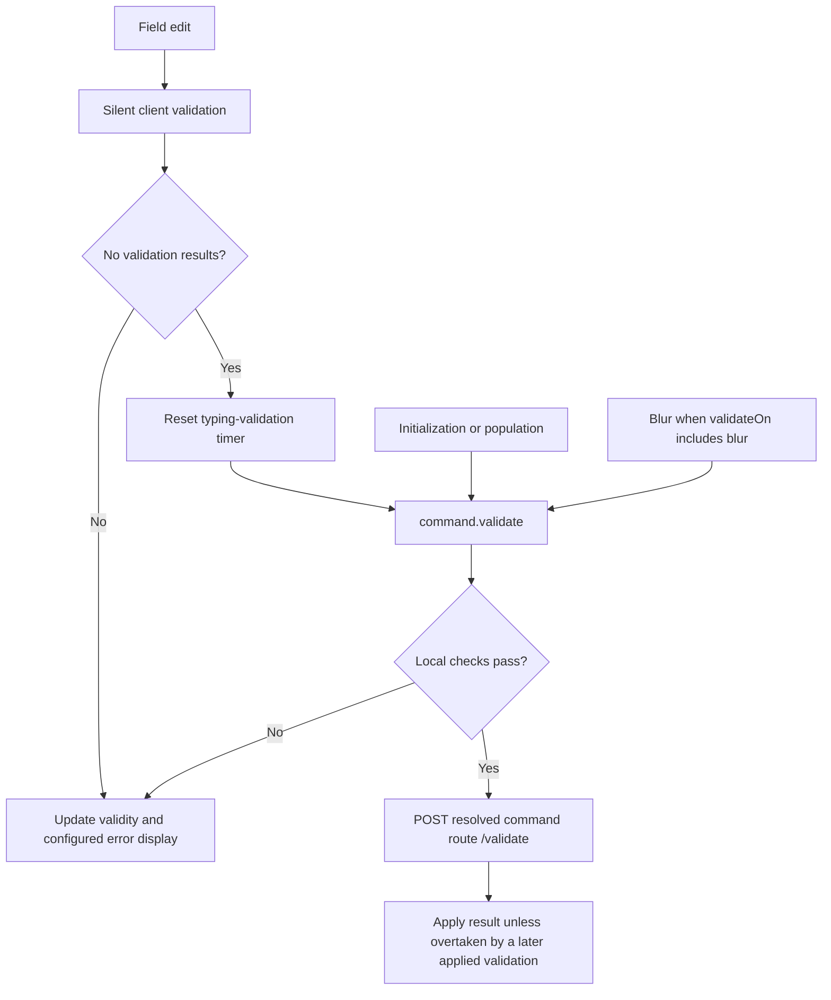

Cratis Arc `CommandForm` can check server-only rules while users edit, so they can correct a problem before submitting. Enable `autoServerValidate` for checks such as an email policy that reads server state. It defaults to `false`; submission still runs server validation when local validation passes.

## Enable preflight feedback

Start with the generated `UpdateProfile` from the [backend validation example](./validation.mdx#backend-validation). After configuring Cratis Arc and generating the proxy, enable the check on the form that owns the edited command:

```tsx
import { CommandForm, InputTextField, useIsCommandExecuting } from '@cratis/arc.react/commands';
import { UpdateProfile } from './commands/UpdateProfile';

function SubmitButton() {
    const isExecuting = useIsCommandExecuting();
    return <button type="submit" disabled={isExecuting}>{isExecuting ? 'Saving…' : 'Save'}</button>;
}

export function ProfileForm() {
    return (
        <CommandForm
            command={UpdateProfile}
            initialValues={{ name: '', email: '' }}
            validateOn="change"
            autoServerValidate
            autoServerValidateThrottle={500}
        >
            <InputTextField<UpdateProfile> value={c => c.name} title="Name" />
            <InputTextField<UpdateProfile> value={c => c.email} title="Email" type="email" />
            <SubmitButton />
        </CommandForm>
    );
}
```

After locally valid edits settle, the form calls the generated command's `validate()` and displays returned field errors. The validation request uses the command's resolved route with `/validate` appended; use the generated route rather than guessing a kebab-case URL. This requires an Arc command endpoint, not an arbitrary JSON validation service.

## Validation flow



The typing timer waits until edits pause before sending a request. This is a debounce, despite the prop's `Throttle` name: another edit clears the pending timer. The default delay is 500 ms; zero removes it on this path. Choose a longer delay for expensive checks.

Other validation paths do not use that delay. With `autoServerValidate` enabled, initialization, population, and eligible blur validation also call `validate()`. `validateOnInit={false}` hides initial error display but does not prevent the initialization check. `validateOn` controls interaction error display, while silent client validation runs on each edit. Account for these additional calls when estimating request traffic.

## Add a server-only rule

The rule needs a command endpoint, such as `UpdateProfile` in [Backend validation](./validation.mdx#backend-validation); a standalone data transfer object and validator do not create that endpoint.

Add the directory rule beside that command, then implement and register the profile-directory service for your application. Its email policy must account for the current profile and tenant, including an unchanged email on an existing profile. The fragment below supplies the validation integration, not the service implementation. For a TypeScript backend, check which rules reach the client in the [generator validation reference](/arc/backend/typescript/proxy-generation/validation/).

<ArcBackendTabs snippet="frontend/react/command-form/auto-server-validation/server-only-rule" />

In C#, keep the `EmailAddressValidator` from the linked example: it owns the required/format rules, and this replacement validator takes over the command-level ones. Arc's concept-aware `RuleFor` unwraps the property, so the three-argument `MustAsync` overload reads the named `command.Email` from the command when calling the application service. `MinimumLength` and `MaximumLength` are FluentValidation method names.

The Kotlin example uses a separate `CommandValidator` with a suspending `validate` function for the directory lookup. Keep it beside the `FluentModelValidator`, which projects the supported literal rules to the client; the fluent surface does not provide an asynchronous or predicate rule. There is no `CancellationToken` parameter: the validator runs inside the command coroutine. The Java example instead returns a `CompletionStage` from `AsyncCommandValidator` and registers it through `AsyncCommandValidatorAdapter`.

Either way the asynchronous directory rule remains server-side, while the name rules and supported format rules are generated for the client. No `minLength`, `maxLength`, or `pattern` props are supported on the built-in `InputTextField`.

A server preflight runs pipeline filters and validators but skips the command handler and handler-argument resolution. Validators and filters must avoid unwanted side effects and disclosing sensitive information. A successful check does not reserve an email or enforce uniqueness under concurrent writes: enforce that invariant when the application performs the write as well.

## Read the response

Arc returns a command result with a `validationResults` array, not a `validationErrors` dictionary. This is an **illustrative failure envelope**; the correlation ID and rule message are example values:

```json
{
  "correlationId": "34c66385-006a-4ab6-a3f9-cb34c751ec30",
  "isSuccess": false,
  "isValid": false,
  "isAuthorized": true,
  "hasExceptions": false,
  "validationResults": [
    {
      "severity": 3,
      "message": "This email cannot be used for this profile.",
      "members": ["email"],
      "state": null,
      "reason": "rule"
    }
  ],
  "exceptionMessages": [],
  "exceptionStackTrace": "",
  "authorizationFailureReason": "",
  "response": null
}
```

A failed preflight has no command response to consume; some server results omit that optional member rather than returning null. CommandForm matches `members` to fields and displays the first matching message by default. Use an [error summary](./validation.mdx#accessing-validation-state) for all messages or results without members.

## Limits and operating guidance

Treat the displayed result as the latest applied check, not permission to submit. An older response cannot replace a newer validation result that has already been applied, but it can still appear while a newer request is pending. If your UI must tie a result to an exact edit, use the [revision-guarded pattern](./validation.mdx#progressive-validation). `isExecuting` reports command execution, not preflight network activity, and CommandForm exposes no validation-pending state. It cannot drive a “Checking availability” indicator.

Preflight can stop at client rules without reaching server authorization. Execution must validate and authorize again, and a request failure must not be treated as success.

The typing delay reduces traffic but does not prevent abuse. Configure ASP.NET Core rate-limiting middleware/policies or equivalent gateway controls, and verify that they cover the generated validation endpoint. Keep lookups indexed and bounded. If you cache results, include the correct tenant/user keys and expiration; cached availability still cannot enforce uniqueness at write time. Prefer submit-only validation for expensive endpoints or checks whose answers reveal private data.

## See also

- [Validation](./validation.mdx)
- [Backend command validation](../../../backend/csharp/commands/command-validation.md)
- [Form lifecycle](./form-lifecycle.md)
- [Customization](./customization.md)
