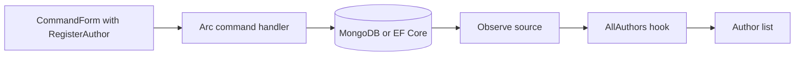

import { Aside } from '@astrojs/starlight/components';

Connect a React screen to your standalone Cratis Arc backend so users can register authors and see the list update without refreshing. Generated TypeScript proxies carry the backend contract into React, and `CommandForm` handles the form's command instance, submission and feedback. Cratis Components supplies the fields in this example. You do not need Chronicle.

Continue here after the C# author walkthrough. If you built the TypeScript backend instead, use its [React proxy walkthrough](/arc/backend/typescript/getting-started/continue-in-the-browser/): its generator and output paths differ.

## Prerequisites

Complete [Your first command and query](/arc/backend/csharp/getting-started/your-first-command/), including the curl check and Debug proxy generation, and keep that backend running on `http://localhost:5000`. Keep the storage branch you chose there: SQLite through EF Core or MongoDB.

You also need a Vite + React 19 app with `react`, `react-dom`, `@cratis/fundamentals`, `@cratis/arc`, and `@cratis/arc.react` installed. If you have no frontend yet, follow [the full-stack slice's browser setup](/arc/tutorial/first-slice/#set-up-the-browser-project) first. It creates the browser project in `Library/`, sharing `src/` with the backend's generated proxies, and supplies the entry point, TypeScript configuration and build commands.

From that browser project's root, add Components and its required peers:

```bash
npm install @cratis/components@4.39.0 reflect-metadata@0.2.2 tsyringe@4.10.0
```

Use the C# walkthrough's baseline for this first run: NuGet Arc **22.156.2**, npm `@cratis/arc` and `@cratis/arc.react` **22.156.2**, Fundamentals **7.27.1**, React **19.3.1**, and Components **4.39.0**. The [browser setup](/arc/tutorial/first-slice/#set-up-the-browser-project) pins the rest of the toolchain.

Keep both Arc npm packages on the version used by your generated proxies and within Components' peer range (`>=20.3.1 <23`). A second Arc runtime copy can make generated classes fail the type-check because their base classes have private members. See [Components setup](/components/getting-started/) for other installation options, or [Without Components](#without-components) to use Arc's built-in fields.

Before adding the screen, check that `src/Authors/RegisterAuthor.ts` and `src/Authors/Author.ts` exist. The C# setup enables `CratisProxiesUseSourceFileAsOutputFile`, which groups `AllAuthors` with `Author`; the imports below use that layout. If you use an existing frontend in a different directory, make sure the configured proxy output is available to it and adjust those imports. Regenerate with a Debug build after changing a backend contract.

Without source-file grouping, `AllAuthors` has its own file and the import becomes `./Authors/AllAuthors`. There is no generated `Bindings` startup file to import; mounting `<Arc>` initializes the bindings.

## Load the Components styles

Import the Components stylesheets once, at the top of your existing entry point, with `tokens` first:

```tsx title="src/main.tsx (excerpt)"
import 'reflect-metadata';
import '@cratis/components/tokens';
import '@cratis/components/styles';
import '@cratis/components/theme';
```

These imports load shared CSS variables, component structure and the baseline theme, including dark mode. If TypeScript reports `TS2882` for the stylesheet imports, declare the subpaths once in `src/cratis-components-styles.d.ts`:

```typescript title="src/cratis-components-styles.d.ts"
declare module '@cratis/components/tokens';
declare module '@cratis/components/styles';
declare module '@cratis/components/theme';
```

## Mount Arc and the author screen

Put this component in `App.tsx` and render it from your entry point:

```tsx title="src/App.tsx"
import { useState } from 'react';
import { Guid } from '@cratis/fundamentals';
import { Arc } from '@cratis/arc.react';
import { CommandForm, useIsCommandExecuting } from '@cratis/arc.react/commands';
import { CratisComponentsProvider } from '@cratis/components';
import { InputTextField } from '@cratis/components/CommandForm';
import { AllAuthors } from './Authors/Author';
import { RegisterAuthor } from './Authors/RegisterAuthor';

function RegisterButton() {
    const isExecuting = useIsCommandExecuting();
    return <button type="submit" disabled={isExecuting}>Register author</button>;
}

function Authors() {
    const [authors] = AllAuthors.use();
    const [id, setId] = useState(() => Guid.create());
    const [message, setMessage] = useState('');

    return (
        <section>
            <h1>Authors</h1>
            {!authors.isReady || authors.isPerforming
                ? <p>Loading authors…</p>
                : !authors.isSuccess
                    ? <p>Could not load authors.</p>
                    : <ul>{authors.data.map(author => (
                        <li key={String(author.id)}>{author.name}</li>
                    ))}</ul>}
            <CommandForm<RegisterAuthor>
                key={String(id)}
                command={RegisterAuthor}
                initialValues={{ id }}
                onSuccess={() => {
                    setMessage('Author registered.');
                    setId(Guid.create());
                }}
                onFailed={() => setMessage('Registration failed. Check the name and your permissions.')}>
                <InputTextField<RegisterAuthor> value={c => c.name} title="Name" />
                <RegisterButton />
            </CommandForm>
            <p role="status">{message}</p>
        </section>
    );
}

export const App = () => (
    <Arc>
        <CratisComponentsProvider>
            <Authors />
        </CratisComponentsProvider>
    </Arc>
);
```

`CommandForm` creates a `RegisterAuthor` instance and seeds it from `initialValues`. The field's `c => c.name` accessor binds the input to the generated command, so you do not need a separate `value`/`onChange` pair. Submitting executes the command. If the backend returns validation messages, the form shows them beside the matching field; server exceptions get a safe message.

Keep `RegisterButton` inside `CommandForm`. Its `useIsCommandExecuting()` hook reads that form's pending state to disable submission. Calling the same hook in `Authors` would put it outside the form's context and throw.

The backend requires both `Id` and `Name`. Its `AuthorId` concept maps to a Fundamentals `Guid` in the generated command. Create the ID once for each new registration and keep it while editing or retrying. It belongs in `initialValues` because the user does not enter it.

After success, `onSuccess` creates the next ID. The form's `key` changes with it, mounting a fresh form with an empty name. Changing `initialValues` alone after mount does not repopulate the form.

`<Arc>` initializes the runtime bindings and provides command, identity, messaging, and query-cache contexts. `CratisComponentsProvider` supplies Components' locale and labels; it does not replace `<Arc>`.

With no origin configured, requests target your current origin, so the Vite dev server must forward Arc's routes to the backend. Add both prefixes to your existing `vite.config.ts`, pointing at the port the backend checkpoint uses:

```typescript title="vite.config.ts (excerpt)"
server: {
    proxy: {
        '/api': { target: 'http://localhost:5000' },
        '/.cratis': { target: 'http://localhost:5000', ws: true }
    }
}
```

`/api` carries the command and query requests; `/.cratis` carries the observable-query stream (Server-Sent Events by default) and identity. See [Vite configuration](./vite-configuration.md) for the other options.

## Check the round trip

Type-check and build your frontend, then start it with your app's Vite command. You should see the author saved by curl in the backend walkthrough.

Enter a new name and submit. “Author registered.” should appear, the name field should clear, and the list should update without a refresh. Register another name, reload, and confirm all three authors remain, each with a different id in the query response.

The live update comes from the backend's `Observe()` source: MongoDB change streams or EF Core's `SaveChanges` notifications in the same host. Arc transports those emissions to `AllAuthors.use()`; executing a command alone does not create a persistence subscription. If loading fails, check the browser's network requests and both Vite proxy targets before changing the UI.



<Aside type="note" title="This backend accepts a blank name">
The backend checkpoint has no validation rules yet, so a blank name is registered. When you add rules on the backend, `CommandForm` shows their messages beside the field without further frontend code. Keep authoritative rules on the backend; see [Command form validation](./command-form/validation.mdx).
</Aside>

## Without Components

You can keep the same form without adopting Components. Skip its installation and stylesheet imports, remove `CratisComponentsProvider`, and import Arc's built-in `InputTextField` instead:

```tsx
import { CommandForm, InputTextField, useIsCommandExecuting } from '@cratis/arc.react/commands';
```

The rest of `App.tsx` stays the same. See [CommandForm field types](./command-form/field-types/index.md) for the other built-in fields.

### Own the whole sequence yourself

Use the generated command hook directly when your application needs to own submission, input binding and feedback. For example, an existing design system may have inputs that cannot be wrapped as command form fields. This version replaces `Authors` above and tracks the pending state and result itself:

```tsx
import { useState } from 'react';
import { Guid } from '@cratis/fundamentals';
import { AllAuthors } from './Authors/Author';
import { RegisterAuthor } from './Authors/RegisterAuthor';

function Authors() {
    const [authors] = AllAuthors.use();
    const [id, setId] = useState(() => Guid.create());
    const [command, setValues] = RegisterAuthor.use({ id, name: '' });
    const [saving, setSaving] = useState(false);
    const [message, setMessage] = useState('');

    async function register() {
        setSaving(true);
        try {
            const result = await command.execute();
            if (result.isSuccess) {
                const nextId = Guid.create();
                setId(nextId);
                command.setInitialValues({ id: nextId, name: '' });
                setValues({ id: nextId, name: '' });
                setMessage('Author registered.');
            } else {
                setMessage('Registration failed. Check the name and your permissions.');
            }
        } finally {
            setSaving(false);
        }
    }

    return (
        <section>
            <h1>Authors</h1>
            {!authors.isReady || authors.isPerforming
                ? <p>Loading authors…</p>
                : !authors.isSuccess
                    ? <p>Could not load authors.</p>
                    : <ul>{authors.data.map(author => (
                        <li key={String(author.id)}>{author.name}</li>
                    ))}</ul>}
            <form onSubmit={event => { event.preventDefault(); void register(); }}>
                <label>
                    Name
                    <input value={command.name ?? ''} disabled={saving}
                        onChange={event => setValues({ name: event.target.value })} />
                </label>
                <button disabled={saving}>Register author</button>
                <p role="status">{message}</p>
            </form>
        </section>
    );
}
```

Mount it with `<Arc><Authors /></Arc>`. The command hook reads initial values only when it creates the instance. After success, this example therefore resets both the change-tracking baseline and current values to the next ID. It does not display validation messages; your UI must read and display them from the result. See [Commands in React](./commands/react-usage.md) for the hook contract.

## Parameterized queries

Once the author screen works, you can use a selected author to load related data. If you add a `BooksForAuthor` query with an `authorId` parameter, pass an argument object to its generated hook. This fragment assumes you have created that query and its book model:

```tsx
const [books] = BooksForAuthor.use({ authorId });
```

Only enumerable queries expose paging variants. See the [hook signature reference](./queries/usage.mdx) before switching query shapes.

## Where to go next

- [Command forms](./command-form/) cover field types, validation timing, loading form data, and lifecycle callbacks.
- [Components](/components/) adds `CommandDialog`, data tables, and other command and query surfaces on top of the same proxies.
- [Build your first full-stack slice](/arc/tutorial/first-slice/) opens the same command in a `CommandDialog` and threads the author domain through the tutorial.
- [MVVM with React](./mvvm/) separates larger screens from their view logic.
- [Build a full-stack feature](/build-a-full-app/) continues the complete application workflow.
