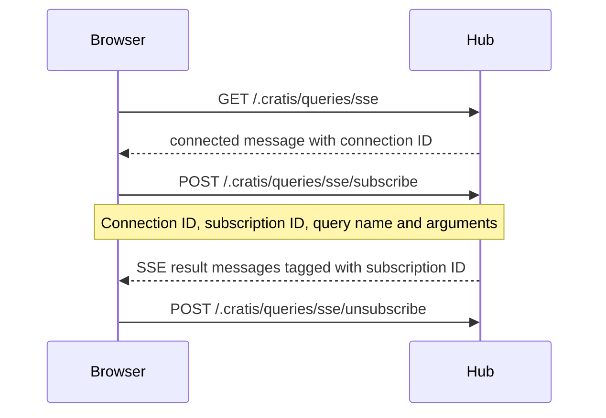

Observable query multiplexing lets several live queries share persistent connections to a hub, which routes each result to its subscription. Use hub mode for a screen with multiple live queries; choose direct mode when debugging a query's own endpoint or connecting to a host without hub endpoints.

Connection sharing is separate from [query instance caching](./query-instance-caching.md). The cache lets matching consumers share one subscription; multiplexing lets different subscriptions travel over the same connection.

## How it works

Choose SSE (Server-Sent Events) or WebSocket with `queryTransportMethod`, then choose hub or direct routing with `queryDirectMode`. Polling uses ordinary HTTP requests and always bypasses the hub:

| `queryTransportMethod` | `queryDirectMode` | Connection and subscription path |
| --- | --- | --- |
| `ServerSentEvents` | `false` | Shared EventSource hub at `/.cratis/queries/sse`; subscribe/unsubscribe through POSTs |
| `WebSocket` | `false` | Shared WebSocket hub at `/.cratis/queries/ws`; subscribe/unsubscribe through socket messages |
| `ServerSentEvents` | `true` | EventSource to each query's own URL |
| `WebSocket` | `true` | WebSocket to each query's own URL |
| `Polling` | either | Repeated GET to each query's own URL; no hub |

Paths above are relative to the configured origin/API base path. `<Arc>` defaults to SSE hub mode with one connection slot. The core `Globals` transport default, before React bindings initialize it, is WebSocket.

### SSE hub connection

The browser first opens the SSE stream. The hub returns a connection ID, which the client uses in separate subscription control POSTs. Adding `?query=Name` to the streaming GET does not subscribe a query:



Multiple subscriptions share that EventSource, the browser API for receiving SSE. The client manages reconnection and resubscription. If you are inspecting requests or implementing a host, continue with the [hub protocol reference](../../../backend/csharp/queries/observable-query-demultiplexer.md) for payloads and server authorization.

### WebSocket hub connection

The client sends typed subscription messages over the shared WebSocket and routes incoming results by subscription ID. It does not issue SSE control POSTs. Both transport handshakes are subject to browser credential restrictions; see [HTTP headers](../arc.md#http-headers-callback).

## Configuring transport and mode

This configuration fragment selects direct SSE; direct mode does not implicitly mean WebSocket:

```tsx
import { Arc } from '@cratis/arc.react';
import { QueryTransportMethod } from '@cratis/arc/queries';

export const App = () => (
    <Arc queryTransportMethod={QueryTransportMethod.ServerSentEvents} queryDirectMode={true}>
        <main>Your query components</main>
    </Arc>
);
```

For shared-hub use, leave `queryDirectMode` false. `queryConnectionCount` sets the number of connection slots in the pool, not the number of queries you may subscribe to. Direct mode and polling do not use this pool.

### SSE connection limit (HTTP/1.1)

Arc caps SSE hub pools at four connections and warns if you request more. Browsers using HTTP/1.1 limit concurrent connections per origin; leaving slots free allows subscription control POSTs and ordinary fetches to proceed. Arc applies its four-slot cap even when the server uses HTTP/2.

Direct SSE connections are outside this pool cap, so opening many of them can still exhaust the browser's connection slots. WebSocket hub pools do not use the SSE cap. Start with the default pool size and inspect your workload before increasing it.

## Provider ownership

Nested `<Arc>` providers share the module-global multiplexer. When connection count, transport, origin, API base path or microservice changes its configuration key, the previous multiplexer is disposed and replaced. Provider nesting therefore does not create independent authenticated hub connections. Review [provider limitations](../arc.md#multiple-microservices-in-one-frontend) before combining services in one frontend.

## Controlling change-stream transfer mode

Transport chooses how results travel; `observableQueryTransferMode` chooses what shared-hub subscriptions ask the server to send. Full mode requests complete snapshots. Delta mode, the default, requests an initial snapshot followed by collection changes rather than the whole collection on every update.

Set this before establishing subscriptions. It is a global setting, not a per-provider isolation mechanism, and also controls fallback handling in `useChangeStream`. Server-provided changesets take precedence over that fallback. Continue with [change streams](./change-stream.md) to consume item-level changes, and check the [observable Suspense delta limitation](./suspense-queries.md#observable-collections-and-delta-only-updates) before using delta-only collection updates with Suspense.

## See also

- [Query configuration](./configuration.md)
- [Query instance caching](./query-instance-caching.md)
- [Backend observable hub](../../../backend/csharp/queries/observable-query-demultiplexer.md)
- [Vite configuration](../vite-configuration.md)
