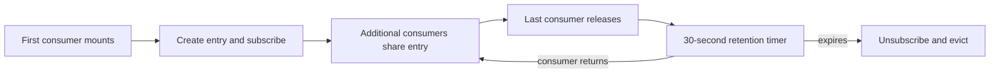

By default, Cratis Arc retains non-Suspense query instances and their last-known data for 30 seconds after the last consumer releases them. Returning to an observable view during that window reuses its live subscription; an ordinary query can show cached data but still fetches again.

Use this distinction when deciding what a return visit should display. Sharing a query instance does not mean ordinary requests are deduplicated, and cache retention does not establish that data is fresh or authorized for a new user.

## How it works

Each mounted `<Arc>` provider owns a `QueryInstanceCache`. Its keys combine the generated stable `queryName` with JSON-serialized arguments whose top-level keys are sorted. The non-Suspense ordinary and observable hooks also include the current page, page size and sort order.

Consumers share an entry only when those values match. The cache key does not include origin or credentials, so a change of identity is not a change of cache entry.

| Hook family | Shared instance | Network/results |
| --- | --- | --- |
| `useObservableQuery` / `useObservableQueryWithPaging` | Only for the same query, arguments, page and sort order | Shares subscription ownership and registers cache listeners for updates |
| `useQuery` / `useQueryWithPaging` | Only for the same query, arguments, page and sort order | Each enabled mount requests data; an overlapping request can abort and replace the earlier request, whose waiting consumer adopts the replacement result |
| Suspense hooks | Separate module-level resource caches | See [Suspense queries](./suspense-queries.md); not governed by this cache's retention setting |

An ordinary query cache hit can seed a new component with successful cached data, but it does not eliminate the new request.

### Ordinary queries are isolated by arguments, paging and sorting

A filter or page change moves an ordinary query consumer to the matching entry and starts a fresh request. The result immediately shows that entry's cached data with `isPerforming: true`, or a not-ready default if nothing is cached. It does not carry over the previous key's data or failure status. A successful result is cached under the key it answers, leaving the old entry's last-known result intact.

Components with different arguments, pages, page sizes or sort orders use separate instances and do not abort each other's requests. Matching consumers share an instance, which runs one request at a time. If a second consumer mounts while the first request is still running, its request aborts and replaces the first. The waiting consumer adopts the replacement's data or failure rather than remaining stuck on its initial result.

That adoption follows one replacement request for the same arguments; it is not a broadcast of all future results. An explicit `perform` with different arguments updates only its caller. A later request made when no other consumer is waiting also updates only its caller. For loading indicators and unmount behavior during overlapping requests, see [when an ordinary query stops performing](./scope.md#when-an-ordinary-query-stops-performing).

### Observable queries share only matching pages and sort orders

Observable hooks use cache listeners, so all mounted consumers of an entry receive its updates. Different arguments, pages, page sizes or sort orders select separate instances and subscriptions.

When a component changes any of those values, it selects the matching entry and starts a subscription only if one is not already active. It immediately shows that entry's cached result unchanged, or the default value with `isReady: false` and `isPerforming: true` until the first result arrives. Later updates to the old entry do not reach the component.

Returning within the retention window reuses the entry's latest result and live subscription. Use [query diagnostics](./observable-query-diagnostics.md) to inspect which consumers own an entry and whether its subscription is still active.

## Lifecycle

The retention timer starts when the last consumer releases an entry, not when the query first runs. After `queryCacheRetentionMs`, which defaults to 30,000 ms, Arc removes the entry and tears down its observable subscription. A returning consumer cancels pending eviction and can reuse the data and subscription.

For an observable entry, the lifecycle is:



Configure retention once when mounting Arc:

```tsx
import { Arc } from '@cratis/arc.react';

export const App = () => (
    <Arc queryCacheRetentionMs={60_000}>
        <main>Your query components</main>
    </Arc>
);
```

Set the value to zero to schedule eviction without a retention delay. Eviction removes the entry's subscription; shared hub connections have their own lifecycle and need not close at that moment.

## React StrictMode compatibility

React StrictMode can run an effect's setup, cleanup and setup again during development. Reacquiring an entry cancels its pending eviction, allowing that immediate return to reuse it. The provider also defers disposal so an immediate effect setup can cancel it. This provider-level disposal delay is separate from `queryCacheRetentionMs`.

## Relationship with the conditional when hook

`when(false)` prevents a non-Suspense hook's automatic request or subscription, but the hook still creates or looks up an entry and acquires it. Another consumer may already own a live subscription, and retention can keep a previous subscription alive.

Use the condition itself to choose disabled UI. `hasData` is not an enabled flag: single-result proxies default to `{}`, which can make it true without loaded data. See [conditional queries](./conditional-queries.md) for a selection-driven example.

## Trust and ownership limits

Account switching needs an explicit application policy for cached data. Clearing identity or reconnecting observables does not purge the cache, and nested providers do not isolate the global transport multiplexer. Review [Arc provider boundaries](../arc.md) before relying on a provider change to separate users or services.

## See also

- [Observable query multiplexing](./observable-query-multiplexing.md)
- [Query diagnostics](./observable-query-diagnostics.md)
- [Query usage](./usage.mdx)
