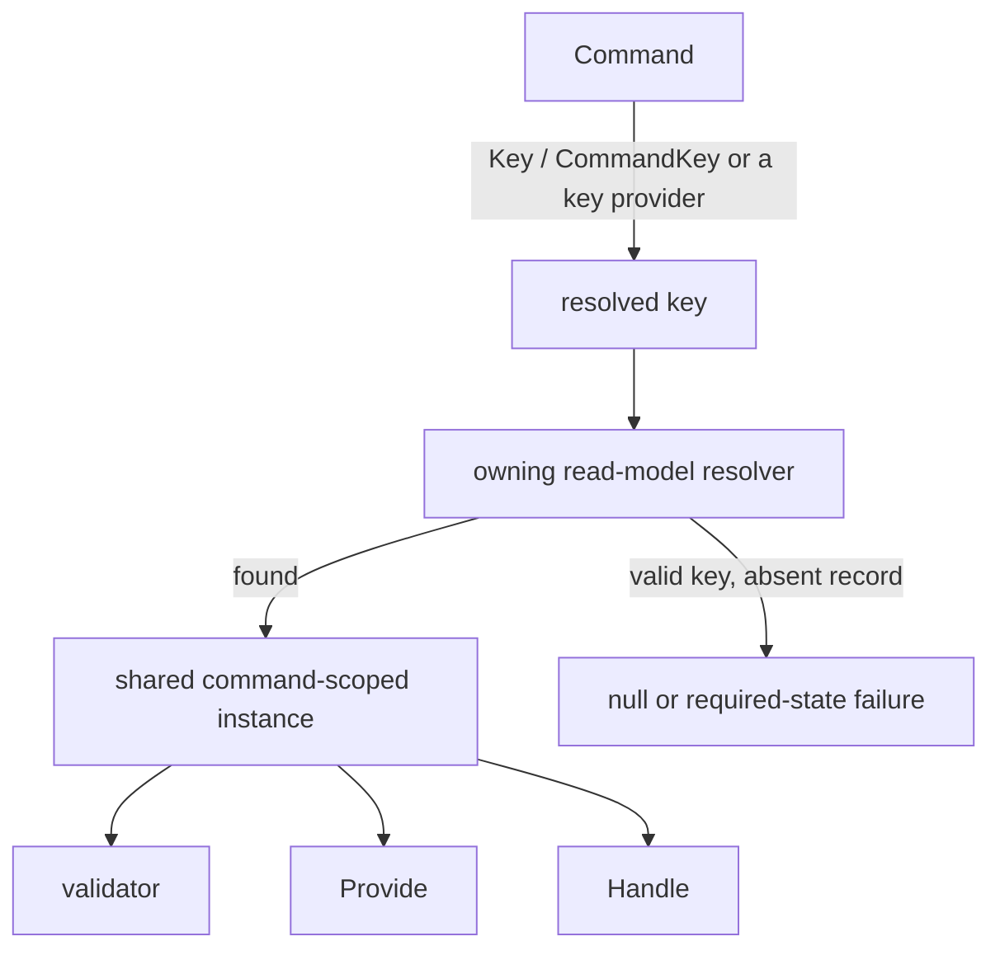

When a Cratis Arc command renames an author, it can receive the stored author as an input rather than repeat a lookup inside the handler. Declare the command key, configure a provider that can load the read model by that key, then decide what should happen if the author is missing.

## Before you start

Use a standalone Arc application with stored authors and the matching backend's storage integration. The rename fragments use the [MongoDB tutorial's setup, imports, and author types](/arc/backend/csharp/getting-started/your-first-command/); add the key import shown in the command fragment. Cratis Chronicle is not required.

A read model is the stored view of data the command needs to read. Marking a type `[ReadModel]` (C#), `@ReadModel` (JVM), or `@readModel()` (TypeScript) identifies it to Arc but does not configure storage. Its provider must claim responsibility for loading that type by key. Arc can then share the resolved instance within the command execution, in the positions each backend supports.

## Declare the key and provider

Mark the author identifier as the command key using `[Key]` in C#, `@CommandKey` on the JVM, or `@key()` in TypeScript. A property named `Id` alone does not establish a standalone command key.

For a computed key, C# supports `ICanProvideKeyForCommand.GetKey()`, the JVM supports `CommandKeyProvider.commandKey()`, and TypeScript supports a registered `CommandKeyResolver` or `getKey()`. Declare one key: C# uses the first `[Key]` property it finds rather than rejecting a second. If you compose a key from several values, check that the storage provider can resolve that stored key.

| Provider                         | What enables resolution                                                                                                                      |
| -------------------------------- | -------------------------------------------------------------------------------------------------------------------------------------------- |
| MongoDB (C#)                     | Configured Arc MongoDB integration discovers read-model candidates as fallback ownership and loads by mapped document id                     |
| MongoDB (TypeScript)             | `withMongoDB` registers a resolver for models listed in `readModels` and loads by their declared document key; applications can register their own resolver |
| EF Core (C#)                     | A registered `ReadOnlyDbContext` owns a `[ReadModel]` entity through `DbSet<T>`; resolution currently requires a single-property primary key |
| Spring Data JPA / MongoDB (JVM)  | The integrations contribute storage-neutral `CanResolveReadModelForCommand` providers for exact mapped `@ReadModel` types; JPA claims `DECLARED` ownership, MongoDB `FALLBACK` |
| Chronicle (optional)             | A projection or reducer supplies integration-specific ownership and event-source key resolution; TypeScript's integration has capability-specific limits                                     |

For EF Core, a writable `BaseDbContext` such as the tutorial's `LibraryDbContext` does not establish command-read-model ownership. Either inject that context for explicit lookups and writes, or configure a [read-only context](/arc/backend/csharp/entity-framework/read-only/) for provider-based resolution. Use the integration's configured discovery rather than duplicating its registrations.

On the JVM, equal-strength claims for the same type fail startup rather than picking a store by bean order, and a registry-owned read-model parameter is resolved before ordinary Spring services, so a bean of the model class cannot bypass tenant or key selection.

## Write against standalone state

Declare a keyed rename command and take the stored author as a handler parameter:

<ArcBackendTabs snippet="scenarios/use-current-state-in-a-command/rename-author" />

Arc loads the author for the command key and supplies it alongside the collection or repository used to write. The explicit replacement persists the new name; returning a response object alone would not update the stored author.

## Choose the decision point

| Need                                       | Position                                       |
| ------------------------------------------ | ---------------------------------------------- |
| Reject with a friendly message before work | `CommandValidator<TCommand>`                   |
| Acquire data using current state           | `Provide()` / `provide`                        |
| Compute and perform the write or response  | `Handle()` / `handle`                          |

C# can supply the same provider-owned instance to all three positions. On the JVM, automatic model resolution applies to `provide` and `handle`; the validator fragment below injects a repository and does its own lookup.

TypeScript binds `commandReadModel(Type)` to a `provide()` or `handle()` parameter. Its validator fragment also uses an application-owned repository, not a read-model constructor parameter. For resolution inside an async validation rule, use `readModelForValidation` instead.

:::tip[Use current state to decide the write]
Keep state acquisition in the provider or `Provide()`. On the C# backend, for immediate inline writes, prefer returning a [command operation](../backend/csharp/commands/operations/index.md) from `Handle()` describing the chosen replacement; Arc executes it afterward. The direct replacement above remains supported. Moving execution does not make the acquired state fresh or remove the need for database constraints and atomic conditional writes.
:::

Add a validator beside the command to reject a missing author or a rename to the current name:

<ArcBackendTabs snippet="scenarios/use-current-state-in-a-command/rename-author-validator" />

The C# validator takes a nullable author so it can turn absence into a business message before the required handler parameter is resolved. The JVM and TypeScript validators look up the author through their repositories. These lookups are not automatically shared with the handler's provider-owned instance.

For TypeScript, apply the validator to `RenameKnownAuthor` from the handler fragment: use that type in `@validator(...)` and `CommandValidator<...>` instead of the validator fragment's `RenameAuthor`.

To use the resolved state when fetching another decision input, continue with [Provide data to a command handler](./provide-data-to-a-command.mdx).

## Check the rename

Execute the command with an existing author key and a different name. Expect success and confirm that the stored author's name changed while its identifier stayed the same. Next, submit the current name: expect validation feedback and no write.

Finally, use a valid key for an author that does not exist. With the validator shown, expect its missing-author message rather than a newly created author. If Arc cannot resolve the dependency at all, check the key and provider configuration before changing the handler.

## Say what absence means

- **Nullable:** a valid key with no record supplies `null`; write the business rule around that possibility. TypeScript declares this with `commandReadModel(Type, { optional: true })`. On the JVM a Kotlin `T?` parameter observes `null` and an ordinary Java `Optional<T>` observes `Optional.empty()`.
- **Non-nullable:** the instance is required. Missing state produces `ReadModelDoesNotExistForCommand` as a validation failure (HTTP 400) in C#, one `dependencyUnavailable` validation result and HTTP 400 on the JVM, and a validation failure in TypeScript — rather than invoking your code with a fabricated model.
- **No usable key:** even a nullable parameter cannot mean “not found” when Arc cannot identify what to fetch. Key-resolution failure is separate from absence.

For registration, absence can be the **desired** state. This alternative domain fragment assumes a keyed `RegisterCustomer` and a provider-owned `Customer`:

<ArcBackendTabs snippet="scenarios/use-current-state-in-a-command/register-customer-validator" />

For an operation requiring an existing order, a non-nullable dependency can instead express that precondition. This fragment assumes a keyed `SubmitOrder`, a provider-owned order read model, and an application `OrderStatus` enum:

<ArcBackendTabs snippet="scenarios/use-current-state-in-a-command/required-order-state" />

The tabs put the same statement in the position each backend supports. C# declares the requirement on the validator's non-nullable constructor parameter; the JVM and TypeScript declare it on the handler's read-model parameter, because their validators do not take read models as constructor parameters. Either way, a missing record rejects the command before your code decides anything.

[ARC0006](../backend/csharp/code-analysis/ARC0006.md) warns on non-nullable read-model dependencies in C# so the choice is explicit.

Sharing a resolved instance can avoid repeated provider lookups within the command, but it is not a lock, transaction, or freshness guarantee. Another command can change the database after the read. Protect rules that must hold under concurrent writes with database constraints, atomic conditional writes, or a transaction. Chronicle projections may additionally lag their events; its [constraints](/chronicle/constraints/) enforce supported rules at append time.

## Optional: projected state with Chronicle

Use this section only when the command reads state derived from Chronicle events. On C#, [Chronicle integration](../backend/csharp/chronicle/index.md) supports read models backed by fluent `IProjectionFor<T>`, model-bound projection attributes, or `IReducerFor<T>`. Integration-specific key resolution can use event-source identifiers; each backend's supported injection positions still apply.

The fragments below need event-source `LedgerId` / `AccountId` types, configured projections, and registered event types. They do not persist anything in standalone Core:

<ArcBackendTabs snippet="scenarios/use-current-state-in-a-command/chronicle-commands" />

In C#, the nullable parameter satisfies [ARC0006](../backend/csharp/code-analysis/ARC0006.md), and missing state rejects the command with a validation error. Do not return a nullable event to signal "nothing to do": the command then succeeds without recording anything, and the caller cannot tell that it never happened.

The event-source identity is stated differently. TypeScript's Chronicle integration uses the resolved command key as its default event-source ID; declare `@key()` or supply a resolver rather than relying on a property name. C# also accepts an `EventSourceId<T>`-derived property as the identity candidate, so `SettleLedger` needs no attribute; Arc.Kotlin reads `CommandContext.commandKey`, so the identifying property carries `@CommandKey` and a command returning events without a resolvable key is rejected rather than appended to the wrong stream.

A `SettleLedgerValidator` can reject a nonpositive balance; an order validator can similarly gate on `ReadyForSubmission`. Those are state checks, not concurrency guarantees.

A Chronicle command scenario can pin the read model the command reads. This **setup fragment** supplies that state directly:

<ArcBackendTabs snippet="scenarios/use-current-state-in-a-command/pin-read-model" />

C# pins through the Chronicle-specific `Given.ForEventSource(id).ReadModel(...)`. TypeScript pins with `givenReadModel(AccountBalance, id, instance)`; `given.forEventSource(id).readModel(instance)` does the same. Arc.Kotlin pins through the scenario's own ownership registry with `withReadModelForKey`, which works for Chronicle-, JPA-, or MongoDB-owned read models and also proves the command carries the key it should.

Seeding events instead of pinning establishes event-source history, but what it gives the command differs by backend. In C#, `Given.ForEventSource(id).Events(...)` materializes reducer- and projection-backed read models. TypeScript's in-memory `ChronicleCommandScenario` materializes reducer-backed models and can also materialize projection-backed models with `@cratis/chronicle >= 6.19.0`; use `ChronicleKernelScenario` to test against a running kernel. On the JVM, seeded events populate only the in-memory event log, not the command read-model registry, so pin the read model the command reads.

See [Chronicle testing](../backend/csharp/testing/chronicle.md) and the [JVM testing guide](/arc/backend/kotlin/guides/testing/) for the complete fixtures. Standalone tests instead seed their provider or register application-service fakes as in [Test a command](./test-a-command.mdx).

## See also

- [Read models from other providers](../backend/csharp/chronicle/read-models/other-providers.md) — provider ownership and explicit standalone keys.
- [Resolution failures](../backend/csharp/chronicle/read-models/failures.md) — distinguish missing state, missing keys, and configuration errors.
- [Validate a command](./validate-a-command.mdx) — choose the narrowest place for a rule.
- [Chronicle event-source resolution](../backend/csharp/chronicle/resolving-event-source-id.md) — optional integration key conventions.
- [Identify a command with a key](/arc/backend/kotlin/guides/command-keys/) — `@CommandKey` and `CommandKeyProvider` on the JVM.
- [Repositories in queries and commands](/arc/backend/kotlin/guides/spring-data/repositories/) — JVM provider ownership, tenancy, and absence behavior.
