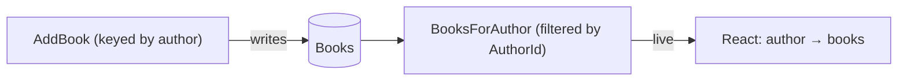

import {Aside} from '@astrojs/starlight/components';

Add books to the library app by storing an author's id on each book, then query the books for that id. The librarian sees each author's catalog through a filtered query, without a join between the author and book read models.

The new slice follows the same command-to-screen path as author registration:



## The book slice

Continue from [chapter 2](/arc/tutorial/validation/), using its project and one database branch. Create `BookId.cs`, `BookTitle.cs`, `AddBook.cs`, and `Book.cs` under `src/Books/`, each with `namespace Library.Books;` above the declarations shown. Add `global using Library.Books;` to `GlobalUsings.cs`. Existing global imports supply the Arc, provider, and author types.

On the JVM, the same four declarations go in a `books` package beside the `authors` one, each file importing what it uses — there is no global-import step. Keep the package inside the application's component-scan root so Spring finds the repository and Arc's KSP processor sees the artifacts.


1. **Define the book id and title.** Use the concept pattern from chapter 1: a record deriving from `ConceptAs<T>` on C#, a data class implementing `ConceptAs<T>` on the JVM, or a concept class on TypeScript:

   <ArcBackendTabs snippet="tutorial/books-and-relationships/book-concepts" />

   The C# sentinels and the implicit conversion are conveniences, not requirements; the JVM has no implicit-conversion operator, so a Kotlin caller writes `BookTitle("...")` where C# can pass a bare string.

2. **Write the book with its author id.** `AddBook` carries `AuthorId` alongside the book's own id and title, then saves those values in a `Book`:

   <ArcBackendTabs snippet="tutorial/books-and-relationships/add-book" />

   **On the relational branch**, .NET takes the context and saves through it. The JVM and TypeScript handlers still use a repository; its implementation supplies the relational write:

   <ArcBackendTabs snippet="tutorial/books-and-relationships/relational-add-book" />

   On the JVM, the command still uses `BookRepository`: its document-store implementation can use `MongoRepository<Book, …>`, while its relational implementation delegates to `JpaRepository<BookRow, UUID>` and converts between `Book` and the mapped row.

On TypeScript, create `Features/Books/BookId.ts` and `BookTitle.ts` from the concepts above, `Features/Books/Book.ts` from the query below, and `Features/Books/AddBook.ts` from the command above. Import each type the excerpts use from its feature file, with `.js` on relative backend imports. Put this runtime token in `Features/Books/BookRepository.ts`; both the command and query import it (not as a type-only import):

<ArcBackendTabs snippet="tutorial/books-and-relationships/book-repository" variants="typescript" />

The MongoDB implementation belongs beside it in `Features/Books/MongoBookRepository.ts`. It encodes books through the collection's codec before writing; the filter uses the codec's stored field name and the encoded author id so it matches MongoDB's UUID representation, not a JavaScript `Guid` object:

<ArcBackendTabs snippet="tutorial/books-and-relationships/mongodb-book-repository" variants="typescript" />

In `main.ts`, import `Book`, `BookRepository`, and `MongoBookRepository`, then add `Book` to the existing `readModels` list and register the repository **before** `builder.discover(...)`. Keep the chapter-1 tenant resolver, author repository, and chapter-2 unique index startup:

<ArcBackendTabs snippet="tutorial/books-and-relationships/mongodb-book-registration" variants="typescript" />

Regenerate with `npm run generate` after adding the files. The [MongoDB setup](/arc/backend/typescript/mongodb/getting-started/) explains collection tokens and model registration in more detail.


## Read a catalog back, filtered

`Book` is the read model for the catalog. Its `AuthorId` lets the query select books for one author. Arc binds the `authorId` query argument by name; the method observes books matching that id:

<ArcBackendTabs snippet="tutorial/books-and-relationships/books-for-author" />

C# expresses the filter as a typed predicate over `Book`. The JVM passes Spring Data `Criteria` naming the stored field, while TypeScript's MongoDB repository filters the collection's mapped `authorId` field. Each query returns a stream: `ISubject<…>`, `Flow<List<…>>`, or `ObservableSource<Book[]>`. With the observation source configured, the stream supplies updated results when matching books change. On the TypeScript relational branch, the Drizzle repository uses `eq(books.authorId, authorId.value)` and announces changes after committed writes.

**On the relational branch**, read from the configured relational store instead:

<ArcBackendTabs snippet="tutorial/books-and-relationships/relational-books-for-author" />

For EF Core, also add `public DbSet<Book> Books => Set<Book>();` to `LibraryDbContext`. Apply the schema change before running: recreate only the disposable tutorial SQLite database as explained in [setup](/arc/backend/csharp/getting-started/), or use a migration for retained data. Re-register an author after recreating it. MongoDB creates its book collection on the first write. On the JVM, the snapshot query projects mapped JPA rows into the `Book` read model; configure the repository to persist those rows and publish changes for `Book` after commit. JPA observation is in-process only. TypeScript's Drizzle observation also requires explicit table registration and change announcements after writes. The tab shows the SQLite/`sql.js` adapter; [observe SQL tables](/arc/backend/typescript/sql/observing-tables/) shows the `withDrizzle` registration, schema setup, and scoped repository pattern. SQL writes must be committed before `notifyChanged` when a transaction is owned outside Arc.

Before adding React, regenerate the proxies — `dotnet build -c Debug` on C#, `./gradlew generateArcProxies` on the JVM, or `npm run generate` on TypeScript (using the [application's generator script](/arc/backend/typescript/getting-started/create-an-application/)). On C# and JVM, verify `src/Books/AddBook.ts` and `src/Books/Book.ts` exist; the latter includes `BooksForAuthor` in source-file output mode. With the TypeScript backend's co-located `--use-proxy-file-suffix` setup, import `AllAuthors` in `src/Catalog.tsx` from `../Features/Authors/AllAuthors.proxy`, `BooksForAuthor` from `../Features/Books/BooksForAuthor.proxy`, and `AddBook` in `src/AddBook.tsx` from `../Features/Books/AddBook.proxy`. The `src/Books/Book` and `src/Books/AddBook` imports in the React examples below are for the .NET/JVM source-file grouping.

<Aside type="tip" title="The relationship is a filter, not an existence constraint">
`Observe(b => b.AuthorId == authorId)` reads books carrying this author's id, without a join. The form supplies an existing author, but these examples do not prevent a direct caller from submitting an unknown id. Add server validation and, where supported, a database foreign-key constraint if author existence is a required invariant.
</Aside>

## Showing the catalog

`BooksForAuthor` takes an author id, so it's a query *per author*. The list of authors comes from chapter 1's `AllAuthors`; each row renders its own live catalog:

```tsx title="src/Catalog.tsx"
import { Guid } from '@cratis/fundamentals';
import { useDialog } from '@cratis/arc.react/dialogs';
import { AddBookDialog } from './AddBook';
import { AllAuthors } from './Authors/Author';
import { BooksForAuthor } from './Books/Book';   // generated proxies

const AuthorBooks = ({ authorId }: { authorId: Guid }) => {
    const [books] = BooksForAuthor.use({ authorId });   // live, scoped to this author
    return <ul>{books.data.map(b => <li key={String(b.id)}>{b.title}</li>)}</ul>;
};

export const Catalog = () => {
    const [authors] = AllAuthors.use();
    const [AddBookDialogWrapper, showAddBook] = useDialog(AddBookDialog);
    return (
        <>
            <ul>
                {authors.data.map(a => (
                    <li key={String(a.id)}>
                        {a.name}
                        <button onClick={() => void showAddBook({ authorId: a.id })}>Add book</button>
                        <AuthorBooks authorId={a.id} />
                    </li>
                ))}
            </ul>
            <AddBookDialogWrapper />
        </>
    );
};
```

Use a `CommandDialog<AddBook>` for the write, following the author-registration form. Pass the selected `authorId` and a fresh `bookId` as initial values so the command is complete before the librarian confirms:

```tsx title="src/AddBook.tsx"
import { useState } from 'react';
import { Guid } from '@cratis/fundamentals';
import { CommandDialog } from '@cratis/components/CommandDialog';
import { InputTextField } from '@cratis/components/CommandForm';
import { AddBook } from './Books/AddBook';

export const AddBookDialog = ({ authorId }: { authorId: Guid }) => {
    const [bookId] = useState(() => Guid.create());
    return (
        <CommandDialog<AddBook>
            command={AddBook}
            title="Add book"
            okLabel="Add"
            initialValues={{ authorId, bookId }}>
            <InputTextField<AddBook> value={i => i.title} title="Title" />
        </CommandDialog>
    );
};
```

<Aside type="note" title="Why initialValues, not onBeforeExecute">
Both `authorId` and `bookId` are required and must be in `initialValues` before confirmation can become enabled. Keep the selected author's generated `Guid` value. Mount a fresh `AddBookDialog` per operation through the [dialog composition](/arc/frontend/react/dialogs/) and unmount on close: the id stays stable while editing but is not reused for the next book. `onBeforeExecute` cannot satisfy an unset required field.
</Aside>

## Mount the catalog

Replace `src/App.tsx` from chapter 1 with this composition: import `Catalog` instead of `Authors` and render `<Catalog />` instead of `<Authors />`. Keep the Add author action and both providers:

```tsx title="src/App.tsx"
import { Arc } from '@cratis/arc.react';
import { useDialog } from '@cratis/arc.react/dialogs';
import { CratisComponentsProvider } from '@cratis/components';
import { AddAuthor } from './AddAuthor';
import { Catalog } from './Catalog';

function Library() {
    const [AddAuthorDialog, showAddAuthor] = useDialog(AddAuthor);
    return (
        <>
            <button onClick={() => void showAddAuthor()}>Add author</button>
            <Catalog />
            <AddAuthorDialog />
        </>
    );
}

export const App = () => (
    <Arc>
        <CratisComponentsProvider>
            <Library />
        </CratisComponentsProvider>
    </Arc>
);
```

`Catalog` owns one dialog wrapper, outside the author loop. Each Add book button passes that row's `Guid` to `showAddBook`. The wrapper mounts `AddBookDialog` only while open and unmounts it on close, so its `bookId` state is fresh for the next operation.

## Check the relationship

Click **Add book** beside one author, add a book, then open the dialog again to add a second book. Verify that their ids differ and only that author's list grows. Another author's list should remain unchanged. Run `npx tsc -p tsconfig.web.json --noEmit` (or `npx tsc6 -p tsconfig.web.json --noEmit` with the TypeScript backend) and `npx vite build` from the frontend project root: `BooksForAuthor.use({ authorId })` requires a parameter object, not a positional id or a string conversion; use the `dist-web` output from chapter 1 so the TypeScript backend's `dist/main.js` survives the Vite build.

## What you built

The catalog combines two slices: author registration supplies the author list, and `AddBook` writes books that `BooksForAuthor` filters by author id. The screen passes the selected id through the generated command and query contracts; the backend remains responsible for enforcing any author-existence rule.

Next, [verify live catalog updates →](/arc/tutorial/real-time/). You'll open the catalog in two browser tabs and check which writes your configured observation source can report.
