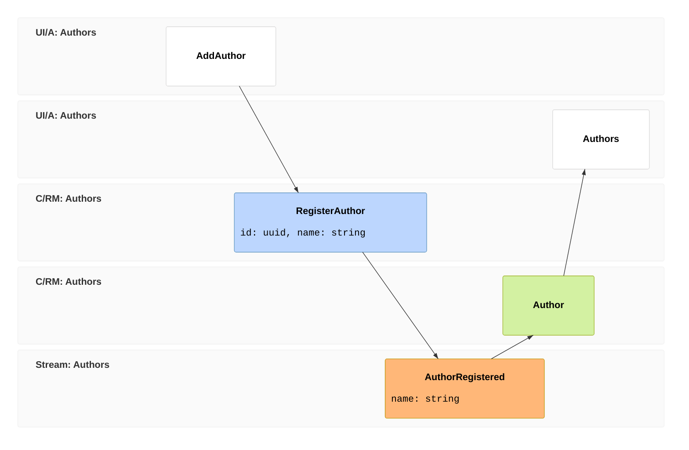
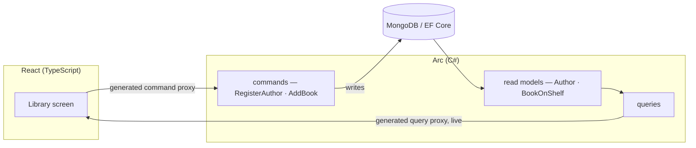

import { Aside, Steps, Tabs, TabItem } from '@astrojs/starlight/components';
import YouWillLearn from '@components/YouWillLearn.astro';

Build a library back office with Cratis Arc and React: register authors, catalog their books, and connect commands and queries to screens through generated TypeScript clients. By the last chapter, you'll have forms with validation, live catalog queries, and role-based authorization.

Start from a configured backend and database using [the prerequisites below](#what-youll-need), then connect the first screen. The tutorial includes C# and JVM paths plus a **[TypeScript backend](/arc/backend/typescript/)** with no published npm package and no claim of full parity. Follow the setup for your chosen backend; the examples are not interchangeable.

[Arc for Go](/arc/go/) has a separate [running application guide](/arc/go/backend/go/core/getting-started/) and [TypeScript generation guide](/arc/go/backend/go/generation/typescript/). This tutorial does not yet have a Go path; check its [parity reference](/arc/go/parity/) before carrying a chapter's behavior across.

Work through one vertical slice at a time: a command requests a change, a read model holds the data a screen needs, and a query reads it for React. A generated proxy is the TypeScript class the frontend uses to call that command or query. Regenerate proxies after backend changes, then type-check the frontend to catch structural mismatches.

The tutorial writes directly to a database: MongoDB or EF Core on C#, Spring Data on the JVM, or MongoDB on TypeScript. This lets you learn CQRS, the separation of writes from reads, without setting up an event store. Cratis Chronicle is an optional event-sourcing integration.

The [event model](/event-modeling/) below describes the author-registration feature before choosing storage. Read it left to right: the librarian submits an author, `RegisterAuthor` requests the change, `AuthorRegistered` names the resulting business fact, and the `Author` read model supplies the list screen.

`AuthorRegistered` describes what happened; this tutorial does not store it as an event. The command writes the `Author` read model directly to the database. Later, adding and listing books gives you another slice of the same shape.

The next diagram follows the running C# version. React calls generated command and query proxies; the backend writes and reads the database. You declare those contracts on the backend instead of maintaining a separate API client:

Use the event model to plan the behavior and the flowchart to trace a request through the C# implementation. [Understanding the proxy boundary](/arc/understanding-the-proxy-boundary/) explains which contract changes generation and frontend type-checking can catch.

## What you'll build

By the last chapter, a librarian can register authors, add their books, and browse the catalog. An observable query keeps the author list updated without a refresh. Blank or duplicate author names are rejected with a reason on the form, and role-based authorization restricts catalog changes to librarians.

<Aside type="note" title="Live-query boundary">

Live updates require a configured observation source. [Chapter 4](./real-time.mdx) explains which database changes your chosen setup can observe; a connected subscription alone does not establish that external writes are visible.

</Aside>

## What you'll learn

<YouWillLearn>

- The full Arc loop — **command → read model → query → React** — and how generation (`dotnet build -c Debug`, `./gradlew generateArcProxies`, or the TypeScript application's `npm run generate`) followed by a frontend type-check catches drift.
- How to put **validation and business rules** on a command and have the failure surface in the UI through the generated proxy.
- How to model a **second feature that reads the first**, and read related data back.
- How **observable queries** keep a screen live with no polling.
- How to **authorize** commands and queries at the boundary.

</YouWillLearn>

## One tutorial, three backend paths

There is **one tutorial** with C#, JVM, and TypeScript backend examples. The
[TypeScript backend](/arc/backend/typescript/) has no published npm package and
does not claim full parity. Use its own setup and
[capability reference](/arc/backend/typescript/reference/capabilities/) before
following a chapter's tab. The React examples consume the shared frontend
runtime rather than three different browser libraries. The ideas
are the same across these paths — a slice from command to read model to query to screen,
validation, relating slices, live queries, authorization.

Keep your chosen backend's setup throughout the tutorial. The SDK, generation
command, database integration, and development sign-in differ. Each chapter
names setup and behavior differences beside the step they affect.

<Aside type="note" title="Building on Kotlin or Java?">

Set up first with [Get started with Kotlin](/arc/backend/kotlin/get-started/) or
[Get started with Java](/arc/backend/kotlin/get-started/java/), which take you
through the first round trip with Gradle and Spring Boot, then follow the
chapters below and pick the Kotlin tab. Read "MongoDB or EF Core" as
[Spring Data MongoDB or Spring Data JPA](/arc/backend/kotlin/guides/spring-data/),
and keep the [Kotlin and Java documentation](/arc/backend/kotlin/) open for the
detail a tutorial cannot carry. The [scenario recipes](/arc/scenarios/) show both
languages side by side too.

</Aside>

## What you'll need

<Tabs syncKey="arc-backend-setup">
  <TabItem label="C#">

For C#, start with [standalone ASP.NET Core setup](/arc/backend/csharp/getting-started/), then complete its [backend checkpoint](/arc/backend/csharp/getting-started/your-first-command/). It specifies a released package set, SDK, imports, the default EF Core/SQLite schema bootstrap or alternative MongoDB replica-set settings, Debug proxy generation, and a curl write/read test.

  </TabItem>
  <TabItem label="Kotlin or Java">

On the JVM, start with [Get started with Kotlin](/arc/backend/kotlin/get-started/) or [Get started with Java](/arc/backend/kotlin/get-started/java/): JDK 17, Gradle, the `io.cratis.arc` plugin, and `arc-spring-boot-starter`. Those first round trips use an in-memory repository; add the [Spring Data integration](/arc/backend/kotlin/guides/spring-data/) and configure your database before following this tutorial's persistence examples.

  </TabItem>
  <TabItem label="TypeScript">

On TypeScript, follow [create an application](/arc/backend/typescript/getting-started/create-an-application/) and use the [standalone MongoDB host](/arc/arc-without-event-sourcing/#a-standalone-slice-end-to-end) as the chapter-1 prerequisite.

  </TabItem>
</Tabs>

Choose one database branch and keep it throughout the tutorial. Chapter 1 continues in the same project with a Vite app and a Components dialog; do not recreate the backend types it recaps. If you already have a Vite app, [frontend getting started](/arc/frontend/react/getting-started/) offers an inline form and a no-Components alternative.

<Aside type="note" title="Standalone tutorial setup">

No Chronicle package, event store, or `dotnet new cratis` scaffold is required. That template is an **Arc + Chronicle** alternative, not this tutorial's starting point. Backend excerpts assume the setup's imports and namespaces; UI fragments are labeled where they require the surrounding composition.

</Aside>

## The tour

<Steps>

1. **[Your first full-stack slice](/arc/tutorial/first-slice/)** — register an author from the backend all the way to a live React screen, fully typed.
2. **[Make it trustworthy](/arc/tutorial/validation/)** — reject bad input with a validator and a uniqueness rule, and show the reason in the form.
3. **[Relate your slices](/arc/tutorial/books-and-relationships/)** — add books that belong to an author, and read them back.
4. **[Make it live](/arc/tutorial/real-time/)** — observable queries that update the screen the moment the data changes.
5. **[Decide who can do what](/arc/tutorial/authorization/)** — lock the catalog down with role-based authorization.

</Steps>

Once your backend passes its write/read checkpoint, [connect the first author screen →](/arc/tutorial/first-slice/). Keep that project for the remaining chapters; each adds behavior to the same library app.
