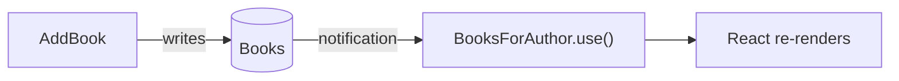

import { Aside } from '@astrojs/starlight/components';

Cratis Arc observable queries keep the catalog updated by sending new results to subscribed React components when the configured database observation source reports a change. Use the catalog from [chapter 3](/arc/tutorial/books-and-relationships/) to verify that path in two browser tabs, then distinguish same-process updates from external writes.

## Why the screen already moves

The queries in earlier chapters return streams: `ISubject<…>` on C#, `Flow<List<…>>` on the JVM, and `ObservableSource<…>` on TypeScript. Arc exposes those streams as observable queries. The generated React `.use()` hook subscribes to results instead of fetching a list just once:

When a command writes and the observation source reports the change, the query publishes updated data and React re-renders the catalog. The command does not tell the screen to refresh; the subscription connects the database notification to the next result.

<Aside type="note" title="Under the hood">
The React client defaults to WebSocket transport; Server-Sent Events (SSE) is also available. Both carry updated query results over an open connection without polling. To inspect a query's SSE stream directly, see [observable queries with cURL](/arc/backend/csharp/queries/using-observable-queries-with-curl/). The connection carries results; the backend still needs a source of database change notifications.
</Aside>

## Verify the scope of observation

Keep the database and backend setup from chapter 3, then check the screen:

1. Open two browser tabs connected to the same backend process and display the same author's catalog in both.
2. Add a book in one tab. Confirm that it appears in the other without reloading.
3. Add another book from the second tab and confirm that the first tab updates too.

This checks the tutorial's live path, including the C# SQLite setup. It does not establish that a write from another process will be observed. That depends on the database integration:

- MongoDB uses [change streams](/arc/backend/csharp/mongodb/observing-collections/) on a replica set or supported sharded deployment, including the JVM and TypeScript integrations. A configured change stream can report external writes.
- C# [observed `DbSet` queries](/arc/backend/csharp/entity-framework/observing/) receive same-process notifications through the configured `SaveChanges` interceptor. SQLite uses only that path. SQL Server and PostgreSQL need database notification setup for cross-process detection; if setup fails, EF observation can fall back to same-process notifications. Inspect server logs before testing external writes.
- JVM JPA observation uses explicit in-process change publication after commit. See [observable snapshots](/arc/backend/kotlin/guides/spring-data/observable-snapshots/) for the publisher and transaction behavior.
- TypeScript Drizzle observation requires table registration and explicit change announcements after committed writes. Follow [observe SQL tables](/arc/backend/typescript/sql/observing-tables/) for that setup.

If the second tab stays stale, check the backend notification source as well as the browser connection. A subscription can remain connected without receiving fresh data.

## What makes a query live

The following are **alternative MongoDB method fragments** in `Author`, using the tutorial imports. Replace the method rather than adding a second method with the same signature.

A one-shot query returns the current data and completes:

<ArcBackendTabs snippet="tutorial/real-time/one-shot-query" />

The observable version returns a stream backed by database observation. Replace the method with this version, then regenerate the proxies using your backend's chapter-1 command. The generated `.use()` hook subscribes to the stream; the catalog component keeps the same hook call:

<ArcBackendTabs snippet="tutorial/real-time/observable-query" />

Choose per query. A lookup that only needs data when opened can return a plain list. Use an observable query when the screen should reflect later changes, and configure the notification source for the writes it needs to see.

## What you built

The two-tab check follows a write through database observation, the query subscription, and React rendering. Keep the same-process and external-write checks separate so a working local catalog does not hide a missing cross-process notification source.

Next, [restrict catalog access →](/arc/tutorial/authorization/). You'll require the `Librarian` role on commands and queries, then test access with and without that role.
