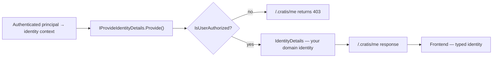

import { Aside } from '@astrojs/starlight/components';

Cratis Arc separates identity enrichment from operation authorization and tenant isolation. Use identity details to give the UI context about the signed-in user, authorization to decide which commands and queries that user may run, and tenant membership checks plus tenant-aware storage to control whose data those operations use.

The boundaries below apply across backends, but authentication middleware, role
metadata, and tenant enforcement are host-specific. API names and configuration
links in the prose use C#; the example tabs also show JVM and TypeScript forms.
For those hosts, continue with [JVM security](/arc/backend/kotlin/guides/security/)
or [TypeScript identity](/arc/backend/typescript/identity/) and
[authorization](/arc/backend/typescript/core/authorization/). Go has
separate [identity](/arc/go/backend/go/identity/) and
[authorization](/arc/go/backend/go/authorization/) guides. Check the
[HTTP contract](/arc/http-contract/) and each backend's capability reference for
status-code and enforcement differences.

## Who is the user — identity, enriched once

Authentication establishes who the caller is. In C#, that identity is represented by a `ClaimsPrincipal`, the server-side user object containing claims such as an id, a name, and roles. Identity enrichment adds application details, such as a display name or preferences, so the UI can show information relevant to that user.

In C#, implement `IProvideIdentityDetails<TDetails>` to supply those details. Arc passes an `IdentityProviderContext` containing the user's id, name, and claims, rather than the raw token. In this illustrative MongoDB fragment, the provider looks up a library member by that id. It assumes application-owned `Member` and `LibraryIdentity` types and the identity/provider imports:

<ArcBackendTabs snippet="understanding-identity-and-access/identity-provider" />

If the member is missing, the provider returns `IdentityDetails` with `IsUserAuthorized: false`, and `/.cratis/me` responds with `403`. That decision applies to the identity-details response. Command and query authorization evaluates the principal and operation declarations independently, so rejecting identity enrichment does not block the user's operations. Enforce restrictions such as blocked accounts or expired subscriptions on those operations too.

When the provider accepts the member, `/.cratis/me` returns the details for the frontend to consume through a generated identity type. Use the [identity provider flow](/arc/backend/csharp/identity/) and [identity contracts](/arc/backend/csharp/identity/contracts/) to implement the backend, then [read identity in React](/arc/frontend/react/identity/) to use those details in the UI.

<Aside type="caution" title="Details are not authorization claims">
A `LibraryIdentity.Role` property is application data. It does not add `ClaimTypes.Role` or grant `[Roles("Librarian")]`. Configure roles through trusted authentication and claims handling on the server. The UI can use identity details to choose what to display, but hiding an action does not prevent someone from calling its endpoint.
</Aside>

## What can they do — authorize commands and queries

Authorization decides whether the caller may run an operation before its command or query logic executes. In this MongoDB excerpt, registering an author requires the Librarian role, while reading the public catalog allows anonymous callers. The excerpt uses the [tutorial's domain types and provider setup](/arc/backend/csharp/getting-started/your-first-command/) plus `Cratis.Arc.Authorization` imports. `LibraryRole` names the application's roles for `nameof`, as recommended by the [ARC0011 role-name analyzer](/arc/backend/csharp/code-analysis/#arc0011-role-names):

<ArcBackendTabs snippet="understanding-identity-and-access/authorization" />

In C#, `[Authorize]` requires an authenticated user. `[Roles("Librarian", "Admin")]` also requires authentication and accepts at least one of the listed roles. `[AllowAnonymous]` permits callers without signing in. The role name must match a role in the authenticated principal; declaring an enum member does not assign that role to anyone.

For queries, a class-level declaration covers methods without their own declaration. A method-level declaration replaces the class-level requirements. Use this deliberately when making a query public or giving it a different role requirement.

Authentication can stop an HTTP request with `401` before Arc runs. If Arc's command or query pipeline rejects authorization, the HTTP response is `403`, and the generated command/query result reports `isAuthorized: false` so the UI can respond.

Some rules depend on the data being accessed: a user may edit their own profile but not another user's. Check that relationship on the server against the trusted principal and the target record, using an authorization extension or an explicit operation guard. An ordinary validation rejection is a different result from an authorization rejection. Continue with [authorization attributes, policies, and inheritance rules](/arc/backend/csharp/core/authorization/) to choose the right check.

## Whose data — multi-tenancy

A tenant is a customer or organization whose data your application keeps separate from others in the same deployment. A user may have permission to register authors without having permission to register them for every tenant. Operation authorization and tenant membership answer different questions.

A host selects a tenant id through a resolver, which reads a configured source such as a claim or header. A header resolver reads the supplied value; authenticating the caller first does not prove that the caller belongs to the tenant they selected. On C#, register an application-owned `ITenantMembership` check to verify that relationship during request tenant resolution, or enforce membership at a trusted ingress (a proxy or gateway) before the request reaches the app. Arc does not automatically enforce membership without a registered check. The [tenant membership guide](/arc/backend/csharp/tenancy/membership/) explains registration and the check's scope.

Storage isolation is a separate responsibility. Tenant-aware database routing, partitions, or application query filters must keep an allowed operation within the selected tenant's data. Resolving a tenant id does not add filters to every query or make every store tenant-aware. Verify both boundaries: a caller cannot select a tenant they do not belong to, and an allowed request cannot read or change another tenant's data.

<Aside type="caution" title="Resolve the tenant after you authenticate">
Use trusted identity claims or verify membership against authoritative data before accepting a tenant selected by a header or query parameter. [Cratis AuthProxy](/authproxy/) strips spoofable identity and tenant headers before forwarding its own values. Its optional tenant verification checks that a tenant exists, not that the caller belongs to it. Enforce caller-to-tenant membership separately, and prevent callers from bypassing any trusted ingress to reach the backend directly.
</Aside>

Choose how requests select a tenant with [tenant resolvers](/arc/backend/csharp/tenancy/resolvers/), then use [tenant context](/arc/backend/csharp/tenancy/tenant-context/) to read the selected id in application services. For MongoDB, [database resolvers](/arc/backend/csharp/tenancy/database-resolvers/) route storage by tenant. The [tenancy overview](/arc/backend/csharp/tenancy/) connects these choices.

## Where to go next

- [Supply identity details](/arc/backend/csharp/identity/) when the UI needs application-specific information about the caller.
- [Authorize commands and queries](/arc/backend/csharp/core/authorization/) when you need to restrict an operation by authentication, role, or policy.
- [Configure tenancy](/arc/backend/csharp/tenancy/) when one deployment serves customers whose data must stay separate.

If a trusted ingress supplies the caller's identity, follow [Microsoft Identity headers](/arc/backend/csharp/asp-net-core/microsoft-identity/) to configure the `x-ms-client-principal` header family. These headers carry unsigned assertions, not bearer tokens validated by Arc. The ingress must replace spoofable headers and prevent direct backend access. The host must opt in with `TrustForwardedIdentityHeaders` before Arc trusts them. For local-only fixtures, see [Generate a principal](/arc/backend/csharp/development/generating-principal/).
