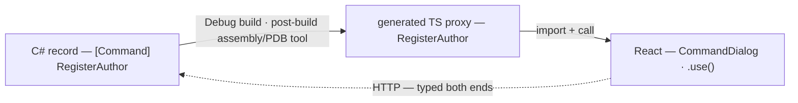

import { Aside } from '@astrojs/starlight/components';

When you rename a backend command property, how do you find the React components that still send the old name? Arc generates TypeScript proxies from backend declarations so that regeneration and frontend type-checking can identify those callers.

The proxy boundary is that generated contract between the backend and its consumers. You maintain the backend declaration rather than a second set of TypeScript request and response shapes. The example below follows an author-registration command across the boundary, then changes a property to show what the compiler catches.

## One source of truth

The backend declaration defines the contract used to generate the proxy. In the C# example below, the `RegisterAuthor` record defines the shape; JVM, TypeScript, and Go backends use their own declarations and generators. Change the declaration and regenerate to update the frontend types.



Generating from the same types catches structural drift at compile time when you rebuild and type-check both sides. It does not prove that a deployed client matches a deployed server, that runtime serialization customizations agree, or that build-time routes match runtime configuration. Those still need integration checks.

## Walk the boundary

1. **Write the slice on the backend.** A command is a record (C#), a data class (Kotlin), or a decorated class (TypeScript) with a handler on it. This standalone excerpt uses the [tutorial's domain types, imports, and provider setup](/arc/backend/csharp/getting-started/your-first-command/):

   <ArcBackendTabs snippet="understanding-the-proxy-boundary/register-author" />

2. **Configure and generate.** Each backend discovers commands, queries, referenced types and supported validation rules from its own declarations. Generation is not an automatic step of every build; configure and run the appropriate backend tool.

   On **C#**, install `Cratis.Arc.ProxyGenerator.Build` and set `CratisProxiesOutputPath` as in [generator setup](/arc/backend/csharp/proxy-generation/getting-started/), then run `dotnet build -c Debug`. An MSBuild target runs after the build and invokes a **post-build executable** that inspects the compiled assembly and its PDB — it is not a Roslyn source generator. Without an output path the target does nothing, which is also how you skip generation on a second build.

   On **Kotlin and Java**, apply the `io.cratis.arc` Gradle plugin and configure `cratisArc { proxies { } }` as in [TypeScript proxies](/arc/backend/kotlin/guides/typescript-proxies/). A **KSP annotation processor** runs as part of compilation and records what it found in an artifact manifest, and the `generateArcProxies` Gradle task turns that manifest into TypeScript.

   On **TypeScript**, `arc-proxygenerator` reads backend TypeScript source with `--project` and `--artifacts`, and writes client proxies and optionally server metadata. Run your application's generation script when declarations change; see [TypeScript generator setup](/arc/backend/typescript/proxy-generation/getting-started/). That backend has its own [capability reference](/arc/backend/typescript/reference/capabilities/), not a guarantee of parity with C# or JVM.

   On **Go**, follow [TypeScript generation](/arc/go/backend/go/generation/typescript/) for the explicit metadata and typed adapter workflow. Its [parity reference](/arc/go/parity/) separates supported generated-client checks from unverified browser and React behavior; the tabs here do not include a Go example.

   Namespace folders, source-file placement, and index output depend on each backend's generator configuration.

3. **Import the proxy in React.** The generated class supplies the command's typed properties and execution behavior. This form fragment assumes the frontend imports, providers, and per-operation `id` state from the [first-slice tutorial](/arc/tutorial/first-slice/):

   ```tsx
   import { RegisterAuthor } from './Authors/RegisterAuthor';   // generated

   // Form fragment: retain the imports/providers and per-operation id state
   // from the first-slice tutorial; mount a new dialog instance per registration.
   <CommandDialog<RegisterAuthor> command={RegisterAuthor} title="Add author" initialValues={{ id }}>
       <InputTextField<RegisterAuthor> value={i => i.name} title="Name" />
   </CommandDialog>
   ```

## What keeps it honest

Suppose you rename the command's `name` property to `fullName`:

<ArcBackendTabs snippet="understanding-the-proxy-boundary/rename-property" />

Regenerate the proxy and type-check the frontend. The proxy now has `fullName` where it used to have `name`, so TypeScript rejects the form's old property accessor:

```tsx
// This line stops compiling until you fix it:
<InputTextField<RegisterAuthor> value={i => i.name} title="Name" />
//                                         ^^^^ Property 'name' does not exist on RegisterAuthor
```

Update the accessor to the new property before running the form. This catches a structural mismatch without opening the browser. It does not check whether a rename changes the meaning of the field or whether older deployed clients still need the old contract.

<Aside type="note" title="The read side is just as honest">
Renaming a field on a `[ReadModel]` follows the same sequence: regenerate, then type-check. A component that accesses the old field through the generated query type gets a compiler error too.
</Aside>

## What gets generated

A configured C# generator build can emit these contracts. Use the backend-specific guides above for JVM and TypeScript output.

| Output | What the consumer uses |
| --- | --- |
| Commands | A class to instantiate and execute or hand to `CommandDialog`, with route, query-string, and body parameters represented as typed properties. |
| Queries | A proxy with React hooks and typed result state. Observable hooks subscribe to an emitting source and re-render on updates. |
| Types and enums | The referenced shapes used by command and query contracts, including nested data. |
| Identity details | The application's custom identity type for frontend consumers. |

Each has a detailed reference: [Commands](/arc/backend/csharp/proxy-generation/commands/), [Queries](/arc/backend/csharp/proxy-generation/queries/), and [Identity details](/arc/backend/csharp/proxy-generation/identity-details/). The [frontend proxy-generation guide](/arc/frontend/react/proxy-generation/) shows the generated TypeScript for each, with the `.use()` and `useSuspense()` hooks.

<Aside type="note" title="Not every backend return value crosses the boundary">
On the C# backend, [command operations](./backend/csharp/commands/operations/index.md) describe inline work for the server, not the browser. The proxy generator excludes operations and operation batches from the client response contract. React still executes the generated command and handles its ordinary result; compensation and recovery observations remain backend concerns.
</Aside>

## The transport disappears too

The proxy also handles the request, so a component can execute `RegisterAuthor` or call `AllAuthors.use()` without constructing the URL or opening a socket. You still configure the backend address, headers, and live-query transport in Arc.

A regular query makes an HTTP request. An observable query streams over WebSocket or Server-Sent Events (SSE), selected with the `queryTransportMethod` prop on the [`<Arc/>` context component](/arc/frontend/react/arc/). When you need a snapshot instead of a subscription, call `perform()` on the same observable proxy:

```tsx
const [authors] = AllAuthors.use();                  // live — streams over WebSockets or SSE
const snapshot = await new AllAuthors().perform();   // one-shot — a plain HTTP fetch, same proxy
```

The hook follows future emissions; `perform()` requests one result. For an observable snapshot, check readiness before treating missing data as an empty list. Some producers need [wait-for-first-result configuration](/arc/backend/csharp/queries/model-bound/observable-queries/#waiting-for-the-first-http-result). Tune the live transport in the [query configuration reference](/arc/frontend/react/queries/configuration/).

## It's a build step, not a runtime discovery call

Keep generation in the development workflow:

- **You never edit a generated file.** Change the backend declaration and regenerate; TypeScript projects may commit generated proxies alongside the source.
- **On C#, the generator tracks what it made** and removes files for commands or queries you delete. See [File index tracking](/arc/backend/csharp/proxy-generation/file-index-tracking/); the TypeScript generator also limits stale deletion to files it owns.
- **The sequencing matters:** generate proxies from updated backend declarations, then type-check the frontend. C# requires a successful Debug build first; the TypeScript generator reads source with the project configuration.

## Why this is the thing that matters

Use the generated boundary to make backend contract changes visible to React callers during development. Keep integration checks for deployed versions, serialization, and runtime routing; those sit outside what TypeScript can prove.

To follow the same path in an application, [build your first command and query](/arc/backend/csharp/getting-started/your-first-command/), then [wire it into React](/arc/frontend/react/getting-started/). After it works, rename a property, regenerate, and use the frontend type-check to find the affected consumer.
