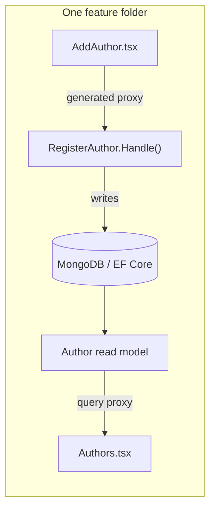

import { FileTree } from '@astrojs/starlight/components';

A **vertical slice** in a Cratis Arc application groups the artifacts for one behavior: the command that writes state, the read model and query that serve it, the React component that renders it, and its specs. Keeping them in one folder lets you follow a behavior without navigating separate folders for each technical layer.

:::note[A layout convention, not a boundary]
We recommend organizing an application by **feature**, with a folder per slice. Arc does not enforce this layout, and co-location does not enforce dependency boundaries: you still decide what a slice owns and which contracts it shares. The slice folders inside a feature can follow the timeline an [event model](/event-modeling/) lays out.
:::

Use this layout when you want to follow a change from its input through persistence to the screen without moving between technical layers. The registration example below shows where those files go. For implementation steps, the [standalone Arc tutorial](/arc/tutorial/) builds a database-backed feature; the [capstone walkthrough](/build-a-full-app/) connects the wider Cratis stack.

## The pain it removes

In a layer-organized codebase, registering an author can involve files in several folders:

```shell title="Organized by layer"
❌ Organized by layer — "register author" touches five folders
Commands/RegisterAuthor.cs
Handlers/RegisterAuthorHandler.cs
Dtos/AuthorDto.cs
Clients/AuthorsClient.ts
web/src/features/authors/AddAuthor.tsx
```

The folders tell you what kind of code each file contains, but not which files participate in registration. A slice groups those files under the behavior's name so you can inspect the command, consumer, and specs together:

<FileTree>

- Authors/
  - Registration/
    - Registration.cs # command + Handle() + read model + query
    - AddAuthor.tsx # the React screen
    - when_registering/ # the specs

</FileTree>

Here, `Registration.cs` holds the backend behavior, `AddAuthor.tsx` consumes its generated contract, and `when_registering/` holds the specs. Shared domain types can stay outside the slice.

## Why the frontend and backend belong together

The examples and MSBuild settings below use the C# backend with a React frontend. Registration crosses both: the form collects input, the command handles it, and the query supplies what the screen reads. Keeping those files adjacent lets you inspect the handoffs as part of the same change.

With C# proxy generation configured, build the changed backend to regenerate the proxies, then type-check the frontend. A property rename can then surface as a TypeScript error where the React code still uses the old name. Co-location puts that caller near the contract it consumes. [Understanding the proxy boundary](./understanding-the-proxy-boundary.mdx) explains what generation and type-checking can catch.

The folder also makes ownership visible, but it cannot prevent one feature from depending on another's internals. Prefer commands, queries, and shared contracts for those handoffs, and review cross-feature dependencies explicitly.



You can keep backend and frontend apart when that fits your team's ownership or build setup. The `CratisProxiesOutputPath` MSBuild property sets the generator's output folder, including a separate frontend folder or another checkout. The same generation and type-checking sequence still applies. Co-location reduces navigation; it is not a requirement for typed contracts.

## What lives in a slice

On C#, a single backend `.cs` file can hold the backend artifacts for the behavior — the `[Command]` with its `Handle()`, validators, and the `[ReadModel]` with its query methods. Alongside it sit the React component(s) that consume the generated proxies, and the specs. Arc discovers commands, queries, and validators by convention. Host/provider setup, application-service dependencies, frontend composition, and any schema/index changes still need wiring; co-location does not do those automatically.

## Slice types

Not every slice does the same job. There are four kinds — the same building blocks an event model lays out on its timeline:

| Type             | Purpose                                                                                |
| ---------------- | -------------------------------------------------------------------------------------- |
| **State change** | Mutates state — a command that writes to MongoDB, EF Core, or an optional event store. |
| **State view**   | Serves current state through a queryable read model.                                   |
| **Automation**   | Runs side effects after a command or, with Chronicle, reacts to stored events.         |
| **Translation**  | Adapts input from one slice/system by triggering a command in another.                 |

## The one nuance

Keep code used by one behavior in its slice. When slices genuinely share a [concept](/fundamentals/) such as `AuthorId`, a read-model contract, or a domain fact, put that declaration at the feature root or another shared location instead of copying it. Share the contract where it is needed without making every slice depend on a common implementation.

## See also

Start with the [standalone tutorial](/arc/tutorial/) to implement a database-backed slice. Use the walkthroughs below when you want the wider stack or are moving from an existing layered application.

- [Build a full-stack feature](/build-a-full-app/) — a slice built end to end.
- [Why Arc](/arc/why-arc/) — the framework that makes slices low-ceremony.
- [MediatR, MVC, and Arc](/arc/backend/csharp/coming-from-mediatr-and-mvc/) — how this differs from layered controllers/handlers.
