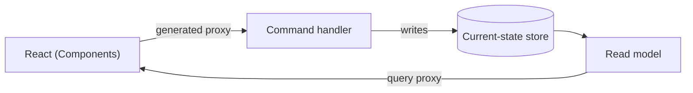

Choose Cratis Arc when you want backend commands and queries to define the contracts your TypeScript frontend calls. Arc is a full-stack CQRS framework: it separates requests that change data from requests that read it, exposes them over HTTP, and generates typed clients. For those contracts, you do not maintain a separate API client.

Consider adding a field to an author-registration form. Without generation, the backend request, frontend type, and HTTP wrapper may each need an edit. With Arc, you change the backend contract, regenerate its TypeScript proxy, and type-check the frontend to find callers that no longer match. You still test the behavior at runtime.

Event sourcing is a separate choice. Cratis generally favors it for information systems, with Cratis Chronicle storing and processing the events. Arc can use that integration, but it can also put commands and queries over a current-state database or application services. You can adopt Arc's frontend contract workflow without adopting an event log.

## What Arc gives you

On C#, a command is a record with a `Handle()` method; on the JVM and TypeScript it has a `handle()` method. A query can be a method on a read model, the data shape returned to the caller. Go uses explicit metadata and typed adapters rather than those attributes or decorators; start with its [running application guide](/arc/go/backend/go/core/getting-started/). Arc maps registered commands and queries to HTTP.

Configure proxy generation to produce typed clients for recognized commands and queries that are not excluded. On C#, set `CratisProxiesOutputPath`; type and namespace exclusions control what is included. The [proxy boundary guide](./understanding-the-proxy-boundary.mdx) explains what generation covers and how to regenerate after a contract change.

Your command and query code uses the storage you configure: [Chronicle](/arc/backend/csharp/chronicle/) for event sourcing, [MongoDB](/arc/backend/csharp/mongodb/) or [EF Core / SQL](/arc/backend/csharp/entity-framework/) for current state on C#, [Spring Data](/arc/backend/kotlin/guides/spring-data/) on the JVM, or [MongoDB and Drizzle](/arc/backend/typescript/reference/capabilities/) on TypeScript. Chronicle adds its [command transaction semantics](/arc/backend/csharp/chronicle/commands/); those guarantees do not cover arbitrary external-service or database writes.

On C#, Arc also supplies validation, authorization, identity, tenant resolution, OpenAPI, and MongoDB/EF Core hooks. Check the [capability matrix](/arc/capabilities/), [TypeScript capability reference](/arc/backend/typescript/reference/capabilities/), and [Go parity reference](/arc/go/parity/) for each backend's integration surface and verification limits. Your application must configure trusted authentication, membership checks, storage isolation, and business constraints.

## Why CQRS and proxy generation?

A command to register an author needs the values required to make that change. A catalog query can return the fields a screen needs to display. CQRS lets those contracts have different shapes. Proxy generation carries each shape into the frontend, so a change to one can be checked against its callers. Regeneration followed by frontend type-checking can catch structural mismatches; it does not prove runtime behavior or compatibility between deployed versions.

:::note[CQRS and event sourcing]
CQRS is often associated with event sourcing because events are a natural write-side model and projections are a natural read-side model. But CQRS is not event sourcing. Arc can put that boundary over current-state storage or optional Chronicle; Chronicle can store and process events without Arc. Integrations differ by backend.
:::

That diagram is the direct-database setup, useful for bounded current-state slices and for learning Arc in isolation. In the full Cratis loop, the [Chronicle integration](/arc/backend/csharp/chronicle/add-event-sourcing/) adds events and projections. Preserving the public query contract can keep the React caller unchanged, but provider code and data migration remain explicit work.

## Vertical slices, not layers

A vertical slice keeps one behavior's code together: its command, read model and query, React component, and specs. For an author-registration feature, you can follow the input from the form through the write and back to the author list in one folder. You do not have to trace it across `Commands/`, `Handlers/`, `DTOs`, and `Clients/`.

Arc does not require this folder structure. It is the convention used in the tutorial, with features divided into slices using [event modeling](/event-modeling/). Follow that path if you want the code layout to match the behavior you are building.

## When to keep a simpler boundary

If a few controller actions and an existing client already meet your needs, you may not need Arc's command/query conventions or a proxy-generation step. Arc fits when you want those contracts to drive the frontend too, and are willing to include regeneration and frontend type-checking in your workflow. For a C# comparison, see [MediatR, MVC, and Arc](./backend/csharp/coming-from-mediatr-and-mvc.md); for other backends, check the [capability matrix](./capabilities.md) before choosing an integration.

## Where to start

- Build your first feature with [C#](/arc/backend/csharp/getting-started/), [Kotlin or Java](/arc/backend/kotlin/get-started/), or [TypeScript from source](/arc/backend/typescript/getting-started/).
- Walk the full database-backed path in the [Arc tutorial](/arc/tutorial/).
- Need the wider stack? [Why developers choose Cratis](/why-cratis/) shows how Arc, Chronicle, Components, and the tools fit together.
